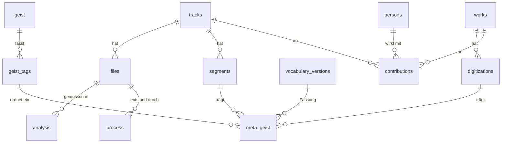
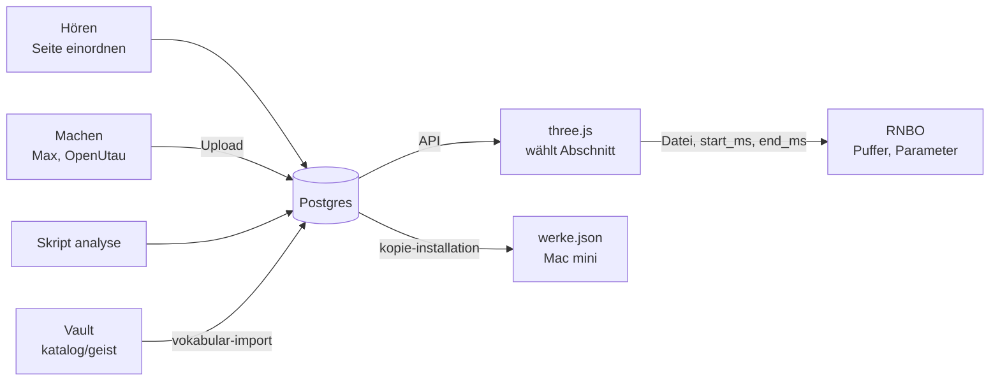

# Das Datenbank-Gespräch vom 2026-11-24

Der vollständige Verlauf einer Sitzung in Claude Code, gestartet im Vault `C\`. Fragen und Antworten stehen wörtlich darin, in der Reihenfolge, in der sie kamen. In den Antworten sind nur die Überschriften um zwei Ebenen tiefer gesetzt. Ausgelassen sind die Ausgaben der Werkzeuge. Was Claude jeweils nachgesehen hat, steht unter „Nachgesehen“ und ist für diese Datei ergänzt. Abschnitt 6 ist die Antwort auf die letzte Nachricht und erscheint nur hier.

**Wie das Gespräch verlief:**

1. Erste Empfehlung: PocketBase auf dem IONOS-VPS, für den Mac mini eine JSON-Kopie im Image.
2. Abgleich mit den Recherche-Dokumenten `Datenbank.md` und `Backend-Grundlagen.md`: PocketBase bleibt. R2, Convex und Vercel passen nicht.
3. Convex, Echtzeit, die Timecode-Tabellen und die Projektstruktur mit Obsidian Bases: PocketBase bleibt, Convex fällt weg.
4. Neuer Maßstab, auf die Zukunft ausgelegt: Die Empfehlung wechselt zu Postgres + Hono + Drizzle. Kafka nicht.
5. Die Bitte um diese Datei.
6. Ein Ansatz für die Timecode-Struktur, die Projektstruktur mit RNBO und three.js und den Workflow mit Obsidian und eigenen Seiten.

**Offen am Ende:** Wird Postgres + Hono + Drizzle die Grundlage? Danach folgt die Spec `specs\wwww-main\daten.md`. Die übrigen offenen Fragen stehen am Ende von Abschnitt 6.

---

## 1 · Welches Datenbank-Setup für wwww?

### Frage

> Welches Datenbank Setup würdest du für meine webseite bzw. wwww installation mit three.js und rnbo empfehlen? zum beispiel eine sample datenbank und die klassifizierung der samples oder auch die metadaten der kunstwerke, die mit threejs gezeigt werden, wie jetzt von johannes und peter. sozusagen so, dass man es als digitales portfolio bzw. online galerie ausbauen könnte. auch benutzerprofile wegen discord und das hochladen von dateien könnte interessant sein.

### Nachgesehen

- `zaehlen\README.md`, `zaehlen\wwww\README.md`, `zaehlen\wwww\ARCHITEKTUR.md`
- `specs\wwww-main\README.md`, `discord.md`, `originale.md`, `konzept.md`
- `specs\wwww-threejs\README.md`, `verraeumlichung.md`, `zaehlen\wwww-threejs-schichten\README.md`
- `specs\wwww-rnbo\aufstieg.md`, `katalog\README.md`
- `zaehlen\vps\README.md` und `inventur.md`: 4 Kerne, 3,8 GB RAM (2,4 GB belegt), 116 GB Platte (14 GB belegt)
- GitHub-API zu PocketBase: Das Repo ist archiviert und laut README nach `ganigeorgiev.com/pocketbase/pocketbase` umgezogen. Letzte Version auf GitHub ist v0.40.6 vom 2026-10-23, die Datei für Linux hat rund 12 MB. Die Doku nennt v0.42.3.

*Zwischenmeldung: Ich lese gerade den Stand von `zaehlen\wwww` und dem VPS, damit die Empfehlung zu dem passt, was schon läuft.*

### Antwort

**Wo wir stehen:** `zaehlen\wwww` ist heute nur ein Dateiserver (Caddy). Er läuft an drei Orten: auf diesem PC, auf dem IONOS-VPS und auf dem Mac mini ohne Internet. Eine Datenbank gibt es noch nicht. Die Werke von Johannes und Peter liegen als Scans in `zaehlen\quellen\medien\`. Die Felder ihres Galerie-Schilds gibt es bisher nur als Liste in `specs\wwww-main\originale.md`.

**Anker:** Spec `wwww-main`, Projekt `zaehlen\wwww`.

#### Die Empfehlung

**PocketBase auf dem VPS als einzige Datenbank. Die Installation bekommt eine Kopie als JSON-Datei im Image.**

PocketBase ist ein einzelnes Programm mit einer eingebauten **SQLite**°-Datenbank. Die ganze Datenbank ist also eine Datei. Es bringt die drei Dinge mit, nach denen du fragst:

- Die Anmeldung mit Discord über **OAuth2**° läuft ohne eigenen Code.
- Hochgeladene Dateien landen auf der Platte des VPS (116 GB, davon 14 GB belegt).
- In einer Oberfläche im Browser trägst du die Schild-Felder eines Werks ein.

Der VPS hat 3,8 GB Arbeitsspeicher, davon sind 2,4 GB belegt (`zaehlen\vps\inventur.md`). PocketBase passt in den Rest. Es bekommt einen eigenen Ordner in `zaehlen\vps\compose\`, so wie der Bot aus `specs\wwww-main\discord.md`. Der Bot liest später dieselbe Tabelle `users`. Darin steht die Discord-ID, also kennt er die Person und ihre Stufe aus 1, 3, 7 und 12.

**Der Haken:** PocketBase hat Version 1.0 noch nicht erreicht, die aktuelle ist v0.42.3. Im Kern pflegt es eine Person. Im Oktober 2026 ist das Repo von GitHub auf die Seite des Autors umgezogen, die Arbeit daran geht weiter. Ein Update kann also etwas kaputt machen. Deshalb legst du die Version fest, wie bei `caddy:2.10-alpine`. Wird das Projekt eingestellt, kann jedes SQLite-Werkzeug die Datei weiter lesen. Die Datenbank liegt im Ordner `pb_data` und kommt in die Sicherung aus `zaehlen\vps\backup.md`.

#### Die Installation bekommt eine Kopie

Der Mac mini hat kein Internet, und das Image soll an allen drei Orten dasselbe sein. Deshalb fragt die Seite dort keine Datenbank. Vor dem `docker build` speichert ein Skript die Antwort von PocketBase als `site/data/werke.json` und kopiert die Dateien dazu. Das ist der bewusste Kopierschritt aus `ARCHITEKTUR.md`.

Die Datei hat dieselbe Form wie die Antwort der Datenbank. three.js braucht also nur einen Leser: Online fragt er PocketBase, vor Ort liest er die Datei. Anmelden und Hochladen gibt es nur online.

#### Die Tabellen

|Tabelle|Was darin steht|
|---|---|
|`personen`|Johannes, Peter, du: Name, Lebensdaten, Rolle. Ein Konto kann damit verknüpft sein.|
|`werke`|das Werk selbst: Titel, Jahr, Technik, Maße, Standort, ein kurzer Text und die **Bildbeschreibung**|
|`digitalisate`|alles Digitale zu einem Werk: Scan, `.glb`, Form-Ebenen, Makrofoto. Dazu bei jedem Eintrag die „Digitale Erweiterung“: was, wann, womit.|
|`samples`|die Audiodatei mit Dauer, Samplerate, Tonhöhe, Lautheit, Quelle und dem Text aus dem Heft 25920|
|`tags`|die feste Liste für die Klassifizierung. Jeder Tag gehört zu einer Gruppe, etwa Quelle, Klangfarbe oder Stimme.|
|`users`|die Discord-Konten: Discord-ID, Name, Avatar und die Stufe|

Vier Entscheidungen darin wirken sich später stark aus:

- **Werk und Digitalisat sind getrennt.** Das ist die Regel aus `originale.md` als Tabelle: Das Original bleibt trennbar. Ein Werk hat viele Digitalisate, und das Galerie-Schild gehört zum Werk, nicht zum Scan.
- **Person und Konto sind getrennt.** Johannes und Peter stehen auch ohne Discord als Mitwirkende in der Galerie. Melden sie sich später an, wird ihr Konto mit ihrer Person verknüpft.
- **Die Bildbeschreibung ist ein Pflichtfeld.** Ohne sie lässt sich kein Werk speichern. So setzt die Datenbank durch, was `originale.md` verlangt: Die Bildbeschreibung entsteht beim Digitalisieren.
- **Tags kommen aus der festen Liste, nicht als freier Text.** Sonst werden „Sax“, „sax“ und „Saxophon“ drei verschiedene Klassen.

Für das Hochladen bekommen `werke`, `digitalisate` und `samples` zwei Felder mehr: `status` („eingereicht“ oder „freigegeben“) und `von`, das Konto. Eine **API-Regel**° in PocketBase zeigt nach außen nur, was freigegeben ist. Laden andere ihre Werke hoch, kommt ein Haken „Rechte bestätigt“ dazu. Die Messwerte eines Samples tippst du nicht ein, ein Skript misst sie beim Hochladen.

#### Was sich für RNBO ändert

`specs\wwww-rnbo\aufstieg.md` geht davon aus, dass die OpenUtau-Samples als Puffer im RNBO-Export stecken. Mit der Datenbank holt three.js ein Sample erst, wenn es gebraucht wird, und gibt es an einen Puffer im laufenden Patch (`device.setDataBuffer`). Für ein neues Sample brauchst du dann keinen neuen Export. Den Aufruf kenne ich nur aus dem Gedächtnis. Vor dem Bau muss ich ihn in der RNBO-Doku prüfen.

#### Warum nicht die anderen

|Möglichkeit|Warum nicht|
|---|---|
|Supabase, selbst betrieben|Das sind rund ein Dutzend Container samt Postgres. Sie belegen den freien Speicher des VPS.|
|Directus oder Strapi|Das sind richtige CMS, aber sie brauchen einen Node-Dienst und eine eigene Datenbank. Das heißt mehr Speicher und zwei Dinge zu pflegen.|
|Notizen mit Frontmatter wie in `katalog\`|Das reicht, solange nur du einträgst. Johannes und Peter können aber nicht in deinen Vault schreiben, und für das Hochladen brauchst du ohnehin einen Server.|

**Was auf dich wartet:** Sag mir, ob ich das als Spec `specs\wwww-main\daten.md` festhalten soll. Gebaut ist noch nichts. Der erste Download wäre PocketBase selbst. Gemessen habe ich nur v0.40.6 auf GitHub, rund 12 MB. Die Größe der aktuellen Version messe ich vor dem Download.

*Besser: Gib jedem Sample zusätzlich ein Audio-**Embedding**°. Dann findet die Seite zu einem Klang den ähnlichsten (similis) und den fremdesten (varius). Die Zweiteilung aus `discord.md` gälte so auch für den Klang.*

*Neu hier: **SQLite**°, **OAuth2**°, **API-Regel**°, **Embedding**° — `/planish` erklärt sie und trägt sie ins Glossar.*

---

## 2 · Was taugen die Vorschläge aus der eigenen Recherche?

### Frage

````text
Ich habe dazu auch folgende Dokumente in meiner Recherche angelegt. Was hältst du von den Vorschlägen dort?
1) "C:\Users\nolte\Desktop\zaehlen\quellen\input\Datenbank.md"
2) "C:\Users\nolte\Desktop\zaehlen\quellen\input\Backend-Grundlagen.md"
3) 
```
- **Kategorie** **Optionen**  
Direkte Konkurrenz (Backend-as-a-Service) **Supabase** (Postgres, sehr verbreitet), **Firebase**, **Appwrite**, **Nhost**  
Self-hosted, schlank **PocketBase** (eine Binary, SQLite)  
Realtime/Local-first **InstantDB**, **Triplit**, **ElectricSQL**, **Zero** (Rocicorp)  
Baukasten statt Plattform **Neon** oder **PlanetScale** + Drizzle/Prisma + eigenes API-Layer  
- **Szenario B — Mit Uploads / Nutzerkonten (Asset-Verwaltung):** Nutzer melden sich an, laden Assets hoch, verwalten ihre Bibliothek. → **Convex** (Metadaten, Auth, reaktive UI) + **Cloudflare R2** (die eigentlichen Dateien via Presigned URLs). Alternativ **Supabase** (wenn du SQL/Portierbarkeit willst) + R2.  
- 1. Komplett selbstgehosteter Objektspeicher (auf eigenem Server / VPS)  
Wenn du einen eigenen vServer (z. B. von Hetzner, DigitalOcean oder zu Hause) hast, kannst du dort eine eigene Cloud-Speicher-API aufsetzen, die sich exakt wie AWS S3 oder Cloudflare R2 verusacht:  
**MinIO:**   
Der bekannteste und mächtigste S3-kompatible Objektspeicher.   
Du installierst MinIO als Docker-Container auf deinem Server. Es stellt dir eine Weboberfläche, Benutzerverwaltung und vor allem eine **S3-kompatible API** inklusive **Presigned URLs** zur Verfügung.  
_Hinweis zur Lizenz:_ Beachte, dass MinIO für kommerzielle Nutzung die AGPL-Lizenz hat. Für private Projekte oder Open Source ist es unproblematisch.   
**SeaweedFS oder Garage:**  
Hervorragende, ressourcenschonende und lizenzfreundlichere Open-Source-Alternativen (Apache 2.0), die ebenfalls eine S3-Schnittstelle auf deinem eigenen Server bereitstellen und extrem performant mit kleinen und großen Dateien umgehen.  
### Für deinen Fall kippt die Empfehlung deutlich — aus einem Grund, den wir bisher gar nicht besprochen haben: Bandbreite.

Die entscheidende Erkenntnis

3D-Modelle (GLB) und Audio-Samples sind groß. Ein einzelnes detailliertes Modell kann 20–100 MB haben, eine WAV-Sammlung schnell mehrere Hundert MB. Dein Kostentreiber ist nicht die Datenbank — es ist der Traffic beim Ausliefern.

Und genau da wird es interessant: Cloudflare R2 verlangt $0,00/GB für Egress, bei jedem Volumen. AWS nimmt $0,09, GCP $0,12. Der Free-Tier umfasst 10 GB Speicher, 1 Mio. Class-A- und 10 Mio. Class-B-Operationen pro Monat — und das ist ein monatlich wiederkehrender Free-Tier, kein 12-Monats-Trial.

Zum Vergleich: Convex' Free-Tier gibt dir 1 GB Dateien. Das ist für 3D-Assets nichts.

Die Architektur, die ich empfehlen würde

Trenne Bytes von Metadaten.

|                                                   |                                       |
| ------------------------------------------------- | ------------------------------------- |
| Ebene                                             | Womit                                 |
| Die eigentlichen Dateien (GLB, WAV, Texturen)     | Cloudflare R2                         |
| Metadaten (Name, Tags, Kategorie, Autor, Version) | Datenbank — winzig, ein paar MB       |
| Frontend                                          | Vercel, Netlify oder Cloudflare Pages |

Die Datenbank speichert nur Zeilen wie { name: "kick_808.wav", key: "audio/kick_808.wav", bpm: 120, tags: [...] }. Das ist so klein, dass die DB-Wahl fast egal wird — jeder Free-Tier reicht.

Brauchst du überhaupt Realtime?

Ehrliche Frage. Wenn deine Seite ein Showcase/Portfolio ist, bei dem Besucher Modelle anschauen und Samples abspielen: nein. Dann brauchst du gar kein reaktives Backend. R2 + statisches Hosting reicht, und du zahlst praktisch nichts.

Realtime lohnt sich erst, wenn:

- Mehrere Nutzer sich gleichzeitig in derselben 3D-Szene bewegen (Avatare, Cursor)
- Nutzer Assets hochladen und andere sollen sie sofort sehen
- Kollaboratives Bearbeiten stattfindet

Konkrete Empfehlung

Showcase/Portfolio: R2 + Astro/Next auf Cloudflare Pages. Kosten: ~0 €. Kein Backend nötig.

Mit Upload/Nutzerkonten, aber ohne Multiplayer: R2 + Supabase (Auth, Metadaten-Tabelle). Dessen Storage-Egress ist teuer — deshalb R2 für die Dateien.

Mit echtem Multiplayer in der Szene: R2 für Assets + Convex für State. Aber Vorsicht: Positions-Updates von Avataren sind Hochfrequenz-Traffic. Convex Free hat 1 Mio. Function Calls/Monat — bei 20 Updates/Sekunde pro Nutzer ist das in Minuten weg. Für Bewegungsdaten nimmt man besser einen reinen Realtime-Transport (Liveblocks, PartyKit, oder ein eigener WebSocket-Server) und die DB nur für persistenten State.

Drei Three.js-spezifische Tipps

1. Draco- oder Meshopt-Kompression für GLB — reduziert Modelle oft um 70–90 %.
2. KTX2/Basis für Texturen statt PNG/JPG — wird direkt auf der GPU dekomprimiert, spart RAM und Ladezeit.
3. Audio-Sprites oder Opus statt WAV — falls die Samples nicht in Studioqualität gebraucht werden.

Diese drei Maßnahmen können deine Storage- und Traffic-Kosten stärker senken als jede Plattformwahl.

Sag mir, ob die Seite eher Showcase oder kollaborativ ist — dann kann ich konkreter werden.
```
````

### Nachgesehen

- `zaehlen\quellen\input\Datenbank.md` (63.842 Zeichen): Teil 4 bis 7, mit deinen Markierungen, etwa „~~nicht relevant~~“ beim Multiplayer und „~~seafile~~“ über dem Vergleich der Speicher
- `zaehlen\quellen\input\Backend-Grundlagen.md` (26.439 Zeichen): Teil 3, 4 und 7
- `zaehlen\vps\inventur.md`: „Snapshots sind bei diesem Tarif nicht möglich“
- PocketBase-Doku: `--automigrate` ist im fertigen Programm voreingestellt. Dateien können auf einen S3-kompatiblen Speicher umziehen.
- Websuche zum Traffic bei IONOS: laut IONOS unbegrenzt bis 1 Gbit/s, im Preis enthalten

*Zwischenmeldung: Ich habe beide Dokumente gelesen und prüfe noch eine Behauptung nach: ob der VPS für Traffic extra zahlt.*

### Antwort

**Wo wir stehen:** Wir suchen ein Datenbank-Setup für die wwww-Seite. Es soll die Werke von Johannes und Peter tragen, die Samples für RNBO und später Discord-Konten und Uploads. Meine erste Empfehlung war PocketBase auf dem IONOS-VPS, dazu eine JSON-Kopie für den Mac mini ohne Internet. Diese Empfehlung habe ich jetzt mit deinen zwei Dokumenten in `zaehlen\quellen\input\` und dem eingefügten Auszug verglichen.

**Anker:** Spec `wwww-main`, Projekt `zaehlen\wwww`.

**Kurz:** Die Grundlagen in beiden Dokumenten stimmen. Der wertvollste Teil sind die three.js-Tipps. Die Empfehlungen (Cloudflare R2, Convex, Vercel) passen zu einer Cloud-App ohne eigenen Server. An PocketBase für wwww ändern sie nichts. Drei Dinge übernehme ich: die Kompression, die Regel für Migrationen und einige Felder aus dem Metadaten-Schema.

Die Rückfrage im Auszug, Showcase oder kollaborativ, beantwortet deine eigene Markierung: ein Showcase mit Konten und Uploads, ohne Multiplayer. Das ist Szenario B.

#### Die Vorschläge einzeln

|Vorschlag|Urteil|Grund|
|---|---|---|
|Dateien nicht in die Datenbank|stimmt, schon erfüllt|PocketBase legt die Dateien auf die Platte (`pb_data/storage`). In SQLite stehen nur die Metadaten.|
|Cloudflare R2 wegen der Bandbreite|nicht jetzt|Gründe im nächsten Abschnitt.|
|Convex + R2|nein|Die Seite braucht kein Realtime, das sagt das Dokument selbst. Läuft Convex beim Anbieter, liegen die Daten in dessen Cloud. `discord.md` legt aber fest, dass die Texte der Besucher auf dem eigenen Server bleiben.|
|Supabase + R2|nein|Der kostenlose Tarif pausiert nach einer Woche ohne Zugriff (`Datenbank.md`, Teil 4). Eine Kunstseite mit seltenen Besuchen wäre oft aus. Selbst betrieben ist Supabase zu schwer für den VPS.|
|Frontend auf Vercel, Netlify oder Cloudflare Pages|nein|Dann gäbe es kein Image mehr, das an allen drei Orten gleich ist.|
|MinIO, SeaweedFS oder Garage auf dem VPS|nicht nötig|Das wäre ein zweiter Dienst, der nur kann, was PocketBase schon kann.|
|Local-first (InstantDB, Triplit, Zero)|nein|Das löst gemeinsames Bearbeiten ohne Netz. Die Installation zeigt offline nur etwas an, dafür reicht die JSON-Kopie.|
|SQLite hat nur einen Schreiber|stimmt, stört nicht|Geschrieben wird selten: bei einem Upload oder einer Anmeldung.|
|Draco/Meshopt, KTX2, Opus|übernehmen|mit zwei Änderungen, siehe unten|

#### Die Bandbreite ändert hier nichts

Das Argument stimmt für AWS und Google Cloud. Dort kostet jedes ausgelieferte Gigabyte Geld (**Egress**°). Beim IONOS-VPS ist laut IONOS unbegrenzter Traffic bis 1 Gbit/s im Preis drin. Die Kosten pro Gigabyte, um die sich die Empfehlung dreht, fallen hier nicht an.

Dazu kommt der Mac mini. Er hat kein Internet und erreicht R2 deshalb nicht. Die Dateien müssen also sowieso ins Image, und R2 wäre ein vierter Ort. Ein Modell mit 100 MB lädt auf dem Handy langsam, egal woher es kommt. Dagegen hilft die Kompression, nicht der Speicherort.

**Der Weg zu R2 bleibt offen.** Laut Doku kann PocketBase seine Dateien auf einen S3-kompatiblen Speicher legen, also auch auf R2. Werden die Dateien einmal zu groß für den VPS, ist das eine Einstellung und kein Umbau.

#### Ein Fehler in `Backend-Grundlagen.md`

Teil 7 behauptet, man klicke das Schema von PocketBase im Admin-UI zusammen, und Claude Code könne es deshalb nicht sehen. Das stimmt nicht. Laut PocketBase-Doku ist im fertigen Programm `--automigrate` von Anfang an eingeschaltet. Jede Änderung an einer Tabelle im Admin-UI landet als JS-Datei in `pb_migrations\`. Diese Datei liegt im git, ich kann sie lesen und selbst schreiben.

Damit entfällt die dritte Frage im Entscheidungsbaum, die zu Convex führt. Für wwww endet der Baum bei PocketBase: Die Seite braucht kein SQL für Auswertungen und keine Listen, die sich live aktualisieren.

**Die Regel aus Teil 4 übernehme ich:** Eine **Migration**° schreibe ich, du wendest sie an, und zwar nach einer Sicherung von `pb_data`. Beim VPS ist das besonders wichtig. Laut `zaehlen\vps\inventur.md` erlaubt sein Tarif keine Snapshots, ohne Sicherung gibt es also keinen Rückweg.

#### Was ich übernehme

**Die Kompression, mit zwei Änderungen für wwww:**

- Die Decoder für Meshopt und KTX2 liegen als Dateien in `site/vendor/three/`, aus derselben Version `three@0.160.0`. Vor Ort gibt es kein CDN. Ich nehme Meshopt statt Draco, weil es auf dem Handy schneller entpackt.
- Opus nehme ich erst nach einem Test auf dem iPhone. Die Seite nutzt `DeviceOrientationEvent.requestPermission()`, und das gibt es nur in Safari auf iOS. Ich weiß nicht sicher, ob Safari Opus über `decodeAudioData` öffnet. Wenn nicht, nehme ich AAC als `.m4a`.

Die Originale bleiben in der Datenbank: WAV und GLB ohne Kompression. Aus ihnen entsteht die kleine Fassung für die Auslieferung.

**Felder aus dem Metadaten-Schema (`Datenbank.md`, Teil 6):** Format, Dateigröße, Vorschaubild und „komprimiert ja/nein“. Bei 3D kommen die Zahl der Punkte und die Ausdehnung dazu, bei Audio die Zahl der Kanäle. Die eine Tabelle `assets` für alles übernehme ich nicht. Ihr fehlen die Trennung von Werk und Digitalisat und die Bildbeschreibung aus `originale.md`.

**Was auf dich wartet:** Sag mir, ob ich daraus die Spec `specs\wwww-main\daten.md` schreiben soll. Deine zwei Dokumente würden darin zum Abschnitt „Woraus gebaut wird“: was ich übernehme und was sie für wwww falsch einschätzen. Dafür ziehen sie aus `input\` an ihren Ort in `zaehlen\quellen\`. Das betrifft mehrere Dateien, deshalb zeige ich dir vorher die Change-Liste.

*Besser: Lass den Server bei jedem Upload die kleine Fassung selbst erzeugen. Dann laden Johannes und Peter ihre Originale hoch, und kein unkomprimiertes Modell landet auf einem Handy.*

*Neu hier: **Egress**°, **Migration**° — `/planish` erklärt sie und trägt sie ins Glossar.*

Quellen:
- [IONOS vServer / VPS](https://www.ionos.de/server/vps?ps_id=P1662055)
- [experte.de: IONOS-Server im Test](https://www.experte.de/server/ionos)
- [PocketBase: JS-Migrationen](https://pocketbase.io/docs/js-migrations/)
- [PocketBase: Dateien](https://pocketbase.io/docs/files-handling/)

---

## 3 · Convex, Echtzeit, die Timecode-Tabellen und Obsidian Bases

### Frage

````text
Was ist mit diesem Ansatz? ### PostgreSQL + Hono + Drizzle
Warum brauche ich kein Echtzeit?
Ich war eigentlich daran mich für Convex zu entscheiden, weil es so KI-orientiert ist und typsicher.
````

> Außerdem schau hier, das war die bisherige datenbank struktur die ich gedacht habe: "C:\Users\nolte\Desktop\C\specs\wwww-rnbo\raw\timecode CSV SQL"
>
> Und hier die Projektstruktur, in der ich obsidian bases für meine datenbankstruktur nutzen wollte:

````text
- Trennung Logik (Backend), Erfahrung (Frontend/Three.js) und Wissen (Vault)
- Automatisierung (Skripte) und Typisierung (Schema)
```text
/ (Root - Dein VS Code Workspace & GitHub Repo)
│
├── .env                     # Umgebungsvariablen (z.B. VAULT_PATH=./vault, DB_URL)
├── .gitignore               # Ignoriert node_modules, .DS_Store, .obsidian/workspace.json & app.db
├── package.json             # Scripts für Vite (Frontend), Express (Backend) & Sync-Skripte
├── vite.config.js           # Konfiguration für das Three.js Frontend & Asset-Handling
│
├── backend/                 # LOGIK-SCHICHT: Node.js & SQLite
│   ├── api/                 # Express.js API
│   │   ├── server.js        # Haupteinstiegspunkt für den API-Server
│   │   └── routes/          # Endpunkte für Content & Three.js Parameter
│   ├── db/                  # DATEN-SCHICHT
│   │   ├── app.db           # Die aktive SQLite-Datenbankdatei
│   │   └── migrations/      # SQL-Skripte zur Tabellenerstellung
│   ├── schema/              # DEFINITION: Validierung von YAML/Markdown aus dem Vault
│   │   └── contentModel.js  # Datenstruktur-Vorgaben
│   └── export/              # SYNC-LOGIK (Die Brücke)
│       ├── obsidianSync.js  # SQLite -> Vault (für Obsidian Bases)
│       └── vaultParser.js   # Vault (02_Website) -> SQLite
│
├── src/                     # PRÄSENTATIONS-SCHICHT: Three.js Frontend
│   ├── index.html           # Haupteinstieg (enthält Canvas & UI-Container)
│   ├── script.js            # Initialisierung (instanziiert Experience & UI)
│   ├── style.css            # Globales CSS & UI-Overlay Styles
│   │
│   ├── Experience/          # ENCAPSULATED KERN: Reines 3D (Three.js)
│   │   ├── Experience.js    # Hauptklasse (Singleton)
│   │   ├── Camera.js        # Kamera-Setup
│   │   ├── Renderer.js      # Renderer & Post-Processing
│   │   ├── sources.js       # Asset-Manifest (Modell-Liste)
│   │   ├── Utils/           # Helfer: Debug, Sizes, Time, Resources, EventEmitter
│   │   └── World/           # Die Szene: World, Environment, Floor, Fox
│   │
│   └── UI/                  # INTERFACE: HTML/DOM-Elemente
│       ├── Overlay.js       # Steuert Texteinblendungen, Ladebalken & HUD
│       ├── Menu.js          # Navigation innerhalb der 3D-Szene
│       └── Interaction.js   # Verbindet DOM-Events mit der Experience
│
├── static/                  # 3D ASSETS (Direkter Zugriff durch Three.js)
│   ├── draco/               # Decoder-Bibliotheken
│   ├── models/              # z.B. Fox/Fox.glb
│   └── textures/            # Environment Maps & Maps
│
├── assets/                  # WEB ASSETS (Klassische Ressourcen)
│   ├── css/                 # theme.css (UI-Styling)
│   ├── img/                 # UI-Grafiken (Logos, Icons)
│   ├── js/                  # Externe Hilfs-Skripte
│   └── fonts/               # Webfonts für Overlays
│
└── vault/                   # WISSENS-SCHICHT: Obsidian (Vollständige Struktur)
    ├── 00_Inbox/            # Unsortierte Notizen, schneller Input
    ├── 01_Project/          # Projektmanagement & Strategie
    │   ├── brief.md         # Projektziele
    │   ├── sitemap.md       # Struktur der Webseite
    │   ├── content-plan.md  # Zeitplan
    │   ├── style-guide.md   # Design-Vorgaben
    │   └── tasks.md         # Aufgabenliste für dich & Claude
    ├── 02_Website/          # CONTENT-QUELLE (Headless CMS Core)
    │   ├── pages/           # Markdown pro Szene/Seite
    │   ├── components/      # Doku der UI-Bausteine
    │   ├── config/          # Parameter (Fox-Speed, Licht-Farben via YAML)
    │   ├── seo/             # Metadaten & Keywords
    │   └── deploy-notes.md  # Release-Logbuch
    ├── 03_Media/            # ASSET-MANAGEMENT (Rohdaten & Archiv)
    │   ├── images/          # Web-optimierte Bilder
    │   ├── video/           # Video-Assets
    │   ├── audio/           # Sound-Files
    │   ├── source-files/    # PSD, Blender, AI Quelldateien
    │   └── exports/         # Finale Render-Exporte
    ├── 04_Research/         # Inspiration & Technik-Recherche
    ├── 05_Reviews/          # Feedback-Schleifen & Abnahmen
    ├── 06_Archive/          # Eingefrorene Projektstände
    ├── 07_BackendSync/      # AUTOMATISIERUNG (Fenster zur Datenbank)
    │   ├── _database_views/ # Ziel für Obsidian Bases
    │   ├── tables/          # Generierte Markdown-Tabellen aus SQLite
    │   ├── table_view.md    # Master-Übersicht der DB-Inhalte
    │   ├── db_dump.json     # Rohdaten-Export
    │   └── sync-log.md      # Protokoll des letzten Sync-Vorgangs
    ├── 90_Templates/        # Vorlagen
    │   ├── new-page-template.md 
    │   └── asset-metadata.md
    
```
## Optimierungen 
- Symlinks für Media (Die „Echtzeit-Brücke“)
    - Ein Symlink (Symbolic Link) ist eine Verknüpfung auf Dateisystem-Ebene. Er sorgt dafür, dass ein Ordner an zwei Stellen gleichzeitig existiert, ohne den Speicherplatz doppelt zu belegen.
> [!NOTE]-
> - **Das Problem:** Du speicherst ein neues Logo in deinem Obsidian-Vault (`03_Media/images/logo.png`). Damit deine Webseite es anzeigen kann, müsstest du es manuell nach `assets/img/` kopieren.
> - **Die Lösung:** Du löschst den physischen Ordner `assets/img/` und erstellst stattdessen einen Symlink, der direkt auf `vault/03_Media/images/` zeigt.
> - **Der Effekt:** Sobald du in Obsidian ein Bild per Drag-and-Drop in deinen Media-Ordner ziehst, „sieht“ Vite das Bild sofort im Web-Projekt. Claude kann im Code darauf zugreifen, ohne dass Dateien hin- und hergeschoben werden müssen.
> - **Befehl (Beispiel Windows):** `mklink /D "assets\img" "..\vault\03_Media\images"`
- Asset-Manifest Automatisierung (Automatisches Laden)
    - In Three.js-Projekten ist die sources.js oft ein Flaschenhals. Man vergisst oft, ein neues Modell dort einzutragen, und wundert sich, warum es nicht erscheint.
> [!NOTE]-
> - **Das Problem:** Jedes Mal, wenn du ein Modell (z.B. `Fox.glb`) hinzufügst, musst du die `sources.js` öffnen und manuell ein Objekt hinzufügen: `{ name: 'foxModel', type: 'gltfModel', path: 'models/Fox.glb' }`.
> - **Die Lösung:** Ein kleines Node-Skript (z.B. `scripts/generate-sources.js`), das bei jedem Start des Dev-Servers (via `package.json`) ausgeführt wird. Es scannt den Ordner `static/models/`, erkennt Dateiendungen (`.glb`, `.jpg`, `.hdr`) und schreibt die `sources.js` Datei automatisch.
> - **Der Effekt:** Du legst ein Modell in den Ordner, und beim nächsten Refresh ist es in Three.js verfügbar. Du musst die `sources.js` nie wieder manuell anfassen. Claude kann dieses Skript für dich schreiben.
- Shader-Ordner (Professionelle Grafik-Effekte)
    - Wenn du fortgeschrittene Effekte willst (z.B. glühendes Fell für den Fuchs oder animiertes Wasser), nutzt du GLSL (Shader-Code).
> [!NOTE]-
> - **Das Problem:** Standardmäßig schreibt man Shader oft als lange, unübersichtliche "Strings" direkt in die JavaScript-Dateien. Das macht den Code hässlich und fehleranfällig (kein Syntax-Highlighting).
> - **Die Lösung:** Du erstellst `src/Experience/World/Shaders/`. Dort liegen Dateien wie `foxVertex.glsl` und `foxFragment.glsl`. Mit dem Vite-Plugin `vite-plugin-glsl` kannst du diese Dateien einfach importieren:    
>     ```js
>     import foxVertex from './Shaders/foxVertex.glsl'
>     // Jetzt kannst du foxVertex direkt im Material verwenden
>     ```
> - **Der Effekt:** Du hast sauberen Code mit Syntax-Highlighting (in VS Code). Claude kann Shader-Logik separat optimieren, ohne den Rest der Three.js-Welt zu stören.
````

### Nachgesehen

- `specs\wwww-rnbo\raw\timecode CSV SQL\`: neun CSV-Dateien (`tracks`, `segments`, `contributors`, `files`, `analysis`, `meta_geist`, `meta_geist_def`, `process`, `data_dictionary`) und drei ODS-Dateien. `timecode.ods` hält die Formularantworten, `timecode2.ods` und `timecode3.ods` alle Tabellen als Blätter.
- `meta_geist_def.csv` ganz, in Latin-1 gelesen
- Abgleich der Tags: In `timecode.ods` stehen 211 verschiedene Zeichenfolgen mit `#`, drei davon sind Farbcodes. In `meta_geist_def.csv` stehen 32. Drei kommen in beiden vor. Das Formular hat rund 63 Einträge.

*Zwischenmeldung: Ich habe deine Timecode-Tabellen gelesen und gleiche jetzt ab, welche Tags im Formular vorkommen, die in `meta_geist_def` fehlen.*

### Antwort

**Wo wir stehen:** Wir wählen das Datenbank-Setup für die wwww-Seite. Bisher empfehle ich PocketBase auf dem IONOS-VPS, dazu eine JSON-Kopie für den Mac mini ohne Internet. Du hast zu Convex tendiert. Jetzt hast du dein früheres Datenmodell gezeigt (`specs\wwww-rnbo\raw\timecode CSV SQL\`) und eine geplante Projektstruktur mit Obsidian Bases.

**Anker:** Specs `wwww-main` und `wwww-rnbo`, Projekt `zaehlen\wwww`.

**Kurz:**
- Convex passt am schlechtesten. Der Grund steckt in deinen eigenen Tabellen: Sie sind relational und für Auswertungen gebaut, und Convex kann keine **JOINs**° (Tabellen verbinden).
- Postgres + Hono + Drizzle ist ein guter Ansatz. Login, Upload und eine Eingabemaske baust du dann aber selbst.
- Ich bleibe bei PocketBase. Für Auswertungen fragst du die SQLite-Datei direkt mit SQL ab.
- Obsidian bekommt Daten nur in eine Richtung. Ein Sync in beide Richtungen macht Probleme.

#### Warum die Datenbank kein Echtzeit braucht

Echtzeit heißt: Ändert jemand etwas, sehen es alle offenen Seiten sofort, ohne Neuladen. Ein Beispiel: Peter lädt ein Bild hoch. Es erscheint erst, wenn du es freigibst. Ob ein Besucher es eine Sekunde oder eine Stunde später sieht, ändert nichts. Das Gespräch findet in Discord statt, und Discord ist selbst schon Echtzeit. Die Erinnerungen nach 1, 3, 7 und 12 Tagen laufen nach Zeitplan.

Echtzeit gibt es in wwww nur an einer Stelle: wenn die Handys M1 und M2 in der Installation die Projektion steuern (`konzept.md`). Das sind viele Sensorwerte pro Sekunde, und sie laufen im lokalen Netz ohne Internet. Laut deinem eigenen Dokument (`Datenbank.md`, Teil 6) gehören solche Werte in einen **WebSocket**°, nicht in die Datenbank. Convex in der Cloud erreicht der Mac mini dort ohnehin nicht.

#### Die drei Wege, gemessen an wwww

|Frage|Convex|Postgres + Hono + Drizzle|PocketBase|
|---|---|---|---|
|SQL für Auswertungen deiner Timecode-Tabellen|nein, keine JOINs|ja, am stärksten|ja, lesend direkt auf der SQLite-Datei|
|Discord-Login, Upload, Freigabe|zum Teil eingebaut|selbst bauen|eingebaut|
|Maske zum Eintragen eines Werks|nur der Datenbrowser im Dashboard|selbst bauen|eingebaut|
|Schema als Code im git|ja|ja|ja, über `pb_migrations\`|
|Typsicherheit|durchgehend|durchgehend|über einen Generator|
|Wie gut KI-Modelle es kennen|wenig (dein Dokument sagt: „mehr Halluzinationen“)|sehr gut|mittel|

**Typsicherheit fängt Tippfehler**, etwa ein Feld `titel`, das eigentlich `title` heißt. Die teuren Fehler bei Login und Upload sind aber keine Tippfehler. Ein Upload-Endpunkt, der nicht prüft, wem ein Eintrag gehört, kompiliert ohne Fehler. Bei PocketBase ist dieser Teil fertig. Bei Hono schreibst du ihn selbst.

Dazu kommt: Die Seite ist heute reines JavaScript ohne Build-Schritt (`site/index.html`). Die Typen von Convex oder Drizzle helfen erst, wenn das Projekt auf TypeScript umzieht.

**Postgres + Hono + Drizzle lohnt sich**, sobald das Backend selbst zur Hauptarbeit wird. Das wäre etwa der Fall bei viel eigener Logik zu den Stufen 1, 3, 7 und 12 mit Rollenwechsel. Ein späterer Umzug von PocketBase dorthin geht, weil die Daten in SQLite liegen.

#### Deine Timecode-Tabellen

Das Modell ist besser als meine Tabellen `samples` und `tags` von vorhin und ersetzt sie. Drei Dinge daran sind stark:

- Die Klassifizierung hängt an einem Zeitabschnitt (`segments`), nicht an der ganzen Datei.
- Die Verbindung zwischen Abschnitt und Tag trägt Gewichte: intensity, polarity, dominance, confidence.
- Messwerte (`analysis`) stehen getrennt von Urteilen (`meta_geist`). `process` hält fest, aus welchem Patch eine Datei stammt. Das ist die Brücke zu `katalog\patches\`.

Diese Stellen würde ich ändern:

|Stelle|Problem|Vorschlag|
|---|---|---|
|`meta_geist_def`|Nur die erste Zeile hat eine ID (`DEF_KYR_01`). Name, Begriff, Alias und Stufe stehen in jeder Zeile neu.|Zwei Tabellen: `geist` (kyriotetes, timbre, Stufe 2) und `tag` (#bright gehört zu kyriotetes). Jede Zeile bekommt eine ID.|
|Formular und Vokabular|In den 63 Formular-Einträgen stehen rund 200 verschiedene Tags. `meta_geist_def` kennt 32, nur drei davon kommen in beiden vor. Doppelt sind etwa `#repetetive`/`#repetitive`, `#lofi`/`#lowfi`, `#string`/`#strings`.|Die 200 Tags sind der Rohstoff für das Vokabular: Jeder wird einmal einer Gruppe zugeordnet. Ein zusammengesetzter Tag wie `#staccatosax` wird zu zwei Tags, `#staccato` und `#sax`.|
|`contributors`|Der Name steht bei jedem Track, dieselbe Person also mehrfach.|`personen` nur einmal, dazu `mitwirkung` mit Person, Track oder Werk und Rolle. Dieselbe Tabelle trägt dann auch Johannes und Peter.|
|`data_dictionary`|Sie hat die Spalten von `process`.|Löschen oder zu einem echten Datenwörterbuch machen: Tabelle, Spalte, Typ, Bedeutung.|
|`resonance_target`|Es steht in `analysis` und in `meta_geist`.|Es kommt an eine Stelle.|
|Kodierung|Die CSV-Dateien sind Latin-1. „Hüter“ wird in UTF-8-Werkzeugen zu Zeichensalat.|Als UTF-8 exportieren.|

#### Die Projektstruktur mit Obsidian Bases

**Ein Sync in beide Richtungen erzeugt zwei Quellen.** Der Plan hat `vaultParser.js` für Vault → SQLite und `obsidianSync.js` für SQLite → Vault. Änderst du in Obsidian einen Titel, während Peter online die Beschreibung ändert, gewinnt der Sync, der zuletzt läuft. Besser hat jede Art von Daten genau eine Quelle, wie in `katalog\`:

- **Der Vault ist die Quelle für das Vokabular**, also `geist` und `tag`. Das ist Wissen, das nur du schreibst. Es liegt als Notizen wie in `katalog\capabilities\`, und Bases zeigt es als Tabelle. Ein Skript schreibt es in die Datenbank, nur in diese Richtung.
- **Die Datenbank ist die Quelle für alles andere**: Werke, Konten, Uploads, Messwerte. Obsidian bekommt davon höchstens eine Kopie zum Lesen.

**Einen zweiten Vault im Repo** (`vault/` mit `00_Inbox` bis `90_Templates`) brauchst du nicht. Du hast schon `C\` mit `specs\`, `raw\` und `archive\`. Laut `ARCHITEKTUR.md` wandert zwischen `C\` und `zaehlen\` keine Datei. Ein zweiter Vault würde dein Denken auf zwei Orte verteilen.

**Symlinks scheitern am Image.** `docker build` folgt keinem Link, der aus dem Build-Ordner hinausführt. Im Image läge ein toter Link, und die Installation zeigte kein Bild. Auf diesem PC fällt das nicht auf, weil die Datei hier existiert. Deshalb steht in `ARCHITEKTUR.md`: „Kopiert heißt kopiert“.

**Das automatische Manifest ist eine gute Idee.** Mit einer Datenbank liest `sources.js` nicht mehr einen Ordner, sondern die Kopie `werke.json`. Dann kann niemand vergessen, ein Modell einzutragen. Shader-Ordner und Vite sind eine eigene Entscheidung, denn die Seite hat heute keinen Build-Schritt.

**Was auf dich wartet:** Die Entscheidung zwischen PocketBase und Postgres + Hono + Drizzle. Convex fällt nach dem Vergleich weg. Ich empfehle PocketBase: Login, Upload und Eingabemaske sind fertig, und deine Timecode-Tabellen lassen sich mit SQL auf der SQLite-Datei auswerten. Postgres + Hono + Drizzle nimmst du, wenn dir Typsicherheit über alles geht und du Login und Upload selbst bauen willst. Sobald du entschieden hast, schreibe ich die Spec.

*Besser: Häng `meta_geist` nicht nur an Zeitabschnitte, sondern auch an Digitalisate. Dann trägt eine Zeichnung von Johannes dieselben Wesen wie ein Klang, und die Seite findet zu einem Bild das passende Sample.*

*Neu hier: **JOIN**°, **WebSocket**° — `/planish` erklärt sie und trägt sie ins Glossar.*

---

## 4 · Auf die Zukunft ausgelegt, und Kafka?

### Frage

> denke aber auch so, dass wir jetzt noch die mgölichkeit haben alles umzubauen. es soll auf die zukunft ausgelegt sein. es soll sich nicht danach richten, was wir haben. auch dass wir die möglichkeit haben das ganze projekt weiterzuentwickeln und dann vielleicht sachen brauchen, die eine andere lösung schon hat.
>
> wäre es viel mehraufwand mit ki postgres hono und drizzle zu implementieren?
>
> ich habe außerdem auch ein interview gehört, was meinte man solle kafka nutzen, weil es jetzt so viel leichter mit ki zu integrieren ist und eine plattform ist, die sich in der zukunft lohnen wird.

### Nachgesehen

npm, Stand 2026-11-24:

|Paket|Version|zuletzt geändert|Downloads pro Woche|
|---|---|---|---|
|`hono`|4.13.21|2026-11-23|113.589.642|
|`drizzle-orm`|0.45.4|2026-11-20|49.635.806|
|`drizzle-kit`|0.31.11|2026-11-20|41.642.549|
|`better-auth`|1.7.27|2026-11-20|21.121.233|
|`postgres`|4.1.1|2026-11-11|37.898.907|

*Zwischenmeldung: Ich prüfe kurz, wie gepflegt die Bausteine für Postgres + Hono + Drizzle gerade sind.*

### Antwort

**Wo wir stehen:** Wir wählen das Datenbank-Setup für die wwww-Seite. Bisher habe ich PocketBase empfohlen, weil es am besten zu dem passt, was schon läuft. Jetzt gibst du einen anderen Maßstab vor: Das Setup soll auf die Zukunft ausgelegt sein, und ein Umbau ist erlaubt.

**Anker:** Spec `wwww-main`, Projekt `zaehlen\wwww`.

**Mit diesem Maßstab ändert sich meine Empfehlung: Postgres, mit Hono und Drizzle. Kafka nicht.**

#### Warum jetzt Postgres

Bisher habe ich nach dem geringsten Aufwand gewählt. Wählt man nach der Zukunft, gewinnt Postgres, weil fast alles Neue darauf aufbaut. Die Sync-Engines aus deiner Recherche (Zero, ElectricSQL, PowerSync) setzen Postgres voraus. Supabase und Neon sind selbst Postgres. Convex und PocketBase dagegen sind Inseln: Was sie nicht können, lässt sich dort nicht nachrüsten.

|Was später kommen kann|Wie es in Postgres geht|
|---|---|
|zu einem Bild von Johannes der passende Klang|Ähnlichkeitssuche mit **pgvector**°|
|Suche in Bildbeschreibungen und Texten|Volltextsuche, schon eingebaut|
|doch Echtzeit|Zero, ElectricSQL oder Supabase Realtime auf derselben Datenbank|
|Auswertungen über deine Timecode-Tabellen|SQL mit JOINs|
|Ereignisse an andere Dienste, auch an Kafka|**Debezium**° liest jede Änderung mit und gibt sie weiter|
|ein fertiger Dienst statt Eigenbau|Umzug zu Supabase, die Tabellen bleiben dieselben|

**Auch Drizzle hat Version 1.0 noch nicht erreicht**, wie PocketBase. Der Unterschied: Drizzle ist nur die Schicht zwischen Code und Datenbank. Bricht ein Update etwas oder verschwindet Drizzle, bleiben Daten und Schema ganz normales Postgres. Bei PocketBase liegen die Daten in genau dem Programm, das noch nicht bei 1.0 ist.

Für den Mac mini bleibt die JSON-Kopie. Später kann dort auch dieselbe Postgres laufen, eingespielt aus einer Sicherung, etwa wenn die Installation offline Eingaben sammeln soll.

#### Wie viel Mehraufwand mit KI

Beim Schreiben ist es wenig mehr. Meine grobe Schätzung: PocketBase steht an einem Abend, der Postgres-Weg braucht einige Sitzungen bis zum selben Stand.

|Baustein|PocketBase|Postgres + Hono + Drizzle|
|---|---|---|
|Schema der Timecode-Tabellen|in der Maske klicken|`schema.ts`, das schreibe ich. Das kann KI sehr gut.|
|Discord-Login|eingebaut|Better Auth, eine Bibliothek mit Anschluss an Discord und Drizzle. Wenig Code, aber Callback-Adresse und Cookies musst du prüfen.|
|Upload und Freigabe|eingebaut|Ein eigener Endpunkt prüft Dateityp, Größe und Besitzer und legt die Datei ab, auf die Platte oder in einen S3-Speicher.|
|Eingabe der Werke|eingebaut|Zuerst Drizzle Studio für dich allein. Eine eigene Maske erst, wenn andere eintragen.|
|Sicherung|einen Ordner kopieren|`pg_dump`, eine Zeile im Backup-Skript|

**Der eigentliche Mehraufwand liegt beim Prüfen und Pflegen:**

- Login und Upload sind Sicherheitscode. Die KI schreibt ihn schnell, aber jemand muss ihn prüfen.
- Du pflegst mehrere npm-Pakete statt eines Programms. Ein Wechsel auf eine neue Hauptversion von Postgres braucht Sicherung und Wiederherstellung.
- Für Migrationen gilt die Regel aus deinem Dokument: Ich erzeuge sie, du wendest sie an, und vorher läuft `pg_dump`.

Die Pakete sind gut gepflegt. Alle drei wurden in der letzten Woche aktualisiert:

|Paket|Version|Downloads pro Woche|
|---|---|---|
|`hono`|4.13.21|rund 114 Mio.|
|`drizzle-orm`|0.45.4|rund 50 Mio.|
|`better-auth`|1.7.27|rund 21 Mio.|

#### Kafka

Das Interview kenne ich nicht. Kafka ist ein Protokoll von Ereignissen, über das viele Dienste Daten austauschen, bis zu Millionen pro Sekunde. Gebaut ist es für Firmen, in denen Dutzende Systeme dieselben Ereignisse brauchen. Ein Beispiel ist ein Onlinehändler: Eine Bestellung geht gleichzeitig an Lager, Rechnung, Versand und Betrugserkennung. Dort stimmt auch, dass es mit KI leichter wird, denn ein Agent kann den Datenstrom live mitlesen.

wwww hat dieses Problem nicht: eine Seite, ein Bot und wenige Schreibvorgänge am Tag. Die Ereignisse in wwww sind etwa „ein Upload soll komprimiert werden“ oder „nach 3 Tagen erinnern“. Das erledigt eine **Job-Queue**° in Postgres. Kafka wäre ein zusätzlicher Cluster, der dauernd läuft und gepflegt werden will. Die Tür zu Kafka bleibt trotzdem offen, über Debezium. Zukunftssicher heißt hier: auf Postgres bauen, nicht Kafka auf Vorrat.

**Was auf dich wartet:** Sag mir, ob wir Postgres + Hono + Drizzle als Grundlage nehmen. Wenn ja, schreibe ich die Spec `specs\wwww-main\daten.md`. Der Abschnitt „Woraus gebaut wird“ stützt sich dann auf deine zwei Recherche-Dokumente und die Timecode-Tabellen. Das betrifft mehrere Dateien, deshalb zeige ich dir vorher die Change-Liste.

*Besser: Gib dem Vokabular (`geist` und `tag`) eine Versionsnummer, und jede Klassifizierung merkt sich, mit welcher Fassung sie entstand. Die rund 200 Tags aus dem Formular werden das Vokabular noch oft ändern, und alte Einträge bleiben trotzdem lesbar.*

*Neu hier: **pgvector**°, **Debezium**°, **Job-Queue**° — `/planish` erklärt sie und trägt sie ins Glossar.*

---

## 5 · Diese Datei

### Frage

> schreib mir den ganzen session verlauf bitte in eine einzige md datei vollständig. ich will ihn nochmal in ruhe lesen und überdenken

### Antwort

Diese Datei. Deine nächste Nachricht kam, während ich sie schrieb. Ihre Antwort steht als Abschnitt 6 darunter.

---

## 6 · Ein Ansatz für Timecode, Projektstruktur und Workflow

### Frage

> dazu bitte auch einen ansatz, wie wir die timecode struktur und die gesamte projekt struktur mit rnbo und threejs anlegen und den gesamten damit verbundenen workflow mit obsidian oder einem anderen interface.

### Nachgesehen

Für diesen Abschnitt nichts Neues. Er baut auf Abschnitt 1 (die drei Orte und die Tabellen der Werke), Abschnitt 3 (die Timecode-Tabellen) und Abschnitt 4 (Postgres + Hono + Drizzle) auf.

### Antwort

**Die Grundannahme:** Postgres + Hono + Drizzle, wie in Abschnitt 4 empfohlen. Die Entscheidung dafür ist noch offen. Mit PocketBase bliebe die Timecode-Struktur dieselbe, nur die Ordner `api\` und `db\` fielen weg.

#### Drei Regeln, aus denen der Rest folgt

1. **Jede Art von Daten hat genau eine Quelle.** Das Vokabular steht im Vault, alles andere in der Datenbank. Nichts wird in beide Richtungen abgeglichen.
2. **Zeit steht in Millisekunden, nicht als `HH:MM:SS`.** In `segments.csv` ist `HH:MM:SS` vorgesehen. Ein Abschnitt von 300 ms hätte so weder Anfang noch Ende. RNBO rechnet ohnehin in Millisekunden oder Samples.
3. **Fremde Musik bleibt privat.** Die Tracks im Formular stammen von Bandcamp. Ihre Einordnung ist deine Forschung, ihre Dateien darf die Seite nicht ausliefern. Ein Feld `herkunft` mit „eigen“ oder „fremd“ hält fremde Tracks aus der öffentlichen API und aus der Kopie für den Mac mini heraus.

#### Die Timecode-Struktur

Die Namen folgen deinen CSV-Dateien, damit der Weg vom Entwurf zur Datenbank kurz bleibt.



|Gruppe|Tabelle|Was darin steht|Neu gegenüber deinem Entwurf|
|---|---|---|---|
|Klang|`tracks`|ein Stück Klang als Ganzes: ein fremder Track oder ein eigenes Sample. Titel, Link, Dauer.|`herkunft`: eigen oder fremd|
|Klang|`files`|eine Datei eines Tracks: Format, Samplerate, Bittiefe, Kanäle, Fingerprint, Größe|`original_id`: Die Opus-Fassung zeigt auf ihr WAV. Dazu `status` und `von` für Uploads.|
|Klang|`segments`|ein Zeitabschnitt eines Tracks|`start_ms` und `end_ms` statt `HH:MM:SS`|
|Klang|`analysis`|Messwerte einer Datei: LUFS, Crest-Faktor, Spectral Flux, Spectral Centroid, MFCC, IACC|`werkzeug`: womit gemessen, in welcher Version. MFCC als Liste in einem Feld.|
|Klang|`process`|wie eine Datei entstand: Patch, Parameter, Absicht|`patch` nennt die Notiz in `katalog\patches\`|
|Vokabular|`geist`|die Gruppen, etwa kyriotetes, exusiai, dynamis: Begriff, Alias, Hierarchie|aus `meta_geist_def` herausgelöst|
|Vokabular|`geist_tags`|die Tags, jeder mit eigener ID und seiner Gruppe|jede Zeile mit ID|
|Vokabular|`vocabulary_versions`|eine Zeile pro Import des Vokabulars|neu. Die Version ist der git-Commit des Vaults beim Import.|
|Einordnung|`meta_geist`|ein Tag an einem Abschnitt, mit intensity, polarity, dominance, confidence|`von` (wer einordnete) und `vocabulary_version`. Das Ziel darf auch ein Digitalisat sein.|
|Bild|`works`|das Werk selbst, die Bildbeschreibung ist Pflicht|aus Abschnitt 1|
|Bild|`digitizations`|Scan, `.glb`, Form-Ebenen, Makrofoto|aus Abschnitt 1|
|Menschen|`persons`|Johannes, Peter, die Leute hinter den Bandcamp-Tracks, du|aus `contributors` herausgelöst|
|Menschen|`contributions`|Person, Track oder Werk, Rolle|neu|
|Menschen|die Konten|Better Auth legt eigene Tabellen an: Nutzer, Sitzung, Konto.|Eine Person kann auf ein Konto zeigen.|

Was `resonance_target` bedeutet, weiß ich nicht. Davon hängt ab, ob es zu `analysis` oder zu `meta_geist` gehört.

#### Die Projektstruktur

Seite, API und Datenbank liegen in einem Repo, `zaehlen\wwww`. Eine Änderung am Schema und die Änderung an der Seite, die sie braucht, passen so in einen Commit.

```text
C:\Users\nolte\Desktop\
├── C\                                    DENKEN
│   ├── specs\wwww-main\daten.md           die Spec, noch nicht geschrieben
│   ├── katalog\geist\                     das Vokabular: eine Notiz pro Geist, die Tags im Frontmatter
│   ├── katalog\geist.base                 Bases zeigt das Vokabular als Tabelle
│   └── katalog\patches\                   eine Notiz pro RNBO-Patch, wie heute
│
└── zaehlen\wwww\                         BAUEN, ein Repo
    ├── site\                              was der Browser lädt
    │   ├── experience\                    three.js: Kamera, Renderer, Welt
    │   ├── klang\                         lädt RNBO, füllt Puffer, setzt Parameter
    │   ├── einordnen\                     die Seite zum Hören und Einordnen
    │   ├── verwaltung\                    Werke eintragen, Uploads freigeben
    │   ├── rnbo\                          der Export: patch.export.json, dependencies.json
    │   └── vendor\                        three.js, RNBO.js und die Decoder, alles lokal
    ├── rnbo\                              die Quelle: .maxpat mit rnbo~
    ├── api\                               Hono: Routen, Login, Upload
    ├── db\                                Drizzle: schema.ts und migrations\
    ├── werkzeug\                          ein Skript pro Schritt
    │   ├── vokabular-import               Vault → Datenbank
    │   ├── timecode-import                die 63 Einträge aus timecode.ods, einmal
    │   ├── analyse                        füllt analysis
    │   ├── fassungen                      WAV → Opus, GLB → Meshopt, PNG → KTX2
    │   └── kopie-installation             Datenbank → werke.json und Dateien fürs Image
    ├── docker-compose.yml                 Seite, API, Postgres
    └── logs\
```

Drei Punkte darin sind Entscheidungen:

- **Die Quelle des RNBO-Patches liegt beim Projekt**, in `zaehlen\wwww\rnbo\`. Sein Export landet in `site\rnbo\`. Bausteine, die mehrere Patches nutzen, kommen weiter aus `zaehlen\max-bausteine`.
- **RNBO.js liegt lokal in `site\vendor\`**, so wie three.js. Vor Ort gibt es kein Internet. Die Version muss zu der passen, mit der exportiert wurde.
- **`katalog\geist\` ist ein Vorschlag.** Bevor ich dort etwas anlege, prüfe ich den Ort an `katalog\README.md`.

#### Der Weg eines Klangs



1. **Hören.** Du hörst einen Track auf der Seite `einordnen\`. Die Leertaste setzt Anfang und Ende eines Abschnitts, so wie heute das Tastenkürzel im Formular. Tags tippst du mit Vervollständigung aus dem Vokabular. Vier Regler setzen intensity, polarity, dominance und confidence. Ein Tag, den es noch nicht gibt, landet in einer Liste mit Vorschlägen, nicht im Vokabular.
2. **Machen.** Ein eigenes Sample entsteht in Max oder OpenUtau. Du lädst es hoch und nennst den Patch. Das Skript `fassungen` erzeugt daraus die Opus-Datei, `analyse` misst sie.
3. **Ordnen.** Die Vorschläge ordnest du in Obsidian einer Geist-Notiz zu. `vokabular-import` schreibt das Vokabular mit einer neuen Version in die Datenbank.
4. **Spielen.** Die Szene fragt die API, etwa nach Abschnitten, in denen kyriotetes mit einer Intensität über 0,6 eingeordnet ist. Sie lädt die Datei, gibt sie an den Puffer im RNBO-Patch und setzt `start_ms` und `end_ms` als Parameter. Die Bewegung des Handys steuert weitere Parameter, direkt im Browser und ohne Datenbank.
5. **Ausliefern.** `kopie-installation` schreibt alles Öffentliche als `werke.json` samt Dateien ins Image. Fremde Tracks bleiben draußen.

#### Welches Interface wofür

| Tätigkeit                                          | Interface                                            | Warum dort                                                                                                                |
| -------------------------------------------------- | ---------------------------------------------------- | ------------------------------------------------------------------------------------------------------------------------- |
| Vokabular pflegen: Gruppen, Tags, Zusammenlegungen | Obsidian, Notizen und Bases                          | Das Vokabular ist Wissen. Eine Geist-Notiz kann auf die Steiner-Stelle verlinken, aus der die Gruppe stammt.              |
| Hören und einordnen                                | eigene Seite `einordnen\`                            | Obsidian spielt keinen Ton ab und setzt keine Zeitmarken. Das Google-Formular ließ jeden Tag frei zu, daher die rund 200. |
| Werke eintragen, Uploads freigeben                 | eigene Seite `verwaltung\`, am Anfang Drizzle Studio | Nur hier lassen sich Pflichtfelder wie die Bildbeschreibung durchsetzen.                                                  |
| Auswerten                                          | SQL in einem Datenbank-Programm                      | Eine Frage wie „Welche Geister dominieren in fremden Tracks mit hoher Lautheit?“ ist ein JOIN.                            |
| Patches bauen                                      | Max mit RNBO, dazu die Notiz in `katalog\patches\`   | bleibt wie heute                                                                                                          |

#### Was nicht in den Vault kommt

Die Datenbank wird nicht als Markdown in den Vault exportiert. Laut `zaehlen\quellen\README.md` kommen erzeugte Texte und große Dateimengen nie in den Vault. Am 2026-11-04 haben 3.875 solche Dateien die Notizen des Vaults verdoppelt, und Obsidian zeigte danach ein weißes Fenster. Tausende Abschnitte als Notizen wären derselbe Fall. Den Überblick über die Daten gibt die Seite `verwaltung\`.

#### Die Reihenfolge

1. Die rund 200 Tags aus `timecode.ods` den Geist-Gruppen zuordnen. Ich schlage für jeden Tag eine Gruppe vor, du entscheidest. Daraus entstehen die Geist-Notizen.
2. `db\schema.ts` schreiben und die erste Migration erzeugen. Du wendest sie an.
3. `vokabular-import` und `timecode-import` laufen lassen. Danach stehen deine 63 Einträge in der Datenbank.
4. Die Seite `einordnen\` bauen. Ab hier ersetzt sie das Formular.
5. `analyse` und `fassungen` bauen.
6. three.js und RNBO lesen über die API. Dazu `kopie-installation` für den Mac mini.
7. Werke, Discord-Konten und Uploads.

**Warum diese Reihenfolge:** Das Vokabular steht am Anfang, weil jede Einordnung darauf zeigt. Konten und Uploads kommen zuletzt, weil bis dahin nur du einträgst.

#### Offen

- Postgres + Hono + Drizzle oder PocketBase (Abschnitt 4)
- Was `resonance_target` bedeutet
- Ob `katalog\geist\` der richtige Ort für das Vokabular ist
- Ob ein fremder Track je eine Datei bekommt oder nur Link und Zeitmarken

*Besser: Nenn die Parametergruppen im RNBO-Patch so wie die Geist-Gruppen: kyriotetes steuert die Klangfarbe, exusiai den Raum, dynamis die Hüllkurve. Deine Tabelle ordnet jedem Geist schon einen musikalischen Begriff zu. Dann wählt die Einordnung nicht nur den Abschnitt aus, sondern sagt dem Patch auch, wie er ihn spielt.*
