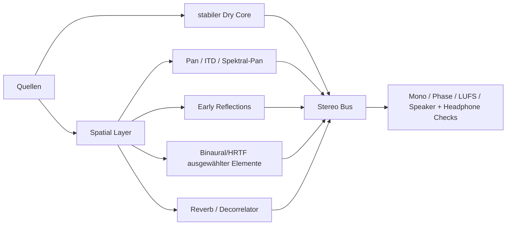
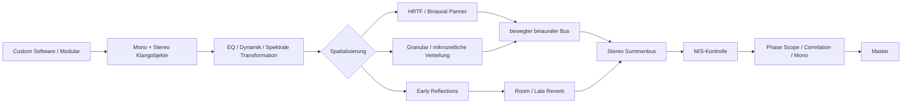
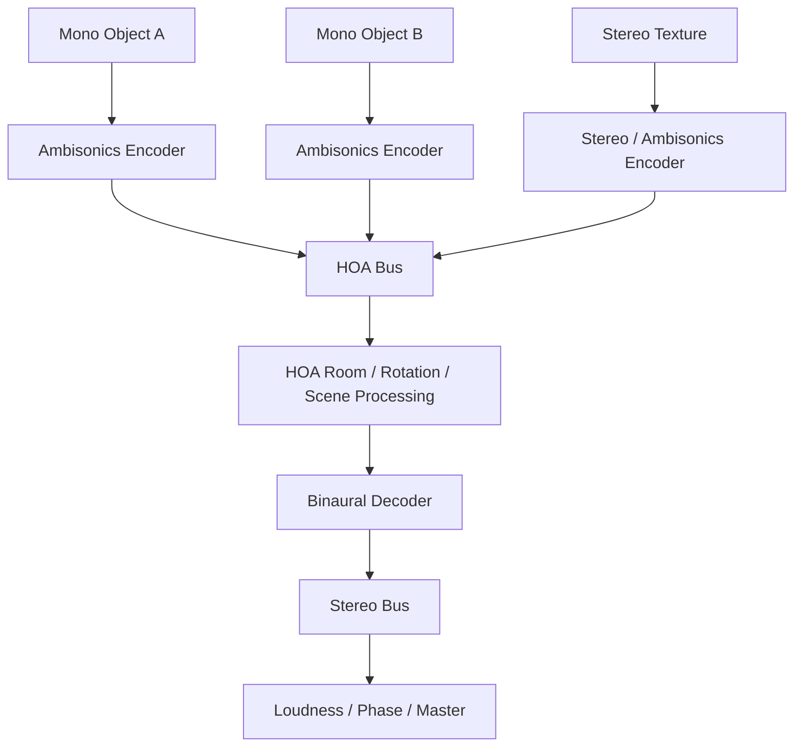

# Räumlicher Klang: Spatialisation in Stereo und Mehrkanal

Zusammengeführt am 2026-11-04 aus zwei Recherchen: *Spatialisation in elektroakustischer Musik & immersivem Audio: Techniken, DSP-Grundlagen und genexpr-Code* und *Räumliche Tiefe und „3D Audio“ in Stereo: Psychoakustik, Mixing, Routing, Werkzeuge und reproduzierbare Workflows*. Der Text ist wortgetreu übernommen, entfernt sind nur doppelte Aussagen. Nur Überschriften, Querverweise und die mit „Anmerkung der Zusammenführung“ markierten Stellen sind neu.

Marker der Form `citeturn6search30` stammen aus der Stereo-Recherche und stehen für Belege. Ihre Quellenliste wurde nicht mitexportiert, sie führen also auf keinen Link.

| Teil | Inhalt | Kapitel |
|---|---|---|
| Auf einen Blick | Kurzfassungen beider Recherchen | – |
| I Gemeinsame Grundlagen | Gehör, genexpr, Distanz, Dekorrelation, Trajektorien, Granular | 1–6 |
| II Stereo und Binaural | Panning, Mid/Side, Tiefe, Routing, Binaural, Rezepte, Messung | 7–14 |
| III Mehrkanal | VBAP, DBAP, Ambisonics, WFS, Feldoperationen, Klangregie | 15–20 |
| IV Von der Mehrkanal-Szene zu binauralem Stereo | AudioSpace und Ambisonics-zu-Binaural-Routing | 21 |
| V Werkzeuge | Plugins und Suiten | 22–23 |
| VI Vorbehalte und Literatur | Grenzen der Angaben, Quellen | 24–25 |

## Auf einen Blick

### Kurzfassung: Techniken und Mehrkanal

- Alle Bewegungs- und Gestaltungstechniken der Mehrkanal-Spatialisation lassen sich in sechs Familien ordnen: (1) Panning/Rendering-Verfahren (Stereo, VBAP/MDAP, DBAP, Ambisonics, Binaural, WFS), (2) Trajektorien & Bewegung, (3) Distanz-/Raumsimulation, (4) Breite/Dekorrelation, (5) granulare & mikrozeitliche Spatialisation, (6) spektrale Spatialisation und Klangregie/Diffusion.
- In gen~ lassen sich fast alle zeit- und amplitudenbasierten Verfahren nativ und effizient bauen (Panner, Distanzmodell, Doppler mit interpoliertem `delay`, Random Walk, Lissajous, Allpass-Dekorrelation, Crossover-Filterbank); FFT-basierte spektrale Verfahren gehören in `pfft~`+gen~ oder in `pvoc`/`mc.`-Objekte, und fertige Ambisonics/VBAP/WFS-Renderer holt man sich aus spat5, ICST, IEM, HOA-Library.
- Für die Praxis gilt: VBAP für präzise Punktquellen, DBAP für unregelmäßige Setups ohne Sweet-Spot, Ambisonics (mit max-rE-Decoder) für rotierbare Felder und größere Publikumsflächen, Dekorrelation/Spektralstreuung für Breite und „Timbre-Spatialisation", Diffusion (Acousmonium/BEAST) für die Live-Interpretation von Stereo/Reduktionen.

### Kernbefunde: Techniken und genexpr

- **Zwei Denkschulen**: „phantom source"-Verfahren (Amplituden-/Zeitpanning, Ambisonics) erzeugen Scheinquellen über Interferenz und sind sweet-spot-abhängig; „physikalische" Verfahren (WFS) rekonstruieren die Wellenfront und erlauben fokussierte Quellen im Publikum, brauchen aber sehr dichte Arrays.
- **genexpr-Syntax ist C-/JavaScript-ähnlich**: `Param`, `History`, `Delay`-Deklarationen; `in1..inN`/`out1..outN` bestimmen Ein-/Ausgänge; Funktionen wie `cos, sin, atan2, sqrt, pow, clamp, mix, wrap, fold, noise` sind verfügbar; Mehrkanal-Ausgabe über mehrere `out`-Objekte. Es gibt **kein natives FFT im Audio-gen~** — dafür `pfft~` mit gen~ innen.
- **Der Doppler-Effekt** entsteht in gen~ ganz natürlich durch eine variable, interpolierte Verzögerungszeit (`delay @interp linear/cubic`); Zipper-Noise vermeidet man durch geglättete Positionssteuerung und höherwertige Interpolation.
- **Konventions-Fallen bei Ambisonics**: FuMa ordnet W,X,Y,Z (mit W=1/√2), AmbiX/ACN ordnet W,Y,Z,X mit SN3D-Normalisierung (W=1). Decoder-Gewichtung entscheidet über die nutzbare Hörfläche: „basic" (Zentrum), „max-rE" (beste Allround-Lokalisation), „in-phase" (größte Fläche).
- **Timbre-Spatialisation** (Robert Normandeau, „Timbre Spatialisation: The Medium is the Space", Organised Sound 14/3, 2009) zerlegt einen Klang mit Bandpässen in 4–16 Bänder und verteilt sie auf verschiedene Lautsprecher — der Klang existiert als Ganzes nur virtuell im Raum. Verwandt: Gmebaphone/Cybernéphone (Bourges), Torchia/Lippe FFT-Verteilung (2004).

### Kurzfassung: Stereo

Ein überzeugendes räumliches Erlebnis in einer normalen Zweikanaldatei entsteht nicht durch einen einzelnen „3D“-Effekt, sondern durch die **kontrollierte Kombination mehrerer Wahrnehmungsebenen**: Links-Rechts-Lokalisation durch Pegel- und Zeitunterschiede, Höhen- und Vorne/Hinten-Hinweise durch HRTF-basierte spektrale Filterung, Tiefenwirkung durch Direkt-/Diffusschall-Verhältnis und Reflexionen sowie Bewegung durch zeitvariable Automation. Die Hörforschung beschreibt drei zentrale Richtungshinweise: **interaurale Zeitdifferenzen (ITD), interaurale Pegeldifferenzen (ILD) und richtungsabhängige spektrale Hinweise**; letztere sind wesentlich in der HRTF enthalten. citeturn6search30turn6search18

Die wichtigste praktische Unterscheidung lautet:

> **Breites Stereo ist nicht dasselbe wie binaurales 3D.**

Konventionelles Stereo mit Amplituden-Panning, Mid/Side, decorrelierten Delays und Reverb kann auf Lautsprechern hervorragend Tiefe und Breite erzeugen. **Binaurales Rendering** versucht dagegen, die akustischen Signaturen nachzubilden, die an den beiden Ohren bei einer realen Schallquelle entstehen. Es kann damit auf Kopfhörern zusätzlich Elevation, Vorne/Hinten und Externalisierung ermöglichen; bei nicht-individuellen HRTFs kann die Wahrnehmung aber stark zwischen Hörern variieren und teilweise „im Kopf“ bleiben. Individuelle HRTFs, Raumreflexionen und Head-Tracking können die Externalisierung verbessern. citeturn8search2turn8search5turn8search6

Für einen **universellen Stereo-Mix**, der sowohl auf Kopfhörern als auch auf Lautsprechern funktioniert, ist deshalb meist ein hybrider Ansatz überlegen:



Die Mitte, Transienten und der relevante Bass bleiben relativ stabil; räumliche Informationen werden stärker in Mitten/Höhen, Reflexionen, Effektreturns und ausgewählten Objekten aufgebaut. Für eine **explizit kopfhörerzentrierte Kunstproduktion** kann man aggressiver binaural arbeiten.

---

## Teil I: Gemeinsame Grundlagen

### 1. Wie das Gehör ortet

#### 1.1 ITD, ILD und HRTF

Für eine seitlich verschobene Schallquelle erreicht das Signal die Ohren unterschiedlich. Zwei Hinweise sind besonders wichtig.

**ITD – Interaural Time Difference** bezeichnet den Laufzeitunterschied zwischen den Ohren. Phasen- und Zeitinformation ist insbesondere für tiefe und mittlere Frequenzen ein starker Richtungsindikator. **ILD – Interaural Level Difference** bezeichnet Pegeldifferenzen, die unter anderem durch die Abschattung des Kopfes entstehen und mit steigender Frequenz stärker werden. Beide Mechanismen sind grundlegende Bestandteile der horizontalen Lokalisation. citeturn6search18turn6search30

Eine reine Stereo-Panoramaautomation verändert meistens primär ILD-artige Pegelverhältnisse. Deshalb hört man damit überzeugend „links/rechts“, aber noch nicht automatisch „hinter mir“ oder „über mir“.

Die **Head-Related Transfer Function, HRTF**, erweitert das Modell. Kopf, Außenohr und Oberkörper verändern ein eintreffendes Signal richtungsabhängig. Diese Filterstruktur enthält ITD, ILD sowie frequenzabhängige Kerben und Verstärkungen, die entscheidende Informationen über Elevation und Vorne/Hinten enthalten. Forschung zur räumlichen Lokalisation bestätigt die Bedeutung sowohl binauraler als auch spektraler Hinweise. citeturn6search8turn6search30

Alle Lautsprecher-Techniken bedienen sich dieser Reize: Amplitudenpanning erzeugt vor allem ILD-artige Reize (bei tiefen Frequenzen entstehen indirekt auch ITDs durch Summation), Zeitpanning (Haas/Präzedenz) nutzt ITD, HRTF-Binaural liefert alle Reize direkt an den Ohren, WFS rekonstruiert das physikalische Feld.

Vereinfacht:

\[
y_L(t)=x(t)*h_L(\theta,\phi,r,t)
\]

\[
y_R(t)=x(t)*h_R(\theta,\phi,r,t)
\]

mit Azimut \(\theta\), Elevation \(\phi\), Entfernung \(r\) und den linken/rechten HRTF- beziehungsweise HRIR-Filtern \(h_L\), \(h_R\).

Die HRTF ist allerdings anatomisch individuell. Daher kann ein generisches HRTF-Modell bei einem Hörer hervorragend funktionieren und bei einem anderen zu Vorne/Hinten-Verwechslungen oder Internalisierung führen.

#### 1.2 Spektrale Hinweise und Elevation

Elevation lässt sich nicht einfach mit „Pan hoch“ erzeugen. Das Außenohr verursacht charakteristische frequenzabhängige Muster, deren genaue Form von der Ankunftsrichtung und individuellen Ohrgeometrie abhängt. Diese spektralen Hinweise tragen auch zur Unterscheidung von vorne und hinten bei. citeturn6search8

Daraus folgt eine praktische Regel:

**Ein EQ-Preset allein ist kein vollständiger Höhen-Panner.** Eine spektrale Manipulation kann die Illusion unterstützen, aber glaubwürdige Elevation benötigt normalerweise eine HRTF- oder vergleichbare binaurale Modellierung.

#### 1.3 Entfernung, Early Reflections und Reverberation

„Tiefe“ ist multidimensional. Ein Signal wirkt tendenziell näher, wenn sein Direktanteil stark, klar und transientenreich ist. Mit wachsendem wahrgenommenem Abstand nehmen Raumanteil und spektrale Dämpfung typischerweise an Bedeutung zu.

Besonders wertvoll sind **Early Reflections**. Sie liefern Informationen über Raumgröße, Oberflächen und Relation zwischen Quelle und Hörer. Untersuchungen zur binauralen Externalisierung zeigen, dass Reflexionen und Reverberation wesentlich dazu beitragen können, eine Schallquelle außerhalb des Kopfes wahrzunehmen. citeturn8search5turn8search7

Deshalb sollte man Reverb im 3D-Mixing besser in zwei funktionale Komponenten zerlegen:

**Early Reflections → Position, Entfernung, Raumgeometrie**

**Late Reverb → Envelopment, Größe, Atmosphäre**

Das ist wesentlich präziser, als einfach einen langen Hall über jedes Signal zu legen.

#### 1.4 Precedence Effect, Haas-Techniken und zeitbasiertes Panning

Bei direktem Klang plus kurz darauf eintreffenden Reflexionen dominiert für die Lokalisation häufig die erste Wellenfront. Dieses als **Precedence Effect** untersuchte Phänomen ist für natürliche Raumwahrnehmung ebenso relevant wie für Stereo-Delay-Tricks. citeturn7search3turn7search0

Im Studiokontext wird häufig pauschal vom „Haas-Effekt“ gesprochen. Die populäre Vorstellung einer universellen festen Grenze – beispielsweise „unter X Millisekunden immer breit, darüber Echo“ – ist jedoch zu grob. Ob zwei Ereignisse fusionieren, hängt unter anderem von Signalart, Pegel, Transienten und Delay ab. Daher sind Zeitwerte im Mixing **Startpunkte, keine psychoakustischen Gesetze**.

Ein praxistauglicher Ausgangspunkt ist beispielsweise:

| Delay einer decorrelierten Parallelkopie | Typische Wirkung |
|---:|---|
| < 1 ms | starke Phasen-/Kammfilterwirkung; vorsichtig |
| 1–8 ms | seitliche Verschiebung, Breite, potenziell starke Mono-Färbung |
| 8–20 ms | deutlich räumlicher/fusionierter Zweitanteil |
| 20–40 ms | zunehmende Wahrnehmung als Doppelung/Slap bei transientem Material |

Diese Werte sind bewusst **heuristische Arbeitsbereiche**. Bei Percussion kann ein Delay viel früher als separates Ereignis auffallen als bei Pads.

**DSP einfach.** Kommt derselbe Klang aus zwei Boxen, aber einer 1–35 ms später, lokalisieren wir ihn bei der *früheren* Box (Präzedenzeffekt), obwohl beide gleich laut sind. Als Lokalisationswerkzeug: kleine Delays statt/zusätzlich zu Pegeldifferenzen. Vorsicht: über ~35–50 ms kippt es in ein hörbares Echo. In gen~ trivial mit `delay`.

> **Anmerkung der Zusammenführung:** Die Techniken-Recherche nennt 1–35 ms als Bereich und 35–50 ms als Kipppunkt zum Echo. Die Stereo-Recherche hält eine feste Grenze für zu grob und gibt Arbeitsbereiche an. Beide Angaben stehen deshalb hier; nimm die Zahlen als Startpunkte.

### 2. genexpr-Werkzeugkasten

**genexpr-Sprache (Cycling '74, GenExpr Reference).** Wesentliche Punkte, die man für Spatialisation braucht:
- Ein-/Ausgänge werden durch `in1..inN` und `out1..outN` erkannt; `in`=`in1`, `out`=`out1`.
- Semikolons sind bei mehreren Statements Pflicht; einzeilige Ausdrücke ohne Zuweisung setzen implizit `out1`.
- `Param name (default), min=…, max=…;` deklariert steuerbare Parameter (Signal- oder Kontrollrate).
- `History name (init);` erzeugt eine Ein-Sample-Verzögerung und erlaubt Rückkopplung (Basis für Ein-Pol-Filter, Integratoren, Random Walk).
- `Delay name (maxlen, taps);` — die Delay-Deklaration; `@interp linear|cosine|cubic|spline` für fraktionale (interpolierte) Delays, `@feedback 0` für Delayzeiten < 1 Sample. Aufruf: `y = name.read(delaytime); name.write(x);` bzw. Objekt-Stil.
- Mehrfach-Rückgaben: `r, theta = cartopol(x, y);` und `x, y = poltocar(r, theta);`.
- Verfügbare Funktionen u.a.: `cos, sin, tan, atan2, sqrt, pow, exp, log, abs, sign, min, max, clamp, wrap, fold, mix (lineare Interpolation), scale, noise (weißes Rauschen −1..1), phasor, cycle, floor, ceil, round`.
- Sample&Hold/rate-limitierte Zufallswerte: `latch(signal, trigger)`, Zustandsänderung via `change` und `delta`.
- **Kein Array-Indexing `[i]`** in reinem genexpr; für Tabellen nutzt man `Data`/`Buffer` mit `peek`/`poke` bzw. `channels`/`dim`.
- **Kein FFT im Audio-gen~**: spektrale Verfahren gehören in `pfft~` (mit gen~ im Subpatch) oder in MSP-Objekte (`pfft~`, `pvoc~`, `mc.`-Objekte).

Für echte Mehrkanal-Praxis kombiniert man gen~ meist mit **MC (Multichannel) in Max 8/9**: ein `gen~` mit N Ausgängen speist `mc.`-Ketten, oder man nutzt `mc.gen~`.

### 3. Distanz in der Signalverarbeitung

#### 3.1 Abstandsgesetz (1/r) und Luftabsorption

**DSP einfach.** Schalldruck fällt mit 1/r (−6 dB pro Distanzverdopplung). Zugleich absorbiert Luft hohe Frequenzen stärker → ferne Quellen klingen dumpfer. Das simuliert man mit einem **Ein-Pol-Tiefpass**, dessen Cutoff mit der Distanz sinkt. In gen~ ist der Ein-Pol-Tiefpass die Kombination `mix` + `History`: y += b·(x − y), mit b = Cutoff-Koeffizient (0..1).

```genexpr
// ---- Distanzmodell: 1/r + Luftabsorptions-Tiefpass ----
// in1 = Signal; Param dist = Abstand (>= mindist)
Param dist(1), mindist(0.3);
d = max(dist, mindist);
gain = mindist / d;                 // 1/r, auf mindist normiert
// Cutoff-Koeffizient sinkt mit Distanz (mehr Absorption fern):
Param absorb(0.02);                 // Absorptionsstärke
b = clamp(1 - absorb*d, 0.02, 1);   // 1 = offen, ->0 = dumpf
History y(0);
y = y + b*(in1 - y);                // Ein-Pol-Tiefpass
out1 = y * gain;
```

#### 3.2 Direkt-/Diffusschall-Verhältnis, frühe Reflexionen, Nachhall pro Kanal

**DSP einfach.** Man kreuzblendet Direktsignal und Hallanteil abhängig von der Distanz (D/R-Ratio). Frühe Reflexionen (erste 5–80 ms) geben Distanz- und Raumgrößen-Reize; sie werden als kurze, richtungsabhängige Delays je Kanal gesetzt. Später diffuser Nachhall wird idealerweise *dekorreliert* auf mehrere Kanäle verteilt (sonst kollabiert der Raum in die Mitte). Fertige Raum-Engines: `spat5.spat~`/`spat5.reverb~` (perzeptiver Ansatz mit direkt/früh/spät-Segmenten), IEM `RoomEncoder`.

#### 3.3 Doppler-Effekt (variable Verzögerungszeit)

**DSP einfach.** Der Doppler-Effekt ist *kein* separater Pitch-Shifter — er entsteht automatisch, wenn sich die Verzögerungszeit (= Laufzeit Quelle→Hörer = Distanz/Schallgeschwindigkeit) *ändert*: verkürzt sie sich, wird der Ton höher, verlängert sie sich, tiefer. Man braucht also eine **fraktionale, interpolierte Delay-Leitung**, deren Länge = Distanz/343 m/s.

In gen~ liefert das `delay`-Objekt genau das: mit `@interp linear` (Standard) oder `@interp cubic`/`spline`. **Zipper-Noise/Klicks** entstehen, wenn sich die Delayzeit sprunghaft ändert → Positionssignal glätten (Ein-Pol-Tiefpass auf die Distanz) und höherwertige Interpolation wählen. Wichtig: gen~-`delay` ist ein *tapping buffer* — kontinuierliche Zeitänderung erzeugt genau den gewünschten Pitch-Effekt (anders als das intern gerampte `delay~`).

```genexpr
// ---- Doppler via interpoliertem Delay ----
// in1 = Signal; Param dist = Abstand in Metern
Param dist(1);
Param smooth(0.001);       // Glättung gegen Zipper
History dprev(1);
dsm = dprev + smooth*(dist - dprev);  // Distanz glätten
dprev = dsm;
c = 343;                   // Schallgeschwindigkeit m/s
delsamps = (dsm / c) * samplerate;    // Delay in Samples
// max. Delay 2 s, interpoliert:
Delay dl(96000, 1);
y = dl.read(delsamps, interp="cubic");
dl.write(in1);
// zusätzlich 1/r-Pegel:
out1 = y * (1 / max(dsm, 0.3));
```

### 4. Breite und Diffusität (Dekorrelation)

#### 4.1 Dekorrelation (Kendall 1995)

**DSP einfach.** Grundlage ist Gary S. Kendall, „The Decorrelation of Audio Signals and Its Impact on Spatial Imagery", Computer Music Journal 19(4): 71–87, 1995. Aus einem Monosignal macht man mehrere Signale, die *gleich klingen*, aber *unterschiedliche Wellenformen/Phasen* haben. Werden sie auf verschiedene Boxen gelegt, wird die Quelle breit/umhüllend statt punktförmig, ohne Kammfilter-Kollaps. Kendall nennt drei Wege: (a) **Random-Phase-FFT** — flaches Betragsspektrum, Phasen zufällig ±π, per IFFT zu einem FIR-Filter (→ `pfft~`/Faltung, nicht Audio-gen~); (b) **Allpass-Ketten** mit randomisierten, langsam variierenden Koeffizienten (in gen~ machbar); (c) **Velvet Noise** (spärliche ±1-Impulse) als kurze Faltung.

Typische Fallstricke: zu viel Time-Smearing zerstört Transienten (Faustregel: ≤60 ms bei tiefen, 10–20 ms bei hohen Frequenzen); bei Mono-Summierung entstehen Kammfilter.

```genexpr
// ---- Dekorrelation über Allpass-Kette (ein Kanal) ----
// Erzeugt eine phasenveränderte, klanggleiche Variante von in1.
// Vier First-Order-Allpässe mit unterschiedlichen Koeffizienten.
Param k1(0.6), k2(-0.5), k3(0.7), k4(-0.45);
History x1(0), y1(0);
ap1 = -k1*in1 + x1 + k1*y1;  x1 = in1;  y1 = ap1;
History x2(0), y2(0);
ap2 = -k2*ap1 + x2 + k2*y2;  x2 = ap1;  y2 = ap2;
History x3(0), y3(0);
ap3 = -k3*ap2 + x3 + k3*y3;  x3 = ap2;  y3 = ap3;
History x4(0), y4(0);
ap4 = -k4*ap3 + x4 + k4*y4;  x4 = ap3;  y4 = ap4;
out1 = ap4;
// Für N Kanäle: N solcher Ketten mit je anderen (randomisierten) k-Werten.
// Koeffizienten langsam per rate-limitiertem noise() modulieren = dynamische Dekorrelation.
```

#### 4.2 Rotation der Phasenbeziehungen / Diffusion

Langsam variierende Allpass-Phasen (4.1) oder Feedback-Delay-Netzwerke erzeugen einen sich bewegenden, diffusen Klangschleier — Basis von „stereoisierten"/Multichannel-Reverbs.

### 5. Trajektorien und Bewegungserzeugung

Alle Trajektorien liefern letztlich eine Position (Winkel oder x/y/z), die in einen der Panner (Stereo: Kapitel 8, Mehrkanal: Kapitel 15) geht. Wichtig: **Bewegung erzeugen ≠ Bewegung rendern**. Man trennt Positionsgenerator und Panner.

Musikalische Anwendungen stehen in den Stereo-Rezepten: Makrobewegung + Mikrobewegung (12.4) und signalabhängige Bewegung (12.9). Die mehrkanal-eigenen Bewegungen Sprungtechnik und Feldrotation stehen in 16.1 und 16.2.

#### 5.1 Rotation (Kreis) und Ellipse

Kreis: x = r·cos(ωt), y = r·sin(ωt). Ellipse: x = a·cos(ωt), y = b·sin(ωt). Ein Phasor liefert die Zeitbasis.

```genexpr
// ---- Rotations-/Ellipsen-Trajektorie ----
Param freq(0.2);   // Umläufe pro Sekunde
Param a(1), b(0.6); // Halbachsen (a=b -> Kreis)
phase = phasor(freq);          // 0..1 rampe
ang = phase * 2 * pi;
out1 = a * cos(ang);   // x
out2 = b * sin(ang);   // y
out3 = atan2(out2, out1); // Azimut (falls Panner Winkel will)
```

#### 5.2 Spirale (Radius über Zeit)

Radius wächst/schrumpft, während der Winkel umläuft → Quelle spiralt nach außen/innen. r(t) = r0 + k·t (oder oszillierend). Musikalisch: „Hereinziehen"/„Wegschleudern".

```genexpr
// ---- Spirale ----
Param rotFreq(0.3), radFreq(0.05);
ang = phasor(rotFreq) * 2 * pi;
rad = 0.5 + 0.5*sin(phasor(radFreq)*2*pi); // Radius oszilliert 0..1
out1 = rad*cos(ang);
out2 = rad*sin(ang);
```

#### 5.3 Pendel / Oszillation

Sinus-LFO auf einer Achse (oder Winkel), evtl. mit `fold` für „abprallende" Bewegung. x = A·sin(ωt). Auto-Panning mit LFO ist der einfachste Fall.

#### 5.4 Lissajous-Figuren

Zwei Oszillatoren unterschiedlicher Frequenz/Phase auf x und y: x = A·sin(f_x·t + δ), y = B·sin(f_y·t). Ganzzahlige Frequenzverhältnisse ergeben geschlossene Figuren, irrationale nie schließende, quasi-chaotische Bahnen — sehr ergiebig für sich langsam wandelnde Raumbewegungen.

```genexpr
// ---- Lissajous-Trajektorie ----
Param fx(0.2), fy(0.3), phase_x(0);
Param A(1), B(1);
// Zeit-Integrator (accum-Ersatz per History):
History tprev(0);
t = tprev + 1/samplerate;
tprev = t;
x = A * sin(2*pi*fx*t + phase_x);
y = B * sin(2*pi*fy*t);
out1 = x; out2 = y;
```

#### 5.5 Brownsche Bewegung / Random Walk

**DSP einfach.** Statt absoluter Zufallsposition addiert man in jedem Schritt eine kleine Zufallsänderung: pos += rate·noise. Das ergibt eine glatte, „driftende" Bahn (im Gegensatz zum sprunghaften weißen Rauschen). Mit Grenzen (`clamp`/`fold`) hält man die Quelle im Raum. Rate-limitiert man über `latch`, entstehen ruhigere Schritte.

```genexpr
// ---- Brownscher Random Walk als Positionsgenerator (x,y) ----
Param step(0.001);   // Schrittweite / "Temperatur"
Param rate(30);      // neue Zufallsrichtung pro Sekunde
History xpos(0), ypos(0);
// rate-limitierter Zufall via sample&hold:
trig = phasor(rate);
d = delta(trig);              // Sprung bei Wrap des Phasors
newx = latch(noise(), d<0);  // neue Zufallsrichtung bei jedem Zyklus
newy = latch(noise(), d<0);
xpos = clamp(xpos + step*newx, -1, 1);
ypos = clamp(ypos + step*newy, -1, 1);
out1 = xpos; out2 = ypos;
```

#### 5.6 1/f-Rauschen als Steuerung

**DSP einfach.** Weißes Rauschen ist zu zappelig, Random Walk driftet zu stark. 1/f- („pink") Rauschen liegt dazwischen und wirkt „natürlich/organisch" — ideal für lebendige, nicht vorhersehbare, aber nicht chaotische Bewegung. Erzeugung z.B. über gefiltertes weißes Rauschen (mehrere Ein-Pol-Tiefpässe, Voss-McCartney-Algorithmus) oder Summe mehrerer rate-limitierter Zufallsprozesse.

#### 5.7 Chaos-Systeme (Lorenz-Attraktor)

**DSP einfach.** Deterministisches, aber nie repetitives System dreier gekoppelter Differentialgleichungen. Man integriert schrittweise (Euler) und nutzt x,y,z als Koordinaten oder Steuergrößen. Klingt „lebendig", umkreist zwei Zentren (Schmetterlingsform).

```genexpr
// ---- Lorenz-Attraktor als 3D-Positionsgenerator ----
Param sigma(10), rho(28), beta(2.6667);
Param dt(0.005);   // Integrationsschritt (klein halten!)
History x(0.1), y(0), z(0);
dx = sigma*(y - x);
dy = x*(rho - z) - y;
dz = x*y - beta*z;
x = x + dt*dx;
y = y + dt*dy;
z = z + dt*dz;
// auf sinnvollen Bereich skalieren:
out1 = x*0.03; out2 = y*0.03; out3 = (z-25)*0.03;
```

#### 5.8 Interpolation zwischen Breakpoints, Easing, Geschwindigkeitskurven

Man definiert Wegpunkte und interpoliert (linear, cosine, cubic/Catmull-Rom). „Easing" (langsam-schnell-langsam) macht Bewegungen musikalisch: statt linearer Rampe eine S-Kurve (smoothstep: 3t²−2t³). In gen~ mit `mix`, `interp` oder eigener Kurvenformel; Breakpoint-Listen kommen von außen (`line`/`function`/`zmap`) oder aus einem `Data`-Buffer.

#### 5.9 Auto-Panning mit LFOs, Spatial Modulation

LFO auf die Panning-Position = Auto-Panning (5.3). Bei Audiorate wird daraus **Spatial Modulation** (ringmodulationsartiges Panning, McGee 2015 „spatial modulation synthesis") — die Bewegung wird so schnell, dass sie als Klangfarbe/Seitenbänder hörbar wird statt als Bewegung.

### 6. Granulare und mikro-zeitliche Spatialisation

**DSP einfach.** In der granularen Synthese wird Klang in kurze Körner (1–100 ms) zerlegt (Curtis Roads, *Microsound*, MIT Press 2001). Bei granularer *Spatialisation* bekommt **jedes Korn eine eigene Position**: McLeran, Roads, Sturm & Shynk beschreiben in „Granular Sound Spatialization Using Dictionary-Based Methods" (Proc. 5th Sound and Music Computing Conference, Berlin 2008), dass „spatialisation can now be explored down to the microsound level of sonic structure, where individual spatial positions are assigned to every sonic grain". Man kann Körner streuen (scattering), konvergieren/divergieren lassen oder panoramisch verteilen — es entsteht ein „Wolken"-Raum statt einer Punktquelle. Entscheidend: **Korn-Rate und Bewegungsrate trennen** (die Wolke kann ruhen, während die Körner räumlich zittern, oder umgekehrt).

Praktisch: In Max baut man das mit `mc.`-Objekten, `poly~`, MuBu (`mubu.granular~`) oder mit einer gen~-Korn-Engine, bei der jedes Korn beim Start eine Zufallsposition/-richtung erhält und über einen der Panner (VBAP/DBAP/Ambisonics) gerendert wird. Jedes Korn kann zusätzlich eine eigene Distanz/Filterung bekommen (spektral-räumliche Streuung). Fallstricke: bei hoher Dichte verschmieren Einzelpositionen zur diffusen Textur (kann erwünscht sein); pro Korn eigene HRTF/Encodierung ist CPU-intensiv.

```genexpr
// ---- Skizze: pro Korn eigene Azimut-Position (Ein-Korn-Voice) ----
// erzeugt neue Zufallsposition je Korn.
Param spread(1);   // 0=alle mittig, 1=volle Streuung
grainPhase = phasor(20);         // 20 Körner/s (Beispiel)
newgrain = delta(grainPhase) < 0;
History az(0);
az = latch(spread * pi * noise(), newgrain);  // neue Richtung pro Korn
// Fenster (Hann) über das Korn:
win = 0.5 - 0.5*cos(2*pi*grainPhase);
g = in1 * win;
// constant-power auf Stereo als minimaler Renderer:
th = (az+pi)/(2*pi) * (pi*0.5);
out1 = g*cos(th); out2 = g*sin(th);
```

Granularverfahren sind für 3D besonders geeignet, weil **nicht die gesamte Quelle an einem Punkt sitzen muss**.

Beispiel:

```text
Original Sample
→ Grain Engine
   Grain 1 → -50°
   Grain 2 → +25°
   Grain 3 → +80° / leicht erhöht
   Grain 4 → hinten links
   ...
→ Binaural/HOA sum
→ Room
```

Der Fehler wäre, hunderte Grains jeweils extrem räumlich und laut zu machen. Das Ergebnis wird diffus und verliert jede Positionswahrnehmung.

Besser:

- wenige dominante Grains klar positionieren,
- viele leise Grains diffus verteilen,
- unterschiedliche Bewegungszeiten verwenden,
- Bassanteile weniger räumlich zerlegen,
- Grain Density und Spatial Density unabhängig automatisieren.

---

## Teil II: Stereo und Binaural

### 7. Annahmen für Stereo und Binaural

Diese Annahmen gelten für Teil II und Teil IV.

Da die Zielparameter nicht spezifiziert wurden, arbeite ich mit folgenden Annahmen:

| Parameter | Annahme |
|---|---|
| Endformat | normale Zweikanal-Stereodatei |
| Primäres Ziel bei echtem Binaural | Kopfhörer |
| Sekundäres Ziel | möglichst robuste Wiedergabe auf Stereo-Lautsprechern |
| HRTF | zunächst generisch, nicht individuell |
| Head-Tracking | für statische Musikdatei nicht vorausgesetzt |
| Arbeitsformat | beispielhaft 48 kHz / 24 Bit; kein Muss |
| Loudness | musikalisch/platformabhängig; BS.1770-Messung, **nicht pauschal -23 LUFS** |
| Originalsessions der Referenzen | nicht verfügbar |
| Referenzanalyse | dokumentierte Produktionsangaben + psychoakustisch plausible Rekonstruktion, keine Behauptung über unbekannte konkrete Plug-ins |

Gerade die letzte Einschränkung ist wichtig: Die folgenden Ketten zu *Magnetic Moments* und AudioSpace sind, wo nicht ausdrücklich dokumentiert, **rekonstruktive Hypothesen**, keine behauptete Reverse-Engineering-Analyse der Originalsessions.

### 8. Panning

#### 8.1 Amplitudenpanning und Pan-Laws

**DSP einfach.** Eine Monoquelle wird mit zwei Gains g_L, g_R auf zwei Lautsprecher verteilt. Der wahrgenommene Ort hängt vom Verhältnis ab. Drei gängige „Pan-Laws":
- **Lineares Panning**: g_L = 1−p, g_R = p (p∈[0,1]). Problem: in der Mitte fällt die *Leistung* ab → Lautheitsloch (−6 dB in der Mitte bei gleicher Amplitude-Summe).
- **Constant Power / sin-cos (−3 dB)**: g_L = cos(θ), g_R = sin(θ) mit θ = p·(π/2). Da cos²+sin²=1 bleibt die Summenleistung konstant; in der Mitte je Kanal −3 dB. Standard für die meisten DAWs.
- **−4,5 dB-Kompromiss**: geometrisches Mittel aus linear und constant power.

Das Pan-Law entscheidet, ob beim Schwenken die Lautheit konstant bleibt. Für unkorrelierte Wiedergabe (getrennte Boxen) ist constant power richtig; bei Mono-Summierung wäre −6 dB linear korrekt.

```genexpr
// ---- Constant-Power Stereo-Panner ----
// in1 = Monosignal, Param pan = 0..1 (0=links, 1=rechts)
Param pan(0.5);
theta = pan * (pi * 0.5);   // 0..pi/2
gL = cos(theta);            // Gain links
gR = sin(theta);            // Gain rechts
out1 = in1 * gL;
out2 = in1 * gR;
```

Ein Pan-Regler verändert nicht nur die Position, sondern – abhängig von der DAW – auch den Pegel. Logic Pro bietet beispielsweise Pan Laws von 0, -3, -4,5 und -6 dB sowie kompensierte Varianten. Apple beschreibt ausdrücklich, dass die Pan Law den Pegel beim Übergang von Center nach links/rechts beeinflusst, damit die wahrgenommene Lautheit konsistent bleiben kann. citeturn17search2turn17search4

Für bewegte Monoquellen ist **-3 dB beziehungsweise Equal-Power-artiges Panning** ein sinnvoller Ausgangspunkt. Entscheidend ist weniger die konkrete Zahl als Konsistenz: Ein Mix sollte nicht versehentlich aufgrund wechselnder Pan Laws bei Bewegung lauter und leiser werden.

Vor einer umfangreichen Pan-Automation:

1. Pan Law festlegen.
2. Einen Mono-Testton oder eine repräsentative Quelle Center → Side automatisieren.
3. Lautheit beurteilen.
4. Erst danach die komplette räumliche Automation schreiben.

#### 8.2 Level-, Delay- und Spectral-Panning kombinieren

Ein gewöhnlicher Panpot benutzt hauptsächlich Pegel. Realistischere seitliche Bewegung kann entstehen, wenn drei Faktoren kombiniert werden:

**Level:** L/R-Pegelverhältnis  
**Delay:** kleiner Zeitunterschied zwischen Kanälen  
**Spectrum:** richtungsabhängige Filterung

Genau dieses Prinzip implementiert beispielsweise Goodhertz Panpot mit Level-, Delay-, Spektral- und Phase-Panning. Es ist bewusst kein vollständiger Höhen-/HRTF-Renderer, aber ein interessantes Zwischenstadium zwischen einfachem DAW-Panning und Binauraltechnik. Der aktuelle Preis liegt bei $49. citeturn22search12turn22search9

Für Lautsprecher-first-Stereo kann solches Panning oft robuster sein als eine aggressive generische HRTF.

#### 8.3 Haas-/Delay-Widening ohne unnötige Monozerstörung

Eine verbreitete schlechte Kette lautet:

> Monoquelle → exakte Kopie → hart L/R → eine Seite 10 ms verzögern.

Das funktioniert in Stereo, produziert beim Mono-Summieren aber vorhersehbar Kammfilter.

Besser:

```text
Original:
Monoquelle → Dry Center / gewünschte Pan-Position

Width-Send:
Quelle
 → HPF 200–500 Hz
 → leichte spektrale Veränderung
 → Delay ca. 8–20 ms
 → ggf. minimale Modulation
 → gegenüberliegende Seite
 → 6–15 dB leiser als Dry
```

Die exakten Werte sind Startpunkte. Entscheidend ist, dass die verzögerte Kopie **nicht gleichwertiger Zwilling des Direktklangs** ist. Dadurch wird ihre Kammfilterwirkung beim Mono-Sum weniger dominant. iZotope weist bei Haas-basiertem Widening ebenfalls ausdrücklich auf mögliche Mono-Kammfilterprobleme hin. citeturn23search16

### 9. Mid/Side

#### 9.1 Mid/Side als geometrische Sicht auf Stereo

Bei normierter M/S-Matrix kann man schreiben:

\[
M=\frac{L+R}{\sqrt{2}}, \qquad
S=\frac{L-R}{\sqrt{2}}
\]

und entsprechend zurückdecodieren.

Der Vorteil ist konzeptionell enorm:

- **Mid** enthält gemeinsame beziehungsweise zentrumsnahe Information.
- **Side** betont Unterschiede zwischen links und rechts.

Mono-Summierung entfernt deshalb große Teile reiner Side-Information. Je aggressiver ein Mix seine Identität im Side-Kanal aufbaut, desto höher das Risiko, dass er in Mono kollabiert.

M/S sollte daher primär als **selektives Werkzeug** verwendet werden: Bass stabilisieren, Hall verbreitern, obere Frequenzen öffnen, seitliche Informationen EQen – nicht als pauschales „Width = 200 %“.

#### 9.2 M/S-Bearbeitung

Eine robuste M/S-Kette auf einer Gruppe könnte sein:

```text
Stereo Bus
→ M/S Encode
   Mid:  Low-End unverändert, ggf. leichte Präsenz
   Side: HPF bzw. Low-Shelf-Absenkung, leichte Höhenöffnung
→ M/S Decode
→ Gain Match
→ Mono Check
```

Als typischer Startpunkt – nicht als Regel – kann Side unter etwa **80–150 Hz** schrittweise reduziert werden, wenn Kick und Bass stabil im Zentrum bleiben sollen.

Für Pads, Field Recordings oder diffuse Texturen kann dagegen bewusst mehr Side bestehen bleiben.

#### 9.3 M/S-Reverb

Ein besonders effizientes Tiefenwerkzeug ist ein **Stereo- beziehungsweise True-Stereo-Reverb auf einem Aux**, dessen Return anschließend M/S-bearbeitet wird:

```text
SEND
 ↓
Reverb 100 % wet
 ↓
M/S Encode
 ├─ Mid: eher kompakt
 └─ Side: HPF + ggf. +1…3 dB Breite
 ↓
M/S Decode
 ↓
Spatial FX Bus
```

Dadurch bleibt der Direktklang fokussiert, während hauptsächlich der Raum seitlich wächst.

Bei zu starkem Side-Reverb verschwindet allerdings beim Mono-Summen ein großer Teil der Atmosphäre. Deshalb niemals nach Kopfhörer-Eindruck allein einstellen.

True-Stereo-Convolution ist hier besonders interessant: Im Gegensatz zu einfacher Stereo-Convolution enthält ein True-Stereo-System auch die Kreuzwege L→R und R→L. LiquidSonics beschreibt diese Crossfeed-Strukturen explizit und ermöglicht in Reverberate 3 getrennte beziehungsweise simulierte True-Stereo-Bearbeitung. citeturn23search2turn23search15

### 10. Tiefenstaffelung und DAW-Routing

#### 10.1 Depth Mixing als systematische Hierarchie

Statt zehn verschiedenen Hall-Presets empfehle ich drei definierte Tiefenebenen:

| Ebene | Dry | Early Reflections | Tail | HF | Stereobreite |
|---|---:|---:|---:|---|---|
| **Near** | hoch | niedrig–mittel | niedrig | offen | fokussiert |
| **Mid** | mittel | mittel | mittel | leicht gedämpft | mittel |
| **Far** | niedriger | hoch | höher | stärker gedämpft | eher diffus |

Das ist kein physikalisch vollständiges Distanzmodell, aber ein reproduzierbares Mixing-System. Reverberation und Reflexionsstruktur sind nachweislich wichtige Beiträge zur Externalisierung und Distanzwahrnehmung. citeturn8search5turn8search7

#### 10.2 Empfohlenes DAW-Routing

Ein DAW-unabhängiges Template:

| Spur/Bus | Typ | Routing | Funktion |
|---|---|---|---|
| `SRC_xx` | Mono/Stereo Audio/Instrument | → Instrument Bus | Quellklang |
| `DRY CORE` | Group/Bus | → Mix Bus | Transienten, Bass, Center |
| `SPAT OBJECTS` | Group/Bus | → Mix Bus | bewegte/positionierte Elemente |
| `ER ROOM` | Aux/Return | Send von Quellen | Early Reflections |
| `TAIL ROOM` | Aux/Return | Send von Quellen | Late Reverb |
| `WIDTH FX` | Aux/Return | selektive Sends | Delay/Decorrelator/Microshift |
| `GRANULAR SPACE` | Aux/Return | selektiv | Grains, diffuse Bewegung |
| `SC DETECTOR` | Sidechain-Bus | → FX-Kompressoren | Ducking durch Vocal/Kick |
| `SPATIAL SUM` | Group | FX Returns | M/S und Breitenkontrolle |
| `MIX BUS` | Stereo | alles | Summierung |
| `MONITOR` | Monitor-only | nach Mix | Mono, Crossfeed, Metering |
| `MASTER PRINT` | Stereo Record | vor Monitor-FX | endgültiger Bounce |

Sends können je nach gewünschter Raumlogik **post-fader** sein, damit der Hall dem Dry-Level folgt, oder pre-fader, wenn ein Effekt beziehungsweise „Geisterklang“ unabhängig vom Direktpegel bestehen soll. Cubase erlaubt beispielsweise getrenntes Send-Panning; seine Sidechain-Architektur kann das Ausgangssignal einer Spur zur Steuerung eines Effekts auf einer anderen Spur verwenden, unter anderem für Ducking. citeturn17search7turn17search5

Ein musikalisch sehr nützlicher Spezialfall:

```text
Lead Vocal ────────────────→ Mix
     │
     ├─send→ Long Reverb ──→ Spatial Bus
     │                       ↑
     └────────sidechain──── Compressor
```

Während die Stimme singt, wird der Reverb beispielsweise 1–4 dB reduziert; in Lücken öffnet sich der Raum. Dadurch kann ein Mix **tief und groß** wirken, ohne dass die Sprache entfernt erscheint.

### 11. Binaurales Rendering

#### 11.1 Binaurales Rendering (HRTF)

**DSP einfach.** Für Kopfhörer faltet man das Monosignal mit den kopfbezogenen Übertragungsfunktionen (HRIR) für linkes/rechtes Ohr aus der Zielrichtung. Das liefert ILD, ITD und spektrale Reize direkt an den Ohren → Externalisierung und Höhenwahrnehmung. Faltung ist FFT-basiert → nicht in Audio-gen~, sondern `pfft~`, `spat5.virtualspeakers~`, IEM `BinauralDecoder`, `mc.`-Faltung oder externe HRTF-Objekte. Ambisonics→Binaural (virtuelle Lautsprecher + HRTF) ist der gängige Produktionsweg für VR/360.

#### 11.2 Referenz: Kamran Sadeghi – *Magnetic Moments*

##### Was nachweislich dokumentiert ist

Sadeghi beschreibt *Magnetic Moments* als etwa 35-minütige, kontinuierliche Komposition, die von ihm selbst komponiert, **binaural gemischt und gemastert** wurde; die Veröffentlichungsseite empfiehlt Kopfhörer. Die Klänge entstanden mit eigens entwickelter Software und modularer Synthese. Er beschreibt Klang ausdrücklich als skulpturales Material und das Werk als betretbaren beziehungsweise räumlich erfahrbaren Raum. Außerdem entstanden die visuellen Begleitbilder aus einem **Phase Scope während des Masterings**. citeturn19view0

Damit steht dort nicht maximale statische Stereobreite, sondern die Behandlung von Klang als bewegliches, räumliches Material im Mittelpunkt.

Diese Kombination ist produktionstechnisch bemerkenswert: Die Phasenbeziehungen scheinen nicht erst am Ende als technisches Problem überprüft worden zu sein, sondern waren offenbar auch ein bewusst beobachteter Bestandteil des räumlichen Materials. Das ist eine Interpretation der dokumentierten Arbeitsweise, nicht der Nachweis eines konkreten Algorithmus. citeturn19view0

##### Plausible rekonstruktive Processing-Architektur

Eine technisch plausible, aber **nicht verifizierte** Kette wäre:



Die für diesen Klangansatz wahrscheinlich effektivste Strategie wäre, **nicht die gesamte Mischung identisch binaural zu behandeln**, sondern einzelne klangliche Figuren als Objekte zu bewegen, während diffuse und kontinuierliche Schichten ein stabileres Raumfeld bilden.

Eine gute Reproduktion des Ansatzes könnte so aussehen:

1. Erzeuge fünf bis zehn relativ fokussierte Mono-Klangobjekte und einige diffuse Stereo-Texturen.
2. Spatialisiere fokussierte Objekte individuell mit einem HRTF-Panner.
3. Automatisiere Azimut langsamer als Klangparameter wie Filter oder Grain Density. Dadurch entsteht eine nachvollziehbare räumliche Trajektorie statt zufälligem „Stereo-Flattern“.
4. Schicke jedes Objekt zusätzlich in einen gemeinsamen Early-Reflection-Raum.
5. Erzeuge eine zweite, stärker decorrelierte oder granulare Raumebene.
6. Halte zentrale oder tieffrequente Elemente weniger mobil.
7. Beobachte Vectorscope und Korrelationsgrad während der Automation.
8. Schalte während des Designs regelmäßig auf Mono.
9. Vergleiche Kopfhörer und Lautsprecher, statt erst beim Mastering festzustellen, dass HRTF- und Stereo-Width-Effekte nicht übersetzen.

Ein entscheidender Produktionsgedanke aus *Magnetic Moments* ist damit nicht „welches Plugin erzeugt 3D?“, sondern **Raum als kompositorischen Parameter zu behandeln**. Die dokumentierte kontinuierliche Form und der binaurale Mix stützen genau diese Lesart. citeturn19view0

### 12. Presets, Genre-Rezepte und kreative Spatialization

Die folgenden Zahlen sind **Startpresets**, keine Normwerte. Bei jedem Rezept gilt: nach relevanten Änderungen Lautheit angleichen, Mono kontrollieren und auf mindestens einem Kopfhörer plus Lautsprechern beurteilen.

#### 12.1 Universal-Preset „Deep Stereo, speaker-safe“

Für ein Element, das breiter und tiefer werden soll, aber Lautsprecherkompatibilität behalten muss:

```text
SOURCE

1. EQ
   HP/tonale Korrektur nach Material

2. Pan
   konventionelles Level-Panning

3. WIDTH SEND
   HPF: 250–400 Hz
   Delay: 8–18 ms
   leichte Modulation: < ±2 ms
   Return: ca. -12 dB unter Dry

4. EARLY REFLECTION SEND
   kurze, diffuse Reflexionen
   wenig Late Tail

5. LONG REVERB SEND
   Predelay nach Arrangement
   100 % wet
   anschließend M/S:
      Side leicht anheben
      tiefen Side-Anteil reduzieren

6. Bus:
   Correlation / vectorscope

7. Mono Check
```

#### 12.2 Preset „Binaural Object“

Für eine einzelne definierte Schallquelle:

```text
Mono Source
→ corrective EQ
→ leichte Dynamik
→ HRTF / Binaural Panner
   Azimut: automatisiert
   Elevation: sparsam
→ Stereo-linked dynamics falls nötig
→ Output
```

Parallel:

```text
Pre-HRTF Source
→ Early Reflection / Room Engine
→ eigenes binaurales oder HOA-basiertes Room Rendering
→ Output
```

Die HRTF möglichst **nicht anschließend durch aggressive Stereo-Widener zerstören**. Da ITD, ILD und spektrale Hinweise gerade die räumliche Information tragen, kann unabhängige L/R-Dynamik oder extreme Phasenbearbeitung hinter dem Renderer die gewünschte Position verändern. citeturn6search30

#### 12.3 Ambient, Drone und Electroacoustic

Dieses Genre eignet sich am stärksten für den *Magnetic Moments*-Ansatz.

**Schrittfolge:**

1. Drei Ebenen definieren: fokussierte Objekte, diffuse Texturen, Raum.
2. Fokussierte Klänge zunächst mono halten.
3. Ein Drittel der Objekte HRTF-basiert positionieren.
4. Langsame Azimutbahnen über beispielsweise 8–30 Sekunden programmieren.
5. Elevation noch langsamer und seltener bewegen.
6. Granular-Return erzeugen: kleine Grains über unterschiedliche Positionen verteilen.
7. Early-Reflection-Bus als gemeinsamen „Raum“ verwenden.
8. Separaten langen, stärker decorrelierten Reverb hinzufügen.
9. Einzelne Automationen bewusst völlig trocken werden lassen; der Kontrast erzeugt mehr Tiefe als Dauerhall.
10. Phase Scope während des gesamten Abschnitts beobachten, nicht nur beim Mastering.

IEMs GranularEncoder ist speziell für eine räumlich verteilte Grain-Struktur interessant und passt konzeptionell gut zu einem solchen Workflow. Die IEM Suite enthält entsprechende Ambisonics- und Raumwerkzeuge bis zur siebten Ordnung. citeturn22search0

#### 12.4 Kreativtechnik: Makrobewegung + Mikrobewegung

Nicht einen schnellen zufälligen LFO direkt auf Pan legen.

Stattdessen:

```text
Makro:
Azimut -45° → +70° über 16 s

Mikro:
±3–8° zufällige Modulation
0,1–0,5 Hz

Timbre:
unabhängiger Filter-LFO

Distance:
separate langsame Automation
```

Damit wird die räumliche Bewegung lesbar, aber nicht statisch.

#### 12.5 Techno, Electronica und Bassmusik

Hier ist die Gefahr besonders groß, dass spektakuläres Kopfhörer-Stereo den Punch zerstört.

**Empfohlene Hierarchie:**

**Kick/Sub:** Center, fast kein künstlicher Side-Anteil.  
**Bass-Obertöne:** dürfen breiter sein als Fundament.  
**Clap/Snare:** Center plus breite ER.  
**Hats/Percussion:** ideale Bewegungsobjekte.  
**Pads/Noise:** großzügiges M/S und Reverb.  
**FX/Transitions:** aggressives binaurales Panning möglich.

Rezept:

1. Kick und Sub auf dem Dry-Core-Bus lassen.
2. Bass in Low- und High-Band splitten; nur oberes Band verbreitern.
3. Hats ±20–70 % pannen und langsame oder rhythmische Bewegungen automatisieren.
4. Percussion in einen 8–18-ms decorrelierten Width-Return senden.
5. Pad → M/S; Side hauptsächlich oberhalb der Bassregion öffnen.
6. Reverb-Bus von Kick sidechainen: etwa 1–3 dB Ducking als Startpunkt.
7. Breakdown: Width-/Room-Sends automatisieren.
8. Drop: Spatial Returns kurz zurücknehmen. Der relative Kontrast lässt den Drop sogar größer wirken.

#### 12.6 Pop, Songwriting und Vocal-Produktion

Das Ziel ist nicht, die Leadstimme rund um den Kopf wandern zu lassen. Räumliche Tiefe sollte die Hierarchie unterstützen.

Rezept:

1. Lead Vocal im Center.
2. Hauptstimme weitgehend mono-kompatibel halten.
3. 20–80-ms frühe Reflexionsstruktur als leiser stereo Room.
4. Vocal-Doubles ±30–70 % verteilen.
5. Nur Doubles mit Microshift/Delay verbreitern.
6. Langer Reverb auf Aux.
7. Vocal → Sidechain-Kompressor auf Reverb.
8. Reverb-Return gegebenenfalls M/S-bearbeiten.
9. Ad-libs als räumliche „Objekte“ benutzen: Bewegung, binaurale Throws, Elevation.
10. Räumliche Automation an Phrasenenden einsetzen.

Dadurch bleibt die semantisch wichtigste Quelle stabil, während sekundäre Klangereignisse den Raum definieren.

#### 12.7 Akustik, Neo-Klassik und Cinematic

Hier sollte Spatial Processing den aufgenommenen Raum möglichst **erweitern statt ersetzen**.

1. Natürliche Stereo- beziehungsweise Hauptmikrofonabbildung als Kern erhalten.
2. Spot-Mics eher zur Lokalisation als zur Breitenmaximierung nutzen.
3. Gemeinsamen True-Stereo-Convolution-Reverb verwenden.
4. Frühe Reflexionen möglichst für alle Instrumente aus derselben Raumfamilie verwenden.
5. Reverb-Send nach gewünschter Entfernung staffeln.
6. M/S-Korrektur erst auf Gruppen beziehungsweise Reverb-Returns vornehmen.
7. Einzelne synthetische FX dürfen stärker binaural sein als das Ensemble.

Reverberate 3 erlaubt True-Stereo-IR-Verarbeitung und trennt in seinem Fusion-IR-System frühe und späte Reverb-Anteile, was genau für solche Tiefenstaffelungen nützlich ist. citeturn23search6

#### 12.8 Convolution mit eigenen Impulse Responses

Eine besonders kreative Variante ist, Räume nicht nur „realistisch“ abzubilden, sondern als Instrument zu behandeln:

```text
Field Recording / Klatscher / Sweep
        ↓
aufgenommene IR
        ↓
Convolution Reverb
        ↓
Early/Late getrennt
        ↓
Pitch / Stretch / Reverse / Modulation
        ↓
Spatial Return
```

Man kann außerdem zwei IRs kombinieren: beispielsweise reale Early Reflections eines kleinen Betondraums plus langen synthetischen Tail. Reverberate 3 unterstützt getrennte Early-/Late-Strukturen und die Kombination beziehungsweise Modulation von IR-Material. citeturn23search6turn23search17

#### 12.9 Signalabhängige Bewegung

Eine elegante Alternative zu festen LFOs ist, **den Klang selbst die Bewegung steuern zu lassen**. Sound Particles Energy Panner 2 erzeugt Pan-Bewegung aus der Signalintensität; Brightness Panner 2 kann Bewegungen aus spektraler Helligkeit beziehungsweise Pitch ableiten. citeturn22search7turn22search10

Das kann beispielsweise bedeuten:

> leise Textur = Center  
> zunehmende Resonanz = bewegt sich nach außen  
> hoher Frequenzanteil = steigt beziehungsweise wandert  
> Transient = kurzer Positionssprung

So entsteht eine kausale Verbindung zwischen Timbre und Raum, die häufig musikalischer wirkt als ein unabhängig laufender Sinus-LFO.

### 13. Messung und Evaluation

#### 13.1 Phase und Mono-Kompatibilität

Ein Spatial-Mix muss nicht permanent eine Korrelation nahe +1 haben. Eine extrem breite Produktion darf zeitweise stark decorreliert sein.

Problematisch wird es, wenn:

- der Korrelationswert langfristig stark negativ ist,
- wichtige Elemente in Mono verschwinden,
- Kick/Bass beim Mono-Sum dünner werden,
- beim Mono-Umschalten starke Tonhöhen-/Timbreänderungen entstehen,
- ein Delay-Widener im Mono-Sum deutlich Kammfilter erzeugt.

Korrelation grob:

**+1:** L und R stark identisch/in Phase  
**0:** weitgehend unkorreliert  
**< 0:** zunehmende gegenphasige Beziehung

Ein einzelner globaler Korrelationswert reicht allerdings nicht aus. Eine Mischung kann im Bass problematisch und in den Höhen völlig unkritisch sein. Daher immer kombinieren:

> Correlation Meter + Vectorscope + echtes Mono-Sum + Hören.

#### 13.2 LUFS und True Peak

Für integrierte Lautheitsmessung ist **ITU-R BS.1770-5** die aktuelle veröffentlichte ITU-Empfehlung; sie spezifiziert Algorithmen für Programme Loudness und True-Peak. Die derzeit gültige BS.1770-5 stammt aus November 2023. citeturn9search0turn9search4

EBU R128 verwendet für Broadcast einen Zielwert von **-23 LUFS** und definiert unter anderem Momentary-, Short-Term- und Integrated-Loudness-Konventionen. citeturn9search5

Wichtig für Musikproduktion:

**-23 LUFS ist kein universelles Musik-Streaming-Masterziel.**

Für den vorliegenden Workflow ist LUFS primär nützlich, um A/B-Vergleiche zu **level-matchen**. Ein breiterer Mix klingt sonst allein durch zusätzliche Energie schnell subjektiv „besser“.

Ein sauberer Vergleich lautet also:

```text
Mix A = normal
Mix B = Spatial-Version

↓ BS.1770 Loudness messen
↓ Integrated bzw. relevante Passage angleichen
↓ erst dann Breite/Tiefe beurteilen
```

#### 13.3 Kopfhörer versus Lautsprecher

Die gleiche binaurale Zweikanaldatei kann auf Kopfhörern und Lautsprechern sehr unterschiedlich funktionieren.

**Kopfhörer:** Jedes Ohr bekommt weitgehend seinen vorgesehenen Kanal. Das ist ideal für binaurale ITD-/ILD-/HRTF-Informationen. Logic Pro beschreibt seinen Binaural Panner entsprechend als primär für Kopfhörerwiedergabe geeignet. citeturn18search2

**Lautsprecher:** Beide Ohren hören beide Boxen. Dieses akustische Crosstalk verändert die künstlich eingebauten binauralen Hinweise. Deshalb übersetzt nicht jeder beeindruckende Kopfhörer-HRTF-Effekt zuverlässig auf Speaker.

Daraus ergeben sich drei Strategien:

| Ziel | Strategie |
|---|---|
| Kopfhörer-Kunstwerk | aggressives Binaural/HRTF |
| Universal-Stereo | Hybrid aus stabiler Stereo-Basis + selektiven binauralen Elementen |
| höchste Qualität beider Welten | getrennte Headphone-Binaural- und Speaker-Stereo-Master |

Die dritte Variante ist technisch am saubersten, sofern Distribution und Produktionsbudget es erlauben.

#### 13.4 Head-Tracking und Externalisierung

Bei statischen Stereodateien bewegt sich die virtuelle Szene normalerweise mit dem Kopf. In der realen Welt bleibt eine Schallquelle dagegen an einem festen Ort, während der Hörer den Kopf dreht.

Diese Diskrepanz ist einer der Gründe, warum Head-Tracking binaurale Externalisierung verbessern kann. Forschung zeigt Vorteile insbesondere bei nicht-individuellen HRTFs; auch Reflexionen und individuelle HRTFs tragen zur überzeugenden Außenlokalisation bei. citeturn8search2turn8search5

Für Musikstreaming ohne Head-Tracking bedeutet das: Bewegungen sollten nicht darauf angewiesen sein, dass eine perfekte reale Außenlokalisation bei jedem Hörer entsteht.

#### 13.5 Systematischer Listening-Test

Ich empfehle nicht nur „auf mehreren Geräten hören“, sondern eine feste Matrix.

##### Test A: Räumliche Wirkung

Höre die gleiche, lautheitsangepasste Passage auf:

1. guten offenen Kopfhörern,
2. geschlossenen Kopfhörern,
3. Consumer-Earbuds,
4. Stereo-Monitoren,
5. kleinen Consumer-Lautsprechern,
6. Mono.

Bewerte getrennt von 1–5:

| Kriterium | Frage |
|---|---|
| Lateralisation | Ist links/rechts eindeutig? |
| Externalisierung | Sitzt der Klang außerhalb des Kopfes? |
| Elevation | Ist oben/unten wahrnehmbar? |
| Front/Back | Gibt es Verwechslungen? |
| Depth | Existieren klare Near/Mid/Far-Layer? |
| Envelopment | Umgibt der Raum den Hörer? |
| Focus | Bleiben Lead/Kick/Transienten präzise? |
| Timbre | Klingt Spatialisierung tonal unnatürlich? |
| Stability | Springt die Position zwischen Kopfhörern? |
| Mono | Überlebt die musikalische Hierarchie? |

#### 13.6 HRTF-A/B-Test

Bei binauraler Arbeit:

```text
A = Spatializer OFF / normales Pan
B = HRTF 1
C = HRTF 2
D = HRTF + Early Reflections
```

Alle Varianten lautheitsangleichen.

Dann nicht nur „welche ist spektakulärer?“ fragen, sondern:

- Welche klingt am weitesten außerhalb des Kopfes?
- Welche Position ist am eindeutigsten?
- Welche verfärbt das Timbre am wenigsten?
- Welche funktioniert bei mehreren Hörern?
- Welche überlebt die Lautsprecherwiedergabe?

#### 13.7 Formellere Hörtests

Für wissenschaftlichere Evaluation existieren ITU-Verfahren. **ITU-R BS.1116-3** behandelt die subjektive Beurteilung kleiner Qualitätsunterschiede; **BS.1534-3/MUSHRA** ist für Systeme mit deutlicheren beziehungsweise intermediären Qualitätsunterschieden ausgelegt. citeturn9search2turn9search11turn9search15

Für eine kleine Studio-Evaluation kann man daraus einen pragmatischen Blindtest ableiten:

- fünf bis zehn Hörer,
- normalisierte Lautstärke,
- zufällige Variantenreihenfolge,
- keine Plugin-Namen anzeigen,
- dieselbe 15–30-Sekunden-Passage,
- Bewertung der oben genannten Raumdimensionen,
- danach mediane statt nur einzelne Bewertungen betrachten.

Das ist besonders wichtig bei HRTFs, weil anatomische Unterschiede die Wahrnehmung zwischen Personen verändern können. citeturn8search2turn6search30

#### 13.8 Headphone-Crossfeed als Monitoring-Hilfe

Ein Crossfeed-Prozessor wie Goodhertz CanOpener kann helfen, auf Kopfhörern eine lautsprecherähnlichere Kanalübersprechung zu simulieren. Goodhertz positioniert CanOpener ausdrücklich als Monitoring-Werkzeug und nicht als 3D-Room-Simulator. citeturn22search2

Deshalb:

```text
MASTER PRINT
     ↓
Monitor Bus
     ↓
CanOpener / Headphone Correction
     ↓
Headphones
```

nicht:

```text
MASTER
→ CanOpener
→ Bounce   ← falsch
```

#### 13.9 Finalisierungs-Checkliste

Vor dem Export eines räumlichen Stereo-Mixes sollte jede dieser Fragen eindeutig beantwortbar sein:

- [ ] Was ist das **primäre Abhörziel**: Kopfhörer, Lautsprecher oder Hybrid?
- [ ] Sind Kick, Bass, Lead und zentrale Transienten räumlich stabil?
- [ ] Erzeugt Breite tatsächlich musikalischen Nutzen oder nur Lautheit?
- [ ] Wurden A/B-Vergleiche lautheitsangepasst?
- [ ] Ist die Pan Law der DAW bewusst gewählt und konsistent? citeturn17search4
- [ ] Funktioniert der Mix bei normaler Stereo-Lautsprecheraufstellung?
- [ ] Funktioniert die Hierarchie in echtem Mono?
- [ ] Verschwinden entscheidende Reverbs oder Instrumente beim Mono-Sum?
- [ ] Gibt es länger anhaltende problematische negative Phasenkorrelation?
- [ ] Wurden Delay-Widener gezielt auf Kammfilter geprüft?
- [ ] Ist der Low-End-Side-Anteil absichtlich so gewählt?
- [ ] Sind HRTF-Effekte auf mindestens zwei unterschiedlichen Kopfhörern getestet?
- [ ] Wurde bei binauralen Quellen auf Front/Back- und Elevationsfehler geachtet?
- [ ] Werden Early Reflections und Late Tail bewusst getrennt behandelt?
- [ ] Gibt es klare Near/Mid/Far-Ebenen?
- [ ] Wurde räumliche Automation auf musikalische Phrasen abgestimmt?
- [ ] Bewegen sich nicht zu viele Elemente gleichzeitig?
- [ ] Sind Reverb-Returns gegebenenfalls durch Lead/Kick sidechain-komprimiert?
- [ ] Wurde True Peak mit einem BS.1770-kompatiblen Meter überprüft? citeturn9search0
- [ ] Sind reine Monitoring-Plugins aus dem Renderpfad entfernt?
- [ ] Wurde der finale Bounce nach dem Export erneut auf Kopfhörer, Speaker und Mono geprüft?

### 14. Der Gestaltungsgrundsatz

Der übergeordnete Gestaltungsgrundsatz lautet damit:

> **Tiefe entsteht durch Differenz, nicht durch maximale Breite.**

Ein räumlich überzeugender Mix braucht enge und breite, trockene und diffuse, nahe und ferne, statische und bewegte Elemente. Werden alle Signale maximal decorreliert, hallig und binaural bewegt, gibt es keine räumliche Hierarchie mehr. *Magnetic Moments* ist besonders interessant, weil der dokumentierte Ansatz Klang tatsächlich als räumlich bewegtes, skulpturales Material behandelt; Sounding Futures AudioSpace zeigt die komplementäre technische Architektur, bei der eine mehrdimensionale Ambisonics-Szene erst am Ende für Kopfhörer zu binauralem Stereo decodiert wird. citeturn19view0turn19view2

Für eine eigene Produktion, die beide Ansätze verbindet, wäre die robusteste Architektur daher:

> **stabiler Stereo-Dry-Core → selektiv binaurale/HOA-Objekte → gemeinsamer Early-Reflection-Raum → decorrelierter/True-Stereo-Tail → kontrolliertes M/S → Mono-/Phasenprüfung → BS.1770-Metering → getrennte Kopfhörer- und Lautsprechertests.**

Damit wird „3D in Stereo“ weniger zu einem einzelnen Effekt und mehr zu dem, was es psychoakustisch tatsächlich ist: **eine orchestrierte Kombination aus Richtung, spektraler Form, Zeit, Reflexion, Distanz, Bewegung und Kontrast.** citeturn6search30turn7search3turn8search5

---

## Teil III: Mehrkanal

### 15. Panning- und Rendering-Verfahren

#### 15.1 Pairwise Panning (Paarweises Panning)

**DSP einfach.** Bei einem Ring aus N Lautsprechern wird die Quelle immer nur auf das *nächste Lautsprecherpaar* verteilt, zwischen dem sie liegt — mit constant-power-Kurve. Das ist die klassische Verallgemeinerung von Stereo auf Kreise: John M. Chowning führte in „The Simulation of Moving Sound Sources" (Journal of the Audio Engineering Society 19/1, Januar 1971) quadrophonisches Amplitudenpanning zusammen mit Doppler und reverb-basierten Distanzcues ein — der intuitive Vorläufer von VBAP im 2D-Fall.

```genexpr
// ---- Pairwise / Rotations-Panner für 8 Lautsprecher im Kreis ----
// Winkel az (0..2pi) wählt das aktive Boxenpaar aus.
// Ausgabe: 8 Kanäle, jeweils constant-power zwischen Nachbarn.
Param az(0);                 // Azimut in Radiant
n = 8;                       // Anzahl Lautsprecher
seg = az / (2*pi) * n;       // Position in "Boxen-Einheiten" 0..8
seg = wrap(seg, 0, n);       // umlaufend
idx = floor(seg);            // Index der linken Box des Paars
frac = seg - idx;            // 0..1 Anteil zur nächsten Box
theta = frac * (pi*0.5);
gLo = cos(theta);            // Gain für Box idx
gHi = sin(theta);            // Gain für Box idx+1
// Verteilen auf 8 Ausgänge per Vergleich (kein Array-Index in genexpr):
out1 = in1 * ((idx==0)*gLo + (idx==7)*gHi);
out2 = in1 * ((idx==1)*gLo + (idx==0)*gHi);
out3 = in1 * ((idx==2)*gLo + (idx==1)*gHi);
out4 = in1 * ((idx==3)*gLo + (idx==2)*gHi);
out5 = in1 * ((idx==4)*gLo + (idx==3)*gHi);
out6 = in1 * ((idx==5)*gLo + (idx==4)*gHi);
out7 = in1 * ((idx==6)*gLo + (idx==5)*gHi);
out8 = in1 * ((idx==7)*gLo + (idx==6)*gHi);
// Hinweis: in der Praxis eleganter mit for-Schleife + poke in ein Data-Objekt.
```

#### 15.2 VBAP (Vector Base Amplitude Panning, Pulkki 1997)

**DSP einfach.** Grundlage ist Ville Pulkki, „Virtual Sound Source Positioning Using Vector Base Amplitude Panning", JAES 45(6): 456–466, Juni 1997. Jeder Lautsprecher wird durch einen Einheitsvektor l in seine Richtung beschrieben. Die gewünschte Quellrichtung ist ein Vektor p. Man wählt die zwei (2D) bzw. drei (3D) Lautsprecher, deren Vektoren p „umspannen", und löst g = p · L⁻¹, wobei L die Matrix aus den Lautsprechervektoren ist. Danach wird g normalisiert (meist auf konstante Leistung, ‖g‖=1). Ergebnis: die Quelle klingt aus genau diesem Boxen-Paar/-Triplett, sehr „punktförmig".

VBAP aktiviert die kleinstmögliche Boxenzahl → sehr präzise Lokalisation, aber Breiten- und Klangfarbenschwankungen bei bewegten Quellen (mal 1, mal 2 Boxen aktiv). 3D braucht eine Triangulation (konvexe Hülle) des Setups.

```genexpr
// ---- VBAP-artiges pairwise panning (2D, zwei Boxen) ----
// Praktisch für ein bekanntes Boxenpaar. Vektoren als Param übergeben.
// p = Zielrichtung (Einheitsvektor px,py); l1,l2 = Boxenrichtungen.
Param px(1), py(0);
Param l1x(1), l1y(0);   // Box 1 Richtung
Param l2x(0), l2y(1);   // Box 2 Richtung
// Inverse der 2x2-Matrix L = [[l1x,l1y],[l2x,l2y]]
det = l1x*l2y - l1y*l2x;
inv = det!=0 ? 1/det : 0;
// g = p * L^-1   (Zeilenvektor * inverse Matrix)
g1 = (px*l2y - py*l2x) * inv;
g2 = (-px*l1y + py*l1x) * inv;
// Negative Gains kappen (Quelle außerhalb des Paars) und Leistungs-Normalisierung:
g1 = clamp(g1, 0, 1e9);
g2 = clamp(g2, 0, 1e9);
norm = sqrt(g1*g1 + g2*g2);
norm = norm>0 ? 1/norm : 0;
out1 = in1 * g1 * norm;
out2 = in1 * g2 * norm;
```
Fertige Implementierungen: `vbap`-External (Pulkki, für Max/MSP und Pd), `spat5.pan~` (Modus VBAP), SPARTA/COMPASS-Panner, ICST. Für vollständiges Setup-Handling (Triangulation, Boxenwahl) nimmt man diese fertigen Objekte statt gen~.

#### 15.3 MDAP (Multiple-Direction Amplitude Panning, Pulkki 1999)

**DSP einfach.** Wie VBAP, aber die Quelle wird an mehreren leicht versetzten Richtungen zugleich gepannt und summiert → mehr aktive Boxen. Vorteil: die Quellbreite und Klangfarbe bleiben *richtungsunabhängig* konstant (kein „Aufblitzen", wenn die Quelle über eine Box läuft), Nachteil: größere scheinbare Quellbreite und geringere Lokalisationsschärfe außerhalb des Zentrums. MDAP ist der Standardweg, um in VBAP kontrollierten „Spread" zu erzeugen.

#### 15.4 DBAP (Distance-Based Amplitude Panning)

**DSP einfach.** Grundlage ist Trond Lossius (BEK, Bergen), Pascal Baltazar & Théo de la Hogue (GMEA, Albi), „DBAP – Distance-Based Amplitude Panning", Proc. ICMC 2009, Montreal. Das Verfahren macht *keine* Annahme über Hörerposition oder Boxenanordnung — im Originalwortlaut: „no assumptions are made concerning the layout of the speaker array nor the position of the listener". Es zählt nur der Abstand jeder Box zur virtuellen Quellposition. Alle Boxen sind immer aktiv; der Gain jeder Box fällt mit ihrer Distanz zur Quelle ab. Die Gains werden so normalisiert, dass die Gesamtleistung konstant bleibt:

g_i = k / d_i^a, mit d_i = Abstand Quelle↔Box i, a aus dem Rolloff R (dB pro Distanzverdopplung; R=6 dB ≈ Freifeld), und k so gewählt, dass Σg_i² = 1. Ein „spatial blur"-Parameter r_s verhindert die Division durch 0, wenn die Quelle genau auf einer Box liegt.

DBAP ist ideal für unregelmäßige Setups, Installationen und Bühnen ohne Sweet-Spot. Nachteil: keine echte „Außen"-Lokalisation, wenn die Quelle die Boxenhülle verlässt (alle Gains gleichen sich an). Die klassische Lossius-Variante erzeugt bei Quellen weit außerhalb Artefakte — Jacob Sundstrom beschreibt in „Speaker Placement Agnosticism: Improving the Distance-based Amplitude Panning Algorithm" (arXiv:2109.08704, 2021), dass die Lossius-Implementierung dort „distorted aural impressions and wildly undulating amplitudes" erzeugt, und liefert eine korrigierte ADBAP-Variante.

```genexpr
// ---- DBAP-Gainberechnung für 4 Lautsprecher ----
// Quellposition (sx,sy); Boxenpositionen als Param; rolloff R in dB.
Param sx(0), sy(0);
Param x1(-1),y1(-1), x2(1),y2(-1), x3(1),y3(1), x4(-1),y4(1);
Param R(6);                        // dB pro Distanzverdopplung
Param blur(0.2);                   // spatial blur (verhindert /0)
a = R / (20*log10(2));             // Exponent aus Rolloff
// Distanzen + blur:
d1 = sqrt((sx-x1)*(sx-x1)+(sy-y1)*(sy-y1) + blur*blur);
d2 = sqrt((sx-x2)*(sx-x2)+(sy-y2)*(sy-y2) + blur*blur);
d3 = sqrt((sx-x3)*(sx-x3)+(sy-y3)*(sy-y3) + blur*blur);
d4 = sqrt((sx-x4)*(sx-x4)+(sy-y4)*(sy-y4) + blur*blur);
g1 = pow(d1, -a); g2 = pow(d2, -a);
g3 = pow(d3, -a); g4 = pow(d4, -a);
// Leistungsnormalisierung: Summe der Quadrate = 1
p = sqrt(g1*g1+g2*g2+g3*g3+g4*g4);
p = p>0 ? 1/p : 0;
out1 = in1*g1*p; out2 = in1*g2*p;
out3 = in1*g3*p; out4 = in1*g4*p;
```
Fertig: `a-dbap2d`/`a-dbap3d` (André Sier, Max), Jamoma-Modul, ICST, SPAT (DBAP-Modus).

#### 15.5 Layer-basiertes Panning

**DSP einfach.** Höhen-/Etagen-Setups (z.B. 3D-Dome) werden oft in horizontale Ringe („Layer") zerlegt: horizontal wird per Pairwise/VBAP gepannt, die vertikale Position kreuzblendet zwischen den Ringen (constant power). Einfach, robust und CPU-günstig, aber weniger exakt als echtes 3D-VBAP/Ambisonics.

#### 15.6 Ambisonics (Encoding/Decoding)

**DSP einfach.** Ambisonics kodiert das Schallfeld in Kugelflächenfunktionen (spherical harmonics), unabhängig vom Lautsprecher-Setup. Eine Monoquelle wird zu B-Format-Kanälen kodiert; ein Decoder rechnet das Feld auf ein beliebiges Boxen-Setup. Höhere Ordnungen (HOA) = mehr Kanäle = schärfere Lokalisation und größerer Sweet-Spot. Standardreferenz ist das frei zugängliche Buch von Franz Zotter & Matthias Frank, *Ambisonics: A Practical 3D Audio Theory* (Springer Open Access, 2019, DOI 10.1007/978-3-030-17207-7).

**Encoding, 1. Ordnung** (Azimut θ, Elevation φ):
- **FuMa/B-Format** (Reihenfolge W,X,Y,Z): W = (1/√2)·s ≈ 0,707·s; X = cos(θ)cos(φ)·s; Y = sin(θ)cos(φ)·s; Z = sin(φ)·s. Das √2 (Gerzon, „Practical Periphony", AES Preprint 1571, 1980) gibt den Richtungskanälen im Mittel gleiche Energie wie W.
- **ACN/SN3D (AmbiX)** (Reihenfolge W,Y,Z,X = ACN 0,1,2,3): W=1·s; Y=sin(θ)cos(φ)·s; Z=sin(φ)·s; X=cos(θ)cos(φ)·s. SN3D garantiert, dass kein Kanal den W-Pegel übersteigt. N3D multipliziert die Richtungskanäle zusätzlich mit √3.

```genexpr
// ---- Ambisonics 1. Ordnung Encoder (AmbiX: W,Y,Z,X, SN3D) ----
// in1 = Monoquelle; az = Azimut, el = Elevation (Radiant)
Param az(0), el(0);
cel = cos(el);
W = in1;                       // SN3D: W = 1
Y = in1 * sin(az) * cel;       // ACN 1
Z = in1 * sin(el);             // ACN 2
X = in1 * cos(az) * cel;       // ACN 3
out1 = W; out2 = Y; out3 = Z; out4 = X;
```

**Decoding (basic/sampling decoder, 2D-Horizontalring, N Boxen)** aus W,X,Y (Z entfällt horizontal):
p_i = (1/N)·(√2·W + X·cos(θ_i) + Y·sin(θ_i)). Das √2 hebt den FuMa-W wieder auf Einheitspegel.

```genexpr
// ---- Einfacher Ambisonics-Decoder (2D, 4 Boxen, FuMa W,X,Y) ----
// Eingänge: in1=W, in2=X, in3=Y ; Boxenazimut als Param.
Param a1(0), a2(1.5708), a3(3.1416), a4(4.7124);  // 0,90,180,270°
N = 4;
s2 = 1.41421356;             // sqrt(2)
out1 = (1/N)*(s2*in1 + in2*cos(a1) + in3*sin(a1));
out2 = (1/N)*(s2*in1 + in2*cos(a2) + in3*sin(a2));
out3 = (1/N)*(s2*in1 + in2*cos(a3) + in3*sin(a3));
out4 = (1/N)*(s2*in1 + in2*cos(a4) + in3*sin(a4));
```

**Decoder-Gewichtung** (entscheidend für die nutzbare Hörfläche, Zotter & Frank 2019, Kap. 4):
- **basic** (Gewichte a_n=1): maximiert den Velocity-Vektor, korrekt nur im Zentrum/bei tiefen Frequenzen, ausgeprägte negative Nebenkeulen.
- **max-rE** (Energievektor-Maximierung, a_n = P_n(cos(137,9°/(N+1,51)))): beste Allround-Lokalisation, empfohlen für Off-Center-Hörer und große Publikumsflächen; für 1. Ordnung Richtungsgewicht ≈ 0,707 (2D).
- **in-phase** (keine negativen Keulen): breiteste Hauptkeule, aber größte nutzbare Fläche, robust auf unregelmäßigen Arrays.
- **AllRAD** (Zotter & Frank, „All-Round Ambisonic Panning and Decoding", JAES 60/10, 2012): dekodiert auf ein dichtes virtuelles t-Design-Boxenset und mappt dieses per VBAP auf die realen (auch unregelmäßigen) Boxen — der De-facto-Standard für Lautsprecherwiedergabe.

**Near-Field-Compensation (NFC).** Kodiert man endliche Distanzen, divergiert der Bass (unendlicher Bass-Boost, mit Ordnung zunehmend; Daniel, „Spatial Sound Encoding Including Near Field Effect", 23rd AES Conf. 2003). NFC-Filter (distance coding filters) kompensieren das; ohne sie ist NFC-HOA nicht praktikabel. Praktische Filter: Adriaensen, „Near Field filters for Higher Order Ambisonics".

**In Max praktisch**: Ambisonics baut man nicht per Hand in gen~ (außer 1. Ordnung als Lernübung), sondern mit **ICST Ambisonics** (`ambiencode~`/`ambidecode~`/`ambipanning~`, bis 11. Ordnung), **IEM Plug-in Suite** (bis 7. Ordnung, AllRADecoder), **HOA-Library/CICM** (`hoa.2d.encoder~` etc.), **spat5** (HOA-Modus), **ambiX**-Plugins.

#### 15.7 Wave Field Synthesis (WFS, Berkhout 1988)

**DSP einfach.** Statt Scheinquellen zu erzeugen, rekonstruiert WFS die *physikalische Wellenfront* (Kirchhoff-Helmholtz-Integral, Huygens-Prinzip) mit einem dichten Lautsprecher-Array. Für jede virtuelle Quelle bekommt jede Box ein eigenes **Delay** (Ankunftszeit der Wellenfront) und eine **Amplitude** (Abstandsabhängig). Kehrt man die Delays um (äußere Boxen zuerst), entsteht eine konkave Wellenfront und die Quelle fokussiert *im Publikumsraum* — man kann um sie herumgehen. Grenzen: Aliasing oberhalb einer Grenzfrequenz (Boxenabstand), sehr hoher Hardware-Aufwand. Die Delay+Amplitude-Logik pro Kanal ist in gen~ prinzipiell abbildbar (viele `delay`-Taps), praktisch nimmt man SPAT Revolution (WFS-Modul), WFSCollider oder Instituts-Systeme.

### 16. Bewegung, Breite und Nähe im Mehrkanal-Feld

#### 16.1 Quantisierung auf Lautsprecherpositionen („Jumping“/Sprungtechniken)

**DSP einfach.** Statt kontinuierlich zu pannen, springt die Quelle auf diskrete Boxen — das nutzt den Präzedenzeffekt und erzeugt rhythmische, „punktuelle" Raumfiguren (Stockhausen-Tradition). Man rundet die Position auf die nächste Boxenrichtung (`round`) und schaltet hart oder mit sehr kurzer Blende um.

#### 16.2 Feldrotation im Ambisonics-Feld

**DSP einfach.** Statt jede Quelle einzeln zu bewegen, rotiert man das *gesamte* B-Format-Feld mit einer Rotationsmatrix (1. Ordnung nur auf X/Y/Z). Sehr effizient (alle Quellen zugleich) und CPU-billig — Grundlage für Head-Tracking im Binauralen. Auch Tilt/Tumble/Mirroring gehören hierher (Abschnitt 17.6).

```genexpr
// ---- Ambisonics-Feldrotation (Yaw) 1. Ordnung, FuMa X,Y ----
// Eingänge in1=X, in2=Y ; W,Z bleiben unverändert (hier weggelassen)
Param yaw(0);
c = cos(yaw); s = sin(yaw);
out1 = in1*c - in2*s;   // X'
out2 = in1*s + in2*c;   // Y'
```

#### 16.3 Quellbreite/Spread in VBAP und Ambisonics

VBAP: Spread über MDAP (mehr Boxen). Ambisonics: **Ordnungsreduktion** verbreitert — je niedriger die effektive Ordnung eines Anteils, desto breiter/diffuser die Quelle (kontrollierter „Directional Blur"). IEM `MultiEncoder`/`DirectionalCompressor` und spat5 bieten Spread-Parameter direkt.

#### 16.4 Nahfeld-Effekt / Bass-Boost, NFC, Parallaxe

Sehr nahe Quellen zeigen einen Bass-Boost (Proximity-Effekt); in Ambisonics ist das der oben genannte NFC-Aspekt. Bewegt sich der Hörer aus dem Zentrum, verschieben sich Winkel (Parallaxe) — dafür braucht es Nahfeldkompensation bzw. objektbasierte Systeme, die Hörerposition kennen. Diese Feinheiten liefern spat5, IEM (`RoomEncoder`/NFC), ICST fertig.

### 17. Spektrale Spatialisation und Feldoperationen

#### 17.1 Filterbank-Aufteilung (Crossover) — in gen~ machbar

**DSP einfach.** Man zerlegt den Klang mit Crossover-Filtern in Frequenzbänder und schickt jedes Band auf eine andere Box/Richtung. Das ist die zeitbereichs-basierte, gen~-taugliche Variante der spektralen Spatialisation. Linkwitz-Riley-Crossover (zwei kaskadierte Butterworth) sind phasenkohärent.

```genexpr
// ---- 3-Band-Crossover-Filterbank (Ein-Pol, einfach) ----
// in1 -> tief/mittel/hoch auf 3 Ausgänge (Boxen).
Param fc_lo(200), fc_hi(2000);
blo = clamp(fc_lo/samplerate*2*pi, 0, 1);
bhi = clamp(fc_hi/samplerate*2*pi, 0, 1);
History l1(0);  l1 = l1 + blo*(in1 - l1);   // Tiefpass 1
low = l1;
History l2(0);  l2 = l2 + bhi*(in1 - l2);   // Tiefpass 2
high = in1 - l2;                             // Hochpass = Signal - TP
mid = l2 - low;                              // Band = TP2 - TP1
out1 = low;    // -> Box 1
out2 = mid;    // -> Box 2
out3 = high;   // -> Box 3
```

#### 17.2 FFT-Bin-Verteilung / spektrales Panning — nicht in Audio-gen~

**DSP einfach.** Feiner als Filterbänke: jeder FFT-Bin (oder Bin-Gruppe) bekommt eine eigene Position; benachbarte Frequenzen können an entgegengesetzte Boxen. Ergebnis: ein einzelner Klang wird über den ganzen Raum „aufgefächert". **Braucht FFT** → `pfft~` (ggf. mit gen~ im Subpatch), `pvoc`, Torchia/Lippe-Ansatz (2004), oder Jitter-Matrizen. Nicht im Audio-gen~ realisierbar (kein natives FFT).

#### 17.3 Normandeaus „Timbre Spatialisation“ (Organised Sound 14/3, 2009)

**DSP einfach.** In „Timbre Spatialisation: The Medium is the Space" (Organised Sound 14(3): 277–285, ZKM-20-Years-Ausgabe, Dezember 2009, DOI 10.1017/S1355771809990094) zerlegt Robert Normandeau einen komplexen Klang mit Bandpässen in **4 bis 16 Bänder** und spatialisiert jedes unabhängig — der Raum und die Ohren des Hörers dienen als „Summation", und „das Spektrum existiert als Ganzes nur virtuell im Konzertraum". McLuhans „the medium is the message" wird zu „the medium is the space". Umsetzbar mit der Crossover-Bank (17.1) plus je Band eigener Trajektorie.

#### 17.4 Bourges Gmebaphone/Cybernéphone — Frequenzbandaufteilung als Instrument

Das Gmebaphone (Clozier, Bourges, ab 1973) verteilte den Klang systematisch nach Frequenzbändern auf klanglich unterschiedliche Lautsprechergruppen — historischer Vorläufer der spektralen Spatialisation und der „Lautsprecher-Orchestrierung".

#### 17.5 Matrix-Mixing und Gain-Matrizen

**DSP einfach.** Jede Amplituden-Spatialisation ist letztlich eine Matrixmultiplikation: Ausgangs-Kanäle = Gain-Matrix × Eingangs-Kanäle. Statisches oder dynamisches Routing (Upmixing, Umverteilung, kanalunabhängiges/objektbasiertes Rendering) baut man mit `matrix~`, `mc.matrix~` oder in gen~ als Summen gewichteter Eingänge. Objektbasiertes Rendering trennt „was" (Klangobjekt + Metadaten Position) von „wie" (Renderer für das konkrete Setup) — das Prinzip hinter Dolby Atmos, spat5-Objekten und ADM.

#### 17.6 Ambisonics-Feldoperationen (Rotation, Tilt, Tumble, Mirroring, Zoom/Dominance, Focus/Blur)

**DSP einfach.** Am kodierten Feld kann man mit einfachen Matrizen den *ganzen Raum* manipulieren (Ambisonic Toolkit, Lossius & Anderson 2014):
- **Rotate/Tilt/Tumble**: Drehung um z-/x-/y-Achse (Feldrotation, 16.2).
- **Mirroring**: Spiegelung aller Quellen an eine Achse.
- **Dominance/Zoom**: Lautstärke-Balance zugunsten einer Richtung verschieben (wie „Hineinzoomen" in eine Klanglandschaft); kann Pegel stark verändern.
- **Focus/Press/Push**: „betonen" bzw. „drücken" von Elementen in Zielrichtung (Cardioid-Charakteristik).
- **Directional Blur**: Ordnungsreduktion → Feld wird diffuser/weniger gerichtet.
Fertig in ATK (Reaper/SuperCollider), IEM (`DirectivityShaper`, `SceneRotator`), spat5.

#### 17.7 Beamforming

Umkehrung des Encodings: aus dem Feld gerichtete „Strahlen" extrahieren (virtuelle Richtmikrofone), um Teile des Feldes zu isolieren oder Reflexionen zu dämpfen (Van Veen & Buckley 1988).

### 18. Phasen- und Netzwerktechniken, Lautsprecher als Farbe

#### 18.1 Phasen-/Polaritäts-Tricks, phantom vs. real source

Polaritätsumkehr und Phasenmanipulation zwischen Kanälen verbreitern oder „entörtlichen" Klänge (out-of-phase → diffus, außerhalb der Boxen). „Phantom source" = Scheinquelle zwischen Boxen (fragil, sweet-spot-abhängig); „real source" = Klang liegt direkt auf einer Box (stabil, aber örtlich fixiert). Bewusster Wechsel ist ein Gestaltungsmittel (BEAST/Diffusionspraxis).

#### 18.2 Multichannel-Feedback-/Delay-Netzwerke im Raum, Delay-Kanonen

**DSP einfach.** Delays zwischen Boxen (mit Feedback) lassen einen Impuls durch den Raum „wandern" oder sich zu Texturen aufschaukeln (Feedback Delay Network, FDN). „Delay-Kanonen"/Trajektorien-Doubling: dasselbe Material zeitversetzt auf mehrere Boxen → räumlich verteilte Kanons. In gen~ mit mehreren `delay @feedback 1`-Leitungen und einer Rückkopplungsmatrix.

#### 18.3 Speaker-Orchestration (Lautsprecherfarbe als Gestaltungsmittel)

Im Acousmonium (Bayle, GRM, 1974) und BEAST (Harrison) sind Lautsprecher *nicht* neutral: verschiedene Typen/Größen/Positionen haben eigene Klangfarben („Solisten", Ferne/Nähe, Höhen-„Trees"). Der Diffuseur „orchestriert" den Klang über diese Farbpalette — ein eigenständiges kompositorisches Mittel.

### 19. Klangregie / Sound Diffusion (Live-Interpretation)

**DSP einfach.** Klangregie ist die *Live-Interpretation* einer (meist Stereo-)Aufnahme über viele Lautsprecher am Mischpult: der Diffuseur schickt das Stereopaar per Fader auf wechselnde Lautsprecherpaare/-gruppen im Saal und „spielt" so den Raum in Echtzeit. Jonty Harrison betont in „Diffusion: theories and practices, with particular reference to the BEAST system" (eContact! 2.4, 1999), dass Diffusion ausdrücklich *nicht* „the random throwing-around of sound which destroys the composer's intentions" sei, sondern eng mit der Komposition verwoben — der Diffuseur agiert als „zweiter räumlicher Komponist". Zwei Schulen:
- **Acousmonium (GRM, Bayle 1974)**: „Orchester von Lautsprechern", meist auf der Bühne, nach Klangcharakter angeordnet, teils asymmetrische „Solisten".
- **BEAST (Birmingham ElectroAcoustic Sound Theatre, gegründet 1982 unter Jonty Harrison)**: über 100 Lautsprecherkanäle, in Paaren/Ringen von vorn nach hinten dupliziert. Das Grund-Setup („Main Eight") besteht aus vier Paaren namens Main, Wide, Distant und Rear, dazu Sub-Bins und Hochton-„Trees" über dem Publikum.

Praktisch ist das eine dynamische Gain-Matrix (17.5), oft mit motorisierten Fadern/Tablet-Controllern. Software/Systeme: BEASTmulch, M2, MuBu-Mapping, spat5 (Matrix/Diffusion). Grenzen der Live-Diffusion: weniger Präzision als studiofixierte Automation, stark saal- und rehearsal-abhängig.

### 20. Verfahrenswahl und Empfehlungen

#### 20.1 Wann was?

**Wann was?** VBAP → präzise Punktquellen, dichte Ringe/Dome. DBAP → unregelmäßige Installations-Setups, kein Sweet-Spot. Ambisonics (max-rE/AllRAD) → rotierbare Felder, größere Flächen, VR/Binaural. WFS → große Publikumsflächen, fokussierte Quellen, wenn Array-Dichte vorhanden. Dekorrelation/Spektralstreuung → Breite, Umhüllung, Timbre-Spatialisation. Diffusion → Live-Interpretation von Stereo/Reduktionen.

#### 20.2 Empfehlungen

1. **Lernpfad (jetzt starten)**: Baue in gen~ zuerst den constant-power Stereo-Panner, dann den 8-Kanal-Rotations-Panner und das Distanzmodell (1/r + Ein-Pol-TP). Das vermittelt die Kernbausteine (Winkel→Gains, `History`-Filter). Danach Doppler mit `delay @interp cubic` und den Brownschen Random Walk. Diese fünf Patches decken den Großteil der praktischen Bewegungsarbeit ab.
2. **Für echte Mehrkanal-Produktion nicht das Rad neu erfinden**: Nutze für VBAP/DBAP/Ambisonics/WFS/Binaural die fertigen Suiten (spat5 kostenlos über IRCAM Forum; IEM & ICST kostenlos/open source). Reserviere gen~ für das, was dort *nicht* fertig ist: eigene Trajektorien-Generatoren, mikro-zeitliche/granulare Spatialisation, maßgeschneiderte Dekorrelatoren, Distanz-/Doppler-Modelle, Feedback-Netzwerke.
3. **Ambisonics-Konvention früh festlegen**: Arbeite durchgängig in **AmbiX (ACN/SN3D)** — es ist der De-facto-Standard und vermeidet die W,X,Y,Z↔W,Y,Z,X-Falle. Verwende einen **max-rE- oder AllRAD-Decoder** (IEM `AllRADecoder`), sobald das Publikum größer als der Sweet-Spot ist.
4. **Zipper-/Kammfilter-Fallstricke vermeiden**: Positionssignale immer glätten (Ein-Pol-TP), bei Doppler höherwertige Interpolation; bei Dekorrelation Time-Smearing begrenzen (≤ ~20 ms hoch, ≤ ~60 ms tief) und niemals dekorrelierte Kanäle auf Mono summieren.
5. **Spektrale Spatialisation**: Für 4–16 Bänder (Normandeau) reicht die gen~-Crossover-Bank; für feine FFT-Bin-Verteilung wechsle zu `pfft~` (mit gen~ innen) oder `spat5`/Jitter. Plane die CPU-Last ein.
6. **Live-Diffusion**: Wenn du Stereo-/Reduktionsmaterial im Saal spielst, baue eine dynamische Gain-Matrix (`mc.matrix~`) mit Fader-/Tablet-Controller und *probe im Raum* — die musikalischen Entscheidungen (Rate, Zahl gleichzeitiger Boxen) sind saalabhängig, nicht theoretisch festlegbar (Harrison).

**Schwellen, die die Empfehlung ändern**: Sitzt das Publikum eng um den Sweet-Spot (< ~1,5 m Radius), genügt basic-Decoder/VBAP; darüber max-rE/AllRAD/DBAP. Steht ein sehr dichtes Frontarray (< ~0,4 m Boxenabstand, wie in SPAT-Revolution-Empfehlungen für WFS) zur Verfügung, wird WFS mit fokussierten Quellen sinnvoll; sonst bleib bei Amplitudenverfahren. Braucht die Arbeit Höhen-/3D, wechsle von Layer-Panning zu echtem 3D-VBAP oder HOA ≥ 3. Ordnung.

---

## Teil IV: Von der Mehrkanal-Szene zu binauralem Stereo

### 21. Referenz: Sounding Future – 3D AudioSpace

#### 21.1 Die Pipeline

AudioSpace verfolgt eine stärker **scene-based** gedachte Pipeline. Sounding Future beschreibt die Plattform als kostenlosen Streaming-Ort für hochwertige binaurale 3D-Wiedergabe und erklärt ausdrücklich, dass eingereichte **Multichannel- oder Ambisonics-Dateien in binaurale Tracks konvertiert** werden. Die Wiedergabe benötigt danach keine spezielle Hardware oder App. citeturn19view2

Das unterscheidet diesen Ansatz fundamental vom nachträglichen Verbreitern eines Stereomasters.

Das ist konzeptionell wichtig: Man komponiert zunächst eine **dreidimensionale Szene** und decodiert erst am Ende in zwei binaurale Kanäle, statt den Raum ausschließlich aus einem fertigen Stereomix herauszuziehen.


Auf AudioSpace werden beispielsweise Werke als **Higher Order Ambisonics dritter Ordnung** ausgewiesen; andere veröffentlichte Beiträge benutzen noch höhere Ordnungen. Die Plattform zeigt damit, dass der räumliche Master als eigenständiges mehrdimensionales Format existieren kann, bevor daraus die binaurale Fassung entsteht. citeturn20search1turn20search7 Sounding Future beschreibt die Erhaltung der räumlichen Intention bei der binauralen Konvertierung selbst als technische und künstlerische Herausforderung. citeturn21view0

Zum Stand Oktober 2026 arbeitet die Plattform zusätzlich an echter Mehrkanalwiedergabe für Formate wie Quad, Oktophonie und 5.1; die öffentlich zugängliche Kernerfahrung bleibt jedoch die binaurale Distribution. citeturn19view1

#### 21.2 Plausible AudioSpace-artige Produktionskette und Routing

Für eine eigene Produktion würde ich diesen Workflow so nachbauen:



Geeignete kostenlose Werkzeuge hierfür sind insbesondere die **IEM Plug-in Suite** und **SPARTA**. IEM unterstützt Ambisonics bis zur siebten Ordnung; SPARTA bietet Decoder bis zur zehnten Ordnung sowie SOFA-HRTFs und OSC-Head-Tracking. citeturn22search0turn23search0turn23search4

IEMs Suite enthält hierfür unter anderem StereoEncoder, MultiEncoder, RoomEncoder, SceneRotator und GranularEncoder. citeturn22search0

Wichtig: Ein normaler Stereo-Widener gehört **nicht mitten in einen HOA-Bus**. Dort sind die Kanäle keine herkömmlichen Links/Rechts-Kanäle. Stereo-M/S-Verarbeitung sollte entweder nach dem binauralen Decode stattfinden oder durch ambisonics-kompatible Werkzeuge ersetzt werden.

---

## Teil V: Werkzeuge

### 22. Werkzeuge für Stereo und Binaural

#### 22.1 Plugins

Preise und Produktstatus wurden am **22. Oktober 2026** überprüft; Währung, Mehrwertsteuer und regionale Angebote können abweichen.

| Werkzeug | Hauptfunktion | Preis/Status | Plattform | Vorteile | Grenzen | Offizielle Quelle |
|---|---|---:|---|---|---|---|
| **IEM Plug-in Suite 1.16** | HOA-Encoding, Rotation, Room, Granular, Analyse | kostenlos/Open Source | macOS, Windows, Linux; VST2/3, LV2, AAX u.a. | extrem leistungsfähig; bis 7th-order Ambisonics | steilere Lernkurve; komplexes Routing | [IEM](https://plugins.iem.at/) citeturn22search0turn22search4 |
| **SPARTA** | Ambisonics, Binauraliser, AmbiBIN | kostenlos/Open Source | macOS, Windows, Linux | bis 10th order; SOFA-HRTF; OSC Head-Tracking | technische Oberfläche | [SPARTA](https://leomccormack.github.io/sparta-site) citeturn23search0turn23search4 |
| **Ozone Imager** | Stereo Width, Stereoize, Vectorscope | kostenlos | macOS/Windows; AU/AAX/VST2/VST3 | sehr schneller Einstieg, gute Visualisierung | kein echter HRTF-Raum | [iZotope](https://www.izotope.com/products/ozone-imager) citeturn23search1 |
| **Goodhertz Midside Matrix** | M/S Encode/Decode | kostenlos | macOS/Windows | ideal für eigene M/S-Ketten | bewusst Minimaltool | [Goodhertz](https://goodhertz.com/plugins/stereo-field/) citeturn22search9turn22search15 |
| **Goodhertz Panpot** | Level-, Delay-, Spectral-, Phase-Panning | $49 | macOS/Windows | sehr kontrolliertes Stereo-Panning; speaker-tauglich | keine vollständige HRTF/Elevation | [Goodhertz](https://goodhertz.com/panpot/) citeturn22search12 |
| **Leapwing StageOne 2** | Width, Depth, Mono Spread | €249 | macOS/Windows; AU/VST3/AAX | sehr guter Mix-/Master-Workflow, Depth über Reflexionen | teuer; kein eigentlicher Objekt-Renderer | [Leapwing](https://www.leapwingaudio.com/product/stageone2/) citeturn22search1 |
| **LiquidSonics Reverberate 3** | True-Stereo Convolution/IR | $99 | macOS/Windows | eigene IRs; getrennte frühe/späte Komponenten; starke Spatial-Reverbs | IR-Management und iLok | [LiquidSonics](https://www.liquidsonics.com/software/reverberate-3/) citeturn23search6 |
| **Sound Particles Space Controller / Studio** | gestische 3D-Pan-Automation | $99 / $399 | macOS/Windows | sehr intuitiv für Bewegungen und Automation | für einfachen Stereo-Mix oft überdimensioniert | [Sound Particles](https://soundparticles.com/products/spacecontroller) citeturn22search3 |
| **Sound Particles Energy Panner 2** | signalabhängiges Panning | kommerziell | macOS/Windows | Bewegung reagiert automatisch auf Signaldynamik | kann schnell gimmickhaft wirken | [Sound Particles](https://www.soundparticles.com/products/energypanner) citeturn22search7turn22search13 |
| **Logic Pro Binaural Panner** | integriertes binaurales Positionieren | in Logic enthalten | macOS | Position inklusive Höheninformation; keine Zusatzsoftware | an Logic gebunden; primär kopfhörerorientiert | [Apple, deutsch](https://support.apple.com/de-de/guide/logicpro/lgcef240d802/mac) citeturn18search2turn18search4 |
| **Goodhertz CanOpener Studio** | Kopfhörer-Crossfeed/Monitoring | $79 | macOS/Windows | wertvolle Übersetzungsprüfung Kopfhörer→Speaker | **Monitoring-Tool, nicht in den Master rendern** | [Goodhertz](https://goodhertz.com/canopener-studio/) citeturn22search2 |

#### 22.2 Sonderfall Dear Reality

Dear-Reality-Werkzeuge waren lange eine der einfachsten Möglichkeiten für HRTF-/3D-Mixing. Seit 2025 werden die Produkte jedoch **nicht mehr weiterentwickelt oder gepflegt**; Sennheiser stellt einen Großteil der ehemaligen Plugins kostenlos bereit, während frühere dearVR PRO/MUSIC-Lizenzen über die jeweilige Legacy-Infrastruktur behandelt werden. Für neue langfristige Produktionssysteme würde ich deshalb IEM/SPARTA oder aktiv gepflegte Werkzeuge bevorzugen. citeturn23search3turn23search7

#### 22.3 Welches Tool für welchen Zweck?

Für **komplett kostenloses ernsthaftes binaurales/HOA-Arbeiten**:

> IEM + SPARTA + Ozone Imager + Goodhertz Midside Matrix

Für **normales Musik-Mixing mit sehr guter räumlicher Tiefe**:

> DAW-Pan + Goodhertz Panpot + StageOne 2 + guter Reverb

Für **sound-art-/AudioSpace-artiges Arbeiten**:

> IEM Encoders → HOA Scene → SPARTA/IEM Binaural Decoder

Für **IR- und Raumexperimente**:

> Reverberate 3 + eigene Stereo-/True-Stereo-Impulse Responses

Für **Kopfhörerkontrolle**:

> CanOpener ausschließlich im Monitorpfad

#### 22.4 Offizielle Tutorials und praktische Ressourcen

Besonders empfehlenswert sind:

- [IEM Plug-in Suite Dokumentation](https://plugins.iem.at/) – Encoder, RoomEncoder, SceneRotator und GranularEncoder. citeturn22search0
- [SPARTA-Dokumentation und Beispiele](https://leomccormack.github.io/sparta-site) – binaurales Decoding, SOFA und Head-Tracking. citeturn23search0
- [Apple: Binaurales Post-Processing in Logic Pro, deutsch](https://support.apple.com/de-de/guide/logicpro/lgcef240d802/mac) – besonders nützlich als deutschsprachiger Einstieg. citeturn18search4
- [iZotope: Stereo-Imaging mit Ozone Imager](https://www.izotope.com/community/blog/6-tips-for-widening-the-stereo-image-of-a-mix) – inklusive Stereoize-Workflow und Mono-Aspekten. citeturn23search5turn23search10
- [LiquidSonics: True-Stereo-Simulation](https://www.liquidsonics.com/2022/12/19/enhancing-stereo-reverbs-with-simulated-true-stereo-in-reverberate-3/) – gute Erklärung von Crossfeed und decorrelierten Reverb-Kanälen. citeturn23search2
- [Steinberg Cubase: Pan für Sends, deutsch](https://www.steinberg.help/r/cubase-pro/15.0/de/cubase_nuendo/topics/audio_effects/audio_effects_send_effects_setting_pan_t.html) – praktisch für räumliche Aux-Konstruktionen. citeturn17search7

### 23. Werkzeuge für Mehrkanal (was liefert die Technik fertig?)

- **IRCAM spat5** (Max, seit 1991; >300 Module): alle Panning-Verfahren (VBAP, DBAP, HOA, WFS, Binaural, Stereo AB/XY/MS), perzeptiver Reverb (direkt/früh/spät), `spat5.panoramix`-Mixing, ACN/FuMa/N3D/SN3D. Kostenlos über IRCAM Forum. **SPAT Revolution** (Flux/IRCAM): DAW-/Standalone-Version für immersives Mixing inkl. WFS-Modul.
- **ICST Ambisonics** (ZHdK, Max-Externals, bis 11. Ordnung): `ambiencode~`/`ambidecode~`/`ambipanning~`, GUI + Trajektorien/Splines. Kostenlos (ambisonics.ch).
- **IEM Plug-in Suite** (Eckdaten in der Tabelle in 22.1): `MultiEncoder`, `AllRADecoder`, `BinauralDecoder`, `SceneRotator`, `DirectivityShaper`, `RoomEncoder`, `EnergyVisualizer`.
- **HOA-Library / CICM** (Max/Pd/openFrameworks): `hoa.2d/3d.*`.
- **Zirkonium** (ZKM, Miyama/Dipper/Brümmer): Toolkit für räumliche Komposition/Performance, Dome-Wiedergabe.
- **HoloEdit / Holophonix** (Amadeus/GRAME): Offline-Trajektorien-Editor mit Scripting (Bascou 2010) bzw. Renderer.
- **ambiX** (Kronlachner): HOA-Plugins inkl. Rotation/Transformation. **ATK** (Ambisonic Toolkit): Rotate/Tilt/Tumble/Focus/Zoom (Reaper/SC). **SPARTA/COMPASS** (Aalto/McCormack): VBAP-Panner, HOA, Binaural. **Envelop for Live** (Ambisonics in Ableton). **mc.-Objekte** (Max 8/9): native Mehrkanal-Infrastruktur. **MuBu** (IRCAM): granulare/korpusbasierte Werkzeuge. **BEASTmulch/M2**: Diffusionssysteme. **WFSCollider**: WFS in SuperCollider.

---

## Teil VI: Vorbehalte und Literatur

### 24. Vorbehalte

- **genexpr-Codebeispiele sind lehrhafte Gerüste**, keine getesteten Produktionspatches. Details der Delay-/Latch-Syntax variieren zwischen Max-Versionen; prüfe deine Version gegen die aktuelle GenExpr-Referenz (Cycling '74). Für Tabellen/mehrere identische Ketten sind `for`-Schleifen + `Data`/`poke` sauberer als der hier gezeigte explizite Ansatz. Cycling '74 selbst weist darauf hin, dass es keine vollständige offizielle GenExpr-Sprachreferenz gibt — vieles ist über Tutorials und Forenbeiträge dokumentiert.
- **`samplerate`/Integratoren**: Nicht alle hier verwendeten Bezeichner sind in jeder Version identisch benannt; im Zweifel Zeit-Integratoren per `History` selbst bauen (wie in 5.4 gezeigt) statt `accum` anzunehmen.
- **max-rE-Zahlenwert für 1. Ordnung**: Die genaue Dezimalgewichtung sollte gegen die Tabellen/Anhänge in Zotter & Frank (2019) verifiziert werden; die angegebene Formel und der 2D-Wert ≈0,707 sind korrekt hergeleitet, aber Konventionen (2D vs. 3D, Normalisierung) unterscheiden sich je Quelle.
- **FFT im Audio-gen~**: existiert nicht — alle FFT-basierten Verfahren (Random-Phase-Dekorrelation, spektrales Bin-Panning, HRTF-Faltung) brauchen `pfft~`/MSP/Jitter. Das ist eine harte Grenze der gen~-Umgebung.
- **Winkel-/Koordinatenkonventionen** unterscheiden sich stark zwischen Literatur und Software (θ=Azimut vs. Elevation; Grad vs. Radiant; +X vorn/links). Die hier gewählte Konvention (θ=Azimut, φ=Elevation, +X vorn, +Y links) folgt AmbiX; beim Übertragen in konkrete Externals immer die dortige Konvention prüfen.
- Einige zitierte Quellen sind hinter Paywalls (Cambridge/Organised Sound, JAES); frei zugänglich sind u.a. Zotter & Frank (Springer Open Access), das DBAP-Paper (jamoma.org), Harrisons BEAST-Text (econtact.ca), Sundstroms ADBAP (arXiv) und die ICST/IEM-Dokumentation.

### 25. Zentrale Literatur (Auswahl)

Pulkki (VBAP, JAES 1997; MDAP, WASPAA 1999) · Lossius/Baltazar/de la Hogue (DBAP, ICMC 2009) · Sundstrom (ADBAP, arXiv 2021) · Gerzon (Periphony/Practical Periphony, AES) · Daniel (HOA-Dissertation 2001; NFC, AES 2003) · Zotter & Frank (*Ambisonics*, Springer Open Access 2019; AllRAD, JAES 2012) · Kendall (Dekorrelation, CMJ 1995) · Normandeau (Timbre Spatialisation, Organised Sound 2009) · Chowning (Moving Sound Sources, JAES 1971) · Roads (*Microsound*, MIT 2001; *Composing Electronic Music*, OUP 2015) · McLeran/Roads/Sturm/Shynk (granulare Spatialisation, SMC 2008) · Berkhout (WFS, JASA 1993) · Harrison (BEAST, eContact! 1999) · Torchia/Lippe (FFT-Spatialisation, 2004).
