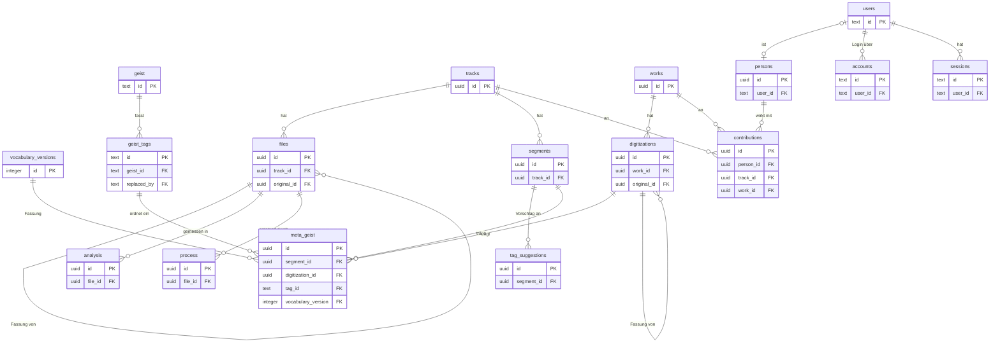

# Daten erklärt — jede Tabelle, jede Spalte, mit Beispielen

**Was das ist:** die ausführliche Erklärung zu `daten.md`, Abschnitt für Abschnitt und mit Beispielen. `daten.md` hält fest, was entschieden ist. Diese Datei erklärt, wie es funktioniert und warum es so gebaut ist. Widerspricht sich etwas, gilt `daten.md`.

**Wie man sie liest:** von oben nach unten. Jeder Abschnitt benutzt nur Wörter, die vorher erklärt sind. Abschnitt 1 erklärt die Wörter, Abschnitt 6 ist die ganze Datenbank, Spalte für Spalte. Abschnitt 17 zeigt, was der Prototyp in `zaehlen\wwww-daten-prototyp` davon nachweist.

**Was hier nicht steht:** der wörtliche Verlauf des Gesprächs. Der steht in `raw\20261124 datenbank-gespraech.md`.

![[daten#^blick]]

~~Läuft Postgres hier auf dem vps~~
~~Lässt sich das Vokabular auf Obsidian bearbeiten?~~

---

## 1 · Die Wörter, die du für den Rest brauchst

| Wort | Was es ist | Beispiel aus wwww |
|---|---|---|
| **Tabelle** | eine Liste gleichartiger Dinge, wie ein Tabellenblatt | `tracks`: alle Stücke Klang |
| **Zeile** | ein einzelnes Ding in der Tabelle | der Track „How Long Can I Burn?“ |
| **Spalte** | eine Eigenschaft, die jede Zeile hat | `title`, `duration_ms` |
| **Typ** | was in einer Spalte stehen darf. Postgres lehnt alles andere ab. | `integer` nimmt nur ganze Zahlen, „1:02“ wird abgelehnt |
| **Primärschlüssel**, kurz PK | die Spalte, die eine Zeile eindeutig macht, meist `id` | jeder Track hat seine eigene `id` |
| **Fremdschlüssel**, kurz FK | eine Spalte, die auf die `id` einer anderen Tabelle zeigt. Postgres prüft, dass es die Zeile dort gibt. | `segments.track_id` zeigt auf `tracks.id`. Ein Abschnitt zu einem Track, den es nicht gibt, wird abgelehnt. |
| **Pflicht**, im Code `not null` | Die Spalte darf nicht leer sein. | ein Werk ohne `image_description` lässt sich nicht speichern |
| **`CHECK`** | eine Regel, die jede Zeile erfüllen muss | `end_ms` muss größer sein als `start_ms` |
| **`unique`** | kein Wert darf zweimal vorkommen | zwei Dateien mit demselben `storage_key` gehen nicht |
| **Index** | ein Inhaltsverzeichnis für eine Spalte. Suchen geht damit schnell, Schreiben etwas langsamer. | ein Index auf `segments.track_id` findet alle Abschnitte eines Tracks, ohne alle Abschnitte zu lesen |
| **JOIN** | verbindet Zeilen aus zwei Tabellen über einen Fremdschlüssel | Abschnitt und Track zusammen lesen, um den Titel zum Abschnitt zu zeigen |
| **View** | eine gespeicherte Abfrage, die sich wie eine Tabelle lesen lässt | `public_works` zeigt nur die Werke, die öffentlich sein dürfen |
| **Transaktion** | mehrere Schreibvorgänge, die alle gelingen oder alle nicht | Abschnitt und seine Einordnung entstehen zusammen oder gar nicht |
| **Migration** | eine `.sql`-Datei, die das Schema ändert, etwa eine Spalte anlegt | `0003_add_rights_confirmed.sql` |
| **Schema**, zwei Bedeutungen | 1. in Drizzle: die Beschreibung aller Tabellen in `db\schema.ts`. 2. in Postgres: ein Ordner für Tabellen. | 1. `schema.ts`. 2. das Schema `pgboss`, in dem pg-boss seine eigenen Tabellen hält |
| **Rolle** | ein Benutzer in Postgres, mit Rechten | `wwww_read` darf nur lesen |
| **API**, **Route**, **Endpunkt** | die Adressen, über die die Seite den Server fragt. Eine Route ist eine solche Adresse. | `GET /api/segments?geist=kyriotetes&min=0.6` |
| **ORM** | eine Bibliothek, die Tabellen als Code zeigt. Hier ist es Drizzle. | `db.select().from(segments)` statt `select * from segments` |
| **uuid** | eine lange Zufallskennung, die sich nicht erraten lässt | `3f2a9c1e-…` |
| **`jsonb`** | ein JSON-Dokument in einer einzigen Zelle, durchsuchbar | ein RNBO-Preset |
| **`timestamptz`** | ein Zeitpunkt mit Zeitzone | `2025-12-27 18:24:18+01` |
| **Bind-Mount** | ein Ordner des Rechners, den ein Container sieht, als läge er in ihm | `buendel\daten\` erscheint im Container als `/srv/daten` |
| **SSE** | eine Verbindung, über die der Server der Seite Nachrichten schickt | „segments geändert“ |
| **WebSocket** | eine Verbindung, über die beide Seiten schicken, viele Male pro Sekunde | die Sensorwerte der Handys |
| **Lint-Regel** | eine Prüfung, die den Code liest, ohne ihn auszuführen | „in dieser Datei kein `db`“ |

Für die Beispielzeilen in Abschnitt 6 gilt: **Statt der langen uuid steht ein Kürzel in spitzen Klammern**, etwa `‹T1›` für einen Track und `‹S1›` für einen Abschnitt. So siehst du, wer auf wen zeigt.

??
## 2 · Die eine Regel: jede Art von Daten hat genau eine Quelle

**Was schiefgeht, wenn es zwei Quellen gibt.** Angenommen, der Titel eines Werks steht im Vault und in der Datenbank. Du änderst ihn in Obsidian auf „Blau, Ocker, Rot“. Zur selben Zeit korrigiert Peter online einen Tippfehler im alten Titel. Jetzt laufen zwei Abgleiche: Vault → Datenbank und Datenbank → Vault. Wer zuletzt läuft, gewinnt, und die andere Änderung ist ohne Meldung weg.

**Deshalb hat jede Art genau eine Quelle:**

| Art                                         | Quelle                                                                                                        | Wer schreibt                          | Wohin es kopiert wird                                                                                                                        |
| ------------------------------------------- | ------------------------------------------------------------------------------------------------------------- | ------------------------------------- | -------------------------------------------------------------------------------------------------------------------------------------------- |
| Vokabular: ==Geist-Gruppen und Tags==       | der Vault                                                                                                     | nur du, in Obsidian                   | in die Datenbank, nur in diese Richtung                                                                                                      |
| Klänge, Abschnitte, Einordnungen, Messwerte | die Datenbank                                                                                                 | du, Johannes, Peter und die Skripte   | in die Kopie für die Installation                                                                                                            |
| Werke, Personen, Konten, Uploads            | die Datenbank                                                                                                 | du und die, die sich anmelden         | ==in die Kopie, nur was öffentlich ist==                                                                                                     |
| Max-Patches                                 | git, in `zaehlen\wwww\rnbo\` oder bei einem geteilten Patch dort, wo die Notiz in `katalog\patches\` hinzeigt | du, in Max                            | Die Datenbank kennt nur Name und Commit. ~~==Wie wird es dann auf den Installationstechner bzw. Auf die Webseite auf dem VPS übertragen?==~~ |
| Dateien: WAV, Scans, `.glb`                 | der Speicher auf dem VPS ==~~wird hier cloudflare oder ähnliches verwendet?~~==                               | ==Upload und das Skript `fassungen`== | in die Kopie, nur die öffentlichen Fassungen                                                                                                 |

Eine Kopie ist nie eine Quelle. Änderst du etwas in der Kopie für den Mac mini, ist es beim nächsten Lauf von `kopie-installation` wieder weg, und das ist richtig so.

## 3 · Was entschieden ist, an Beispielen

**Postgres, weil fast alles Neue darauf aufbaut.** Ein Beispiel: In zwei Jahren willst du zu jeder Zeichnung von Johannes den Klang finden, der ihr am nächsten ist. Mit Postgres ist das die Erweiterung pgvector, und sie steckt schon im Image `pgvector/pgvector`. Mit PocketBase gäbe es dafür keinen Weg.

**Convex nicht, weil deine Fragen JOINs sind.** „Welche Geister dominieren in fremden Tracks mit hoher Lautheit?“ verbindet fünf Tabellen: Einordnung, Tag, Abschnitt, Track, Messwert. In Convex schreibst du dafür eine Schleife im Code, die jede Zeile einzeln holt. In Postgres ist es eine Abfrage, siehe Abschnitt 6.11.

**Kafka nicht, weil wwww kein Onlinehändler ist.** Bei einem Händler geht eine Bestellung gleichzeitig an Lager, Rechnung, Versand und Betrugserkennung. Dafür ist Kafka gebaut. In wwww sind die Ereignisse „Upload freigegeben, Fassung erzeugen“ und „in drei Tagen erinnern“. Das erledigt eine Job-Queue in Postgres.

**Millisekunden statt `HH:MM:SS`.** Ein Abschnitt von 1:02,000 bis 1:02,300 ist 300 ms lang. In `HH:MM:SS` wären Anfang und Ende beide `00:01:02`. In Millisekunden sind es `62000` und `62300`.

**Fremde Musik bleibt privat.** „How Long Can I Burn?“ von Special Guest DJ steht im Formular. Du darfst ihn hören und einordnen, das ist Forschung. Die Seite darf die Datei nicht ausliefern, denn niemand hat zugestimmt. Deshalb trägt der Track `origin = 'foreign'` und fehlt in der View `public_tracks`. ==~~Erkläre genauer, wo Views verwendet werden?~~==

**Ein ganzer Patch gehört in git.** Speicherst du `granular.maxpat` in einer Zelle, gibt es ihn zweimal: in der Zelle und in Max. Nach der nächsten Änderung in Max ist die Zelle veraltet, und niemand merkt es. In git zeigt `git log` jede Änderung, und die Datenbank merkt sich nur den Commit, etwa `a41f9c2`.

**Echtzeit braucht wwww nicht.** Peter lädt ein Bild hoch. Es erscheint erst, wenn du es freigibst. Ob ein Besucher es eine Sekunde oder eine Stunde danach sieht, ändert nichts. ~~==wie ist es bei Multiplayer Interaktion in three.js und rnbo==~~

**Jede Sperre hängt an der Maschine.** Ein Satz wie „Claude führt keine Migration aus“ ist Disziplin. Eine Rolle in Postgres, die keine Tabelle löschen darf, ist eine Sperre: Sie hält auch dann, wenn jemand den Satz vergisst. ~~==Das verstehe ich nicht==~~ 

## 4 · Der Stack: was jedes Teil tut

### Postgres

Die Datenbank selbst. Sie läuft in einem Container aus dem Image `pgvector/pgvector:0.8.7-pg19`, das ist das offizielle Postgres 19 mit der Erweiterung pgvector. Die Daten liegen in einem Docker-Volume, also auf der Platte des Rechners, nicht im Container. ~~==Was ist hier der Unterschied?==~~ Ab Postgres 18 bindet man dafür `/var/lib/postgresql` ein.

### Drizzle

Drizzle beschreibt die Tabellen als TypeScript und übersetzt Abfragen in SQL. So sieht ein Ausschnitt aus `db\schema.ts` aus:

```ts
import { pgTable, uuid, text, integer, timestamp, check, index } from 'drizzle-orm/pg-core'
import { sql } from 'drizzle-orm'
// tracks und users stehen weiter oben in derselben Datei

export const segments = pgTable('segments', {
  /** Kennung des Abschnitts. */
  id: uuid('id').primaryKey().defaultRandom(),
  /** Der Track, zu dem der Abschnitt gehört. */
  trackId: uuid('track_id').notNull().references(() => tracks.id),
  /** Anfang in Millisekunden ab Beginn des Tracks. */
  startMs: integer('start_ms').notNull().default(0),
  /** Ende in Millisekunden. Leer heißt: bis zum Ende des Tracks. */
  endMs: integer('end_ms'),
  /** Wer den Abschnitt gesetzt hat. Leer bei Einträgen aus dem Formular. */
  createdBy: text('created_by').references(() => users.id),
  createdAt: timestamp('created_at', { withTimezone: true }).notNull().defaultNow(),
}, (t) => [
  check('segments_end_after_start', sql`${t.endMs} is null or ${t.endMs} > ${t.startMs}`),
  index('segments_track_id').on(t.trackId),
])
```

Im Code heißt die Spalte `startMs`, in der Datenbank `start_ms`. Der Name in der Datenbank steht ausdrücklich in der Klammer, so siehst du ihn beim Lesen. Drizzle könnte ihn mit `casing: 'snake_case'` auch selbst ableiten, der Prototyp schreibt ihn lieber hin. ~~==Du meinst dadurch könnte er verschlüsselt werden? Könnten wir ihn der Leichtigkeit auch 1zu1 in Drizzel und in der Datenbank identisch benennen?==~~

Eine Abfrage mit Drizzle:

```ts
const rows = await db
  .select({ start: segments.startMs, end: segments.endMs, key: files.storageKey })
  .from(metaGeist)
  .innerJoin(geistTags, eq(metaGeist.tagId, geistTags.id))
  .innerJoin(segments, eq(metaGeist.segmentId, segments.id))
  .innerJoin(files, eq(files.trackId, segments.trackId))
  .where(and(eq(geistTags.geistId, 'kyriotetes'), gt(metaGeist.intensity, 0.6)))
```

Ändert sich `schema.ts`, erzeugt `drizzle-kit generate` die Migration als `.sql`-Datei. `drizzle-kit migrate` spielt sie ein. Den zweiten Befehl führst nur du aus, siehe Abschnitt 13. heist es, dass ich über Schema.ts die Datenbank selbst strukturell bearbeiten kann. Also zum Beispiel eine Spalte hinzufügen?

### Hono

Hono ist der Server für die API. Eine Route sieht so aus:

```ts
// api/app.ts
import { Hono } from 'hono'
import { zValidator } from '@hono/zod-validator'
import { z } from 'zod'
import { segmentsByGeist } from './read/segments'

const app = new Hono()
  .get('/api/segments',
    zValidator('query', z.object({
      geist: z.string(),
      min: z.coerce.number().min(0).max(1),
    })),
    async (c) => {
      const { geist, min } = c.req.valid('query')
      return c.json(await segmentsByGeist(geist, min))
    })

export type AppType = typeof app
export default app
```

`@hono/node-server` startet sie mit `serve({ fetch: app.fetch, port: 3000 })`. Caddy leitet alles unter `/api/` an diesen Port weiter.

**Das Besondere ist die letzte Zeile.** `AppType` ist der Typ der ganzen API. Die Seite holt sich damit einen Client, der jede Route kennt:

```ts
// site/src/Data/ApiSource.ts
import { hc } from 'hono/client'
import type { AppType } from '../../../api/app'

const api = hc<AppType>('/')
const res = await api.api.segments.$get({ query: { geist: 'kyriotetes', min: '0.6' } })
const segments = await res.json()   // der Typ kommt aus der Route
```

Benennt jemand in der Route `start` in `startMs` um, meldet der Compiler den Fehler in der Szene, bevor die Seite lädt. ~~==Was ist eine Route? Eine Änderung an Schema.ts? Erkläre das mit dem schiebt allgemeiner. Ist nicht jeder der mit der API interagiert sofort ein Client?==~~  Das ist die Typsicherheit, die dich an Convex gereizt hat. Laut Hono-Doku braucht sie `"strict": true` in der `tsconfig.json`.

### Zod

Zod prüft Daten zur Laufzeit. Ein Typ in TypeScript ist eine Behauptung, die der Compiler glaubt. Was ein Browser schickt, hat der Compiler nie gesehen. Ein Beispiel:

```ts
const NewSegment = z.object({
  trackId: z.uuid(),
  startMs: z.number().int().min(0),
  endMs: z.number().int().positive().optional(),
})
```

Schickt jemand `startMs: "1:02"`, antwortet die Route mit 400, bevor etwas in die Datenbank kommt. ~~==Das heißt es gibt zwei Schutzmechanismen? Einen für das lauffähig machen / compiling und einen weiteren für aktive API Transaktionen? D.h. Eine falsche Nachricht verschwindet nicht nur, sondern sie gibt auch einen Fehler zurück?==~~

### Better Auth

Better Auth erledigt den Login mit Discord und die Sitzungen:

```ts
// api/auth.ts
import { betterAuth } from 'better-auth'
import { drizzleAdapter } from 'better-auth/adapters/drizzle'
import { dbWrite } from '../db/client'

export const auth = betterAuth({
  database: drizzleAdapter(dbWrite, { provider: 'pg', usePlural: true }),
  socialProviders: {
    discord: {
      clientId: process.env.DISCORD_CLIENT_ID!,
      clientSecret: process.env.DISCORD_CLIENT_SECRET!,
    },
  },
  user: {
    additionalFields: {
      stage: { type: 'number', input: false, defaultValue: 1 },
      role: { type: 'string', input: false, defaultValue: 'member' },
    },
  },
})

// in api/app.ts:
// .on(['GET', 'POST'], '/api/auth/*', (c) => auth.handler(c.req.raw))
```

`input: false` heißt: Diese Felder setzt nur der Server. Niemand kann sich beim Login selbst zum Admin machen. Die Callback-Adresse im Discord-Entwicklerportal ist `https://julianniklasheynert.xyz/api/auth/callback/discord`. Better Auth bringt seine Tabellen als Drizzle-Schema mit (`npx auth@latest generate`), sie kommen in `schema.ts` wie alle anderen. ==~~Das verstehe ich nicht. Ich kann also mit der api das Schema.ts verändern, oder aus obsidian heraus oder sogar aus discord heraus?~~==

### pg-boss

pg-boss ist die Job-Queue. Ein Job ist eine Aufgabe für später, gespeichert in Postgres, damit sie einen Neustart übersteht:

```ts
await boss.createQueue('fassungen')
await boss.send('fassungen', { fileId: '‹F1›' })                    // sofort
await boss.send('erinnerung', { thread: '…' }, { startAfter: 3 * 24 * 3600 })   // in 3 Tagen

await boss.work('fassungen', async ([job]) => {
  await erzeugeFassungen(job.data.fileId)
})
```

Fällt der Server während einer Fassung aus, holt pg-boss den Job nach dem Neustart wieder hervor.

### Vite und TypeScript

Vite baut die Seite. Es nimmt `site\src\`, übersetzt TypeScript, packt alles zusammen und schreibt einen fertigen Ordner. Diesen Ordner kopiert das Dockerfile ins Image. Vor Ort braucht der Ordner weder Vite noch Internet.

### three.js

three.js kommt aus npm, mit fester Version: `"three": "0.187.0"` in `package.json`. Die Loader liegen im selben Paket, `import { GLTFLoader } from 'three/addons/loaders/GLTFLoader.js'`. Heute liegen sie von Hand kopiert in `site\vendor\three\`, aus Version 0.160.0. Mit npm passen Loader und three.js immer zueinander.

### RNBO.js

RNBO.js spielt den exportierten Patch im Browser:

```ts
import { createDevice } from '@rnbo/js'

const context = new AudioContext()                      // erst nach einem Tap, sonst bleibt iOS stumm
const patcher = await (await fetch('/rnbo/patch.export.json')).json()
const device = await createDevice({ context, patcher })
device.node.connect(context.destination)

const bytes = await (await fetch('/dateien/files/‹F2›.opus')).arrayBuffer()
const buffer = await context.decodeAudioData(bytes)
await device.setDataBuffer('klang', buffer)             // 'klang' heißt der Puffer im Patch
device.parametersById.get('start_ms')!.value = 62000
device.parametersById.get('end_ms')!.value = 71500
```

Den `AudioContext` erlaubt iOS erst nach einer Berührung. Das kann derselbe Tap sein, der die Bewegungssensoren freischaltet.

## 5 · Die drei Orte

**Was ein Besucher an jedem Ort bekommt:**

|                                                                                                                                                                                                                                                                                 | dieser PC               | VPS                               | Mac mini                            |
| ------------------------------------------------------------------------------------------------------------------------------------------------------------------------------------------------------------------------------------------------------------------------------- | ----------------------- | --------------------------------- | ----------------------------------- |
| Adresse                                                                                                                                                                                                                                                                         | `http://localhost:8080` | `https://julianniklasheynert.xyz` | der Name vor Ort, über den Slate AX |
| Container ~~==Erkläre die unterschiedlichen Container noch einmal genauer.==~~                                                                                                                                                                                                  | `app`, `api`, `db`      | `app`, `api`, `db`                | `app` und `tls`                     |
| Woher die Seite ihre Daten hat ~~==Liegen die Daten nicht in der Datenbank. Oder meinst du, worüber die Seite ihre Daten bekommt? Also über API wird nicht nur geschrieben sondern auch erhalten? Läuft oder braucht es die API dann gar nicht auf dem Ibstallationstechner==~~ | aus der API             | aus der API                       | aus `/daten/`, der Kopie            |
| Login, Upload, Einordnen                                                                                                                                                                                                                                                        | ja                      | ja                                | nein                                |

**Wie dieselbe `docker-compose.yml` das schafft:**

```yaml
services:
  app:                                   # Caddy mit der gebauten Seite, überall
    image: wwww:0.3.0
    ports: ["${APP_BIND:-127.0.0.1:8080}:80"]
    networks: [proxy, intern]
  api:
    image: wwww-api:0.3.0
    profiles: [online]                   # läuft nur, wenn COMPOSE_PROFILES=online
    networks: [intern]
  db:
    image: pgvector/pgvector:0.8.7-pg19
    profiles: [online]
    volumes: [db-daten:/var/lib/postgresql]
    networks: [intern]
```

In `.env` auf PC und VPS steht `COMPOSE_PROFILES=online`, auf dem Mac mini fehlt die Zeile. Ohne Profil startet Docker nur `app`. Die Datei bleibt gleich, der Unterschied steht in `.env`. Das Netz `intern` hält Postgres aus dem Netz `proxy` heraus, in dem der Nginx Proxy Manager hängt.

## 6 · Die Datenbank, Tabelle für Tabelle

### 6.1 · Der Überblick

Sechs Gruppen mit 18 Tabellen, dazu die Jobs von pg-boss und zwei Views. Das Diagramm zeigt nur die Schlüssel. Eine Linie von `segments` zu `tracks` heißt: `segments.track_id` zeigt auf `tracks.id`.



Fast jede Tabelle hat dazu `created_by` (zeigt auf `users.id`) und `created_at`. Im Diagramm fehlen sie, sonst zeigte jede Tabelle auf `users`.

**Wiederkehrende Spalten**, damit sie unten nicht 14-mal erklärt werden:

| Spalte                | Typ                                                                   | Bedeutung                                                                 |
| --------------------- | --------------------------------------------------------------------- | ------------------------------------------------------------------------- |
| `id`                  | `uuid`, PK, Vorgabe: eine neue Zufallskennung                         | die Kennung der Zeile. Nur das Vokabular und die Konten haben andere IDs. |
| `created_by`          | `text`, FK → `users.id`                                               | wer die Zeile angelegt hat. Leer bei Importen.                            |
| `created_at`          | `timestamptz`, Pflicht, Vorgabe: jetzt                                | wann die Zeile entstand                                                   |
| `status`              | `text`, Pflicht, nur `submitted` oder `approved`, Vorgabe `submitted` | eingereicht oder freigegeben. Nur Freigegebenes ist öffentlich.           |
| `rights_confirmed_at` | `timestamptz`                                                         | wann jemand, der nicht Admin ist, die Rechte am Upload bestätigt hat      |

### 6.2 · Vokabular

#### `vocabulary_versions` — ein Import des Vokabulars

| Spalte | Typ | Pflicht | Bedeutung | Beispiel |
|---|---|---|---|---|
| `id` | `integer`, PK, zählt selbst hoch | ja | die Nummer der Fassung | `3` |
| `vault_commit` | `text` | ja | der git-Commit des Vaults beim Import | `82ed156` |
| `imported_at` | `timestamptz`, Vorgabe jetzt | ja | wann importiert wurde | `2026-12-02 14:10` |
| `note` | `text` | nein | was sich geändert hat, schreibt das Skript | „neu: staccato, sax. zusammengelegt: lowfi → lofi“ |

**Verbindungen:** `geist`, `geist_tags`, `meta_geist` und `tag_suggestions` zeigen hierher.

**Warum es sie gibt:** Das Vokabular ändert sich noch oft. Eine Einordnung vom Dezember mit dem Tag `lowfi` soll im Juni noch lesbar sein, auch wenn `lowfi` dann `lofi` heißt. Jede Einordnung merkt sich die Fassung, mit der sie entstand. Mit `git show 82ed156` siehst du das Vokabular genau so, wie es damals war.

#### `geist` — eine der 14 Gruppen

| Spalte | Typ | Pflicht | Bedeutung | Beispiel |
|---|---|---|---|---|
| `id` | `text`, PK | ja | der Name des Geistes, zugleich der Dateiname der Notiz | `kyriotetes` |
| `musical_term` | `text` | ja | der musikalische Begriff | `timbre` |
| `alias` | `text[]`, eine Liste | nein | weitere Namen | `{Tone, Frequency, Spectral, Herrschaft, Weisheit}` |
| `hierarchy` | `smallint`, nur 1 bis 4 | ja | die Stufe aus `meta_geist_def` | `2` |
| `description` | `text` | nein | der Text der Notiz unter dem Frontmatter | — |
| `added_in` | `integer`, FK → `vocabulary_versions.id` | ja | seit welcher Fassung es den Geist gibt | `1` |
| `removed_in` | `integer`, FK → `vocabulary_versions.id` | nein | in welcher Fassung er wegfiel. Leer heißt: gilt noch. | leer |

**Warum die ID ein Name ist und keine uuid:** In einer Abfrage liest sich `where geist_id = 'kyriotetes'` sofort. Der Name ist auch der Dateiname der Notiz, so findet der Import Notiz und Zeile ohne Umweg.

**Alle 14, aus `meta_geist_def.csv`:**

| `id`             | `musical_term` | `hierarchy` | `alias`                                                      |
| ---------------- | -------------- | ----------- | ------------------------------------------------------------ |
| `throne-asuras`  | opfer          | 1           | Was es nicht ist                                             |
| `cherubim`       | harmonie       | 1           | Poly, Verhältnis, Weltanschauung, 3x4, Tierkreis, Spiegelung |
| `seraphim`       | richtung       | 1           | Sturz, Menschheitsrepräsentant, Planeten                     |
| `kyriotetes`     | timbre         | 2           | Tone, Frequency, Spectral, Herrschaft, Weisheit              |
| `exusiai`        | spatiality     | 2           | Form, Gewalten                                               |
| `dynamis`        | dynamics       | 2           | Envelope, Bewegung, Mächte                                   |
| `archai`         | texture        | 3           | Dichte, Geste, Persönlichkeit, Urbeginne, Zeit               |
| `angeloi`        | context        | 3           | Mood, Use, Function, Energy, Leben, Zwielicht                |
| `archangeloi`    | semantics      | 3           | Feuer                                                        |
| `elementarwesen` | wesen          | 4           | individuell erkannter Wesenssatz in Beziehung zum Hüter      |
| `luzifer`        | instruments    | 4           | —                                                            |
| `sorat`          | techniques     | 4           | —                                                            |
| `umlaufzeiten`   | patterns       | 4           | —                                                            |
| `ahriman`        | material       | 4           | Beschreibung, Wissen                                         |

#### `geist_tags` — ein Tag mit seiner Gruppe

| Spalte | Typ | Pflicht | Bedeutung | Beispiel |
|---|---|---|---|---|
| `id` | `text`, PK, nur Kleinbuchstaben, Ziffern und `-` | ja | der Tag ohne `#` | `bright` |
| `geist_id` | `text`, FK → `geist.id` | ja | die Gruppe, zu der er gehört | `kyriotetes` |
| `replaced_by` | `text`, FK → `geist_tags.id` | nein | bei einer Zusammenlegung der Tag, der ihn ersetzt | bei `lowfi`: `lofi` |
| `added_in` | `integer`, FK → `vocabulary_versions.id` | ja | seit welcher Fassung | `1` |
| `removed_in` | `integer`, FK → `vocabulary_versions.id` | nein | in welcher Fassung er wegfiel | leer |

**Regeln:** Jeder Tag gehört zu genau einem Geist. Ein `CHECK` lässt nur `a-z`, `0-9` und `-` zu, so werden `Sax`, `sax` und `#sax` nie drei Tags. Ein zusammengesetzter Tag wie `#staccatosax` kommt so nicht herein. Er wird zu `staccato` und `sax`.

**Beispielzeilen:**

| `id` | `geist_id` | `replaced_by` | `added_in` | `removed_in` |
|---|---|---|---|---|
| `bright` | `kyriotetes` | | 1 | |
| `harsh` | `kyriotetes` | | 1 | |
| `lofi` | `archai` | | 1 | |
| `lowfi` | `archai` | `lofi` | 1 | 2 |
| `drums` | `luzifer` | | 1 | |

#### `tag_suggestions` — ein Tag, den es noch nicht gibt

| Spalte                                             | Typ                                      | Pflicht | Bedeutung                                                     | Beispiel                 |
| -------------------------------------------------- | ---------------------------------------- | ------- | ------------------------------------------------------------- | ------------------------ |
| `id`                                               | `uuid`, PK                               | ja      |                                                               | `‹V1›`                   |
| `text`                                             | `text`                                   | ja      | was getippt wurde                                             | `staccatosax`            |
| `segment_id`                                       | `uuid`, FK → `segments.id`               | nein    | der Abschnitt, an dem der Tag aufkam                          | `‹S2›`                   |
| `intensity`, `polarity`, `dominance`, `confidence` | `real`                                   | nein    | die vier Regler, wie bei `meta_geist`                         | `0.7`, `0`, `0.5`, `0.6` |
| `created_by`, `created_at`                         |                                          |         | wer und wann                                                  |                          |
| `resolved_in`                                      | `integer`, FK → `vocabulary_versions.id` | nein    | in welcher Fassung entschieden wurde                          | `3`                      |
| `resolved_as`                                      | `text[]`                                 | nein    | was daraus wurde. Ein Vorschlag kann zu mehreren Tags werden. | `{staccato, sax}`        |

**Warum es sie gibt:** Auf der Seite `einordnen\` sollst du nicht anhalten müssen, nur weil ein Tag fehlt. Du tippst ihn, er landet hier, und du arbeitest weiter. Später ordnest du ihn in Obsidian zu. Der nächste Import legt aus dem Vorschlag die Einordnungen in `meta_geist` an und setzt `resolved_in`.

### 6.3 · Klang

#### `tracks` — ein Stück Klang als Ganzes

| Spalte | Typ | Pflicht | Bedeutung | Beispiel | aus dem CSV |
|---|---|---|---|---|---|
| `id` | `uuid`, PK | ja | | `‹T1›` | `track_id` |
| `title` | `text` | ja | der Titel des Stücks | „How Long Can I Burn?“ | `title` |
| `release` | `text` | nein | das Album oder die Veröffentlichung | „Our Fantasy Complex“ | neu |
| `origin` | `text`, nur `own` oder `foreign` | ja | eigen oder fremd | `foreign` | neu, im Gespräch `herkunft` |
| `link` | `text` | nein | die Adresse, etwa bei Bandcamp | `https://….bandcamp.com/track/…` | neu |
| `label` | `text` | nein | das Label | — | `label_name` |
| `source` | `text` | nein | woher der Track kommt | `bandcamp`, `max`, `openutau` | `source_name` |
| `released_on` | `date` | nein | das Erscheinungsdatum | — | `release_date` |
| `duration_ms` | `integer` | nein | die Dauer in Millisekunden | `251000` | `duration` |
| `created_by`, `created_at` | | | | `2025-12-27 18:24:18` | `create_time` |

**Verbindungen:** `files`, `segments` und `contributions` zeigen hierher. Wer den Track gemacht hat, steht nicht hier, sondern in `contributions`.

**Warum `origin` so wichtig ist:** Es ist die eine Spalte, die über die Öffentlichkeit eines Klangs entscheidet. Die View `public_tracks` enthält nur `own`, und `kopie-installation` liest nur diese View.

#### `files` — eine Datei eines Tracks

| Spalte | Typ | Pflicht | Bedeutung | Beispiel | aus dem CSV |
|---|---|---|---|---|---|
| `id` | `uuid`, PK | ja | | `‹F1›` | `file_id` |
| `track_id` | `uuid`, FK → `tracks.id` | ja | der Track | `‹T2›` | `track_id` |
| `original_id` | `uuid`, FK → `files.id` | nein | Bei einer Fassung zeigt es auf das Original. Leer heißt: das ist das Original. | bei `‹F2›`: `‹F1›` | neu |
| `storage_key` | `text`, `unique` | ja | wo die Datei im Speicher liegt | `original/files/‹F1›.wav` | neu |
| `file_format` | `text` | ja | das Format | `wav`, `opus`, `m4a`, `aiff` | `file_format` |
| `sample_rate` | `integer` | ja | Samples pro Sekunde | `48000` | `sample_rate` |
| `bit_depth` | `smallint` | nein | Bit pro Sample. Leer bei Opus, das keine feste Bittiefe hat. | `24` | `bit_depth` |
| `channels` | `smallint` | ja | die Zahl der Kanäle | `2` | neu |
| `channel_layout` | `text` | nein | wie die Kanäle gemeint sind | `stereo`, `mono`, `ambix-1` | `channel_layout` |
| `duration_ms` | `integer` | ja | die Dauer | `251000` | neu |
| `size_bytes` | `bigint` | ja | die Größe | `72288000` | neu |
| `sha256` | `text` | ja | die Prüfsumme des Inhalts. Dieselbe Datei zweimal hochgeladen fällt so auf. | `9f2c…` | `track_fingerprint`, Bedeutung offen |
| `acoustic_fingerprint` | `text` | nein | ein akustischer Fingerabdruck. Er erkennt dieselbe Aufnahme auch in anderem Format. | — | `track_fingerprint`, Bedeutung offen |
| `status`, `rights_confirmed_at`, `created_by`, `created_at` | | | siehe 6.1 | | |

**Ein Rechenbeispiel zur Größe:** 251 Sekunden × 48.000 Samples × 3 Byte (24 Bit) × 2 Kanäle = 72.288.000 Byte, also rund 72 MB als WAV. Als Opus mit 128 kbit/s sind es 251 × 16.000 Byte, rund 4 MB.

**Warum „komprimiert ja/nein“ aus `Datenbank.md` keine Spalte ist:** Es folgt schon aus `original_id`. Hat eine Datei ein Original, ist sie eine Fassung. Eine zweite Spalte könnte dem widersprechen.

#### `segments` — ein Zeitabschnitt eines Tracks

| Spalte | Typ | Pflicht | Bedeutung | Beispiel | aus dem CSV |
|---|---|---|---|---|---|
| `id` | `uuid`, PK | ja | | `‹S2›` | `segment_id` |
| `track_id` | `uuid`, FK → `tracks.id` | ja | der Track | `‹T2›` | `track_id` |
| `title` | `text` | nein | ein Name für den Abschnitt | „das Brummen“ | `segment_title` |
| `start_ms` | `integer`, ab 0, Vorgabe 0 | ja | der Anfang | `62000` | `start_time` |
| `end_ms` | `integer`, größer als `start_ms` | nein | das Ende. Leer heißt: bis zum Ende des Tracks. | `71500` | `end_time` |
| `created_by`, `created_at` | | | | | |

**Warum der Abschnitt am Track hängt und nicht an der Datei:** Das WAV und seine Opus-Fassung haben dieselbe Zeitachse. Hinge der Abschnitt an der WAV-Datei, müsste die Szene für die Opus-Fassung erst das Original suchen. So gilt `62000` bis `71500` für jede Fassung.

**Warum `end_ms` leer sein darf:** Die Einträge aus dem Formular haben keine Zeitmarken. Jeder wird ein Abschnitt von 0 bis zum Ende, also mit leerem `end_ms`. Setzt du später auf `einordnen\` genaue Marken, entstehen neue Abschnitte daneben.

#### `analysis` — die Messwerte einer Datei

| Spalte | Typ | Pflicht | Bedeutung | Beispiel |
|---|---|---|---|---|
| `id` | `uuid`, PK | ja | | `‹A1›` |
| `file_id` | `uuid`, FK → `files.id` | ja | die gemessene Datei, meist das Original | `‹F1›` |
| `tool` | `text` | ja | womit gemessen wurde, im Gespräch `werkzeug` | `essentia` |
| `tool_version` | `text` | ja | in welcher Version | `2.1` |
| `lufs` | `real` | nein | die Lautheit über die ganze Datei, in LUFS. Je näher an 0, desto lauter. | `-14.2` |
| `crest_factor` | `real` | nein | der Abstand zwischen Spitze und Mittel, in dB. Groß heißt: kurze, harte Spitzen. | `11.8` |
| `spectral_flux` | `real` | nein | wie schnell sich das Spektrum ändert, als Mittelwert | `0.31` |
| `spectral_centroid` | `real` | nein | der Schwerpunkt des Spektrums in Hz. Hoch heißt: hell. | `1840` |
| `mfcc` | `jsonb` | nein | 13 Zahlen, die die Klangfarbe beschreiben | `[-212.4, 88.1, …]` |
| `iacc` | `real` | nein | wie ähnlich linker und rechter Kanal sind, 0 bis 1. Nur bei Stereo. | `0.42` |
| `measured_at` | `timestamptz` | ja | wann gemessen wurde | |

**Regel:** `file_id`, `tool` und `tool_version` zusammen sind `unique`. Misst eine neue Version von essentia anders, entsteht eine neue Zeile, und die alte Messung bleibt vergleichbar.

**Welches Werkzeug misst, ist noch nicht gewählt.** essentia steht hier als Beispiel.

#### `process` — wie eine Datei entstand

| Spalte | Typ | Pflicht | Bedeutung | Beispiel | aus dem CSV |
|---|---|---|---|---|---|
| `id` | `uuid`, PK | ja | | `‹P1›` | `process_id` |
| `file_id` | `uuid`, FK → `files.id` | ja | die entstandene Datei | `‹F1›` | `file_id` |
| `category` | `text` | ja | die Art des Prozesses | `synthesis`, `recording`, `processing` | `process_category` |
| `name` | `text` | ja | der Name | „Granularwolke“ | `process_name` |
| `patch` | `text` | nein | der Name der Notiz in `katalog\patches\`, sonst der Pfad im Repo | `rnbo/wolke.maxpat` | neu |
| `patch_commit` | `text` | nein | der git-Commit des Patches beim Erzeugen | `a41f9c2` | `patch_fingerprint` |
| `parameters` | `jsonb` | nein | die Einstellungen | `{"grain_ms": 80, "density": 0.7}` | `parameter_setting` |
| `intent` | `text` | nein | die Absicht | „Rauschen, das nach Holz klingt“ | `intent` |
| `created_at` | | ja | | | `create_time` |

**Warum `patch_commit` reicht:** Mit `git show a41f9c2:rnbo/wolke.maxpat` holst du den Patch genau so zurück, wie er beim Erzeugen war.

### 6.4 · Einordnung

#### `meta_geist` — ein Tag an einem Abschnitt oder Digitalisat

| Spalte | Typ | Pflicht | Bedeutung | Beispiel | aus dem CSV |
|---|---|---|---|---|---|
| `id` | `uuid`, PK | ja | | `‹M5›` | neu |
| `segment_id` | `uuid`, FK → `segments.id` | eins von beiden | der eingeordnete Abschnitt | `‹S2›` | `segment_id` |
| `digitization_id` | `uuid`, FK → `digitizations.id` | eins von beiden | das eingeordnete Digitalisat | leer | neu |
| `tag_id` | `text`, FK → `geist_tags.id` | ja | der Tag | `dense` | `meta_geist_def_id` |
| `intensity` | `real`, 0 bis 1 | nein | wie stark der Tag zutrifft | `0.8` | `intensity (amplitude)` |
| `polarity` | `real`, −1 bis 1 | nein | die Richtung. Was die Pole bedeuten, ist offen. | `-0.3` | `polarity (direction)` |
| `dominance` | `real`, 0 bis 1 | nein | wie sehr der Tag die Aufmerksamkeit führt | `0.6` | `dominance (attention)` |
| `confidence` | `real`, 0 bis 1 | nein | wie sicher du dir bist | `0.5` | `confidence_level` |
| `vocabulary_version` | `integer`, FK → `vocabulary_versions.id` | ja | mit welcher Fassung des Vokabulars eingeordnet wurde | `3` | neu |
| `created_by`, `created_at` | | | wer, wann. Im Gespräch hieß `created_by` noch `von`. | | |

**Regeln:**

- **Genau ein Ziel.** `CHECK ((segment_id is null) <> (digitization_id is null))`. Ein Tag hängt an einem Abschnitt oder an einem Digitalisat, nie an beiden und nie an keinem.
- **Die Gewichte dürfen leer sein**, weil das Formular sie nicht erfasst hat. Sind sie gesetzt, prüft ein `CHECK` den Bereich.
- **Mehrere Personen dürfen denselben Abschnitt einordnen.** Du und Johannes setzen beide `dense` an `‹S2›`, mit verschiedenen Gewichten. Das sind zwei Zeilen. Dieselbe Person setzt denselben Tag am selben Ziel nur einmal.

**Warum es auch an Digitalisaten hängt:** Dann trägt eine Zeichnung von Johannes dieselben Wesen wie ein Klang. Die Szene kann zu einem Bild den Abschnitt finden, der dieselben Tags trägt.

**Warum `resonance_target` fehlt:** Es stand in `analysis` und in `meta_geist`. Ist es ein Messwert, gehört es zu `analysis`. Ist es ein Urteil, gehört es zu `meta_geist`. Das entscheidet seine Bedeutung, und die ist offen.

### 6.5 · Bild

#### `works` — das Werk selbst

| Spalte | Typ | Pflicht | Bedeutung | Beispiel | Zeile auf dem Galerie-Schild |
|---|---|---|---|---|---|
| `id` | `uuid`, PK | ja | | `‹W1›` | |
| `title` | `text` | ja | der Titel | „Ohne Titel“ | Titel |
| `year` | `text` | nein | das Jahr. Text, weil auch „um 2005“ oder „2019–2021“ vorkommt. | `2019` | Jahr |
| `technique` | `text` | nein | Technik und Material | „Buntstift auf Papier“ | Technik und Material |
| `height_mm`, `width_mm` | `integer` | nein | die Maße in Millimetern | `297`, `210` | Maße |
| `depth_mm` | `integer` | nein | die Tiefe bei Objekten | leer | Maße |
| `location` | `text` | nein | Sammlung oder Standort | „Privatbesitz“ | Sammlung oder Standort |
| `text` | `text` | nein | ein kurzer Text zum Werk, zwei bis vier Sätze | | kurzer Text |
| `image_description` | `text`, Pflicht, nicht leer | ja | die Bildbeschreibung, von Hand beim Digitalisieren | siehe unten | **Bildbeschreibung** |
| `status`, `rights_confirmed_at`, `created_by`, `created_at` | | | siehe 6.1 | | |

**Wer das Werk gemacht hat, steht in `contributions`.** Name und Lebensdaten kommen aus `persons`.

**Warum die Maße Zahlen sind und kein Text wie „29,7 × 21 cm“:** `originale.md` sagt, dass dem Scan die Größe fehlt, weil er immer bildschirmgroß ist. Mit Zahlen kann die Szene das Werk in seiner echten Größe zeigen.

**Die Bildbeschreibung**, das Beispiel aus `originale.md`:

> Hochformat, etwa DIN A4. Auf weißem Papier drei ineinandergreifende Formen in Blau, Ocker und Rot. Die blaue Form füllt die untere Hälfte, dicht und fest schraffiert. Die rote ist nur umrissen, darin bleibt das Papier frei. Links oben ist der Stift so fest aufgedrückt, dass das Papier glänzt.

Die Datenbank erzwingt sie mit `not null` und `CHECK (length(trim(image_description)) > 0)`. Ein Werk ohne Beschreibung lässt sich gar nicht anlegen, auch nicht für einen Moment.

#### `digitizations` — etwas Digitales zu einem Werk

| Spalte | Typ | Pflicht | Bedeutung | Beispiel |
|---|---|---|---|---|
| `id` | `uuid`, PK | ja | | `‹D1›` |
| `work_id` | `uuid`, FK → `works.id` | ja | das Werk | `‹W1›` |
| `kind` | `text`, nur `scan`, `model`, `form_layers`, `macro_photo`, `other` | ja | die Art | `scan` |
| `original_id` | `uuid`, FK → `digitizations.id` | nein | bei einer Fassung das Original | bei `‹D3›`: `‹D2›` |
| `storage_key` | `text`, `unique` | ja | wo die Datei liegt | `original/digitizations/‹D1›.tif` |
| `file_format` | `text` | ja | das Format | `tif`, `png`, `glb`, `webp` |
| `size_bytes` | `bigint` | ja | die Größe | |
| `preview_key` | `text` | nein | das Vorschaubild | `public/previews/‹D1›.webp` |
| `pixel_width`, `pixel_height` | `integer` | nein | bei Bildern die Pixel | `4961`, `7016` |
| `vertex_count` | `integer` | nein | bei 3D die Zahl der Punkte | `48210` |
| `bbox` | `jsonb` | nein | bei 3D die Ausdehnung in Metern | `{"x": 0.21, "y": 0.297, "z": 0.004}` |
| `extension` | `text` | ja | die „Digitale Erweiterung“: was gescannt und was hinzugefügt wurde | „Scan mit 600 dpi, nichts hinzugefügt“ |
| `tool` | `text` | nein | womit | „Flachbettscanner“ |
| `made_on` | `date` | nein | wann | `2026-12-01` |
| `image_description` | `text` | nein | eine eigene Bildbeschreibung, wenn ein Mikroraum neues Bildmaterial mit Kunst zeigt | |
| `status`, `rights_confirmed_at`, `created_by`, `created_at` | | | siehe 6.1 | |

**Warum Werk und Digitalisat getrennt sind:** Das ist die Regel aus `originale.md` als Tabelle. Das Original bleibt trennbar. Ein Werk hat viele Digitalisate, und das Galerie-Schild gehört zum Werk, nicht zum Scan. Ein Tap in der Szene blendet die Erweiterung aus und zeigt das Schild aus `works`.

**4961 × 7016 Pixel** ist A4 bei 600 dpi: 210 mm ÷ 25,4 × 600 = 4961.

### 6.6 · Menschen

#### `persons` — ein Mensch

| Spalte      | Typ                               | Pflicht | Bedeutung                                | Beispiel     |
| ----------- | --------------------------------- | ------- | ---------------------------------------- | ------------ |
| `id`        | `uuid`, PK                        | ja      |                                          | `‹P2›`       |
| `name`      | `text`                            | ja      | der Name, wie er auf dem Schild steht    | „Peter Piek“ |
| `born_year` | `smallint`                        | nein    | das Geburtsjahr, für die Lebensdaten     | —            |
| `died_year` | `smallint`                        | nein    | das Todesjahr                            | leer         |
| `link`      | `text`                            | nein    | Website oder Bandcamp                    |              |
| `user_id`   | `text`, FK → `users.id`, `unique` | nein    | das Konto, wenn die Person sich anmeldet | leer         |

**Warum Person und Konto getrennt sind:** Peter steht auch ohne Discord als Urheber in der Galerie. Meldet er sich später an, bekommt `persons.user_id` sein Konto, und nichts anderes ändert sich. Die Leute hinter den Bandcamp-Tracks melden sich nie an und stehen trotzdem hier.

#### `contributions` — eine Person an einem Track oder Werk

| Spalte | Typ | Pflicht | Bedeutung | Beispiel |
|---|---|---|---|---|
| `id` | `uuid`, PK | ja | | `‹C2›` |
| `person_id` | `uuid`, FK → `persons.id` | ja | wer | `‹P2›` |
| `track_id` | `uuid`, FK → `tracks.id` | eins von beiden | an welchem Track | leer |
| `work_id` | `uuid`, FK → `works.id` | eins von beiden | an welchem Werk | `‹W1›` |
| `role` | `text` | ja | die Rolle | `author`, `artist`, `performer`, `composer`, `digitization`, `extension` |
| `consent_since` | `date` | nein | seit wann die Zustimmung gilt. Nur beim `author` eines Werks. | `2026-12-01` |
| `consent_revoked_on` | `date` | nein | der Tag des Widerrufs | leer |
| `note` | `text` | nein | eine Anmerkung | |

**Warum die Zustimmung hier steht und nicht im Werk:** Die Zustimmung gibt eine Person für ein Werk. Hat ein Werk zwei Urheber, braucht es zwei Zustimmungen, und jeder kann für sich widerrufen. Das geht nur, wenn sie an der Verbindung von Person und Werk hängt.

**Was mit `contributors.csv` geschah:** Dort stand bei jedem Track der Name neu. Hier steht der Name einmal in `persons`, und `contributions` zeigt darauf.

### 6.7 · Konten

Diese Tabellen legt Better Auth an. Die Felder stammen aus seinem Quelltext. Mit `usePlural` heißen sie im Plural, die Spalten sind `snake_case`.

#### `users` — ein Konto

| Spalte | Typ | Pflicht | Bedeutung | Beispiel |
|---|---|---|---|---|
| `id` | `text`, PK | ja | von Better Auth erzeugt | `‹U1›` |
| `name` | `text` | ja | der Name aus Discord | „johannes“ |
| `email` | `text`, `unique` | ja | die Adresse aus Discord | |
| `email_verified` | `boolean`, Vorgabe `false` | ja | ob die Adresse bestätigt ist | `true` |
| `image` | `text` | nein | die Adresse des Avatars | |
| `created_at`, `updated_at` | `timestamptz` | ja | | |
| `stage` | `smallint`, nur 1, 3, 7 oder 12, Vorgabe 1 | ja | die Stufe der Teilnahme aus `discord.md`. Nur der Server setzt sie. | `1` |
| `role` | `text`, nur `member` oder `admin`, Vorgabe `member` | ja | `admin` darf `verwaltung\` öffnen und freigeben | `admin` |

#### `accounts` — ein Weg, sich anzumelden

| Spalte | Typ | Pflicht | Bedeutung |
|---|---|---|---|
| `id` | `text`, PK | ja | |
| `user_id` | `text`, FK → `users.id` | ja | das Konto |
| `provider_id` | `text` | ja | der Anbieter, hier `discord` |
| `account_id` | `text` | ja | die Kennung beim Anbieter, hier die **Discord-ID**. Darüber findet der Bot die Person. |
| `access_token`, `refresh_token`, `id_token` | `text` | nein | die Schlüssel von Discord |
| `access_token_expires_at`, `refresh_token_expires_at` | `timestamptz` | nein | wann sie ablaufen |
| `scope` | `text` | nein | was Discord erlaubt hat |
| `password` | `text` | nein | bleibt leer, es gibt nur Discord |
| `created_at`, `updated_at` | `timestamptz` | ja | |
~~==Sind das neu erzeugte Felder und Tabellen?==~~
#### `sessions` — eine Anmeldung in einem Browser

| Spalte | Typ | Pflicht | Bedeutung |
|---|---|---|---|
| `id` | `text`, PK | ja | |
| `user_id` | `text`, FK → `users.id` | ja | das Konto |
| `token` | `text`, `unique` | ja | steht im Cookie des Browsers |
| `expires_at` | `timestamptz` | ja | wann die Sitzung abläuft |
| `ip_address`, `user_agent` | `text` | nein | woher und mit welchem Browser |
| `created_at`, `updated_at` | `timestamptz` | ja | |

#### `verifications` — ein kurzlebiger Wert

| Spalte | Typ | Pflicht | Bedeutung |
|---|---|---|---|
| `id` | `text`, PK | ja | |
| `identifier` | `text` | ja | wofür der Wert gilt |
| `value` | `text` | ja | der Wert selbst |
| `expires_at` | `timestamptz` | ja | wann er verfällt |
| `created_at`, `updated_at` | `timestamptz` | ja | |

Bei einem Login über Discord hält Better Auth hier etwa den Zustand fest, bis Discord zurückmeldet.

### 6.8 · Jobs

pg-boss legt beim ersten Start ein eigenes Postgres-Schema `pgboss` mit seinen Tabellen an. wwww liest sie nie direkt, nur über pg-boss. Darin liegt zum Beispiel der Job „Fassungen für `‹F1›` erzeugen“ mit seinem Zustand: wartend, läuft, fertig oder fehlgeschlagen.

### 6.9 · Die zwei Views

**`public_tracks`** enthält nur eigene Tracks:

```sql
create view public_tracks as
select * from tracks where origin = 'own';
```

**`public_works`** enthält nur freigegebene Werke, deren Urheber alle zugestimmt und keiner widerrufen hat:

```sql
create view public_works as
select w.*
from works w
where w.status = 'approved'
  and exists (
    select 1 from contributions c
    where c.work_id = w.id and c.role = 'author')
  and not exists (
    select 1 from contributions c
    where c.work_id = w.id and c.role = 'author'
      and (c.consent_since is null or c.consent_revoked_on is not null));
```

**Warum Views:** Die Regel, was öffentlich ist, steht so an einer einzigen Stelle. Die API für Besucher und `kopie-installation` lesen beide nur diese Views. Widerruft Peter, setzt jemand `consent_revoked_on`, und das Werk fehlt sofort überall, ohne dass ein Programm geändert wird.

### 6.10 · Vom Entwurf zur Tabelle

**Jede Spalte aus den CSV-Dateien und wohin sie geht:**

| CSV | Spalte | wird zu |
|---|---|---|
| `tracks.csv` | `track_id` | `tracks.id` |
| | `title` | `tracks.title` |
| | `release_date` | `tracks.released_on` |
| | `label_name` | `tracks.label` |
| | `create_time` | `tracks.created_at` |
| | `source_name` | `tracks.source`, Bedeutung offen |
| | `duration` (`HH:MM:SS`) | `tracks.duration_ms` |
| `files.csv` | `file_id`, `track_id` | `files.id`, `files.track_id` |
| | `track_fingerprint` | `files.sha256` oder `files.acoustic_fingerprint`, Bedeutung offen |
| | `file_format`, `sample_rate`, `bit_depth`, `channel_layout` | gleichnamig in `files` |
| `segments.csv` | `segment_id`, `track_id` | `segments.id`, `segments.track_id` |
| | `segment_title` | `segments.title` |
| | `start_time`, `end_time` (`HH:MM:SS`) | `segments.start_ms`, `segments.end_ms` |
| `contributors.csv` | `person_id`, `name` | `persons.id`, `persons.name` |
| | `track_id`, `role` | `contributions.track_id`, `contributions.role` |
| `analysis.csv` | `analysis_id`, `file_id`, `lufs`, `crest_factor`, `spectral_flux`, `spectral_centroid`, `iacc` | gleichnamig in `analysis` |
| | `mfcc` | `analysis.mfcc`, als `jsonb` |
| | `resonance_target` | offen |
| `meta_geist.csv` | `segment_id` | `meta_geist.segment_id` |
| | `meta_geist_def_id` | `meta_geist.tag_id` |
| | `intensity (amplitude)`, `polarity (direction)`, `dominance (attention)`, `confidence_level` | `intensity`, `polarity`, `dominance`, `confidence` |
| | `resonance_target` | offen |
| `meta_geist_def.csv` | `meta_geist_def_id` | entfällt. Die IDs sind jetzt die Namen. |
| | `geist_name`, `musical_term`, `alias`, `hierarchy` | `geist.id`, `geist.musical_term`, `geist.alias`, `geist.hierarchy` |
| | `description`, hält den Tag | `geist_tags.id` |
| | `description_fingerprint` | entfällt. Der Commit in `vocabulary_versions` übernimmt die Aufgabe. |
| `process.csv` | `process_id`, `file_id`, `intent` | gleichnamig in `process` |
| | `process_category`, `process_name` | `process.category`, `process.name` |
| | `patch_fingerprint` | `process.patch_commit` |
| | `parameter_setting` | `process.parameters`, als `jsonb` |
| `data_dictionary.csv` | alle | entfällt, siehe 6.12 |

**Die Spalten des Formulars in `timecode.ods`:**

| Spalte im Formular | Was wirklich darin steht | wird zu |
|---|---|---|
| `Zeitstempel` | der Moment des Absendens, Monat.Tag.Jahr: `12.27.2025 18:24:18` | `tracks.created_at`, `meta_geist.created_at` |
| `track` | „Künstler - Veröffentlichung“: „Special Guest DJ - Our Fantasy Complex“ | `persons.name` und `tracks.release`, getrennt am „ - “ |
| `timecode` | meist der Titel des Stücks: „How Long Can I Burn?“. In 4 von 114 Zeilen eine Zeit wie „01:11“, in 18 nichts. Manchmal der Name eines Ladens: „soundohm“. | `tracks.title`. Eine Zeit wird `segments.start_ms`, der Titel dann die Veröffentlichung. |
| `wesen` | freie Tags: `#disorientingdrum #bruisingbaseline #ragetinged #lowend` | nach der Zuordnung `meta_geist` |
| Spalte 8, ohne Kopf | ein Link zu Bandcamp | `tracks.link` |
| `Timbre`, `Dynamics`, `Texture`, `Context` | je ein Tag aus einer festen Auswahl: `#harsh`, `#smooth`, `#lofi`, `#static` | `meta_geist`, mit der Gruppe der Spalte |
| `Instruments`, `Techniques`, `Pattern` und die Spalten danach | in den ersten Zeilen Namen von Geistern, Notizen zur Ordnung | werden nicht importiert |
| Wörter ohne `#` in den festen Spalten | in 40 Zeilen, etwa „glide“, „bass“, „filtersweep“, „cinematic“. Sie passen nicht zu ihrer Spalte. | werden nicht importiert, der Import nennt sie im Log |

**Eine Zeile aus dem Formular, ganz durch den Import:**

| Tabelle | entstehende Zeile |
|---|---|
| `persons` | `‹P1›` „Special Guest DJ“ |
| `tracks` | `‹T1›` „How Long Can I Burn?“, `release` „Our Fantasy Complex“, `origin` `foreign`, `source` `bandcamp`, `created_at` 2025-12-27 18:24:18 |
| `contributions` | `‹C1›`: `‹P1›` an `‹T1›`, Rolle `artist` |
| `segments` | `‹S1›`: `‹T1›`, `start_ms` 0, `end_ms` leer |
| `meta_geist` | vier Zeilen an `‹S1›`: `harsh` (kyriotetes), `smooth` (dynamis), `lofi` (archai), `static` (angeloi). Gewichte leer, `vocabulary_version` 1. |
| `meta_geist` | dazu die freien Tags, so wie du sie zugeordnet hast. Ein Beispiel: `#disorientingdrum` wird `disorienting` und `drums`, `#bruisingbaseline` wird `bruising` und `bassline`. Die Zuordnung entscheidest du. |

### 6.11 · Abfragen, die das möglich macht

**Was die Szene fragt:** Abschnitte, in denen kyriotetes mit über 0,6 eingeordnet ist, mit ihrer öffentlichen Datei.

```sql
select s.start_ms, s.end_ms, f.storage_key
from meta_geist m
join geist_tags t   on t.id = m.tag_id
join segments s     on s.id = m.segment_id
join public_tracks tr on tr.id = s.track_id
join files f        on f.track_id = tr.id
                   and f.original_id is not null
                   and f.status = 'approved'
where t.geist_id = 'kyriotetes'
  and m.intensity > 0.6;
```

**Was du als Forschung fragst:** Welche Geister dominieren in fremden Tracks mit hoher Lautheit?

```sql
select t.geist_id,
       round(avg(m.dominance)::numeric, 2) as dominanz,
       count(*) as einordnungen
from meta_geist m
join geist_tags t on t.id = m.tag_id
join segments s   on s.id = m.segment_id
join tracks tr    on tr.id = s.track_id and tr.origin = 'foreign'
join files f      on f.track_id = tr.id and f.original_id is null
join analysis a   on a.file_id = f.id
where a.lufs > -10
group by t.geist_id
order by dominanz desc;
```

Diese Frage geht nur, wenn fremde Tracks eine Datei bekommen, sonst gibt es keine Lautheit. Ob sie das tun, ist offen.

**Was die Seite `verwaltung\` zeigt:** alle Uploads, die auf Freigabe warten.

```sql
select 'file' as art, id, storage_key, created_at from files where status = 'submitted'
union all
select 'digitization', id, storage_key, created_at from digitizations where status = 'submitted'
order by created_at;
```

### 6.12 · Das Datenwörterbuch entsteht aus `schema.ts`

**Das ist die Idee aus dem Hinweis.** Ein Datenwörterbuch ist eine Liste aller Spalten mit Tabelle, Typ und Bedeutung, so wie Abschnitt 6 hier. Dein `data_dictionary.csv` sollte eins werden.

**Das Problem eines Wörterbuchs von Hand:** Es ist eine zweite Quelle neben dem Schema, und es veraltet ohne Meldung. Dein CSV zeigt das schon: Es hält die Spalten von `process`, kein Wörterbuch. Drei Fälle, in denen es auseinanderläuft:

| Was passiert | Wörterbuch von Hand | Wörterbuch erzeugt |
|---|---|---|
| eine neue Spalte | fehlt, bis jemand daran denkt | Die Prüfung schlägt fehl, bis die Spalte einen Kommentar hat. |
| eine Spalte wird umbenannt | der alte Name bleibt stehen | der neue Name, beim nächsten Lauf |
| ein Typ ändert sich | der alte Typ bleibt stehen | der neue Typ |

**Wie es geht:** Die Bedeutung steht als Kommentar direkt über der Spalte in `schema.ts`, wie in Abschnitt 4 bei `segments`. Ein Skript `werkzeug\woerterbuch.ts` liest zwei Dinge:

1. **Die Struktur** liefert Drizzle selbst: `getTableConfig(segments)` aus `drizzle-orm/pg-core` gibt Name, Typ, Pflicht und die Fremdschlüssel jeder Spalte zurück.
2. **Die Bedeutung** steht im Kommentar `/** … */`. Den liest der TypeScript-Compiler, weil Drizzle Kommentare nicht kennt.

Daraus schreibt es `db\WOERTERBUCH.md`:

```markdown
## segments

Ein Zeitabschnitt eines Tracks.

| Spalte | Typ | Pflicht | Verweist auf | Bedeutung |
|---|---|---|---|---|
| id | uuid | ja | — | Kennung des Abschnitts. |
| track_id | uuid | ja | tracks.id | Der Track, zu dem der Abschnitt gehört. |
| start_ms | integer | ja | — | Anfang in Millisekunden ab Beginn des Tracks. |
| end_ms | integer | nein | — | Ende in Millisekunden. Leer heißt: bis zum Ende des Tracks. |
```

**Warum es nicht veralten kann:** Mit `--check` erzeugt das Skript die Datei neu und vergleicht sie mit der im git. Weichen sie ab, oder fehlt einer Spalte der Kommentar, endet es mit einem Fehler. Diese Prüfung läuft mit den anderen Gates, bei jedem Commit.

**Eine Erweiterung, wenn du willst:** Dasselbe Skript schreibt die Kommentare als `COMMENT ON COLUMN segments.end_ms IS '…'` in eine Migration. Dann zeigt auch `psql` mit `\d+ segments` die Bedeutung, direkt in der Datenbank. Drizzle kann das nicht selbst, deshalb geht es über eine eigene Migration.

**Was diese Datei hier dann wird:** Sobald `schema.ts` steht, ist `WOERTERBUCH.md` die Quelle für jede Spalte. Abschnitt 6 hier bleibt die Erklärung, warum die Tabellen so gebaut sind.

## 7 · Was als `jsonb` gespeichert wird, im Detail

**Die Faustregel:** In eine `jsonb`-Zelle gehört, was klein ist, immer zusammen gelesen wird und zu genau einer Zeile gehört. Was eine eigene Quelle hat, gehört nicht hinein.

**Ein Preset, vereinfacht.** Die genaue Form bestimmt RNBO:

```json
{ "cutoff": 2400, "resonance": 0.3, "grain_ms": 80 }
```

`device.getPreset()` liefert so ein Objekt, `device.setPreset(preset)` stellt den Patch darauf ein.

**Prüfen vor dem Schreiben.** Drizzle nimmt in eine `jsonb`-Spalte jedes JSON an. Deshalb steht davor ein Zod-Schema:

```ts
const Parameters = z.record(z.string(), z.union([z.number(), z.string(), z.array(z.number())]))
```

Schickt jemand ein verschachteltes Objekt mit 10.000 Ebenen, lehnt die Route es ab.

**Suchen in `jsonb`.** Zwei Arten von Fragen brauchen zwei Arten von Index:

| Frage | SQL | Welcher Index |
|---|---|---|
| Welche Prozesse haben `"filter": "lowpass"`? | `where parameters @> '{"filter": "lowpass"}'` | ein GIN-Index auf der ganzen Spalte |
| Welche Prozesse haben einen Cutoff über 2000? | `where (parameters->>'cutoff')::numeric > 2000` | ein Index auf genau diesem Ausdruck |

Im Gespräch hieß es, der GIN-Index mache auch die zweite Frage schnell. Das stimmt nicht, er hilft nur bei „enthält“. Bei ein paar Tausend Zeilen ist beides auch ohne Index schnell genug.

**Was nicht hineingehört:**

| Was | Warum nicht | Wohin |
|---|---|---|
| `wolke.maxpat`, 400 KB | Max öffnet die Datei, git zeigt die Änderungen. Eine Kopie in der Zelle wäre eine zweite Quelle. | `zaehlen\wwww\rnbo\`, in der Datenbank nur `patch` und `patch_commit` |
| `patch.export.json` | Der Browser lädt ihn als Datei. | `site\static\rnbo\` |
| ein Patch, den jemand hochlädt | Er ist eine Datei wie jede andere. | der Speicher, als `original/…` |
| Werte, nach denen oft gefiltert wird | Die gehören in eigene Spalten mit Typ. | `meta_geist.intensity` ist eine Spalte, kein JSON |

## 8 · Vokabular und Obsidian

### 8.1 · Eine Geist-Notiz

So sähe `katalog\geist\archai.md` aus:

```markdown
---
typ: geist
musical_term: texture
hierarchy: 3
alias: [Dichte, Geste, Persönlichkeit, Urbeginne, Zeit]
tags: [layered, monophonic, granular, lofi, dense-noise]
ersetzt:
  lowfi: lofi
---

# archai

Was diese Gruppe meint, mit Links zur Steiner-Stelle in `zaehlen\quellen\scans\steiner-ga\`.
```

- **`typ: geist`** folgt der Ordnung des Katalogs. Danach filtert die Base.
- **`tags`** ist die Liste der Tags dieser Gruppe. Ein Tag steht in genau einer Notiz.
- **`ersetzt`** hält Zusammenlegungen und Zerlegungen fest: `lowfi` gibt es nicht mehr, es heißt jetzt `lofi`. Links steht der alte Tag, rechts ein Tag aus dieser Notiz, oder eine Liste davon. Steht derselbe alte Tag in mehreren Notizen, wird er zu allen Tags rechts. So zerfällt `#staccatosax` in `staccato` aus `dynamis.md` und `sax` aus `luzifer.md`, siehe Abschnitt 17.
- **Der Text unter dem Frontmatter** wird `geist.description`.

### 8.2 · Die Base

`katalog\geist.base` zeigt die 14 Notizen als Tabelle, nach Stufe sortiert:

```yaml
filters:
  and:
    - file.inFolder("katalog/geist")
    - typ == "geist"
views:
  - type: table
    name: Vokabular
    groupBy:
      property: hierarchy
      direction: ASC
    order:
      - file.name
      - musical_term
      - tags
      - alias
```

Darin änderst du die Tags direkt in der Tabelle. Obsidian schreibt die Änderung ins Frontmatter der Notiz.

### 8.3 · Was `vokabular-import` tut, Schritt für Schritt

1. **Es prüft, ob `katalog\geist\` gespeichert ist.** Gibt `git status` dort Änderungen aus, bricht es ab. Sonst gehörte der Commit in `vocabulary_versions` zu einem anderen Stand als dem importierten.
2. **Es liest den Commit**, etwa `82ed156`.
3. **Es liest jede Notiz** und prüft das Frontmatter mit Zod: `hierarchy` zwischen 1 und 4, jeder Tag nur aus `a-z`, `0-9` und `-`.
4. **Es prüft das Ganze.** Steht ein Tag in zwei Notizen, bricht es ab und nennt beide.
5. **Es schreibt alles in einer Transaktion:** eine neue Zeile in `vocabulary_versions`, neue Geister und Tags, `removed_in` für weggefallene, `replaced_by` für ersetzte. Es löst die passenden Vorschläge in `tag_suggestions` auf und legt ihre Einordnungen an.
6. **Es meldet, was sich geändert hat:** „Fassung 3. neu: staccato, sax. zusammengelegt: lowfi → lofi. Vorschläge aufgelöst: 2.“

Scheitert Schritt 5 in der Mitte, nimmt die Transaktion alles zurück. Die Datenbank hat dann noch Fassung 2, vollständig.

### 8.4 · Ein Vorschlag, vom Tippen bis zur Einordnung

1. Auf `einordnen\` tippst du `#staccatosax` an den Abschnitt `‹S2›`. Den Tag gibt es nicht. Die Seite markiert ihn als Vorschlag und speichert ihn mit deinen Reglern in `tag_suggestions`.
2. Die Seite `verwaltung\` zeigt dir die offenen Vorschläge. In Obsidian trägst du `staccato` in `dynamis.md` ein und `sax` in `luzifer.md`. Du committest.
3. Unter `ersetzt` schreibst du in `dynamis.md` `staccatosax: staccato` und in `luzifer.md` `staccatosax: sax`. Du committest, und `vokabular-import` erzeugt Fassung 3. Es führt beide Zeilen zusammen: `staccatosax` wird `staccato` und `sax`. Es legt zwei Zeilen in `meta_geist` an, setzt `resolved_in = 3` und `resolved_as = {staccato, sax}`.

### 8.5 · Warum Obsidian hier richtig ist und beim Hören nicht

| Tätigkeit | Obsidian | eigene Seite |
|---|---|---|
| 14 Gruppen denken, verlinken, umordnen | ja: Notizen, Links zu Steiner, Bases | nein |
| einen Track hören und eine Stelle markieren | nein: kein Ton, keine Zeitmarken | ja |
| Tausende Abschnitte durchsehen | nein: erzeugte Notizen machten den Vault am 2026-11-04 unbrauchbar | ja |

### 8.6 · Was später möglich ist

**Ein Obsidian-Plugin**, das die API fragt und Ergebnisse zeigt, ohne eine Datei in den Vault zu schreiben. Ein Beispiel: In der Notiz `archai.md` zeigt ein Block, wie viele Abschnitte jeden Tag tragen, und die offenen Vorschläge. Das Plugin liest nur. Die Notizen bleiben Notizen.

## 9 · Projekt und Workflow

### 9.1 · Hast du die Struktur mit Best Practice abgeglichen?

**Im Gespräch nicht.** Die Projektstruktur in Abschnitt 6 des Gesprächs folgte dem, was `zaehlen\wwww` schon hat, und seinen Regeln aus `ARCHITEKTUR.md`. Mit äußeren Quellen habe ich sie erst am 2026-11-25 verglichen, mit diesen:

| Quelle | Was sie sagt |
|---|---|
| three.js-Doku, Installation | Für ein Projekt mit npm empfiehlt sie ein Build-Werkzeug und zeigt den Weg mit Vite. |
| Vite-Doku, statische Dateien | Dateien im `public`-Ordner werden unverändert unter fester Adresse ausgeliefert. Alles, was der Code importiert, verarbeitet Vite und hängt einen Hash an. Eine Datei lässt sich mit `?raw` als Text importieren. Mehrere Seiten baut Vite aus einem Projekt. |
| Hono-Doku, RPC | Der Client bekommt die Typen über `AppType`. Beide Seiten brauchen `"strict": true`. Bei getrennten Ordnern empfiehlt sie einen gemeinsamen TypeScript-Aufbau. |
| Lektion 26 aus Three.js Journey, in `learning\threejs\aufbau-einer-anwendung.md` | `Experience/` mit `Utils/` und `World/`, Singleton, drei Ereignisse |

**Das Ergebnis:** Deine Struktur ist gut. Ihr three.js-Teil ist Lektion 26, und die ist das Bewährteste, was der Kurs hat. Ein offizieller Standard ist sie nicht, denn three.js schreibt keine Struktur vor. Vite ist der Weg, den die three.js-Doku selbst zeigt. Ändern würde ich die Teile, die nicht three.js sind: das Backend, den Vault und die Symlinks. Dazu kommen zwei Ordner, die der Kurs nicht kennt: `Sound\` und `Data\`.

**Was am Singleton zu wissen ist:** Er macht `Experience` zu einer einzigen Instanz pro Seite. Für wwww passt das, denn jede Seite hat genau eine Szene. Er hat zwei bekannte Nachteile:

- **Beim Entwickeln mit Vite.** Ändert sich eine Datei, lädt Vite das Modul neu, aber die alte Instanz bleibt. Dann siehst du die alte Szene. Ein Block mit `import.meta.hot.dispose()` in `Experience.ts` setzt die Instanz zurück.
- **Bei Tests.** Eine einzige Instanz lässt sich schwer ersetzen. Für wwww ist das klein, denn getestet wird vor allem die API.

### 9.2 · Der Abgleich, Teil für Teil

| Teil | Lektion 26 und die eingefügte Struktur | wwww | Warum |
|---|---|---|---|
| Bau | Vite | Vite, `root: 'src'`, `publicDir: '../static'`, wie in Lektion 26 | übernommen |
| three.js | aus npm | aus npm, `0.187.0` fest | Heute liegt 0.160.0 von Hand in `vendor\`. Mit npm passen die Loader immer zur Version. |
| Sprache | JavaScript | TypeScript | Die Typen von Hono reichen sonst nicht bis in die Szene. |
| `Experience/`, `Utils/`, `World/` | | übernommen | Das ist der Teil, der in jedem Projekt gilt. |
| `sources.js` | von Hand, oder ein Skript liest `static/models/` | `sources.ts` fragt `Data\` | Die Werke kommen aus der Datenbank. Niemand vergisst einen Eintrag, und es gibt keinen Ordner, der mit der Datenbank auseinanderläuft. |
| `UI/` | `Overlay.js`, `Menu.js`, `Interaction.js` | übernommen, dazu `GalleryLabel.ts` | Das Galerie-Schild ist Oberfläche, nicht Szene. |
| Klang | fehlt | `Sound\` | RNBO ist kein three.js. Es hört auf `tick` aus `Time`, wie die Welt. |
| Daten | fehlt | `Data\` | Die Szene soll nicht wissen, ob sie online oder in der Installation läuft. |
| `static/` und `assets/` | zwei Ordner | `static\` für Dateien mit fester Adresse. CSS, Schriften und UI-Bilder in `src\`. | Zwei Ordner für „Dateien“ führen zu der Frage, wohin eine neue gehört. Vites Regel beantwortet sie: Wird sie importiert, gehört sie nach `src\`. Fragt der Code sie zur Laufzeit über eine Adresse ab, gehört sie nach `static\`. |
| Draco-Decoder in `static/draco/` | Draco | Meshopt als Modul aus three.js, nur der KTX2-Transcoder in `static\decoder\basis\` | Meshopt entpackt auf dem Handy schneller. Sein Decoder ist JavaScript und braucht keine eigene Datei. |
| Shader | `vite-plugin-glsl` | `import vertex from './vertex.glsl?raw'` | Vite kann das selbst. Das Plugin lohnt erst, wenn ein Shader einen anderen mit `#include` einbindet. |
| Backend | Express, SQLite, `schema/contentModel.js` | Hono, Postgres, Drizzle. Zod statt `contentModel.js`. | siehe Abschnitt 3 |
| `export/obsidianSync.js`, `vaultParser.js` | in beide Richtungen | nur `werkzeug\vokabular-import.ts`, in eine Richtung | eine Quelle |
| `vault/` mit `00_Inbox` bis `90_Templates` | ein zweiter Vault | entfällt | Du hast `C\`. Das Denken läge sonst an zwei Orten. |
| Symlinks für Medien | `mklink /D` | entfällt | `docker build` folgt keinem Link aus dem Build-Ordner. Im Image läge ein toter Link. |
| `.env` mit `VAULT_PATH` und `DB_URL` | | bleibt. `VAULT_PATH` braucht nur `vokabular-import` auf diesem PC. | |
| Seiten | eine | drei: die Szene, `einordnen\`, `verwaltung\` | |
| WebGL oder WebGPU | Lektion 26 ist WebGL | WebGL | `specs\wwww-threejs\welt.md` braucht kein WebGPU, und es fehlt auf älteren iPhones. Die Import-Zeile ist `from 'three'`, nie `three/webgpu`. |

### 9.3 · Jeder Ordner erklärt

| Ordner oder Datei | Was darin liegt | Ein Beispiel |
|---|---|---|
| `site\src\index.html` | die Seite mit der Szene, ein `<canvas class="webgl">` | |
| `site\src\main.ts` | eine Zeile, die die Szene startet | `new Experience(document.querySelector('canvas.webgl')!)` |
| `site\src\Experience\Experience.ts` | hält alles zusammen und ruft in fester Reihenfolge `camera`, `world`, `renderer` auf | |
| `site\src\Experience\sources.ts` | die Liste der Dateien, die `Resources` lädt, aus `Data\` | `{ name: 'werk-‹W1›', type: 'gltfModel', path: '/dateien/digitizations/‹D3›.glb' }` |
| `site\src\Experience\Utils\` | was jede Anwendung braucht: `EventEmitter`, `Sizes`, `Time`, `Resources`, `Debug` | |
| `site\src\Experience\World\` | was diese Szene ausmacht: `World.ts`, `Environment.ts`, eine Datei je Objekt, `Shaders\` | `Werk.ts` zeigt ein Werk und blendet auf Tap die Erweiterung aus |
| `site\src\Sound\` | `Device.ts` lädt den RNBO-Export, `Buffers.ts` füllt Puffer, `Presets.ts` setzt Presets | |
| `site\src\Data\` | `Source.ts` beschreibt, was die Szene fragen darf. `ApiSource.ts` fragt die API, `CopySource.ts` liest `/daten/`. | |
| `site\src\UI\` | das Galerie-Schild, Overlay, Menü | |
| `site\src\einordnen\` | die Seite zum Hören und Einordnen, siehe 9.7 | |
| `site\src\verwaltung\` | die Seite für Werke und Freigaben | |
| `site\static\assets\` | Dateien der Szene, die zu keinem Werk gehören | `szene.glb` aus `zaehlen\comfyui-blender-projektion` |
| `site\static\decoder\basis\` | `basis_transcoder.js` und `.wasm` aus `node_modules\three\examples\jsm\libs\basis\` | |
| `site\static\rnbo\` | der Export aus Max | `patch.export.json`, `dependencies.json` |
| `rnbo\` | die Quelle des Patches | `wolke.maxpat` mit `rnbo~` |
| `api\app.ts` | alle Routen und `AppType` | |
| `api\read\` | Funktionen, die nur lesen, mit der Leserolle | `segmentsByGeist()` |
| `api\write\` | Funktionen, die schreiben. Sie bekommen nur `tx`. | `approveFile(tx, id)` |
| `api\auth.ts` | Better Auth | |
| `api\jobs.ts` | pg-boss: welcher Job was tut | `fassungen`, `erinnerung` |
| `db\schema.ts` | alle Tabellen, mit einem Kommentar je Spalte | |
| `db\migrations\` | die erzeugten `.sql`-Dateien | `0001_init.sql` |
| `db\client.ts` | die zwei Verbindungen `dbRead` und `dbWrite` | |
| `db\WOERTERBUCH.md` | das erzeugte Datenwörterbuch, siehe 6.12 | |
| `werkzeug\` | ein Skript pro Schritt, jedes schreibt nach `logs\` | `npx tsx werkzeug/vokabular-import.ts` |
| `buendel\daten\` | die Kopie für die Installation, nicht im git, nicht im Image | |
| `Dockerfile` | Stufe 1: Node baut `site\` mit Vite. Stufe 2: Caddy mit dem fertigen Ordner. | |
| `api.Dockerfile` | Node mit der API | |
| `logs\` | die Logs der Skripte, nicht im git | `logs\vokabular-import.log` |

### 9.4 · Wie die Teile in der Szene zusammenspielen

```ts
// site/src/Data/Source.ts: was die Szene fragen darf, egal woher die Antwort kommt
export interface Source {
  works(): Promise<Work[]>
  segments(geist: string, min: number): Promise<Segment[]>
}

// site/src/Data/index.ts: beim Start einmal entscheiden
export async function chooseSource(): Promise<Source> {
  const copy = await fetch('/daten/index.json')
  return copy.ok ? new CopySource() : new ApiSource()
}
```

`CopySource` lädt `werke.json` und `abschnitte.json` und filtert in JavaScript. `ApiSource` fragt die Routen. Die Szene ruft in beiden Fällen `source.segments('kyriotetes', 0.6)` auf und weiß nicht, welche Quelle antwortet.

Der Ablauf beim Start:

1. `Experience` fragt `chooseSource()`.
2. `sources.ts` holt mit `source.works()` die Liste der Werke und baut daraus die Dateiliste.
3. `Resources` lädt sie und feuert `ready`.
4. `World` legt die Werke an.
5. Nach dem ersten Tap startet `Sound` den `AudioContext` und lädt den RNBO-Export.
6. Bei jedem `tick` liest `Sound` die Bewegung des Handys und setzt Parameter.

### 9.5 · Der Weg eines eigenen Klangs, ganz durch

1. **Machen.** Du baust in Max eine Granularwolke mit `rnbo/wolke.maxpat` und nimmst 251 Sekunden auf: `wolke-01.wav`, 48 kHz, 24 Bit, Stereo.
2. **Hochladen.** Auf `verwaltung\` lädst du sie hoch und nennst den Patch. Es entstehen `‹T2›` in `tracks` mit „Wolke 01“, `origin` `own`, `source` `max`. Dazu `‹F1›` in `files` mit `original/files/‹F1›.wav`, `submitted`. Und `‹P1›` in `process` mit `patch` `rnbo/wolke.maxpat`, `patch_commit` `a41f9c2` und den Parametern.
3. **Freigeben.** Du klickst auf Freigeben. In einer Transaktion wird `‹F1›` zu `approved`, und pg-boss bekommt den Job `fassungen`.
4. **Fassung.** Der Job erzeugt `public/files/‹F2›.opus`, rund 4 MB, und legt `‹F2›` an, mit `original_id = ‹F1›`.
5. **Messen.** `analyse` misst `‹F1›` und legt `‹A1›` an: LUFS −14,2, Centroid 1840 Hz.
6. **Einordnen.** Auf `einordnen\` hörst du `‹T2›`. Bei 1:02 drückst du die Leertaste, bei 1:11,5 noch einmal. Es entsteht `‹S2›` mit 62000 bis 71500. Du tippst `dense` und setzt die Regler auf 0,8, −0,3, 0,6, 0,5. Es entsteht `‹M5›`.
7. **Spielen.** In der Szene fragt `Data` nach kyriotetes über 0,6. `dense` gehört zu kyriotetes, 0,8 ist über 0,6, also kommt `‹S2›` mit `‹F2›` zurück. `Sound` lädt die Opus-Datei in den Puffer `klang` und setzt `start_ms` 62000 und `end_ms` 71500.
8. **Ausliefern.** `kopie-installation` schreibt `‹S2›` nach `abschnitte.json` und `‹F2›.opus` nach `buendel\daten\dateien\files\`. Das WAV bleibt auf dem VPS.

### 9.6 · Der Weg eines Werks, ganz durch

Ein ausgedachtes Werk von Peter:

1. **Digitalisieren.** Du scannst die Zeichnung mit 600 dpi. Noch mit dem Blatt in der Hand schreibst du die Bildbeschreibung.
2. **Eintragen.** Auf `verwaltung\` legst du `‹P2›` „Peter Piek“ an, falls es ihn noch nicht gibt. Dann `‹W1›` in `works` mit Titel, Technik, 297 × 210 mm und der Bildbeschreibung. Ohne sie lässt sich das Werk nicht speichern.
3. **Zustimmung.** `‹C2›` in `contributions`: `‹P2›` an `‹W1›`, Rolle `author`, `consent_since` 2026-12-01, der Tag, an dem Peter die Vereinbarung unterschrieben hat.
4. **Digitalisate.** `‹D1›` ist der Scan, `original/digitizations/‹D1›.tif`. `‹D2›` ist das Modell aus Blender als `.glb`, mit den getrennten Knoten `original` und `erweiterung` aus `originale.md`. `‹D4›` sind die Form-Ebenen.
5. **Freigeben.** Der Job `fassungen` erzeugt `‹D3›`, die Fassung von `‹D2›` mit Meshopt und KTX2, und die Vorschaubilder.
6. **Zeigen.** `public_works` enthält `‹W1›`: freigegeben, ein Urheber, zugestimmt, kein Widerruf. Die Szene lädt `‹D3›`. Ein Tap blendet den Knoten `erweiterung` aus und zeigt das Schild aus `works` und `persons`.
7. **Widerruf.** Im März schreibt Peter eine E-Mail. Du setzt bei `‹C2›` `consent_revoked_on` auf den Tag. Ab diesem Moment fehlt `‹W1›` in `public_works`, also in der API. Ein Job löscht `‹D3›` und die Vorschaubilder aus `public/`. Der nächste Lauf von `kopie-installation` lässt das Werk weg.

### 9.7 · Die Seite `einordnen\`

Ein Vorschlag, wie sie sich bedient:

| Taste oder Element | Was es tut |
|---|---|
| Liste links | die Tracks. Fremde sind markiert, weil sie nie öffentlich werden. |
| Wellenform oben | der Track zum Abspielen und Springen |
| Leertaste, einmal | Anfang des Abschnitts an der Stelle, die gerade spielt |
| Leertaste, noch einmal | Ende. Der Abschnitt ist gesetzt. |
| `Esc` | den halben Abschnitt verwerfen |
| Tag-Feld | tippen mit Vervollständigung aus `geist_tags`, die Gruppe steht daneben: `dense · kyriotetes` |
| vier Regler | intensity, polarity, dominance, confidence |
| ein unbekannter Tag | wird gelb und als Vorschlag gespeichert. Die Arbeit geht weiter. |
| Speichern | legt Abschnitt und Einordnungen in einer Transaktion an |

Das Google-Formular ließ jeden Tag frei zu. Daraus wurden 208 verschiedene. Die Vervollständigung macht aus „Sax“, „sax“ und „Saxophon“ einen Tag, bevor er gespeichert wird.

### 9.8 · Welches Interface wofür

| Tätigkeit | Interface | Ein Moment daraus |
|---|---|---|
| Vokabular pflegen | Obsidian | Du legst `lowfi` und `lofi` zusammen und verlinkst archai auf die Steiner-Stelle. |
| Hören und einordnen | `einordnen\` | Du setzt bei 1:02 einen Abschnitt und tippst `dense`. |
| Werke eintragen, freigeben | `verwaltung\`, am Anfang Drizzle Studio | Du trägst Peters Zeichnung ein. Drizzle Studio startet mit `npx drizzle-kit studio` und zeigt die Tabellen im Browser. Für die Datenbank auf dem VPS läuft es über einen SSH-Tunnel. |
| Auswerten | SQL, etwa in DBeaver oder `psql` | die Abfrage aus 6.11 nach Geistern und Lautheit |
| Patches bauen | Max mit RNBO | wie heute |

## 10 · Dateien und Fassungen

### 10.1 · Warum die Bytes nicht in der Datenbank liegen

Ein WAV von 72 MB in einer Zelle macht jede Sicherung um 72 MB größer und jede Abfrage, die die Zeile liest, langsam. Die Datenbank hält deshalb nur den Schlüssel: `original/files/‹F1›.wav`. Die Datei liegt auf der Platte des VPS, in einem Docker-Volume.

### 10.2 · Die zwei Bereiche

```text
/dateien/                         das Volume auf dem VPS
├── original/                     privat, nur über die API
│   ├── files/‹F1›.wav
│   └── digitizations/‹D1›.tif
└── public/                       öffentlich, Caddy liefert direkt aus
    ├── files/‹F2›.opus
    ├── digitizations/‹D3›.glb
    └── previews/‹D1›.webp
```

**Caddy liefert nur `public/` aus**, unter der Adresse `/dateien/`. Aus `public/files/‹F2›.opus` wird `/dateien/files/‹F2›.opus`. Auf `original/` gibt es keine Adresse. Will jemand ein Original sehen, fragt die API, prüft die Rechte und schickt die Datei.

**Warum zwei Bereiche:** Ein Upload vor der Freigabe ist noch nicht geprüft. Und die Scans von Johannes und Peter in voller Auflösung sollen nie öffentlich herunterladbar sein. Öffentlich ist nur die Fassung für die Szene.

**Der Schlüssel eines Originals ändert sich nie.** Im Gespräch stand `uploads/<konto>/<id>.wav`. Dann müsste die Datei bei der Freigabe umziehen, und ein Umzug kann halb gelingen. So bleibt das Original liegen, und die Freigabe erzeugt nur etwas Neues in `public/`.

### 10.3 · Die Fassungen

| Original | Fassung | Werkzeug, vor dem Bau zu prüfen |
|---|---|---|
| WAV, 72 MB | Opus, 128 kbit/s, rund 4 MB | `ffmpeg -i in.wav -c:a libopus -b:a 128k out.opus` |
| WAV, wenn Safari kein Opus kann | AAC als `.m4a` | `ffmpeg -i in.wav -c:a aac -b:a 192k out.m4a` |
| GLB | Meshopt für die Geometrie, KTX2 für die Texturen | `gltf-transform optimize in.glb out.glb --compress meshopt --texture-compress ktx2`. Für KTX2 braucht gltf-transform die KTX-Software. |
| Scan als TIFF | WebP für die Ansicht, ein Vorschaubild mit 512 px | `sharp` oder `ffmpeg` |

**Der eingefügte Text sagt, Meshopt und Draco machten Modelle oft 70 bis 90 % kleiner.** Das ist nicht gemessen. Der erste Lauf von `fassungen` misst es an einem echten Modell.

**In der Szene liest three.js die Fassungen so:**

```ts
import { GLTFLoader } from 'three/addons/loaders/GLTFLoader.js'
import { KTX2Loader } from 'three/addons/loaders/KTX2Loader.js'
import { MeshoptDecoder } from 'three/addons/libs/meshopt_decoder.module.js'

const ktx2 = new KTX2Loader().setTranscoderPath('/decoder/basis/').detectSupport(renderer)
const gltfLoader = new GLTFLoader().setKTX2Loader(ktx2).setMeshoptDecoder(MeshoptDecoder)
```

### 10.4 · Später zu R2

Der Schlüssel `public/files/‹F2›.opus` ist schon so geformt wie bei S3 und R2. Ein Umzug heißt: den Ordner in einen Bucket kopieren und in `.env` eine Adresse ändern. Die Datenbank bleibt, wie sie ist.

## 11 · Die Kopie für die Installation

**Was im Bündel liegt:**

```text
buendel\
├── wwww-0.3.0.tar                 das Image der Seite
├── caddy-2.10-alpine.tar          der TLS-Terminator
└── daten\
    ├── index.json                 Stand und Zählung
    ├── werke.json                 aus public_works, mit Personen und Digitalisaten
    ├── abschnitte.json            aus public_tracks, mit Einordnungen
    └── dateien\                   die Fassungen aus public/
        ├── files\‹F2›.opus
        └── digitizations\‹D3›.glb
```

**`index.json`, ein Beispiel:**

```json
{ "erstellt": "2026-12-10T18:00:00Z", "vokabular": 3, "werke": 12, "abschnitte": 340 }
```

**Wie der Mac mini den Ordner sieht.** In `compose.installation.yml` kommt ein Eintrag dazu:

```yaml
services:
  app:
    volumes:
      - ${DATEN_DIR:?DATEN_DIR fehlt in .env}:/srv/daten:ro
```

Caddy liefert `/srv` aus, also erscheint die Kopie unter `/daten/`. `:ro` heißt: nur lesen. Auf dem VPS fehlt der Eintrag, dort gibt `/daten/index.json` 404 zurück, und `Data` nimmt die API.

**Warum nicht ins Image:** Dasselbe Image läuft auf dem VPS. Dort läge die Kopie ungenutzt und veraltet. Und jede neue Einordnung bräuchte einen neuen Bau des Images. So kopierst du nur `daten\` neu.

**Der Test des Bündels** startet das Bündel auf einem leeren Rechner. Er prüft dann zusätzlich, dass `/daten/index.json` antwortet und jede Datei aus `werke.json` existiert.

## 12 · Echtzeit

### 12.1 · Was Echtzeit heißt

Ändert jemand etwas, sehen es alle offenen Seiten sofort, ohne Neuladen. In wwww ist das bei keinem geplanten Teil nötig. Darum baut wwww sie erst, wenn ein Fall aus `daten.md` eintritt.

### 12.2 · Wenn sie kommt: Ebene 1 und 2

**Ein Trigger meldet jede Änderung.** Er gehört zu Ebene 2:

```sql
create function notify_change() returns trigger language plpgsql as $$
begin
  perform pg_notify('changed', TG_TABLE_NAME);
  return null;
end $$;

create trigger segments_changed
  after insert or update or delete on segments
  for each statement execute function notify_change();
```

`for each statement` heißt: Legt ein Skript 50 Abschnitte auf einmal an, kommt ein Signal, nicht 50. Das löst die Frage aus deinem Text, wie man 50 Ereignisse in 100 ms zu einem zusammenfasst.

**Hono gibt das Signal weiter, über SSE:**

```ts
import { streamSSE } from 'hono/streaming'

app.get('/api/changes', (c) => streamSSE(c, async (stream) => {
  const { unlisten } = await sql.listen('changed', (table) =>
    stream.writeSSE({ event: 'changed', data: table }))
  stream.onAbort(unlisten)
  while (!stream.aborted) await stream.sleep(30_000)
}))
```

**Die Seite lädt neu.** Das ist Ebene 1:

```ts
const changes = new EventSource('/api/changes')
changes.addEventListener('changed', (e) => { if (e.data === 'segments') list.reload() })
changes.addEventListener('open', () => list.reload())   // nach einer Trennung alles neu
```

Verliert die Seite die Verbindung, baut `EventSource` sie von selbst wieder auf. Beim Wiederverbinden lädt sie alles neu. So schadet ein verlorenes Signal nicht.

### 12.3 · Warum nie Ebene 3

Postgres schreibt jede Änderung zuerst in ein Protokoll, das **WAL**. Ebene 3 liest dieses Protokoll über einen **Replication Slot** mit. Ein Slot hält das Protokoll fest, bis sein Leser es abgeholt hat. Stirbt der Leser, wächst das Protokoll weiter, Stunde um Stunde, bis die Platte voll ist. Dann steht Postgres. Der VPS hat 116 GB Platte und keine Snapshots. Ein Rückweg nach einem solchen Ausfall wäre die letzte Sicherung.

### 12.4 · Die Handys in der Installation

Die Handys M1 und M2 schicken viele Sensorwerte pro Sekunde. Sie laufen über einen WebSocket im lokalen Netz zum Mac mini, nicht über die Datenbank. Gespeichert wird nichts. Bei 20 Werten pro Sekunde und Handy wären es in einer Stunde 144.000 Zeilen, die niemand liest.

## 13 · Sperren gegen die Risiken mit KI

**Das Prinzip:** Jede Sperre hält, auch wenn Claude sich an nichts erinnert. Gegen jedes Risiko steht also eine Maschine, nicht ein Vorsatz.

### 13.1 · Migrationen

**Was schiefgehen kann:** Claude ändert `schema.ts` und lässt `drizzle-kit migrate` gegen die Produktion laufen. Eine Spalte ist weg, und mit ihr die Daten.

**Die erste Sperre**, in `zaehlen\wwww\.claude\settings.json`:

```json
{
  "permissions": {
    "deny": [
      "Bash(npx drizzle-kit migrate:*)",
      "Bash(npx drizzle-kit push:*)",
      "Bash(npm run db:migrate:*)"
    ]
  }
}
```

**Die zweite Sperre ist die stärkere: die Rollen in Postgres.**

```sql
create role wwww_owner login;   -- besitzt die Tabellen. Das Passwort hast nur du.
create role wwww_read  login;
create role wwww_write login;

grant usage on schema public to wwww_read, wwww_write;
grant select on all tables in schema public to wwww_read;
grant select, insert, update, delete on all tables in schema public to wwww_write;
grant usage on all sequences in schema public to wwww_write;
alter default privileges for role wwww_owner in schema public
  grant select on tables to wwww_read;
alter default privileges for role wwww_owner in schema public
  grant select, insert, update, delete on tables to wwww_write;
```

Weder `wwww_read` noch `wwww_write` darf eine Tabelle anlegen, ändern oder löschen. Das darf nur `wwww_owner`, und mit dieser Rolle spielst nur du Migrationen ein. Findet Claude einen Weg an der ersten Sperre vorbei, fehlt ihm immer noch das Passwort.

**Ein Haken dabei:** pg-boss legt beim ersten Start sein Schema `pgboss` an. Den ersten Start machst du mit `wwww_owner`. Danach bekommt `wwww_write` die Rechte auf `pgboss`.

**Der Ablauf einer Migration:**

1. Claude ändert `schema.ts` und führt `npm run db:generate` aus.
2. Das erzeugt `db\migrations\0004_….sql` und startet `pruefe-migration`.
3. Du liest die `.sql`-Datei.
4. Du sicherst: `pg_dump -Fc wwww > vor-0004.dump`.
5. Du spielst ein: `npm run db:migrate`, mit dem Passwort von `wwww_owner`.

### 13.2 · Umbenennungen

**Was schiefgehen kann:** Du willst `segments.title` in `segments.name` umbenennen. Drizzle sieht nur: `title` fehlt, `name` ist neu. Es fragt interaktiv, ob das eine Umbenennung ist. Ein Agent kann nicht antworten oder rät falsch. Dann enthält die Migration `DROP COLUMN title`, und alle Titel sind weg.

**Die Sperre:** Umbenennungen laufen über `drizzle-kit generate --custom --name=rename_segment_title`. Das legt eine leere Migration an, und Claude schreibt von Hand hinein:

```sql
ALTER TABLE segments RENAME COLUMN title TO name;
```

**Dazu hält `pruefe-migration` bei jedem `DROP` an:**

```ts
// werkzeug/pruefe-migration.ts, als Skizze
for (const file of newMigrations()) {
  const text = readFileSync(file, 'utf8')
  if (/\bdrop\s+(table|column)\b/i.test(text) && !text.includes('-- DROP bestätigt:')) {
    console.error(`${file} enthält DROP. Prüfen, dann mit "-- DROP bestätigt: <Grund>" freigeben.`)
    process.exit(1)
  }
}
```

Ein gewolltes `DROP` gibst du frei, indem du die Zeile `-- DROP bestätigt: Spalte wird nicht mehr gebraucht` hineinschreibst.

### 13.3 · `db` statt `tx`

**Was schiefgehen kann:** Der Fehler aus deinem Text.

```ts
await dbWrite.transaction(async (tx) => {
  await tx.update(files).set({ status: 'approved' }).where(eq(files.id, id))
  await dbWrite.insert(auditLog).values({ … })   // läuft außerhalb der Transaktion
})
```

Das kompiliert. Schlägt der erste Schritt fehl, bleibt der zweite trotzdem stehen.

**Die Sperre:** Schreibende Funktionen liegen in `api\write\` und bekommen `tx` als Argument:

```ts
export async function approveFile(tx: Tx, id: string) { … }
// die Route:  await dbWrite.transaction((tx) => approveFile(tx, id))
```

Eine Lint-Regel in `eslint.config.js` verbietet dort den Import der Verbindungen:

```js
{
  files: ['api/write/**/*.ts'],
  rules: {
    'no-restricted-imports': ['error', {
      paths: [{
        name: '../../db/client',
        importNames: ['dbRead', 'dbWrite'],
        message: 'Schreibende Funktionen bekommen tx als Argument.',
      }],
    }],
  },
}
```

Ohne Import gibt es kein `dbWrite`, das man versehentlich statt `tx` schreiben könnte. Zur Regel gehört ein Fixture in `C\.claude\guardrails\typescript\gates\`: eine Datei, die `dbWrite` importiert und durchfallen muss. Fällt sie nicht durch, ist die Regel kaputt.

### 13.4 · Ein Lese-Endpunkt, der schreibt

**Was schiefgehen kann:** Du bittest um einen Endpunkt, der die Werke listet. Nebenbei zählt er einen Besuchszähler hoch. In Hono hindert ihn nichts.

**Die Sperre:** `db\client.ts` hat zwei Verbindungen:

```ts
export const dbRead  = drizzle({ client: postgres(process.env.DATABASE_URL_READ!),  schema })
export const dbWrite = drizzle({ client: postgres(process.env.DATABASE_URL_WRITE!), schema })
```

`api\read\` darf nur `dbRead` importieren, das prüft eine zweite Lint-Regel. `dbRead` meldet sich als `wwww_read` an. Versucht ein Lese-Endpunkt trotzdem zu schreiben, antwortet Postgres mit `permission denied`.

**Die Ausnahme ist Better Auth.** Es verlängert beim Prüfen einer Sitzung deren Ablauf, schreibt also auch bei einem GET. Deshalb bekommt es immer `dbWrite`.

### 13.5 · Die fehlende Prüfung

**Was schiefgehen kann:** Ein Endpunkt funktioniert auch ohne Zod-Schema. Ein Agent lässt es weg, und niemand merkt es, bis jemand Unsinn schickt.

**Die Sperre:** Jede Route entsteht über eine Hilfsfunktion, die beides verlangt. Als Skizze:

```ts
route({
  input: NewSegment,                       // fehlt das, kompiliert es nicht
  allow: (user) => user !== null,          // fehlt das, kompiliert es nicht
  run: async ({ input, user, tx }) => createSegment(tx, input, user.id),
})
```

**Dazu ein Test pro Route:**

```ts
test('POST /api/segments ohne Anmeldung gibt 401', async () => {
  const res = await app.request('/api/segments', { method: 'POST', body: '{}' })
  expect(res.status).toBe(401)
})
test('POST /api/segments mit startMs "1:02" gibt 400', async () => { … })
```

### 13.6 · Kein kanonischer Weg

**Was schiefgehen kann:** Claude soll Jobs einbauen und nimmt BullMQ, weil es das am häufigsten gesehen hat. BullMQ braucht Redis, ein Dienst mehr.

**Die Sperre:** `zaehlen\wwww\CLAUDE.md` nennt die Wahl einmal, und Regel 16 in `C\CLAUDE.md` sorgt dafür, dass sie vor jeder Änderung gelesen wird. Zu jeder Wahl gibt es ein ADR in `zaehlen\wwww\docs\adr\`, mit dem Grund:

```markdown
## Der Stack steht fest
- API: Hono auf Node. Nicht Express, nicht Next.js.
- Datenbank: Drizzle mit postgres.js. Nicht Prisma.
- Login: Better Auth. Nicht Auth.js, nicht Lucia.
- Prüfung: Zod. Nicht Valibot, nicht ArkType.
- Jobs: pg-boss. Nicht BullMQ, nicht graphile-worker.
Eine Abweichung braucht ein neues ADR.
```

### 13.7 · Was Claude selbst prüfen kann

Mit `psql` sieht Claude, was wirklich in der Datenbank steht, und mit `EXPLAIN ANALYZE`, wie lange eine Abfrage braucht und ob sie einen Index nutzt. Auf diesem PC geschieht das mit vollen Rechten. Auf dem VPS bekommt Claude nur `wwww_read`. Es kann also nachsehen, aber nichts verändern.

## 14 · Was verworfen ist, an Beispielen

| Möglichkeit | Ein Fall, an dem es scheitert |
|---|---|
| Convex | Die Frage nach Geistern und Lautheit aus 6.11 wird in Convex eine Schleife, die jede Zeile einzeln holt. |
| PocketBase | In zwei Jahren willst du pgvector oder Zero. PocketBase kann beides nicht, und die Daten stecken in seinem Format. |
| Kafka | Ein Cluster läuft Tag und Nacht für die zwei Ereignisse „Fassung erzeugen“ und „erinnern“. |
| Supabase selbst betrieben | rund ein Dutzend Container auf einem VPS mit 3,8 GB Arbeitsspeicher, von denen 2,4 GB belegt sind |
| Supabase in der Cloud, kostenlos | Eine Woche ohne Besuch, und die Datenbank pausiert. Der nächste Besucher sieht einen Fehler. |
| Directus oder Strapi | ein zweiter großer Dienst mit eigener Datenbank, nur für die Eingabemaske |
| Cloudflare R2, jetzt | Der Mac mini erreicht R2 nicht. Die Dateien müssten trotzdem ins Bündel. |
| Vercel, Netlify, Cloudflare Pages | Die Seite wäre kein Image mehr. Der Mac mini bekäme eine andere Seite als das Netz. |
| MinIO, SeaweedFS, Garage | ein dritter Dienst, der Dateien auf dieselbe Platte legt wie ein Ordner |
| Local-first | löst gemeinsames Bearbeiten ohne Netz. Die Installation zeigt offline nur an. |
| Notizen als Datenbank | Peter kann nicht in deinen Vault schreiben. |
| Abgleich in beide Richtungen | das Beispiel mit dem Titel aus Abschnitt 2 |
| zweiter Vault | Eine Idee zu einem Klang steht in `C\specs\`, eine andere in `zaehlen\wwww\vault\`. |
| Symlinks | `site\assets\img` zeigt auf den Vault. Auf diesem PC geht es, im Image liegt ein toter Link, und die Installation zeigt kein Bild. |
| Export in den Vault | 3.000 Abschnitte als 3.000 Notizen, wie die 3.875 Dateien vom 2026-11-04 |
| pg_cron | Das offizielle Image hat es nicht. Ein eigenes Image müsstest du selbst pflegen. |
| Ebene 3 selbst gebaut | siehe 12.3 |
| eine Tabelle `assets` | Das Galerie-Schild hinge am Scan. Mit dem zweiten Scan gäbe es zwei Schilder. |
| tRPC | Hono hat mit `hc` schon Typen bis in die Szene. tRPC wäre eine zweite Art, dasselbe zu tun. |

## 15 · Woraus gebaut wird, erklärt

**Deine Timecode-Tabellen waren besser als mein erster Vorschlag.** Er hatte nur `samples` und `tags`. Drei Ideen daraus tragen das ganze Modell: Die Einordnung hängt am Abschnitt, nicht an der Datei. Sie trägt Gewichte statt nur Ja oder Nein. Und Messwerte stehen getrennt von Urteilen.

**`Datenbank.md` und `Backend-Grundlagen.md` sind Lerndokumente**, geschrieben für eine Cloud-App ohne eigenen Server. Ihre Grundlagen stimmen. Ihre Empfehlungen passen nicht, weil wwww einen VPS ohne Kosten pro Gigabyte hat und einen Rechner ohne Internet. Übernommen sind die Felder für Dateien, die Regel für Migrationen und die Kompression.

**Die eingefügten Texte vom 2026-11-25** waren gute Fragen an den Stack. Ihre Liste der Risiken mit KI ist fast vollständig in die Sperren aus Abschnitt 13 eingegangen.

**Die Zahlen aus `timecode.ods`** hat Claude mit einem Skript gezählt: 158 belegte Zeilen, 114 mit Track, 208 verschiedene Tags mit `#`. 191 davon stehen nur in der freien Spalte `wesen`, 17 in den festen Spalten. Im Gespräch stand „rund 63 Einträge“, das war falsch. Auch „das Formular hat keine Zeitmarken“ stimmt nicht ganz: 4 Zeilen haben eine Zeit in der Spalte `timecode`.

## 16 · Die Reihenfolge, das Offene und die Ideen

### 16.1 · Die Reihenfolge, mit dem, was jeder tut

| Schritt | Claude | du |
|---|---|---|
| 1. Tags zuordnen | schlägt für jeden der 208 Tags eine Gruppe vor, zerlegt zusammengesetzte, findet Doppelte | entscheidest, prüfst den Ort `katalog\geist\` |
| 2. Schema | schreibt `schema.ts` mit Kommentaren und erzeugt die Migration | liest die `.sql`, sicherst, spielst ein |
| 3. Importe | baut `vokabular-import` und `timecode-import` | committest die Geist-Notizen, startest die Importe |
| 4. `einordnen\` | baut die Seite | ordnest ab jetzt hier ein, nicht mehr im Formular |
| 5. `analyse`, `fassungen` | baut beide | wählst das Messwerkzeug |
| 6. Szene und Kopie | three.js und RNBO lesen über die API, `kopie-installation` | exportierst den Patch aus Max |
| 7. Werke, Konten, Uploads | Better Auth, Uploads, `verwaltung\` | legst die Discord-App an, trägst Werke ein |

### 16.2 · Was offen ist, und was davon abhängt

| Offen | Was davon abhängt |
|---|---|
| Was `resonance_target` bedeutet | ob es eine Spalte in `analysis` oder in `meta_geist` wird |
| Ob `katalog\geist\` der richtige Ort ist | wo die 14 Notizen entstehen |
| Ob fremde Tracks eine Datei bekommen | ob sich Forschungsfragen mit Lautheit beantworten lassen |
| Ob Safari Opus öffnet | Opus oder AAC als Fassung |
| Was die Pole von `polarity` bedeuten | wie der Regler auf `einordnen\` beschriftet ist |
| Was `source_name` und `track_fingerprint` meinten | ob `files.acoustic_fingerprint` gebraucht wird |
| Wo die Anliegen aus `discord.md` liegen | ob eine Tabelle für Anliegen und die Grenzen pro Tag dazukommt |
| Wie `aufstieg.md` angepasst wird | ob Samples im Export stecken oder zur Laufzeit geladen werden. Hier: zur Laufzeit. |
| Die Frist nach einem Widerruf, und ob das Original bleibt | wann der Job nach einem Widerruf löscht, und was |

### 16.3 · Die Ideen

| Idee | Was sie ermöglicht | Was sie kostet |
|---|---|---|
| das Wörterbuch aus `schema.ts` | eine Liste aller Spalten, die nicht veralten kann | ein Skript und ein Gate |
| ein Audio-Embedding pro Abschnitt | zu einem Klang den ähnlichsten finden (similis) und den fremdesten (varius) | eine Spalte `vector` und ein Modell, das die Embeddings rechnet |
| das RNBO-Preset an der Einordnung | Die Datenbank weiß auch, wie der Patch den Abschnitt spielen soll. | eine Spalte `preset jsonb` in `meta_geist` |
| Parametergruppen im Patch nach den Geist-Gruppen | Die Einordnung steuert den Patch direkt: kyriotetes die Klangfarbe, exusiai den Raum, dynamis die Hüllkurve. | eine Namensregel beim Bau des Patches |
| ein Obsidian-Plugin | Abschnitte und Vorschläge in Obsidian sehen, ohne erzeugte Notizen | ein kleines Plugin, das nur liest |

## 17 · Der Prototyp: fünf Zeilen aus dem Formular, ganz durch

`zaehlen\wwww-daten-prototyp` baut die Datenbank aus Abschnitt 6 und füllt sie. Wie man ihn startet, steht in seinem `README.md`. Hier steht, was er zeigt und warum er so gebaut ist.

### 17.1 · Warum genau diese fünf Zeilen

**Der Schritt mit der meisten Arbeit beim echten Import ist das Zerlegen.** 191 der 208 Tags stehen in der freien Spalte `wesen`, und viele davon sind zusammengesetzt. Ein zusammengesetzter Tag mischt zwei Gruppen. `#staccatosax` sagt etwas über die Hüllkurve, das gehört zu dynamis, und etwas über das Instrument, das gehört zu luzifer. Als ein Tag passt er in keine Gruppe. Als zwei Tags passt jeder in genau eine.

Deshalb nimmt der Prototyp „How Long Can I Burn?“ und vier weitere Zeilen, die je eine Schwierigkeit zeigen:

| Zeile im Blatt | Track | freie Tags | was sie zeigt |
|---|---|---|---|
| 5 | Special Guest DJ, „How Long Can I Burn?“ | `#disorientingdrum #bruisingbaseline #ragetinged #lowend` | Zerlegen über zwei Gruppen. Dazu vier feste Tags: `#harsh #smooth #lofi #static`. |
| 14 | emer, „Nobody Speaks“ | `#slow #breakingpad #wavingvoice` | Wörter ohne `#` in den festen Spalten |
| 16 | VANLIGT FOLK, „DA AA NA“ | `#overdrivevoice #overdrivemute #overdrivedelay` | dreimal derselbe erste Teil. `overdrive` darf trotzdem nur einmal eingeordnet sein. |
| 32 | Roedelius & Arnold Kasar, *Lichterfluten* | `#flickeringsynthpad` | ein Tag aus drei Teilen. In `timecode` steht eine Zeit, „01:11“, statt eines Titels. |
| 37 | Derek Bailey, Evan Parker, Han Bennink, *Topographie Parisienne* | `#distantdrums #staccatosax #chaos` | Als Titel steht „soundohm“, der Name eines Ladens. |

### 17.2 · Wie aus einem Tag zwei werden

**Die Zerlegung steht im Vault, nicht im Import.** Jede Geist-Notiz sagt unter `ersetzt`, welcher alte Tag zu einem ihrer Tags wird:

```yaml
# luzifer.md
ersetzt:
  staccatosax: sax
  flickeringsynthpad: [synth, pad]

# dynamis.md
ersetzt:
  staccatosax: staccato
  flickeringsynthpad: flickering
```

`vokabular-import` führt alle Notizen zusammen. Aus `staccatosax` werden `staccato` und `sax`, aus `flickeringsynthpad` werden drei Tags. Rechts darf nur ein Tag stehen, der in derselben Notiz unter `tags` steht. Sonst bricht der Import ab und nennt die Notiz.

**Alle zwölf Einträge im Prototyp.** Jeder ist ein Vorschlag von Claude, entscheiden musst du:

| alter Tag | wird zu | fraglich, weil |
|---|---|---|
| `disorientingdrum` | `disorienting` (angeloi), `drums` (luzifer) | |
| `bruisingbaseline` | `bruising` (kyriotetes), `bass` (luzifer) | „baseline“ ist vermutlich „bassline“, also eher ein Muster als ein Instrument |
| `ragetinged` | `rage` (angeloi) | „rage-tinged“ heißt „von Wut gefärbt“, das „tinged“ geht verloren |
| `breakingpad` | `breaking` (archai), `pad` (luzifer) | |
| `wavingvoice` | `waving` (dynamis), `voice` (archangeloi) | |
| `overdrivevoice` | `overdrive` (sorat), `voice` (archangeloi) | |
| `overdrivemute` | `overdrive`, `mute` (beide sorat) | ob `mute` eine Technik ist |
| `overdrivedelay` | `overdrive`, `delay` (beide sorat) | |
| `flickeringsynthpad` | `flickering` (dynamis), `synth`, `pad` (luzifer) | |
| `distantdrums` | `distant` (exusiai), `drums` (luzifer) | |
| `staccatosax` | `staccato` (dynamis), `sax` (luzifer) | |
| `lowfi` | `lofi` (archai) | keine Zerlegung, eine Zusammenlegung. Kommt in den fünf Zeilen nicht vor. |

**Warum der Formular-Import nicht selbst zerlegt:** Er kennt nur die Datenbank, nie den Vault. Was er nicht genau als Tag findet, legt er als Vorschlag ab. Erst `vokabular-import` liest den Vault und löst die Vorschläge auf. So steht die Zuordnung an einer einzigen Stelle, und die Seite `einordnen\` nutzt genau denselben Weg.

**Der Lauf, wie er war:**

| Schritt | Ergebnis |
|---|---|
| `npm run vokabular` | Fassung 1: 14 Geister, 54 Tags, 12 Einträge in `ersetzt` |
| `npm run timecode` | 5 Tracks, 7 Einordnungen für die Tags, die es genau so gab (`harsh`, `smooth`, `lofi`, `static`, `lowend`, `slow`, `chaos`), 11 Vorschläge |
| `npm run vokabular` | Vokabular unverändert, 11 Vorschläge aufgelöst, daraus 20 Einordnungen |

### 17.3 · Das Ergebnis für „How Long Can I Burn?“

So steht der Track nach den drei Schritten in der Datenbank, abgefragt mit SQL:

| Tag | Geist | woher |
|---|---|---|
| `harsh` | kyriotetes | direkt, feste Spalte Timbre |
| `lowend` | kyriotetes | direkt, frei |
| `bruising` | kyriotetes | aus `bruisingbaseline` |
| `bass` | luzifer | aus `bruisingbaseline` |
| `drums` | luzifer | aus `disorientingdrum` |
| `disorienting` | angeloi | aus `disorientingdrum` |
| `rage` | angeloi | aus `ragetinged` |
| `static` | angeloi | direkt, feste Spalte Context |
| `smooth` | dynamis | direkt, feste Spalte Dynamics |
| `lofi` | archai | direkt, feste Spalte Texture |

Aus acht Tags im Formular wurden zehn Einordnungen in fünf Gruppen. Die Gewichte sind leer, das Formular hat sie nicht erfasst.

Bei „DA AA NA“ kommt `overdrive` aus drei Vorschlägen und steht trotzdem nur einmal in `meta_geist`. Das erzwingt die Regel `meta_geist_once`: dieselbe Person, derselbe Tag, dasselbe Ziel nur einmal.

### 17.4 · Was der Import weglässt, und warum

| Was | Beispiel | Was der Import tut |
|---|---|---|
| Wörter ohne `#` in den festen Spalten | Zeile 14: „glide“ unter Timbre, „bass“ unter Dynamics | lässt sie weg und nennt jedes im Log, zwölfmal in den fünf Zeilen |
| eine Zeit statt eines Titels | Zeile 32: „01:11“ | Die Zeit wird der Anfang, 71000 ms. Der Titel wird die Veröffentlichung, *Lichterfluten*. |
| ein falscher Titel | Zeile 37: „soundohm“ | übernimmt ihn. Ob es ein Laden ist, kann der Import nicht wissen. Das entscheidest du beim Aufräumen. |
| Monat.Tag.Jahr | `12.27.2025 18:24:18` | wird der 27. Dezember 2025 |

### 17.5 · Was der Prototyp nachweislich zeigt

Jeder Punkt hier ist am 2026-11-25 gelaufen, nicht nur geschrieben:

| Behauptung aus dieser Datei | Wie es geprüft wurde | Ergebnis |
|---|---|---|
| 18 Tabellen, 2 Views (6.1, 6.9) | `\dt` und `\dv` in `psql` | 18 und 2 |
| Die Leserolle darf nicht schreiben (13.4) | `insert` als `wwww_read` | `permission denied for table persons` |
| Die Schreibrolle darf keine Tabelle löschen oder anlegen (13.1) | `drop table` und `create table` als `wwww_write` | `must be owner`, `permission denied for schema public` |
| Die Bildbeschreibung ist Pflicht (6.5) | ein Werk mit drei Leerzeichen als Beschreibung | `violates check constraint "works_image_description"` |
| Eine Migration ohne `DROP` läuft durch (13.2) | `npm run db:pruefen` | beide Migrationen: kein `DROP` |
| Das Original bleibt privat (10.2) | `/dateien/original/…` abrufen | 404. Die Opus-Fassung unter `/dateien/files/…` gibt 200. |
| Die Fassung ist viel kleiner (10.3) | `testton` mit ffmpeg | WAV 5,8 MB, Opus 0,53 MB, Lautheit −14,3 LUFS |
| Zod lehnt Unsinn ab (4) | `startMs: "1:02"`, Ende vor Anfang, `min=7` | dreimal 400 |
| Unbekannte Tags werden Vorschläge (8.4) | ein Abschnitt mit `dense` und `staccatosax` | 201, `dense` eingeordnet, `staccatosax` vorgeschlagen, beim nächsten Import aufgelöst |
| Ein Signal pro Änderung (12.2) | `/api/changes` mitlesen, dann speichern | drei Signale: `segments`, `meta_geist`, `tag_suggestions` |
| Das Wörterbuch kann nicht veralten (6.12) | einen Kommentar löschen, `npm run woerterbuch:check` | Fehler, nennt `segments.end_ms`. Mit Kommentar wieder in Ordnung. |
| Die Typen reichen bis in die Seite (4) | `npm run typen` | Es fand eine echte Lücke: Die Seite behandelte die Antwort 400 nicht. Jetzt 0 Fehler. |
| Die Seite lässt sich bauen (9) | `vite build` | zwei Seiten, die Szene mit three.js rund 140 kB gepackt |

**Im Browser geprüft hat der Nutzer**, am 2026-11-25: Ein Klick auf eine Kugel spielt den Ton. Wie `einordnen\` sich bedient, ist noch nicht ausprobiert.

### 17.6 · Was dem Prototyp fehlt

Better Auth, Uploads, `verwaltung\`, pg-boss, RNBO, `kopie-installation` und die Lint-Regeln. Warum, und was stattdessen da ist, steht im `README.md` des Prototyps. Was dort fehlt, bleibt eine Behauptung in dieser Datei, bis der echte Bau es zeigt.
