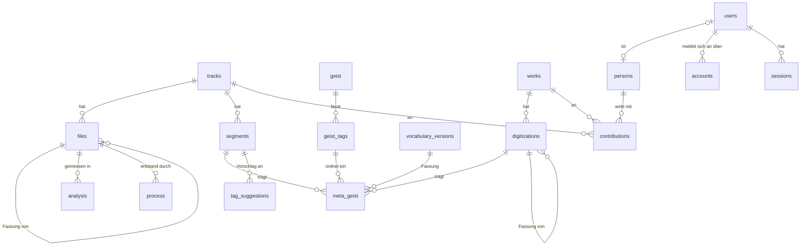
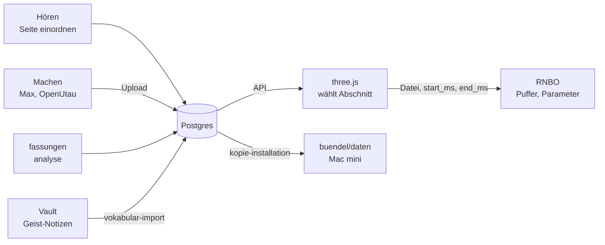

# Daten — jede Art hat genau eine Quelle

Stand 2026-11-25. **Nichts davon ist gebaut.** Entschieden ist der Stack: Postgres mit Hono und Drizzle. Alles Weitere ist ein Vorschlag, den der Bau prüft.

> [!abstract] Jede Art von Daten hat genau eine Quelle
> Das Vokabular steht im Vault, alles andere in Postgres. Nichts wird in beide Richtungen abgeglichen. Die Seite liest über die API, die Installation ohne Internet liest eine Kopie im Bündel. Originale bleiben privat, ausgeliefert werden nur ihre Fassungen.
>
> ```mermaid
> flowchart TD
>   V["Vault<br/>Vokabular"] -->|vokabular-import| DB[("Postgres<br/>alles andere")]
>   H["Seite einordnen,<br/>Uploads"] --> DB
>   DB -->|API| S["three.js<br/>und RNBO"]
>   DB -->|kopie-installation| K["Ordner<br/>im Bündel"]
>   K -->|Mac mini| S
> ```

^blick

**Was hier steht:** was entschieden ist und warum, der Stack, die Tabellen, die Projektstruktur, der Weg der Daten, die Sperren gegen Fehler mit KI, was verworfen ist und was offen bleibt.

**Was hier nicht steht:** jede Spalte mit Typ, Bedeutung und Beispiel. Das steht in `daten-erklaert.md`, dazu Beispiele für jeden Abschnitt dieser Datei. Den wörtlichen Verlauf des Gesprächs hält `raw\20261124 datenbank-gespraech.md`.

**Zum Ausprobieren:** `zaehlen\wwww-daten-prototyp` baut diese Datenbank mit allen 18 Tabellen und füllt sie mit fünf echten Zeilen aus dem Formular. Was er zeigt, steht in `daten-erklaert.md`, Abschnitt 17.

---

## Woraus gebaut wird

| Quelle | Was übernommen wird |
|---|---|
| `raw\20261124 datenbank-gespraech.md`, das Gespräch vom 2026-11-24 und 2026-11-25 | alle Entscheidungen, die Tabellen, die Projektstruktur, der Workflow, die Sperren |
| `specs\wwww-rnbo\raw\timecode CSV SQL\`: neun CSV-Dateien und `timecode.ods` | die Klang-Tabellen und ihre Namen. Die Einordnung hängt am Zeitabschnitt, sie trägt Gewichte, Messwerte stehen getrennt von Urteilen, und `process` ist die Brücke zu den Patches. Die rund 200 Tags sind der Rohstoff des Vokabulars. |
| `raw\Datenbank.md`, Lerndokument vom August 2026 | die Felder für Dateien aus Teil 6: Format, Größe, Vorschaubild, Punkte und Ausdehnung bei 3D, Kanäle bei Audio. Die Regel, Bytes von Metadaten zu trennen. Sensorwerte gehören in einen WebSocket, nicht in die Datenbank. |
| `raw\Backend-Grundlagen.md` | die Regel für Migrationen aus Teil 4: Claude erzeugt sie, der Nutzer wendet sie an. Ein Typ ist eine Behauptung, keine Prüfung (Teil 3). |
| der eingefügte Text vom 2026-11-24 zu BaaS, R2 und three.js | Meshopt, KTX2 und Opus. Die Frage, ob Echtzeit nötig ist. |
| die eingefügte Projektstruktur vom 2026-11-24 | die Trennung von Logik, Erfahrung und Wissen, `src/Experience/` nach Lektion 26, das erzeugte Manifest, Shader in eigenen Dateien |
| die eingefügten Texte vom 2026-11-25 zu Echtzeit, zu den Punkten ① bis ⑥ und zu den Risiken mit KI | die Ebenen 1 und 2, pg-boss, pgvector, die Liste der Risiken |
| `vereinbarung.md`, `originale.md`, `discord.md` | der Widerruf, die Bildbeschreibung als Pflicht, Werk und Digitalisat getrennt, die Stufen 1, 3, 7 und 12 |
| `learning\threejs\aufbau-einer-anwendung.md`, `specs\wwww-threejs\raw\three.js-journey\` | der Aufbau von `src/Experience/` |

**Was die Vorlagen falsch machten:**

- **Das Formular hat kaum Zeitmarken.** Die Spalte `timecode` in `timecode.ods` hält meist den Titel des Stücks, etwa „How Long Can I Burn?“. Nur in 4 der 114 Zeilen mit Track steht dort eine Zeit, etwa „01:11“, 18 sind leer. Der Zeitstempel ist der Moment des Absendens, im Format Monat.Tag.Jahr. Das Gespräch nahm an, ein Tastenkürzel setze dort Zeitmarken. Erst die Seite `einordnen\` setzt Anfang und Ende.
- **Es sind nicht 63 Einträge.** Das Blatt hat 158 belegte Zeilen, 114 davon nennen einen Track. Darunter stehen ein Test und Notizzeilen mit Namen von Geistern. 208 verschiedene Tags kommen vor, 191 davon nur in der freien Spalte `wesen`. In den Spalten Timbre, Dynamics, Texture und Context stehen nur 17.
- **In 40 Zeilen stehen in den festen Spalten Wörter ohne `#`**, etwa „glide“, „bass“, „filtersweep“, „cinematic“. Sie passen nicht zu ihrer Spalte, „bass“ steht unter Dynamics. Es sieht nach einer zweiten Liste von Begriffen aus, nicht nach einer Einordnung. Der Import lässt sie weg und nennt sie im Log.
- **Der Link passt in Stichproben nicht zum Track.** „Family Size“ von Confounder verlinkt `snowstar.bandcamp.com/track/last-day-waltz`. In mehreren Zeilen steht als Titel „soundohm“, der Name eines Ladens.
- **`meta_geist_def` mischt Gruppe und Tag.** Nur die erste Zeile hat eine ID. Die Spalte `description` hält den Tag, etwa `#bright`, keine Beschreibung. Name, Begriff, Alias und Stufe stehen in jeder Zeile neu.
- **`data_dictionary.csv` ist kein Datenwörterbuch.** Es hat die Spalten von `process` und dazu `create_time`.
- **`resonance_target` steht zweimal**, in `analysis` und in `meta_geist`.
- **Die CSV-Dateien sind Latin-1.** „Hüter“ wird in UTF-8-Werkzeugen zu Zeichensalat.
- **`contributors` wiederholt den Namen bei jedem Track.**
- **`Datenbank.md` empfiehlt R2, Convex und Vercel**, also eine Cloud-App ohne eigenen Server. Beim IONOS-VPS kostet der Traffic nichts extra, und der Mac mini erreicht keine Cloud. Seine eine Tabelle `assets` kennt weder Werk und Digitalisat noch die Bildbeschreibung.
- **`Backend-Grundlagen.md` irrt in Teil 7 bei PocketBase.** Im fertigen Programm ist `--automigrate` eingeschaltet. Jede Änderung im Admin-UI landet als Datei in `pb_migrations\`.
- **Die eingefügte Projektstruktur gleicht in beide Richtungen ab** (`vaultParser.js` und `obsidianSync.js`). Sie legt einen zweiten Vault an und verbindet Medien über Symlinks. Alle drei scheitern, siehe „Was verworfen ist“.
- **Das Gespräch sagte, ein GIN-Index mache die Suche nach einem Cutoff über 2000 Hz schnell.** Ein GIN-Index hilft bei „enthält“ (`@>`). Für „größer als“ auf einem Schlüssel braucht es einen Index auf genau diesen Schlüssel.

## Was entschieden ist

| Entscheidung | Warum | Wann |
|---|---|---|
| Postgres mit Hono und Drizzle | Fast alles Neue baut auf Postgres auf: pgvector, die Sync-Engines, Debezium, Supabase. Fällt Drizzle weg, bleiben Daten und Schema normales Postgres. | 2026-11-25, Nutzer |
| Convex nicht | Die Timecode-Tabellen sind relational und für Auswertungen gebaut, Convex kennt keine JOINs. Seine Echtzeit braucht wwww nicht. | 2026-11-24 |
| PocketBase nicht | Gemessen an der Zukunft ist es eine Insel: Was es nicht kann, lässt sich nicht nachrüsten. Die Daten liegen in dem Programm, das noch nicht bei 1.0 ist. | 2026-11-24 |
| Kafka nicht | Kafka ist ein dauernd laufender Cluster für ein Problem, das wwww nicht hat. Die Ereignisse erledigt pg-boss. Debezium hält die Tür offen. | 2026-11-24 |
| Eine Quelle pro Art: das Vokabular im Vault, alles andere in Postgres | Ein Abgleich in beide Richtungen erzeugt zwei Quellen, und der letzte Lauf gewinnt. | 2026-11-24 |
| Kein Export der Datenbank in den Vault | Am 2026-11-04 machten 3.875 erzeugte Dateien Obsidian zu einem weißen Fenster. | 2026-11-24 |
| Zeit in Millisekunden | `HH:MM:SS` kennt keinen Abschnitt von 300 ms. RNBO rechnet in Millisekunden oder Samples. | 2026-11-24 |
| Fremde Musik bleibt privat | Die Tracks im Formular stammen von Bandcamp, ohne Zustimmung. Ihre Einordnung ist Forschung, ihre Dateien liefert die Seite nicht aus. | 2026-11-24 |
| `jsonb` für Presets, Parameter und MFCC, nicht für ganze Patches | Ein `.maxpat` gehört in git, sonst gibt es zwei Quellen. | 2026-11-25 |
| Die Kopie für die Installation liegt im Bündel, nicht im Image | Dasselbe Image läuft auf dem VPS, dort wäre sie Ballast. | 2026-11-25, korrigiert auf Hinweis des Nutzers |
| Echtzeit nur mit Ebene 1 und 2, nie mit Ebene 3 | Ein toter Replication Slot füllt die Platte, und der VPS hat keine Snapshots. | 2026-11-25 |
| Jede Sperre gegen KI-Fehler hängt an der Maschine, nicht an Disziplin | Ein Agent schreibt plausibel falschen Code, der trotzdem kompiliert. | 2026-11-25 |
| Die Seite folgt Lektion 26, mit Vite und TypeScript | Der Nutzer will nahezu seine eingefügte Struktur. Der Abgleich steht unter „Die Projektstruktur“. | 2026-11-25, Vorschlag von Claude |

## Der Stack

| Baustein | Version, gemessen 2026-11-25 | Wofür |
|---|---|---|
| Postgres mit pgvector, Image `pgvector/pgvector:0.8.7-pg19` | rund 167 MB, Stand 2026-11-20 | die Datenbank, mit Vektorsuche von Anfang an |
| Hono auf Node, dazu `@hono/node-server` und `@hono/zod-validator` | 4.13.22 · 2.1.11 · 0.9.1 | die API: Routen, Login, Upload, Signale |
| Drizzle: `drizzle-orm` und `drizzle-kit` | 0.45.4 · 0.31.11 | das Schema als Code, die Abfragen, die Migrationen |
| `postgres` (postgres.js) | 4.1.1 | die Verbindung von Node zu Postgres |
| Better Auth | 1.7.28 | der Login mit Discord, die Sitzungen |
| Zod | 4.6.7 | prüft jede Eingabe und jedes JSON vor dem Schreiben |
| pg-boss | 12.39.0 | Jobs: die Fassungen nach einem Upload, die Erinnerungen nach 1, 3, 7 und 12 Tagen |
| Vite und TypeScript | 8.3.8 · 7.0.2 | baut die Seite, prüft die Typen |
| three.js | 0.187.0, bisher 0.160.0 in `site\vendor\` | die Szene, mit WebGL. `specs\wwww-threejs\welt.md` braucht kein WebGPU. |
| RNBO.js, `@rnbo/js` | 1.4.6 | spielt den Patch im Browser. Die Version muss zu der passen, mit der exportiert wurde. |

**Postgres 19 ist die neueste Hauptversion.** Ein Wechsel der Hauptversion braucht später `pg_dump` und eine Wiederherstellung. Deshalb beginnt wwww auf der neuesten. Die Version steht fest im Tag, wie bei `caddy:2.10-alpine`.

## Die drei Orte

| Ort | Was läuft | Welche Daten |
|---|---|---|
| dieser PC | Seite, API und Postgres in Docker | eine eigene Datenbank zum Entwickeln, Claude hat darauf volle Rechte |
| IONOS-VPS, `julianniklasheynert.xyz` | Seite, API und Postgres, hinter dem Nginx Proxy Manager im Netz `proxy` | die echte Datenbank. Claude bekommt dort nur die Leserolle. |
| Mac mini in der Installation, ohne Internet | nur die Seite, davor der TLS-Terminator aus `compose.installation.yml` | die Kopie im Bündel, als **Bind-Mount** eingebunden |

**`docker-compose.yml` bleibt an allen drei Orten gleich** (Vorschlag von Claude). API und Postgres tragen das Profil `online`. Auf dem PC und dem VPS steht in `.env` die Zeile `COMPOSE_PROFILES=online`, auf dem Mac mini fehlt sie. So steht der Unterschied in `.env`, wie es `zaehlen\wwww\README.md` verlangt.

## Die Tabellen



| Gruppe | Tabelle | Eine Zeile ist | Woher die Daten kommen |
|---|---|---|---|
| Vokabular | `vocabulary_versions` | ein Import des Vokabulars | `vokabular-import` |
| Vokabular | `geist` | eine der 14 Gruppen, etwa kyriotetes | eine Geist-Notiz im Vault |
| Vokabular | `geist_tags` | ein Tag, etwa `bright`, mit seiner Gruppe | das Frontmatter der Geist-Notiz |
| Vokabular | `tag_suggestions` | ein Tag, den es noch nicht gibt | die Seite `einordnen\` |
| Klang | `tracks` | ein Stück Klang als Ganzes: ein fremder Track oder ein eigenes Sample | Formular, Upload |
| Klang | `files` | eine Datei eines Tracks, das Original oder eine Fassung | Upload, `fassungen` |
| Klang | `segments` | ein Zeitabschnitt eines Tracks | die Seite `einordnen\` |
| Klang | `analysis` | die Messwerte einer Datei mit einem Werkzeug | `analyse` |
| Klang | `process` | wie eine Datei entstand: Patch, Parameter, Absicht | Upload |
| Einordnung | `meta_geist` | ein Tag an einem Abschnitt oder Digitalisat, mit vier Gewichten | die Seite `einordnen\`, `timecode-import` |
| Bild | `works` | ein Werk selbst, mit dem Galerie-Schild | die Seite `verwaltung\` |
| Bild | `digitizations` | etwas Digitales zu einem Werk: Scan, `.glb`, Form-Ebenen, Makrofoto | Upload, `fassungen` |
| Menschen | `persons` | ein Mensch: Johannes, Peter, die Leute hinter den Bandcamp-Tracks, du | `verwaltung\`, `timecode-import` |
| Menschen | `contributions` | eine Person an einem Track oder Werk, mit Rolle und Zustimmung | `verwaltung\` |
| Konten | `users`, `sessions`, `accounts`, `verifications` | ein Konto, eine Sitzung, ein Login über Discord, ein kurzlebiger Wert | Better Auth legt sie an |
| Jobs | Schema `pgboss` | ein Job | pg-boss legt es selbst an |
| Ansichten | `public_tracks`, `public_works` | was öffentlich ist | eine **View** über den Tabellen |

**Die Regeln darin:**

- **Die Namen in der Datenbank sind englisch, in `snake_case`** (Vorschlag von Claude). So heißen schon die CSV-Spalten und die Tabellen von Better Auth. Aus dem Gespräch wird `herkunft` zu `origin`, `von` zu `created_by`, `werkzeug` zu `tool`. Die Seiten und die Doku bleiben deutsch.
- **Das Vokabular hat lesbare IDs**: `kyriotetes` und `bright`. Alle anderen Tabellen haben eine `uuid`.
- **Aus dem Vokabular wird nichts gelöscht.** Ein Tag, der wegfällt, bekommt `removed_in`. Eine Zusammenlegung setzt `replaced_by`, etwa von `lowfi` auf `lofi`. Alte Einordnungen bleiben so lesbar.
- **Ein Abschnitt gehört zum Track, nicht zur Datei.** Dieselben Marken gelten für das WAV und für seine Opus-Fassung.
- **`end_ms` darf leer sein und heißt dann: bis zum Ende** (Vorschlag von Claude). So kommen die Einträge aus dem Formular herein, die keine Zeitmarken haben.
- **Die vier Gewichte dürfen leer sein**, denn das Formular hat sie nicht erfasst. Wo sie gesetzt sind, liegen `intensity`, `dominance` und `confidence` zwischen 0 und 1, `polarity` zwischen −1 und 1.
- **`meta_geist` hat genau ein Ziel**, einen Abschnitt oder ein Digitalisat. Ein `CHECK` erzwingt das.
- **Die Bildbeschreibung eines Werks ist Pflicht und darf nicht leer sein.**
- **Zustimmung und Widerruf stehen in `contributions`**, bei der Rolle `author` (Vorschlag von Claude, aus `vereinbarung.md`). Die Zustimmung gibt eine Person für ein Werk, deshalb steht sie dort, wo sich beide treffen. Öffentlich ist ein Werk, wenn es freigegeben ist, eine Zustimmung hat und keinen Widerruf. Das prüft die View `public_works` an einer einzigen Stelle.
- **Uploads tragen `status`** (`submitted` oder `approved`) **und `created_by`.** Wer hochlädt und nicht Admin ist, bestätigt die Rechte, das hält `rights_confirmed_at` fest.
- **Better Auth bekommt Tabellennamen im Plural** (`usePlural`), denn `user` ist in Postgres ein reserviertes Wort. Zwei Felder kommen dazu: `stage` mit 1, 3, 7 oder 12 aus `discord.md` und `role` mit `member` oder `admin`. Beide kann nur der Server setzen.
- **Die Discord-ID steht in `accounts.account_id`**, mit `provider_id = 'discord'`. Darüber findet der Bot die Person.
- **`resonance_target` steht vorerst in keiner Tabelle**, siehe „Offen“.

Jede Spalte mit Typ, Bedeutung, Beispiel und Verbindung steht in `daten-erklaert.md`, Abschnitt 6.

## Was als `jsonb` gespeichert wird

| Was | Wohin | Warum |
|---|---|---|
| ein RNBO-Preset | `jsonb` | `device.getPreset()` liefert es als Objekt, `device.setPreset()` spielt es zurück. Es ist klein und gehört zu einer Zeile. |
| die Parameter eines Prozesses | `process.parameters`, `jsonb` | aus demselben Grund |
| die MFCC-Werte | `analysis.mfcc`, `jsonb` | eine Zahlenreihe pro Datei |
| die Ausdehnung eines 3D-Modells | `digitizations.bbox`, `jsonb` | drei Zahlen, die immer zusammen gelesen werden |
| ein ganzer Max-Patch (`.maxpat`) | als Datei im git. Die Datenbank hält nur Name und Commit. | Max öffnet die Datei, und git zeigt jede Änderung. Eine Kopie in der Datenbank wäre eine zweite Quelle. |
| der RNBO-Export (`patch.export.json`) | als Datei in `site\static\rnbo\` | Der Browser lädt ihn als Datei. |
| ein Patch, den jemand hochlädt | als Datei im Speicher | wie jede andere Datei |

**Zod prüft jedes JSON, bevor es geschrieben wird.** Drizzle prüft den Inhalt einer `jsonb`-Spalte nicht.

**Ein GIN-Index auf `process.parameters`** hilft bei „enthält“, etwa bei allen Prozessen mit `"filter": "lowpass"`. Fragt die Seite oft nach „Cutoff über 2000“, bekommt genau dieser Schlüssel einen eigenen Index.

## Vokabular und Obsidian

| Was | Wie viele | Wo | Interface |
|---|---|---|---|
| Geist-Gruppen | 14: elementarwesen, kyriotetes, exusiai, dynamis, archai, angeloi, luzifer, sorat, umlaufzeiten, ahriman, archangeloi, throne-asuras, cherubim, seraphim | eine Notiz pro Geist im Vault `C\` | Obsidian: die Notiz und eine `.base` als Tabelle |
| Tags | 208 gezählt | als Liste im Frontmatter ihrer Geist-Notiz, keine eigenen Notizen | Obsidian |
| Abschnitte, Einordnungen, Messwerte | Tausende, mit der Zeit mehr | nur in der Datenbank | die Seiten `einordnen\` und `verwaltung\` |

- **Der Ort `katalog\geist\` ist ein Vorschlag.** Er passt zur Mechanik des Katalogs: ein Ordner pro Typ, `typ: geist` im Frontmatter, `katalog\geist.base` als Tabelle. Ob der Katalog auch Wesen statt Geräte tragen soll, ist offen.
- **`vokabular-import` schreibt nur in eine Richtung, vom Vault in die Datenbank.** Jeder Lauf legt eine Zeile in `vocabulary_versions` an, mit dem Commit des Vaults. Hat der Ordner ungespeicherte Änderungen, bricht der Lauf ab (Vorschlag von Claude). Sonst stimmt der Commit nicht mit dem Stand überein, der importiert wurde.
- **Ein Tag, den es noch nicht gibt, wird ein Vorschlag.** Er landet in `tag_suggestions`, mit den vier Gewichten. In Obsidian ordnest du ihn einer Geist-Notiz zu. Der nächste Import legt daraus die Einordnung an.
- **Zusammenlegen und Zerlegen stehen unter `ersetzt` in der Notiz, zu der der neue Tag gehört.** `luzifer.md` sagt `staccatosax: sax`, `dynamis.md` sagt `staccatosax: staccato`. Der Import führt beide zusammen, aus `#staccatosax` werden zwei Einordnungen. Rechts darf nur ein Tag aus derselben Notiz stehen. So kennt nur der Vault die Zuordnung, und nur `vokabular-import` liest sie. `timecode-import` und die Seite `einordnen\` kennen nur die Datenbank.
- **Obsidian ist das Interface für das, was du allein denkst und ordnest.** Eine Geist-Notiz kann auf die Steiner-Stelle verlinken, aus der die Gruppe stammt. Zum Hören taugt Obsidian nicht, weil es keinen Ton abspielt und keine Zeitmarken setzt.
- **Die Bases in `katalog\` reichen.** Die Datenbank bekommt vom Katalog nur, was die Seite zeigt, und nur in diese Richtung. Umziehen müsste der Katalog erst, wenn andere hineinschreiben.
- **`process.patch` nennt die Notiz in `katalog\patches\`, sonst den Pfad im Repo.** Laut `katalog\README.md` bekommt ein Patch, den nur ein Projekt braucht, keine Notiz. Der Patch von wwww liegt in `zaehlen\wwww\rnbo\`.
- **Später möglich: ein Obsidian-Plugin**, das die API fragt und die Abschnitte zeigt, ohne eine Datei in den Vault zu schreiben.

## Die Projektstruktur

Seite, API und Datenbank liegen in einem Repo, `zaehlen\wwww`. Eine Änderung am Schema und die Änderung an der Seite, die sie braucht, passen so in einen Commit.

```text
C:\Users\nolte\Desktop\
├── C\                                       DENKEN
│   ├── specs\wwww-main\daten.md             diese Spec
│   ├── katalog\geist\                       Vorschlag: eine Notiz pro Geist, die Tags im Frontmatter
│   ├── katalog\geist.base                   Bases zeigt das Vokabular als Tabelle
│   └── katalog\patches\                     eine Notiz pro Patch, wie heute
│
└── zaehlen\wwww\                            BAUEN, ein Repo
    ├── site\                                Vite: was der Browser lädt
    │   ├── src\
    │   │   ├── index.html                   die Szene
    │   │   ├── main.ts                      eine Zeile: new Experience(canvas)
    │   │   ├── Experience\                  wie Lektion 26
    │   │   │   ├── Experience.ts  Camera.ts  Renderer.ts  sources.ts
    │   │   │   ├── Utils\                   EventEmitter, Sizes, Time, Resources, Debug
    │   │   │   └── World\                   World, Environment, eine Datei je Objekt, Shaders\
    │   │   ├── Sound\                       RNBO: Gerät, Puffer, Presets
    │   │   ├── Data\                        ein Leser, zwei Quellen: API oder Kopie
    │   │   ├── UI\                          Galerie-Schild, Overlay, Menü
    │   │   ├── einordnen\                   index.html und main.ts: hören und einordnen
    │   │   ├── verwaltung\                  index.html und main.ts: Werke, Freigaben
    │   │   └── style.css
    │   ├── static\                          unverarbeitet, mit fester Adresse
    │   │   ├── assets\                      szene.glb, szene.splat, treffer.glb, wie heute
    │   │   ├── decoder\basis\               der KTX2-Transcoder aus three.js
    │   │   └── rnbo\                        patch.export.json, dependencies.json
    │   └── vite.config.ts
    ├── rnbo\                                die Quelle: .maxpat mit rnbo~
    ├── api\                                 Hono: app.ts, routen\, auth.ts, jobs.ts
    ├── db\                                  schema.ts, migrations\, client.ts
    ├── werkzeug\                            ein Skript pro Schritt
    │   ├── vokabular-import.ts              Vault → Datenbank
    │   ├── timecode-import.ts               timecode.ods, einmal
    │   ├── analyse.ts                       füllt analysis
    │   ├── fassungen.ts                     WAV → Opus, GLB → Meshopt und KTX2, Scan → WebP
    │   ├── kopie-installation.ts            Datenbank → buendel\daten\
    │   ├── pruefe-migration.ts              hält bei DROP an
    │   └── qr.py                            wie heute
    ├── buendel\daten\                       die Kopie: nicht im git, nicht im Image
    ├── package.json  tsconfig.json  eslint.config.js
    ├── Dockerfile                           Stufe 1 baut site, Stufe 2 ist Caddy
    ├── api.Dockerfile                       Node mit der API
    ├── docker-compose.yml                   app, api, db. api und db im Profil online.
    ├── compose.installation.yml             TLS davor, die Kopie als Bind-Mount
    └── logs\
```

- **Die Quelle des RNBO-Patches liegt beim Projekt**, in `zaehlen\wwww\rnbo\`. Sein Export landet in `site\static\rnbo\`. Bausteine, die mehrere Patches nutzen, kommen weiter aus `zaehlen\max-bausteine`.
- **Code heißt englisch, Seiten heißen deutsch.** `Experience\`, `Sound\` und `Data\` folgen den Namen aus Lektion 26. `einordnen\` und `verwaltung\` sind Adressen, die Menschen lesen.
- **Ein `package.json` für alles, `strict` in `tsconfig.json`.** Die Seite importiert den Typ der API direkt aus `api\app.ts`. Die Hono-Doku verlangt `strict` auf beiden Seiten, sonst kommen die Typen nicht an.

**Abgleich mit Lektion 26 und der eingefügten Struktur:**

| Teil | Lektion 26 und die eingefügte Struktur | wwww | Warum |
|---|---|---|---|
| Bau | Vite | Vite, three.js aus npm mit fester Version | Die Loader liegen im selben Paket wie three.js und passen immer zur Version. Das Ergebnis ist ein fertiger Ordner, vor Ort braucht er kein Internet. |
| Sprache | JavaScript | TypeScript | Die Typen von Hono reichen nur dann bis in die Szene, wenn auch sie TypeScript ist. |
| `Experience/` als Singleton | eine Instanz pro Seite | übernommen | Jede Seite hat genau eine Szene. |
| `Utils/`, `World/`, die drei Ereignisse | — | übernommen | Das ist der Teil, der in jedem Projekt gilt. |
| `sources.js` | von Hand, oder ein Skript liest `static/models/` | entsteht aus den Daten | Werke kommen aus der Datenbank, nicht aus einem Ordner. |
| `UI/` | Overlay, Menü, Interaction | übernommen, dazu das Galerie-Schild | — |
| Klang | fehlt | `Sound\` neben `Experience\` | RNBO ist kein Teil von three.js. Es hört auf dieselben Ereignisse. |
| Daten | fehlt | `Data\` neben `Experience\` | Die Szene weiß nicht, ob sie online oder vor Ort läuft. |
| Dateien | zwei Ordner, `static/` und `assets/` | nur `static\` für Dateien mit fester Adresse. CSS und Schriften liegen in `src\`. | Vite verarbeitet `src\` und hängt einen Hash an den Namen. `static\` kopiert es unverändert. |
| Shader | `vite-plugin-glsl` | zuerst Vites eingebautes `?raw`, das Plugin erst bei `#include` | eine Abhängigkeit weniger |
| Backend | Express, SQLite, `schema/contentModel.js` | Hono, Postgres, Drizzle, Zod | siehe „Was entschieden ist“ |
| `vault/`, `07_BackendSync/`, Symlinks | — | entfällt | siehe „Was verworfen ist“ |
| Seiten | eine | drei Einstiege: die Szene, `einordnen\`, `verwaltung\` | Vite baut mehrere Seiten aus einem Projekt. |

**Im Gespräch war die Struktur nicht mit Best Practice abgeglichen.** Sie folgte dem, was `zaehlen\wwww` schon hat. Abgeglichen ist sie seit 2026-11-25 mit der Doku von Vite und Hono, der Installationsseite von three.js und Lektion 26 (`daten-erklaert.md`, Abschnitt 9.1). Das Ergebnis: Die Struktur ist gut. Vite ist der Weg, den die three.js-Doku selbst empfiehlt.

**Der Singleton hat zwei bekannte Nachteile.** Beim Entwickeln lädt Vite geänderte Module neu, aber die alte Instanz bleibt. Dagegen hilft `import.meta.hot.dispose()` in `Experience.ts`. Und eine einzige Instanz lässt sich in Tests schwer ersetzen. Für wwww passt er trotzdem, denn jede Seite hat genau eine Szene.

## Der Weg eines Klangs



1. **Hören.** Du hörst einen Track auf der Seite `einordnen\`. Die Leertaste setzt Anfang und Ende eines Abschnitts. Tags tippst du mit Vervollständigung aus dem Vokabular. Vier Regler setzen intensity, polarity, dominance und confidence. Ein Tag, den es noch nicht gibt, wird ein Vorschlag.
2. **Machen.** Ein eigenes Sample entsteht in Max oder OpenUtau. Du lädst es hoch und nennst den Patch. Die Freigabe stößt den Job `fassungen` an, er erzeugt die Opus-Datei. `analyse` misst das Original.
3. **Ordnen.** In Obsidian ordnest du die Vorschläge einer Geist-Notiz zu. `vokabular-import` schreibt das Vokabular mit einer neuen Version in die Datenbank.
4. **Spielen.** Die Szene fragt die API, etwa nach Abschnitten, in denen kyriotetes mit einer Intensität über 0,6 eingeordnet ist. Sie lädt die Datei, gibt sie mit `device.setDataBuffer()` an den Puffer im RNBO-Patch und setzt `start_ms` und `end_ms` als Parameter. Die Bewegung des Handys steuert weitere Parameter, direkt im Browser und ohne Datenbank.
5. **Ausliefern.** `kopie-installation` schreibt alles Öffentliche nach `buendel\daten\`. Fremde Tracks und widerrufene Werke bleiben draußen.

## Welches Interface wofür

| Tätigkeit | Interface | Warum dort |
|---|---|---|
| Vokabular pflegen: Gruppen, Tags, Zusammenlegungen | Obsidian, Notizen und eine Base | Das Vokabular ist Wissen, das nur du schreibst. |
| Hören und einordnen | die eigene Seite `einordnen\` | Obsidian spielt keinen Ton ab. Das Google-Formular ließ jeden Tag frei zu, daher die 208. |
| Werke eintragen, Uploads freigeben | die eigene Seite `verwaltung\`, am Anfang Drizzle Studio | Nur dort lassen sich Pflichtfelder wie die Bildbeschreibung durchsetzen. |
| Auswerten | SQL in einem Datenbank-Programm | Eine Frage wie „Welche Geister dominieren in fremden Tracks mit hoher Lautheit?“ ist ein JOIN. |
| Patches bauen | Max mit RNBO, bei geteilten Patches die Notiz in `katalog\patches\` | bleibt wie heute |

## Dateien und Fassungen

- **Die Bytes liegen auf der Platte des VPS.** Die Datenbank hält nur den Schlüssel, die Größe und die Metadaten.
- **Der Speicher hat zwei Bereiche** (Vorschlag von Claude, verfeinert aus `uploads/<konto>/<id>.wav` im Gespräch):

  | Bereich | Was darin liegt | Wer es ausliefert |
  |---|---|---|
  | `original/` | jedes Original und jeder Upload vor der Freigabe | nur die API, nach einer Prüfung der Rechte |
  | `public/` | die Fassungen für die Auslieferung und die Vorschaubilder | Caddy direkt |

  Die Schlüssel sehen aus wie bei S3: `original/files/<id>.wav`, `public/files/<id>.opus`, `original/digitizations/<id>.glb`, `public/previews/<id>.webp`. Der Schlüssel eines Originals ändert sich nie, auch nicht bei der Freigabe. So kommen die Scans von Johannes und Peter nie in voller Auflösung ins Netz.
- **Die Freigabe stößt den Job `fassungen` an:**

  | Original | Fassung |
  |---|---|
  | WAV | Opus. Kann Safari Opus nicht über `decodeAudioData` öffnen, wird es AAC als `.m4a`. |
  | GLB | Meshopt für die Geometrie, KTX2 für die Texturen |
  | Scan als TIFF oder PNG | WebP für die Ansicht, KTX2 als Textur in der Szene, ein Vorschaubild |

- **Ein Widerruf löscht die Fassungen in `public/`.** Ob das Original bleibt, regelt die Vereinbarung, siehe „Offen“.
- **Der Decoder für Meshopt steckt in three.js als Modul.** Nur der KTX2-Transcoder braucht eigene Dateien, in `site\static\decoder\basis\`, aus derselben Version.
- **Der Weg zu R2 bleibt offen.** Er heißt: Dateien kopieren, eine Adresse ändern. Die Schlüssel bleiben dieselben.

## Die Kopie für die Installation

- **Es gibt sie nur, weil der Mac mini kein Internet hat.** Er erreicht die Datenbank auf dem VPS nicht.
- **`kopie-installation` liest nur die Views** `public_works` und `public_tracks`. Es schreibt `buendel\daten\` mit `index.json`, `werke.json`, `abschnitte.json` und den Dateien aus `public/`.
- **Nur `compose.installation.yml` bindet den Ordner ein**, als Bind-Mount nach `/srv/daten`, nur lesend. Das Image bleibt an allen drei Orten gleich, und neue Daten brauchen keinen neuen Bau.
- **`Data\` fragt beim Start nach `/daten/index.json`.** Gibt es die Datei, liest die Seite die Kopie, sonst die API.
- **Der Test des Bündels aus `zaehlen\wwww\README.md` prüft den Ordner mit.** Fehlt er, zeigt die Installation nichts.

## Echtzeit

**Für nichts, was geplant ist.** Echtzeit heißt: Ändert jemand etwas, sehen es alle offenen Seiten sofort, ohne Neuladen.

| Fall | Was es braucht |
|---|---|
| Peter lädt hoch, und die Liste in `verwaltung\` zeigt es ohne Neuladen. | Ebene 1: ein Signal, und die Liste lädt neu |
| Du und Johannes ordnet denselben Track ein und seht die Marken des anderen. | Ebene 1 |
| Die Handys M1 und M2 in der Installation steuern die Projektion. | ein WebSocket im lokalen Netz, ohne Datenbank. Die Werte werden nicht gespeichert. |
| Das Publikum einer Performance wirkt gemeinsam auf die Szene. | derselbe Weg, ein gemeinsamer WebSocket-Raum |
| Eine Liste, die aus vielen Tabellen berechnet wird, muss live bleiben. | Ebene 3, dann mit Zero neben Postgres |

- **Kommt sie, reichen Ebene 1 und 2 zusammen.** Ein Trigger schickt `NOTIFY`, sobald sich eine Tabelle ändert, auch wenn ein Skript wie `analyse` schreibt. Hono gibt das Signal über **SSE** an die offenen Seiten weiter, und sie laden neu.
- **Die Grenze von 8 KB stört nicht**, denn das Signal sagt nur „segments geändert“. Geht während einer Trennung ein Signal verloren, lädt die Seite beim Wiederverbinden ohnehin neu.
- **Ebene 3 kommt nicht.** Stirbt der Leser eines Replication Slots, läuft die Platte voll, und Postgres steht. Der Tarif des VPS erlaubt keine Snapshots.

## Sperren gegen die Risiken mit KI

| Risiko | Sperre |
|---|---|
| Eine Migration läuft gegen die Produktion. | Eine Regel in `zaehlen\wwww\.claude\settings.json` verbietet Claude `drizzle-kit migrate` und `drizzle-kit push`. Die Rollen der Anwendung dürfen keine Tabellen anlegen, ändern oder löschen. Migrationen spielst du ein, nach einem `pg_dump`. |
| Eine Umbenennung wird zu `DROP`. | Umbenennungen laufen nie über `schema.ts` allein. `drizzle-kit generate --custom` legt eine leere Migration an, und Claude schreibt `ALTER TABLE … RENAME COLUMN` hinein. `pruefe-migration` prüft jede neue Migration auf `DROP` und hält an. |
| `db` statt `tx` in einer Transaktion | Schreibende Funktionen bekommen nur `tx`. Eine **Lint-Regel** verbietet, `db` in diesen Dateien zu importieren. |
| Ein Lese-Endpunkt schreibt. | Postgres bekommt zwei Rollen, eine nur zum Lesen und eine zum Schreiben. GET-Routen nutzen die Leserolle. Schreibt eine trotzdem, lehnt die Datenbank ab. Better Auth nutzt immer die schreibende Rolle, denn es verlängert beim Prüfen einer Sitzung deren Ablauf. |
| Die Validierung fehlt. | Jede Route entsteht über eine Hilfsfunktion, die ein Zod-Schema und eine Rechteprüfung verlangt. Fehlt eins, kompiliert sie nicht. Ein Test pro Route prüft: ohne Anmeldung 401, mit falschem Inhalt 400. |
| Es gibt keinen kanonischen Weg. | Die Wahl steht einmal fest, in `zaehlen\wwww\CLAUDE.md` und je einem ADR: Hono auf Node, Drizzle, Better Auth, Zod, pg-boss. |
| Die Verbindungen gehen aus. | Auf dem VPS läuft ein Prozess dauerhaft mit einem Pool. Das Problem gibt es nur ohne eigenen Server. |

- **Die Lint-Regeln gehören als Gates zum Stack `typescript` in `C\.claude\guardrails\`.** Dort liegt schon `eslint.config.js`. Jede Regel bekommt ein Fixture, das durchfallen muss. Erst dann gilt sie als bewiesen.
- **Claude prüft die eigene Arbeit an der Datenbank**, mit `psql` und `EXPLAIN ANALYZE`. Auf diesem PC geschieht das mit vollen Rechten, auf dem VPS nur mit der Leserolle.
- **Jede Migration liegt als `.sql`-Datei vor dir**, bevor sie läuft.

## Was verworfen ist

| Möglichkeit | Warum nicht | Was die Tür offen hält |
|---|---|---|
| Convex | keine JOINs, die Daten liegen in fremder Cloud, die Echtzeit bliebe ungenutzt | — |
| PocketBase | eine Insel, Version unter 1.0, die Daten im Programm | — |
| Kafka | ein Cluster für Dutzende Systeme, wwww hat eine Seite und einen Bot | Debezium liest jede Änderung aus Postgres und gibt sie an Kafka weiter. |
| Supabase | selbst betrieben rund ein Dutzend Container, zu schwer für den VPS. Der kostenlose Tarif pausiert nach einer Woche ohne Zugriff. | Die Tabellen sind normales Postgres, ein Umzug ginge. |
| Directus oder Strapi | ein CMS mit eigenem Dienst und eigener Datenbank | — |
| Cloudflare R2, vorerst | Der Traffic des VPS kostet nichts extra, der Mac mini erreicht R2 nicht. | Schlüssel im S3-Format |
| Vercel, Netlify, Cloudflare Pages | Dann gäbe es kein Image, das an allen drei Orten gleich ist. Langlebige Verbindungen gehen dort nicht. | — |
| MinIO, SeaweedFS, Garage | ein zweiter Dienst für das, was die Platte schon kann | Schlüssel im S3-Format |
| Local-first: InstantDB, Triplit, Zero | Die Installation zeigt offline nur etwas an, dafür reicht die Kopie. | Zero läuft neben Postgres, wenn Ebene 3 je nötig wird. |
| Notizen mit Frontmatter als Datenbank | Johannes und Peter können nicht in den Vault schreiben. | — |
| Ein Abgleich in beide Richtungen | Zwei Quellen, der letzte Lauf gewinnt. | — |
| Ein zweiter Vault im Repo | Das Denken läge an zwei Orten. Zwischen `C\` und `zaehlen\` wandert keine Datei. | — |
| Symlinks für Medien | `docker build` folgt keinem Link aus dem Build-Ordner. Im Image läge ein toter Link. | — |
| Ein Export der Datenbank in den Vault | Tausende erzeugte Notizen, wie am 2026-11-04 | ein Obsidian-Plugin, das nur liest |
| pg_cron | fehlt im offiziellen Postgres-Image | pg-boss plant auch wiederkehrende Jobs. |
| Ebene 3 der Echtzeit, selbst gebaut | Ein toter Replication Slot füllt die Platte. | Zero |
| Eine Tabelle `assets` für alles | Ihr fehlen Werk, Digitalisat und Bildbeschreibung. | — |
| tRPC | Hono bringt mit `hc` eigene Typen bis zum Client mit. | — |
| Ein Datenwörterbuch von Hand | `data_dictionary.csv` zeigt, wie es veraltet. | siehe „Ideen“ |

## Die Reihenfolge

1. **Die 208 Tags den Geist-Gruppen zuordnen.** Claude schlägt für jeden Tag eine Gruppe vor, zerlegt zusammengesetzte wie `#staccatosax` und findet Doppelte wie `#lofi` und `#lowfi`. Du entscheidest. Daraus entstehen die 14 Geist-Notizen, nachdem der Ort geprüft ist.
2. **`db\schema.ts` schreiben** und die erste Migration erzeugen. Du wendest sie an.
3. **`vokabular-import` und `timecode-import` laufen lassen, danach noch einmal `vokabular-import`.** Der Formular-Import dreht das Datum von Monat.Tag.Jahr um und lässt den Test und die Notizzeilen weg. „Künstler - Veröffentlichung“ trennt er in Person und Track. Jeder Eintrag wird ein Abschnitt ohne Ende, eine Zeit wie „01:11“ wird sein Anfang. Was nicht genau ein Tag ist, wird ein Vorschlag. Der zweite Lauf von `vokabular-import` löst die Vorschläge über `ersetzt` auf. Der Prototyp zeigt den Ablauf an fünf Zeilen.
4. **Die Seite `einordnen\` bauen.** Ab hier ersetzt sie das Formular.
5. **`analyse` und `fassungen` bauen.**
6. **three.js und RNBO lesen über die API.** Dazu kommt `kopie-installation` für den Mac mini.
7. **Werke, Discord-Konten und Uploads.**

**Warum diese Reihenfolge:** Das Vokabular steht am Anfang, weil jede Einordnung darauf zeigt. Konten und Uploads kommen zuletzt, weil bis dahin nur du einträgst.

**Vor dem ersten Download wird gemessen.** Das Image wiegt rund 167 MB. Die npm-Pakete wiegen ohne ihre Abhängigkeiten zusammen rund 58 MB, mit Abhängigkeiten ist die Größe noch nicht gemessen. Über 1 GB wartet der Bau auf ein Ja.

## Offen

- **Was `resonance_target` bedeutet.** Davon hängt ab, ob es zu `analysis` (ein Messwert) oder zu `meta_geist` (ein Urteil) gehört.
- **Ob `katalog\geist\` der richtige Ort für das Vokabular ist.**
- **Ob ein fremder Track je eine Datei bekommt** oder nur Link und Zeitmarken. Ohne Datei gibt es für ihn keine Messwerte.
- **Ob Safari Opus über `decodeAudioData` öffnet.** Das zeigt ein Test auf dem iPhone.
- **Was die Pole von `polarity` bedeuten**, etwa zentripetal und zentrifugal.
- **Was `source_name` und `track_fingerprint` in den CSV-Dateien meinten.** Der Fingerprint kann eine Prüfsumme sein oder ein akustischer Fingerabdruck. Die Tabelle `files` hat Platz für beides.
- **Wo die Anliegen aus `discord.md` liegen**, mit den Grenzen pro Adresse und pro Tag und den Erinnerungen. Ob der Bot dieselbe Datenbank nutzt, ist nicht entschieden.
- **`specs\wwww-rnbo\aufstieg.md` nimmt an, dass die Samples im RNBO-Export stecken.** Hier lädt die Szene sie zur Laufzeit in einen Puffer. `aufstieg.md` wird angepasst, wenn der RNBO-Teil gebaut wird.
- **Die Frist nach einem Widerruf** steht in `vereinbarung.md` noch frei. Offen ist auch, ob das Original danach gelöscht wird oder privat bleibt.
- **Was die Wörter ohne `#` in den festen Spalten des Formulars sind**, und ob die Spalte mit den Links verrutscht ist.

## Ideen, nicht entschieden

- **Das Datenwörterbuch entsteht aus `db\schema.ts`.** Jede Spalte bekommt dort einen Kommentar. Ein Skript liest die Struktur über Drizzle (`getTableConfig`) und den Kommentar aus dem Quelltext und schreibt `db\WOERTERBUCH.md`. Fehlt ein Kommentar, oder ist die Datei älter als das Schema, schlägt die Prüfung fehl. Erklärt in `daten-erklaert.md`, Abschnitt 6.12. Der Prototyp hat es gebaut, das Gate fällt dort nachweislich durch.
- **Ein Audio-Embedding pro Abschnitt**, mit pgvector. Dann findet die Seite zu einem Klang den ähnlichsten (similis) und den fremdesten (varius).
- **Das RNBO-Preset an der Einordnung**, als `jsonb`. Dann weiß die Datenbank auch, wie der Patch den Abschnitt spielen soll.
- **Die Parametergruppen im RNBO-Patch heißen wie die Geist-Gruppen.** kyriotetes steuert die Klangfarbe, exusiai den Raum, dynamis die Hüllkurve. Die Einordnung sagt dem Patch dann, wie er spielt.
- **Ein Obsidian-Plugin**, das die Abschnitte über die API zeigt.
