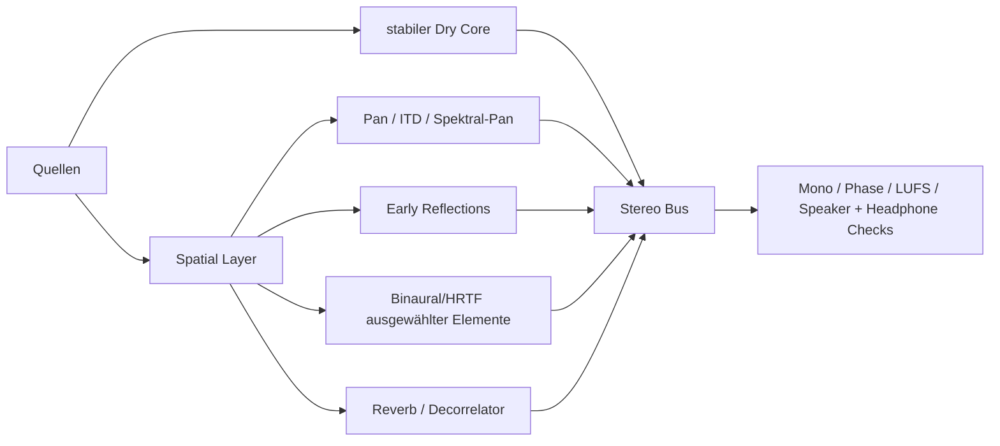
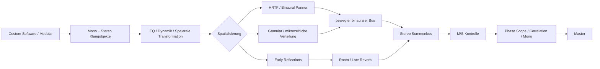
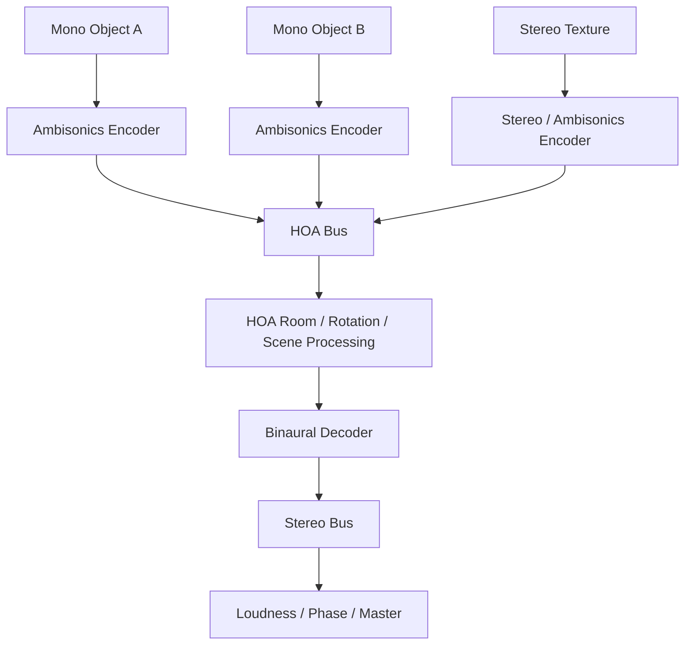

# Räumliche Tiefe und „3D Audio“ in Stereo: Psychoakustik, Mixing, Routing, Werkzeuge und reproduzierbare Workflows

## Executive Summary

Ein überzeugendes räumliches Erlebnis in einer normalen Zweikanaldatei entsteht nicht durch einen einzelnen „3D“-Effekt, sondern durch die **kontrollierte Kombination mehrerer Wahrnehmungsebenen**: Links-Rechts-Lokalisation durch Pegel- und Zeitunterschiede, Höhen- und Vorne/Hinten-Hinweise durch HRTF-basierte spektrale Filterung, Tiefenwirkung durch Direkt-/Diffusschall-Verhältnis und Reflexionen sowie Bewegung durch zeitvariable Automation. Die Hörforschung beschreibt drei zentrale Richtungshinweise: **interaurale Zeitdifferenzen (ITD), interaurale Pegeldifferenzen (ILD) und richtungsabhängige spektrale Hinweise**; letztere sind wesentlich in der HRTF enthalten. citeturn6search30turn6search18

Die wichtigste praktische Unterscheidung lautet:

> **Breites Stereo ist nicht dasselbe wie binaurales 3D.**

Konventionelles Stereo mit Amplituden-Panning, Mid/Side, decorrelierten Delays und Reverb kann auf Lautsprechern hervorragend Tiefe und Breite erzeugen. **Binaurales Rendering** versucht dagegen, die akustischen Signaturen nachzubilden, die an den beiden Ohren bei einer realen Schallquelle entstehen. Es kann damit auf Kopfhörern zusätzlich Elevation, Vorne/Hinten und Externalisierung ermöglichen; bei nicht-individuellen HRTFs kann die Wahrnehmung aber stark zwischen Hörern variieren und teilweise „im Kopf“ bleiben. Individuelle HRTFs, Raumreflexionen und Head-Tracking können die Externalisierung verbessern. citeturn8search2turn8search5turn8search6

Für einen **universellen Stereo-Mix**, der sowohl auf Kopfhörern als auch auf Lautsprechern funktioniert, ist deshalb meist ein hybrider Ansatz überlegen:



Die Mitte, Transienten und der relevante Bass bleiben relativ stabil; räumliche Informationen werden stärker in Mitten/Höhen, Reflexionen, Effektreturns und ausgewählten Objekten aufgebaut. Für eine **explizit kopfhörerzentrierte Kunstproduktion** kann man aggressiver binaural arbeiten.

Die erste Referenz, Kamran Sadeghis *Magnetic Moments*, ist hierfür besonders aufschlussreich. Sadeghi dokumentiert ausdrücklich, dass das rund 35-minütige Werk **binaural gemischt und gemastert** wurde und empfiehlt Kopfhörer. Das Album ist eine kontinuierliche Komposition; das Ausgangsmaterial stammt aus eigens entwickelter Software und modularer Synthese. Bemerkenswert ist außerdem, dass Sadeghi beim Mastering einen **Phase Scope** verwendete und Bilder daraus publizierte. citeturn19view0 Damit steht dort nicht maximale statische Stereobreite, sondern die Behandlung von Klang als bewegliches, räumliches Material im Mittelpunkt.

Die zweite Referenz, Sounding Futures **3D AudioSpace**, illustriert einen anderen Workflow: Die Plattform nimmt **Mehrkanal- oder Ambisonics-Dateien entgegen und konvertiert sie in binaurale Stereo-Tracks** für Wiedergabe ohne Spezialhardware. citeturn19view2 Auf der Plattform finden sich beispielsweise Produktionen in Higher-Order Ambisonics dritter Ordnung; andere veröffentlichte Beiträge benutzen noch höhere Ordnungen. citeturn20search1 Das ist konzeptionell wichtig: Man komponiert zunächst eine **dreidimensionale Szene** und decodiert erst am Ende in zwei binaurale Kanäle, statt den Raum ausschließlich aus einem fertigen Stereomix herauszuziehen.

### Annahmen dieses Reports

Da die Zielparameter nicht spezifiziert wurden, arbeite ich mit folgenden Annahmen:

| Parameter | Annahme |
|---|---|
| Endformat | normale Zweikanal-Stereodatei |
| Primäres Ziel bei echtem Binaural | Kopfhörer |
| Sekundäres Ziel | möglichst robuste Wiedergabe auf Stereo-Lautsprechern |
| HRTF | zunächst generisch, nicht individuell |
| Head-Tracking | für statische Musikdatei nicht vorausgesetzt |
| Arbeitsformat | beispielhaft 48 kHz / 24 Bit; kein Muss |
| Loudness | musikalisch/platformabhängig; BS.1770-Messung, **nicht pauschal -23 LUFS** |
| Originalsessions der Referenzen | nicht verfügbar |
| Referenzanalyse | dokumentierte Produktionsangaben + psychoakustisch plausible Rekonstruktion, keine Behauptung über unbekannte konkrete Plug-ins |

Gerade die letzte Einschränkung ist wichtig: Die folgenden Ketten zu *Magnetic Moments* und AudioSpace sind, wo nicht ausdrücklich dokumentiert, **rekonstruktive Hypothesen**, keine behauptete Reverse-Engineering-Analyse der Originalsessions.

## Psychoakustische und technische Grundlagen

### ITD, ILD und HRTF

Für eine seitlich verschobene Schallquelle erreicht das Signal die Ohren unterschiedlich. Zwei Hinweise sind besonders wichtig.

**ITD – Interaural Time Difference** bezeichnet den Laufzeitunterschied zwischen den Ohren. Phasen- und Zeitinformation ist insbesondere für tiefe und mittlere Frequenzen ein starker Richtungsindikator. **ILD – Interaural Level Difference** bezeichnet Pegeldifferenzen, die unter anderem durch die Abschattung des Kopfes entstehen und mit steigender Frequenz stärker werden. Beide Mechanismen sind grundlegende Bestandteile der horizontalen Lokalisation. citeturn6search18turn6search30

Eine reine Stereo-Panoramaautomation verändert meistens primär ILD-artige Pegelverhältnisse. Deshalb hört man damit überzeugend „links/rechts“, aber noch nicht automatisch „hinter mir“ oder „über mir“.

Die **Head-Related Transfer Function, HRTF**, erweitert das Modell. Kopf, Außenohr und Oberkörper verändern ein eintreffendes Signal richtungsabhängig. Diese Filterstruktur enthält ITD, ILD sowie frequenzabhängige Kerben und Verstärkungen, die entscheidende Informationen über Elevation und Vorne/Hinten enthalten. Forschung zur räumlichen Lokalisation bestätigt die Bedeutung sowohl binauraler als auch spektraler Hinweise. citeturn6search8turn6search30

Vereinfacht:

\[
y_L(t)=x(t)*h_L(\theta,\phi,r,t)
\]

\[
y_R(t)=x(t)*h_R(\theta,\phi,r,t)
\]

mit Azimut \(\theta\), Elevation \(\phi\), Entfernung \(r\) und den linken/rechten HRTF- beziehungsweise HRIR-Filtern \(h_L\), \(h_R\).

Die HRTF ist allerdings anatomisch individuell. Daher kann ein generisches HRTF-Modell bei einem Hörer hervorragend funktionieren und bei einem anderen zu Vorne/Hinten-Verwechslungen oder Internalisierung führen. Versuche zeigen, dass personalisierte HRTFs und Head-Tracking die räumliche Wahrnehmung verbessern können. citeturn8search2turn8search5

### Spektrale Hinweise und Elevation

Elevation lässt sich nicht einfach mit „Pan hoch“ erzeugen. Das Außenohr verursacht charakteristische frequenzabhängige Muster, deren genaue Form von der Ankunftsrichtung und individuellen Ohrgeometrie abhängt. Diese spektralen Hinweise tragen auch zur Unterscheidung von vorne und hinten bei. citeturn6search8

Daraus folgt eine praktische Regel:

**Ein EQ-Preset allein ist kein vollständiger Höhen-Panner.** Eine spektrale Manipulation kann die Illusion unterstützen, aber glaubwürdige Elevation benötigt normalerweise eine HRTF- oder vergleichbare binaurale Modellierung.

### Entfernung, Early Reflections und Reverberation

„Tiefe“ ist multidimensional. Ein Signal wirkt tendenziell näher, wenn sein Direktanteil stark, klar und transientenreich ist. Mit wachsendem wahrgenommenem Abstand nehmen Raumanteil und spektrale Dämpfung typischerweise an Bedeutung zu.

Besonders wertvoll sind **Early Reflections**. Sie liefern Informationen über Raumgröße, Oberflächen und Relation zwischen Quelle und Hörer. Untersuchungen zur binauralen Externalisierung zeigen, dass Reflexionen und Reverberation wesentlich dazu beitragen können, eine Schallquelle außerhalb des Kopfes wahrzunehmen. citeturn8search5turn8search7

Deshalb sollte man Reverb im 3D-Mixing besser in zwei funktionale Komponenten zerlegen:

**Early Reflections → Position, Entfernung, Raumgeometrie**

**Late Reverb → Envelopment, Größe, Atmosphäre**

Das ist wesentlich präziser, als einfach einen langen Hall über jedes Signal zu legen.

### Precedence Effect und „Haas“-Techniken

Bei direktem Klang plus kurz darauf eintreffenden Reflexionen dominiert für die Lokalisation häufig die erste Wellenfront. Dieses als **Precedence Effect** untersuchte Phänomen ist für natürliche Raumwahrnehmung ebenso relevant wie für Stereo-Delay-Tricks. citeturn7search3turn7search0

Im Studiokontext wird häufig pauschal vom „Haas-Effekt“ gesprochen. Die populäre Vorstellung einer universellen festen Grenze – beispielsweise „unter X Millisekunden immer breit, darüber Echo“ – ist jedoch zu grob. Ob zwei Ereignisse fusionieren, hängt unter anderem von Signalart, Pegel, Transienten und Delay ab. Daher sind Zeitwerte im Mixing **Startpunkte, keine psychoakustischen Gesetze**.

Ein praxistauglicher Ausgangspunkt ist beispielsweise:

| Delay einer decorrelierten Parallelkopie | Typische Wirkung |
|---:|---|
| < 1 ms | starke Phasen-/Kammfilterwirkung; vorsichtig |
| 1–8 ms | seitliche Verschiebung, Breite, potenziell starke Mono-Färbung |
| 8–20 ms | deutlich räumlicher/fusionierter Zweitanteil |
| 20–40 ms | zunehmende Wahrnehmung als Doppelung/Slap bei transientem Material |

Diese Werte sind bewusst **heuristische Arbeitsbereiche**. Bei Percussion kann ein Delay viel früher als separates Ereignis auffallen als bei Pads.

### Mid/Side als geometrische Sicht auf Stereo

Bei normierter M/S-Matrix kann man schreiben:

\[
M=\frac{L+R}{\sqrt{2}}, \qquad
S=\frac{L-R}{\sqrt{2}}
\]

und entsprechend zurückdecodieren.

Der Vorteil ist konzeptionell enorm:

- **Mid** enthält gemeinsame beziehungsweise zentrumsnahe Information.
- **Side** betont Unterschiede zwischen links und rechts.

Mono-Summierung entfernt deshalb große Teile reiner Side-Information. Je aggressiver ein Mix seine Identität im Side-Kanal aufbaut, desto höher das Risiko, dass er in Mono kollabiert.

M/S sollte daher primär als **selektives Werkzeug** verwendet werden: Bass stabilisieren, Hall verbreitern, obere Frequenzen öffnen, seitliche Informationen EQen – nicht als pauschales „Width = 200 %“.

## Analyse der beiden Referenzen

### Kamran Sadeghi – *Magnetic Moments*

#### Was nachweislich dokumentiert ist

Sadeghi beschreibt *Magnetic Moments* als etwa 35-minütige, kontinuierliche Komposition, die von ihm selbst komponiert, **binaural gemischt und gemastert** wurde; die Veröffentlichungsseite empfiehlt Kopfhörer. Die Klänge entstanden mit eigens entwickelter Software und modularer Synthese. Er beschreibt Klang ausdrücklich als skulpturales Material und das Werk als betretbaren beziehungsweise räumlich erfahrbaren Raum. Außerdem entstanden die visuellen Begleitbilder aus einem **Phase Scope während des Masterings**. citeturn19view0

Diese Kombination ist produktionstechnisch bemerkenswert: Die Phasenbeziehungen scheinen nicht erst am Ende als technisches Problem überprüft worden zu sein, sondern waren offenbar auch ein bewusst beobachteter Bestandteil des räumlichen Materials. Das ist eine Interpretation der dokumentierten Arbeitsweise, nicht der Nachweis eines konkreten Algorithmus. citeturn19view0

#### Plausible rekonstruktive Processing-Architektur

Eine technisch plausible, aber **nicht verifizierte** Kette wäre:



Die für diesen Klangansatz wahrscheinlich effektivste Strategie wäre, **nicht die gesamte Mischung identisch binaural zu behandeln**, sondern einzelne klangliche Figuren als Objekte zu bewegen, während diffuse und kontinuierliche Schichten ein stabileres Raumfeld bilden.

Eine gute Reproduktion des Ansatzes könnte so aussehen:

1. Erzeuge fünf bis zehn relativ fokussierte Mono-Klangobjekte und einige diffuse Stereo-Texturen.
2. Spatialisiere fokussierte Objekte individuell mit einem HRTF-Panner.
3. Automatisiere Azimut langsamer als Klangparameter wie Filter oder Grain Density. Dadurch entsteht eine nachvollziehbare räumliche Trajektorie statt zufälligem „Stereo-Flattern“.
4. Schicke jedes Objekt zusätzlich in einen gemeinsamen Early-Reflection-Raum.
5. Erzeuge eine zweite, stärker decorrelierte oder granulare Raumebene.
6. Halte zentrale oder tieffrequente Elemente weniger mobil.
7. Beobachte Vectorscope und Korrelationsgrad während der Automation.
8. Schalte während des Designs regelmäßig auf Mono.
9. Vergleiche Kopfhörer und Lautsprecher, statt erst beim Mastering festzustellen, dass HRTF- und Stereo-Width-Effekte nicht übersetzen.

Ein entscheidender Produktionsgedanke aus *Magnetic Moments* ist damit nicht „welches Plugin erzeugt 3D?“, sondern **Raum als kompositorischen Parameter zu behandeln**. Die dokumentierte kontinuierliche Form und der binaurale Mix stützen genau diese Lesart. citeturn19view0

### Sounding Future – 3D AudioSpace

AudioSpace verfolgt eine stärker **scene-based** gedachte Pipeline. Sounding Future beschreibt die Plattform als kostenlosen Streaming-Ort für hochwertige binaurale 3D-Wiedergabe und erklärt ausdrücklich, dass eingereichte **Multichannel- oder Ambisonics-Dateien in binaurale Tracks konvertiert** werden. Die Wiedergabe benötigt danach keine spezielle Hardware oder App. citeturn19view2

Das unterscheidet diesen Ansatz fundamental vom nachträglichen Verbreitern eines Stereomasters.


Auf AudioSpace werden beispielsweise Werke als **Higher Order Ambisonics dritter Ordnung** ausgewiesen; die Plattform zeigt damit, dass der räumliche Master als eigenständiges mehrdimensionales Format existieren kann, bevor daraus die binaurale Fassung entsteht. citeturn20search1turn20search7 Sounding Future beschreibt die Erhaltung der räumlichen Intention bei der binauralen Konvertierung selbst als technische und künstlerische Herausforderung. citeturn21view0

Zum Stand Oktober 2026 arbeitet die Plattform zusätzlich an echter Mehrkanalwiedergabe für Formate wie Quad, Oktophonie und 5.1; die öffentlich zugängliche Kernerfahrung bleibt jedoch die binaurale Distribution. citeturn19view1

#### Plausible AudioSpace-artige Produktionskette

Für eine eigene Produktion würde ich diesen Workflow nachbauen als:

**Source → Ambisonics Encoder → HOA Spatial Bus → HOA Room/Rotation → Binaural Decoder → Stereo Master**

Geeignete kostenlose Werkzeuge hierfür sind insbesondere die **IEM Plug-in Suite** und **SPARTA**. IEM unterstützt Ambisonics bis zur siebten Ordnung; SPARTA bietet Decoder bis zur zehnten Ordnung sowie SOFA-HRTFs und OSC-Head-Tracking. citeturn22search0turn23search0

Wichtig: Ein normaler Stereo-Widener gehört **nicht mitten in einen HOA-Bus**. Dort sind die Kanäle keine herkömmlichen Links/Rechts-Kanäle. Stereo-M/S-Verarbeitung sollte entweder nach dem binauralen Decode stattfinden oder durch ambisonics-kompatible Werkzeuge ersetzt werden.

## Stereo-Mixing und DAW-Routing

### Panning Laws

Ein Pan-Regler verändert nicht nur die Position, sondern – abhängig von der DAW – auch den Pegel. Logic Pro bietet beispielsweise Pan Laws von 0, -3, -4,5 und -6 dB sowie kompensierte Varianten. Apple beschreibt ausdrücklich, dass die Pan Law den Pegel beim Übergang von Center nach links/rechts beeinflusst, damit die wahrgenommene Lautheit konsistent bleiben kann. citeturn17search2turn17search4

Für bewegte Monoquellen ist **-3 dB beziehungsweise Equal-Power-artiges Panning** ein sinnvoller Ausgangspunkt. Entscheidend ist weniger die konkrete Zahl als Konsistenz: Ein Mix sollte nicht versehentlich aufgrund wechselnder Pan Laws bei Bewegung lauter und leiser werden.

Vor einer umfangreichen Pan-Automation:

1. Pan Law festlegen.
2. Einen Mono-Testton oder eine repräsentative Quelle Center → Side automatisieren.
3. Lautheit beurteilen.
4. Erst danach die komplette räumliche Automation schreiben.

### Level-, Delay- und Spectral-Panning kombinieren

Ein gewöhnlicher Panpot benutzt hauptsächlich Pegel. Realistischere seitliche Bewegung kann entstehen, wenn drei Faktoren kombiniert werden:

**Level:** L/R-Pegelverhältnis  
**Delay:** kleiner Zeitunterschied zwischen Kanälen  
**Spectrum:** richtungsabhängige Filterung

Genau dieses Prinzip implementiert beispielsweise Goodhertz Panpot mit Level-, Delay-, Spektral- und Phase-Panning. Es ist bewusst kein vollständiger Höhen-/HRTF-Renderer, aber ein interessantes Zwischenstadium zwischen einfachem DAW-Panning und Binauraltechnik. Der aktuelle Preis liegt bei $49. citeturn22search12turn22search9

Für Lautsprecher-first-Stereo kann solches Panning oft robuster sein als eine aggressive generische HRTF.

### Haas-/Delay-Widening ohne unnötige Monozerstörung

Eine verbreitete schlechte Kette lautet:

> Monoquelle → exakte Kopie → hart L/R → eine Seite 10 ms verzögern.

Das funktioniert in Stereo, produziert beim Mono-Summieren aber vorhersehbar Kammfilter.

Besser:

```text
Original:
Monoquelle → Dry Center / gewünschte Pan-Position

Width-Send:
Quelle
 → HPF 200–500 Hz
 → leichte spektrale Veränderung
 → Delay ca. 8–20 ms
 → ggf. minimale Modulation
 → gegenüberliegende Seite
 → 6–15 dB leiser als Dry
```

Die exakten Werte sind Startpunkte. Entscheidend ist, dass die verzögerte Kopie **nicht gleichwertiger Zwilling des Direktklangs** ist. Dadurch wird ihre Kammfilterwirkung beim Mono-Sum weniger dominant. iZotope weist bei Haas-basiertem Widening ebenfalls ausdrücklich auf mögliche Mono-Kammfilterprobleme hin. citeturn23search16

### M/S-Bearbeitung

Eine robuste M/S-Kette auf einer Gruppe könnte sein:

```text
Stereo Bus
→ M/S Encode
   Mid:  Low-End unverändert, ggf. leichte Präsenz
   Side: HPF bzw. Low-Shelf-Absenkung, leichte Höhenöffnung
→ M/S Decode
→ Gain Match
→ Mono Check
```

Als typischer Startpunkt – nicht als Regel – kann Side unter etwa **80–150 Hz** schrittweise reduziert werden, wenn Kick und Bass stabil im Zentrum bleiben sollen.

Für Pads, Field Recordings oder diffuse Texturen kann dagegen bewusst mehr Side bestehen bleiben.

### M/S-Reverb

Ein besonders effizientes Tiefenwerkzeug ist ein **Stereo- beziehungsweise True-Stereo-Reverb auf einem Aux**, dessen Return anschließend M/S-bearbeitet wird:

```text
SEND
 ↓
Reverb 100 % wet
 ↓
M/S Encode
 ├─ Mid: eher kompakt
 └─ Side: HPF + ggf. +1…3 dB Breite
 ↓
M/S Decode
 ↓
Spatial FX Bus
```

Dadurch bleibt der Direktklang fokussiert, während hauptsächlich der Raum seitlich wächst.

Bei zu starkem Side-Reverb verschwindet allerdings beim Mono-Summen ein großer Teil der Atmosphäre. Deshalb niemals nach Kopfhörer-Eindruck allein einstellen.

True-Stereo-Convolution ist hier besonders interessant: Im Gegensatz zu einfacher Stereo-Convolution enthält ein True-Stereo-System auch die Kreuzwege L→R und R→L. LiquidSonics beschreibt diese Crossfeed-Strukturen explizit und ermöglicht in Reverberate 3 getrennte beziehungsweise simulierte True-Stereo-Bearbeitung. citeturn23search2turn23search15

### Depth Mixing als systematische Hierarchie

Statt zehn verschiedenen Hall-Presets empfehle ich drei definierte Tiefenebenen:

| Ebene | Dry | Early Reflections | Tail | HF | Stereobreite |
|---|---:|---:|---:|---|---|
| **Near** | hoch | niedrig–mittel | niedrig | offen | fokussiert |
| **Mid** | mittel | mittel | mittel | leicht gedämpft | mittel |
| **Far** | niedriger | hoch | höher | stärker gedämpft | eher diffus |

Das ist kein physikalisch vollständiges Distanzmodell, aber ein reproduzierbares Mixing-System. Reverberation und Reflexionsstruktur sind nachweislich wichtige Beiträge zur Externalisierung und Distanzwahrnehmung. citeturn8search5turn8search7

### Empfohlenes DAW-Routing

Ein DAW-unabhängiges Template:

| Spur/Bus | Typ | Routing | Funktion |
|---|---|---|---|
| `SRC_xx` | Mono/Stereo Audio/Instrument | → Instrument Bus | Quellklang |
| `DRY CORE` | Group/Bus | → Mix Bus | Transienten, Bass, Center |
| `SPAT OBJECTS` | Group/Bus | → Mix Bus | bewegte/positionierte Elemente |
| `ER ROOM` | Aux/Return | Send von Quellen | Early Reflections |
| `TAIL ROOM` | Aux/Return | Send von Quellen | Late Reverb |
| `WIDTH FX` | Aux/Return | selektive Sends | Delay/Decorrelator/Microshift |
| `GRANULAR SPACE` | Aux/Return | selektiv | Grains, diffuse Bewegung |
| `SC DETECTOR` | Sidechain-Bus | → FX-Kompressoren | Ducking durch Vocal/Kick |
| `SPATIAL SUM` | Group | FX Returns | M/S und Breitenkontrolle |
| `MIX BUS` | Stereo | alles | Summierung |
| `MONITOR` | Monitor-only | nach Mix | Mono, Crossfeed, Metering |
| `MASTER PRINT` | Stereo Record | vor Monitor-FX | endgültiger Bounce |

Sends können je nach gewünschter Raumlogik **post-fader** sein, damit der Hall dem Dry-Level folgt, oder pre-fader, wenn ein Effekt beziehungsweise „Geisterklang“ unabhängig vom Direktpegel bestehen soll. Cubase erlaubt beispielsweise getrenntes Send-Panning; seine Sidechain-Architektur kann das Ausgangssignal einer Spur zur Steuerung eines Effekts auf einer anderen Spur verwenden, unter anderem für Ducking. citeturn17search7turn17search5

Ein musikalisch sehr nützlicher Spezialfall:

```text
Lead Vocal ────────────────→ Mix
     │
     ├─send→ Long Reverb ──→ Spatial Bus
     │                       ↑
     └────────sidechain──── Compressor
```

Während die Stimme singt, wird der Reverb beispielsweise 1–4 dB reduziert; in Lücken öffnet sich der Raum. Dadurch kann ein Mix **tief und groß** wirken, ohne dass die Sprache entfernt erscheint.

### Routing für echtes Ambisonics → Binaural

Für einen AudioSpace-artigen Workflow:



IEMs kostenlose Suite eignet sich hierfür besonders gut: Sie enthält unter anderem StereoEncoder, MultiEncoder, RoomEncoder, SceneRotator und GranularEncoder und arbeitet bis zur siebten Ambisonics-Ordnung. citeturn22search0 SPARTA ergänzt dies mit binauralen Decodern, SOFA-HRTFs und Head-Tracking. citeturn23search0turn23search4

## Plugins und Werkzeuge

Preise und Produktstatus wurden am **22. Oktober 2026** überprüft; Währung, Mehrwertsteuer und regionale Angebote können abweichen.

| Werkzeug | Hauptfunktion | Preis/Status | Plattform | Vorteile | Grenzen | Offizielle Quelle |
|---|---|---:|---|---|---|---|
| **IEM Plug-in Suite 1.16** | HOA-Encoding, Rotation, Room, Granular, Analyse | kostenlos/Open Source | macOS, Windows, Linux; VST2/3, LV2, AAX u.a. | extrem leistungsfähig; bis 7th-order Ambisonics | steilere Lernkurve; komplexes Routing | [IEM](https://plugins.iem.at/) citeturn22search0turn22search4 |
| **SPARTA** | Ambisonics, Binauraliser, AmbiBIN | kostenlos/Open Source | macOS, Windows, Linux | bis 10th order; SOFA-HRTF; OSC Head-Tracking | technische Oberfläche | [SPARTA](https://leomccormack.github.io/sparta-site) citeturn23search0turn23search4 |
| **Ozone Imager** | Stereo Width, Stereoize, Vectorscope | kostenlos | macOS/Windows; AU/AAX/VST2/VST3 | sehr schneller Einstieg, gute Visualisierung | kein echter HRTF-Raum | [iZotope](https://www.izotope.com/products/ozone-imager) citeturn23search1 |
| **Goodhertz Midside Matrix** | M/S Encode/Decode | kostenlos | macOS/Windows | ideal für eigene M/S-Ketten | bewusst Minimaltool | [Goodhertz](https://goodhertz.com/plugins/stereo-field/) citeturn22search9turn22search15 |
| **Goodhertz Panpot** | Level-, Delay-, Spectral-, Phase-Panning | $49 | macOS/Windows | sehr kontrolliertes Stereo-Panning; speaker-tauglich | keine vollständige HRTF/Elevation | [Goodhertz](https://goodhertz.com/panpot/) citeturn22search12 |
| **Leapwing StageOne 2** | Width, Depth, Mono Spread | €249 | macOS/Windows; AU/VST3/AAX | sehr guter Mix-/Master-Workflow, Depth über Reflexionen | teuer; kein eigentlicher Objekt-Renderer | [Leapwing](https://www.leapwingaudio.com/product/stageone2/) citeturn22search1 |
| **LiquidSonics Reverberate 3** | True-Stereo Convolution/IR | $99 | macOS/Windows | eigene IRs; getrennte frühe/späte Komponenten; starke Spatial-Reverbs | IR-Management und iLok | [LiquidSonics](https://www.liquidsonics.com/software/reverberate-3/) citeturn23search6 |
| **Sound Particles Space Controller / Studio** | gestische 3D-Pan-Automation | $99 / $399 | macOS/Windows | sehr intuitiv für Bewegungen und Automation | für einfachen Stereo-Mix oft überdimensioniert | [Sound Particles](https://soundparticles.com/products/spacecontroller) citeturn22search3 |
| **Sound Particles Energy Panner 2** | signalabhängiges Panning | kommerziell | macOS/Windows | Bewegung reagiert automatisch auf Signaldynamik | kann schnell gimmickhaft wirken | [Sound Particles](https://www.soundparticles.com/products/energypanner) citeturn22search7turn22search13 |
| **Logic Pro Binaural Panner** | integriertes binaurales Positionieren | in Logic enthalten | macOS | Position inklusive Höheninformation; keine Zusatzsoftware | an Logic gebunden; primär kopfhörerorientiert | [Apple, deutsch](https://support.apple.com/de-de/guide/logicpro/lgcef240d802/mac) citeturn18search2turn18search4 |
| **Goodhertz CanOpener Studio** | Kopfhörer-Crossfeed/Monitoring | $79 | macOS/Windows | wertvolle Übersetzungsprüfung Kopfhörer→Speaker | **Monitoring-Tool, nicht in den Master rendern** | [Goodhertz](https://goodhertz.com/canopener-studio/) citeturn22search2 |

### Sonderfall Dear Reality

Dear-Reality-Werkzeuge waren lange eine der einfachsten Möglichkeiten für HRTF-/3D-Mixing. Seit 2025 werden die Produkte jedoch **nicht mehr weiterentwickelt oder gepflegt**; Sennheiser stellt einen Großteil der ehemaligen Plugins kostenlos bereit, während frühere dearVR PRO/MUSIC-Lizenzen über die jeweilige Legacy-Infrastruktur behandelt werden. Für neue langfristige Produktionssysteme würde ich deshalb IEM/SPARTA oder aktiv gepflegte Werkzeuge bevorzugen. citeturn23search3turn23search7

### Welches Tool für welchen Zweck?

Für **komplett kostenloses ernsthaftes binaurales/HOA-Arbeiten**:

> IEM + SPARTA + Ozone Imager + Goodhertz Midside Matrix

Für **normales Musik-Mixing mit sehr guter räumlicher Tiefe**:

> DAW-Pan + Goodhertz Panpot + StageOne 2 + guter Reverb

Für **sound-art-/AudioSpace-artiges Arbeiten**:

> IEM Encoders → HOA Scene → SPARTA/IEM Binaural Decoder

Für **IR- und Raumexperimente**:

> Reverberate 3 + eigene Stereo-/True-Stereo-Impulse Responses

Für **Kopfhörerkontrolle**:

> CanOpener ausschließlich im Monitorpfad

### Offizielle Tutorials und praktische Ressourcen

Besonders empfehlenswert sind:

- [IEM Plug-in Suite Dokumentation](https://plugins.iem.at/) – Encoder, RoomEncoder, SceneRotator und GranularEncoder. citeturn22search0
- [SPARTA-Dokumentation und Beispiele](https://leomccormack.github.io/sparta-site) – binaurales Decoding, SOFA und Head-Tracking. citeturn23search0
- [Apple: Binaurales Post-Processing in Logic Pro, deutsch](https://support.apple.com/de-de/guide/logicpro/lgcef240d802/mac) – besonders nützlich als deutschsprachiger Einstieg. citeturn18search4
- [iZotope: Stereo-Imaging mit Ozone Imager](https://www.izotope.com/community/blog/6-tips-for-widening-the-stereo-image-of-a-mix) – inklusive Stereoize-Workflow und Mono-Aspekten. citeturn23search5turn23search10
- [LiquidSonics: True-Stereo-Simulation](https://www.liquidsonics.com/2022/12/19/enhancing-stereo-reverbs-with-simulated-true-stereo-in-reverberate-3/) – gute Erklärung von Crossfeed und decorrelierten Reverb-Kanälen. citeturn23search2
- [Steinberg Cubase: Pan für Sends, deutsch](https://www.steinberg.help/r/cubase-pro/15.0/de/cubase_nuendo/topics/audio_effects/audio_effects_send_effects_setting_pan_t.html) – praktisch für räumliche Aux-Konstruktionen. citeturn17search7

## Presets, Genre-Rezepte und kreative Spatialization

Die folgenden Zahlen sind **Startpresets**, keine Normwerte. Bei jedem Rezept gilt: nach relevanten Änderungen Lautheit angleichen, Mono kontrollieren und auf mindestens einem Kopfhörer plus Lautsprechern beurteilen.

### Universal-Preset „Deep Stereo, speaker-safe“

Für ein Element, das breiter und tiefer werden soll, aber Lautsprecherkompatibilität behalten muss:

```text
SOURCE

1. EQ
   HP/tonale Korrektur nach Material

2. Pan
   konventionelles Level-Panning

3. WIDTH SEND
   HPF: 250–400 Hz
   Delay: 8–18 ms
   leichte Modulation: < ±2 ms
   Return: ca. -12 dB unter Dry

4. EARLY REFLECTION SEND
   kurze, diffuse Reflexionen
   wenig Late Tail

5. LONG REVERB SEND
   Predelay nach Arrangement
   100 % wet
   anschließend M/S:
      Side leicht anheben
      tiefen Side-Anteil reduzieren

6. Bus:
   Correlation / vectorscope

7. Mono Check
```

### Preset „Binaural Object“

Für eine einzelne definierte Schallquelle:

```text
Mono Source
→ corrective EQ
→ leichte Dynamik
→ HRTF / Binaural Panner
   Azimut: automatisiert
   Elevation: sparsam
→ Stereo-linked dynamics falls nötig
→ Output
```

Parallel:

```text
Pre-HRTF Source
→ Early Reflection / Room Engine
→ eigenes binaurales oder HOA-basiertes Room Rendering
→ Output
```

Die HRTF möglichst **nicht anschließend durch aggressive Stereo-Widener zerstören**. Da ITD, ILD und spektrale Hinweise gerade die räumliche Information tragen, kann unabhängige L/R-Dynamik oder extreme Phasenbearbeitung hinter dem Renderer die gewünschte Position verändern. citeturn6search30

### Ambient, Drone und Electroacoustic

Dieses Genre eignet sich am stärksten für den *Magnetic Moments*-Ansatz.

**Schrittfolge:**

1. Drei Ebenen definieren: fokussierte Objekte, diffuse Texturen, Raum.
2. Fokussierte Klänge zunächst mono halten.
3. Ein Drittel der Objekte HRTF-basiert positionieren.
4. Langsame Azimutbahnen über beispielsweise 8–30 Sekunden programmieren.
5. Elevation noch langsamer und seltener bewegen.
6. Granular-Return erzeugen: kleine Grains über unterschiedliche Positionen verteilen.
7. Early-Reflection-Bus als gemeinsamen „Raum“ verwenden.
8. Separaten langen, stärker decorrelierten Reverb hinzufügen.
9. Einzelne Automationen bewusst völlig trocken werden lassen; der Kontrast erzeugt mehr Tiefe als Dauerhall.
10. Phase Scope während des gesamten Abschnitts beobachten, nicht nur beim Mastering.

IEMs GranularEncoder ist speziell für eine räumlich verteilte Grain-Struktur interessant und passt konzeptionell gut zu einem solchen Workflow. Die IEM Suite enthält entsprechende Ambisonics- und Raumwerkzeuge bis zur siebten Ordnung. citeturn22search0

#### Kreativtechnik: Makrobewegung + Mikrobewegung

Nicht einen schnellen zufälligen LFO direkt auf Pan legen.

Stattdessen:

```text
Makro:
Azimut -45° → +70° über 16 s

Mikro:
±3–8° zufällige Modulation
0,1–0,5 Hz

Timbre:
unabhängiger Filter-LFO

Distance:
separate langsame Automation
```

Damit wird die räumliche Bewegung lesbar, aber nicht statisch.

### Techno, Electronica und Bassmusik

Hier ist die Gefahr besonders groß, dass spektakuläres Kopfhörer-Stereo den Punch zerstört.

**Empfohlene Hierarchie:**

**Kick/Sub:** Center, fast kein künstlicher Side-Anteil.  
**Bass-Obertöne:** dürfen breiter sein als Fundament.  
**Clap/Snare:** Center plus breite ER.  
**Hats/Percussion:** ideale Bewegungsobjekte.  
**Pads/Noise:** großzügiges M/S und Reverb.  
**FX/Transitions:** aggressives binaurales Panning möglich.

Rezept:

1. Kick und Sub auf dem Dry-Core-Bus lassen.
2. Bass in Low- und High-Band splitten; nur oberes Band verbreitern.
3. Hats ±20–70 % pannen und langsame oder rhythmische Bewegungen automatisieren.
4. Percussion in einen 8–18-ms decorrelierten Width-Return senden.
5. Pad → M/S; Side hauptsächlich oberhalb der Bassregion öffnen.
6. Reverb-Bus von Kick sidechainen: etwa 1–3 dB Ducking als Startpunkt.
7. Breakdown: Width-/Room-Sends automatisieren.
8. Drop: Spatial Returns kurz zurücknehmen. Der relative Kontrast lässt den Drop sogar größer wirken.

### Pop, Songwriting und Vocal-Produktion

Das Ziel ist nicht, die Leadstimme rund um den Kopf wandern zu lassen. Räumliche Tiefe sollte die Hierarchie unterstützen.

Rezept:

1. Lead Vocal im Center.
2. Hauptstimme weitgehend mono-kompatibel halten.
3. 20–80-ms frühe Reflexionsstruktur als leiser stereo Room.
4. Vocal-Doubles ±30–70 % verteilen.
5. Nur Doubles mit Microshift/Delay verbreitern.
6. Langer Reverb auf Aux.
7. Vocal → Sidechain-Kompressor auf Reverb.
8. Reverb-Return gegebenenfalls M/S-bearbeiten.
9. Ad-libs als räumliche „Objekte“ benutzen: Bewegung, binaurale Throws, Elevation.
10. Räumliche Automation an Phrasenenden einsetzen.

Dadurch bleibt die semantisch wichtigste Quelle stabil, während sekundäre Klangereignisse den Raum definieren.

### Akustik, Neo-Klassik und Cinematic

Hier sollte Spatial Processing den aufgenommenen Raum möglichst **erweitern statt ersetzen**.

1. Natürliche Stereo- beziehungsweise Hauptmikrofonabbildung als Kern erhalten.
2. Spot-Mics eher zur Lokalisation als zur Breitenmaximierung nutzen.
3. Gemeinsamen True-Stereo-Convolution-Reverb verwenden.
4. Frühe Reflexionen möglichst für alle Instrumente aus derselben Raumfamilie verwenden.
5. Reverb-Send nach gewünschter Entfernung staffeln.
6. M/S-Korrektur erst auf Gruppen beziehungsweise Reverb-Returns vornehmen.
7. Einzelne synthetische FX dürfen stärker binaural sein als das Ensemble.

Reverberate 3 erlaubt True-Stereo-IR-Verarbeitung und trennt in seinem Fusion-IR-System frühe und späte Reverb-Anteile, was genau für solche Tiefenstaffelungen nützlich ist. citeturn23search6

### Convolution mit eigenen Impulse Responses

Eine besonders kreative Variante ist, Räume nicht nur „realistisch“ abzubilden, sondern als Instrument zu behandeln:

```text
Field Recording / Klatscher / Sweep
        ↓
aufgenommene IR
        ↓
Convolution Reverb
        ↓
Early/Late getrennt
        ↓
Pitch / Stretch / Reverse / Modulation
        ↓
Spatial Return
```

True-Stereo-IRs sind für Raumtiefe besonders interessant, weil neben L→L und R→R auch Kreuzwege zwischen den Kanälen modelliert werden können. LiquidSonics dokumentiert diese Verarbeitung explizit. citeturn23search15

Man kann außerdem zwei IRs kombinieren: beispielsweise reale Early Reflections eines kleinen Betondraums plus langen synthetischen Tail. Reverberate 3 unterstützt getrennte Early-/Late-Strukturen und die Kombination beziehungsweise Modulation von IR-Material. citeturn23search6turn23search17

### Granulare Spatialization

Granularverfahren sind für 3D besonders geeignet, weil **nicht die gesamte Quelle an einem Punkt sitzen muss**.

Beispiel:

```text
Original Sample
→ Grain Engine
   Grain 1 → -50°
   Grain 2 → +25°
   Grain 3 → +80° / leicht erhöht
   Grain 4 → hinten links
   ...
→ Binaural/HOA sum
→ Room
```

Der Fehler wäre, hunderte Grains jeweils extrem räumlich und laut zu machen. Das Ergebnis wird diffus und verliert jede Positionswahrnehmung.

Besser:

- wenige dominante Grains klar positionieren,
- viele leise Grains diffus verteilen,
- unterschiedliche Bewegungszeiten verwenden,
- Bassanteile weniger räumlich zerlegen,
- Grain Density und Spatial Density unabhängig automatisieren.

### Signalabhängige Bewegung

Eine elegante Alternative zu festen LFOs ist, **den Klang selbst die Bewegung steuern zu lassen**. Sound Particles Energy Panner 2 erzeugt Pan-Bewegung aus der Signalintensität; Brightness Panner 2 kann Bewegungen aus spektraler Helligkeit beziehungsweise Pitch ableiten. citeturn22search7turn22search10

Das kann beispielsweise bedeuten:

> leise Textur = Center  
> zunehmende Resonanz = bewegt sich nach außen  
> hoher Frequenzanteil = steigt beziehungsweise wandert  
> Transient = kurzer Positionssprung

So entsteht eine kausale Verbindung zwischen Timbre und Raum, die häufig musikalischer wirkt als ein unabhängig laufender Sinus-LFO.

## Messung und Evaluation

### Phase und Mono-Kompatibilität

Ein Spatial-Mix muss nicht permanent eine Korrelation nahe +1 haben. Eine extrem breite Produktion darf zeitweise stark decorreliert sein.

Problematisch wird es, wenn:

- der Korrelationswert langfristig stark negativ ist,
- wichtige Elemente in Mono verschwinden,
- Kick/Bass beim Mono-Sum dünner werden,
- beim Mono-Umschalten starke Tonhöhen-/Timbreänderungen entstehen,
- ein Delay-Widener im Mono-Sum deutlich Kammfilter erzeugt.

Korrelation grob:

**+1:** L und R stark identisch/in Phase  
**0:** weitgehend unkorreliert  
**< 0:** zunehmende gegenphasige Beziehung

Ein einzelner globaler Korrelationswert reicht allerdings nicht aus. Eine Mischung kann im Bass problematisch und in den Höhen völlig unkritisch sein. Daher immer kombinieren:

> Correlation Meter + Vectorscope + echtes Mono-Sum + Hören.

Der Phase-Scope-Aspekt ist auch bei *Magnetic Moments* bemerkenswert, weil Sadeghi ausdrücklich dokumentiert, dass die Visualisierungen des Albums während des Masterings mit einem Phase Scope entstanden. citeturn19view0

### LUFS und True Peak

Für integrierte Lautheitsmessung ist **ITU-R BS.1770-5** die aktuelle veröffentlichte ITU-Empfehlung; sie spezifiziert Algorithmen für Programme Loudness und True-Peak. Die derzeit gültige BS.1770-5 stammt aus November 2023. citeturn9search0turn9search4

EBU R128 verwendet für Broadcast einen Zielwert von **-23 LUFS** und definiert unter anderem Momentary-, Short-Term- und Integrated-Loudness-Konventionen. citeturn9search5

Wichtig für Musikproduktion:

**-23 LUFS ist kein universelles Musik-Streaming-Masterziel.**

Für den vorliegenden Workflow ist LUFS primär nützlich, um A/B-Vergleiche zu **level-matchen**. Ein breiterer Mix klingt sonst allein durch zusätzliche Energie schnell subjektiv „besser“.

Ein sauberer Vergleich lautet also:

```text
Mix A = normal
Mix B = Spatial-Version

↓ BS.1770 Loudness messen
↓ Integrated bzw. relevante Passage angleichen
↓ erst dann Breite/Tiefe beurteilen
```

### Kopfhörer versus Lautsprecher

Die gleiche binaurale Zweikanaldatei kann auf Kopfhörern und Lautsprechern sehr unterschiedlich funktionieren.

**Kopfhörer:** Jedes Ohr bekommt weitgehend seinen vorgesehenen Kanal. Das ist ideal für binaurale ITD-/ILD-/HRTF-Informationen. Logic Pro beschreibt seinen Binaural Panner entsprechend als primär für Kopfhörerwiedergabe geeignet. citeturn18search2

**Lautsprecher:** Beide Ohren hören beide Boxen. Dieses akustische Crosstalk verändert die künstlich eingebauten binauralen Hinweise. Deshalb übersetzt nicht jeder beeindruckende Kopfhörer-HRTF-Effekt zuverlässig auf Speaker.

Daraus ergeben sich drei Strategien:

| Ziel | Strategie |
|---|---|
| Kopfhörer-Kunstwerk | aggressives Binaural/HRTF |
| Universal-Stereo | Hybrid aus stabiler Stereo-Basis + selektiven binauralen Elementen |
| höchste Qualität beider Welten | getrennte Headphone-Binaural- und Speaker-Stereo-Master |

Die dritte Variante ist technisch am saubersten, sofern Distribution und Produktionsbudget es erlauben.

### Head-Tracking und Externalisierung

Bei statischen Stereodateien bewegt sich die virtuelle Szene normalerweise mit dem Kopf. In der realen Welt bleibt eine Schallquelle dagegen an einem festen Ort, während der Hörer den Kopf dreht.

Diese Diskrepanz ist einer der Gründe, warum Head-Tracking binaurale Externalisierung verbessern kann. Forschung zeigt Vorteile insbesondere bei nicht-individuellen HRTFs; auch Reflexionen und individuelle HRTFs tragen zur überzeugenden Außenlokalisation bei. citeturn8search2turn8search5

Für Musikstreaming ohne Head-Tracking bedeutet das: Bewegungen sollten nicht darauf angewiesen sein, dass eine perfekte reale Außenlokalisation bei jedem Hörer entsteht.

### Systematischer Listening-Test

Ich empfehle nicht nur „auf mehreren Geräten hören“, sondern eine feste Matrix.

#### Test A: Räumliche Wirkung

Höre die gleiche, lautheitsangepasste Passage auf:

1. guten offenen Kopfhörern,
2. geschlossenen Kopfhörern,
3. Consumer-Earbuds,
4. Stereo-Monitoren,
5. kleinen Consumer-Lautsprechern,
6. Mono.

Bewerte getrennt von 1–5:

| Kriterium | Frage |
|---|---|
| Lateralisation | Ist links/rechts eindeutig? |
| Externalisierung | Sitzt der Klang außerhalb des Kopfes? |
| Elevation | Ist oben/unten wahrnehmbar? |
| Front/Back | Gibt es Verwechslungen? |
| Depth | Existieren klare Near/Mid/Far-Layer? |
| Envelopment | Umgibt der Raum den Hörer? |
| Focus | Bleiben Lead/Kick/Transienten präzise? |
| Timbre | Klingt Spatialisierung tonal unnatürlich? |
| Stability | Springt die Position zwischen Kopfhörern? |
| Mono | Überlebt die musikalische Hierarchie? |

### HRTF-A/B-Test

Bei binauraler Arbeit:

```text
A = Spatializer OFF / normales Pan
B = HRTF 1
C = HRTF 2
D = HRTF + Early Reflections
```

Alle Varianten lautheitsangleichen.

Dann nicht nur „welche ist spektakulärer?“ fragen, sondern:

- Welche klingt am weitesten außerhalb des Kopfes?
- Welche Position ist am eindeutigsten?
- Welche verfärbt das Timbre am wenigsten?
- Welche funktioniert bei mehreren Hörern?
- Welche überlebt die Lautsprecherwiedergabe?

### Formellere Hörtests

Für wissenschaftlichere Evaluation existieren ITU-Verfahren. **ITU-R BS.1116-3** behandelt die subjektive Beurteilung kleiner Qualitätsunterschiede; **BS.1534-3/MUSHRA** ist für Systeme mit deutlicheren beziehungsweise intermediären Qualitätsunterschieden ausgelegt. citeturn9search2turn9search11turn9search15

Für eine kleine Studio-Evaluation kann man daraus einen pragmatischen Blindtest ableiten:

- fünf bis zehn Hörer,
- normalisierte Lautstärke,
- zufällige Variantenreihenfolge,
- keine Plugin-Namen anzeigen,
- dieselbe 15–30-Sekunden-Passage,
- Bewertung der oben genannten Raumdimensionen,
- danach mediane statt nur einzelne Bewertungen betrachten.

Das ist besonders wichtig bei HRTFs, weil anatomische Unterschiede die Wahrnehmung zwischen Personen verändern können. citeturn8search2turn6search30

### Headphone-Crossfeed als Monitoring-Hilfe

Ein Crossfeed-Prozessor wie Goodhertz CanOpener kann helfen, auf Kopfhörern eine lautsprecherähnlichere Kanalübersprechung zu simulieren. Goodhertz positioniert CanOpener ausdrücklich als Monitoring-Werkzeug und nicht als 3D-Room-Simulator. citeturn22search2

Deshalb:

```text
MASTER PRINT
     ↓
Monitor Bus
     ↓
CanOpener / Headphone Correction
     ↓
Headphones
```

nicht:

```text
MASTER
→ CanOpener
→ Bounce   ← falsch
```

### Finalisierungs-Checkliste

Vor dem Export eines räumlichen Stereo-Mixes sollte jede dieser Fragen eindeutig beantwortbar sein:

- [ ] Was ist das **primäre Abhörziel**: Kopfhörer, Lautsprecher oder Hybrid?
- [ ] Sind Kick, Bass, Lead und zentrale Transienten räumlich stabil?
- [ ] Erzeugt Breite tatsächlich musikalischen Nutzen oder nur Lautheit?
- [ ] Wurden A/B-Vergleiche lautheitsangepasst?
- [ ] Ist die Pan Law der DAW bewusst gewählt und konsistent? citeturn17search4
- [ ] Funktioniert der Mix bei normaler Stereo-Lautsprecheraufstellung?
- [ ] Funktioniert die Hierarchie in echtem Mono?
- [ ] Verschwinden entscheidende Reverbs oder Instrumente beim Mono-Sum?
- [ ] Gibt es länger anhaltende problematische negative Phasenkorrelation?
- [ ] Wurden Delay-Widener gezielt auf Kammfilter geprüft?
- [ ] Ist der Low-End-Side-Anteil absichtlich so gewählt?
- [ ] Sind HRTF-Effekte auf mindestens zwei unterschiedlichen Kopfhörern getestet?
- [ ] Wurde bei binauralen Quellen auf Front/Back- und Elevationsfehler geachtet?
- [ ] Werden Early Reflections und Late Tail bewusst getrennt behandelt?
- [ ] Gibt es klare Near/Mid/Far-Ebenen?
- [ ] Wurde räumliche Automation auf musikalische Phrasen abgestimmt?
- [ ] Bewegen sich nicht zu viele Elemente gleichzeitig?
- [ ] Sind Reverb-Returns gegebenenfalls durch Lead/Kick sidechain-komprimiert?
- [ ] Wurde True Peak mit einem BS.1770-kompatiblen Meter überprüft? citeturn9search0
- [ ] Sind reine Monitoring-Plugins aus dem Renderpfad entfernt?
- [ ] Wurde der finale Bounce nach dem Export erneut auf Kopfhörer, Speaker und Mono geprüft?

Der übergeordnete Gestaltungsgrundsatz lautet damit:

> **Tiefe entsteht durch Differenz, nicht durch maximale Breite.**

Ein räumlich überzeugender Mix braucht enge und breite, trockene und diffuse, nahe und ferne, statische und bewegte Elemente. Werden alle Signale maximal decorreliert, hallig und binaural bewegt, gibt es keine räumliche Hierarchie mehr. *Magnetic Moments* ist besonders interessant, weil der dokumentierte Ansatz Klang tatsächlich als räumlich bewegtes, skulpturales Material behandelt; Sounding Futures AudioSpace zeigt die komplementäre technische Architektur, bei der eine mehrdimensionale Ambisonics-Szene erst am Ende für Kopfhörer zu binauralem Stereo decodiert wird. citeturn19view0turn19view2

Für eine eigene Produktion, die beide Ansätze verbindet, wäre die robusteste Architektur daher:

> **stabiler Stereo-Dry-Core → selektiv binaurale/HOA-Objekte → gemeinsamer Early-Reflection-Raum → decorrelierter/True-Stereo-Tail → kontrolliertes M/S → Mono-/Phasenprüfung → BS.1770-Metering → getrennte Kopfhörer- und Lautsprechertests.**

Damit wird „3D in Stereo“ weniger zu einem einzelnen Effekt und mehr zu dem, was es psychoakustisch tatsächlich ist: **eine orchestrierte Kombination aus Richtung, spektraler Form, Zeit, Reflexion, Distanz, Bewegung und Kontrast.** citeturn6search30turn7search3turn8search5