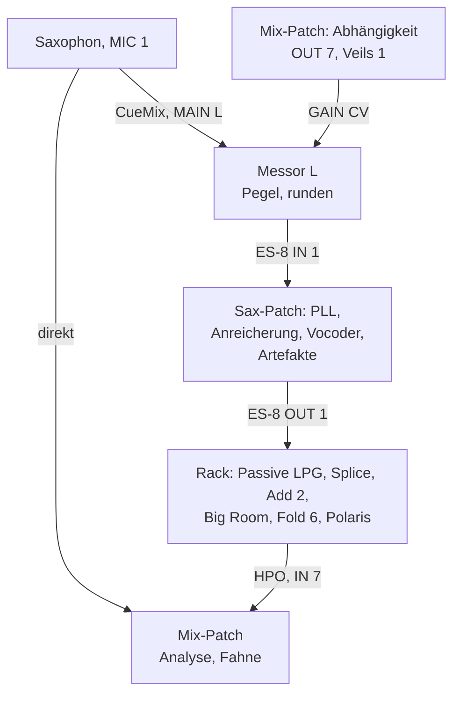

# Setup — drei Stimmen und ein Geist

Stand 2026-11-11. **Gebaut sind der Baustein `platz` und der Patch für die erste Probe,** mit Mixer als Raster, Geist, Merkmalen für Saxophon und Yoga und dem Modulations-Mixer, alles in Plätzen. Lautlos geprüft, gehört sind Testton, Saxophon und Geist. Geprobt ist nichts.

> [!abstract] Drei Stimmen gehen in einen Patch, und aus ihrer Analyse entsteht die vierte
> Peter, Yoga und das Saxophon kommen im Mix-Patch an und klingen über die drei Genelec. Aus ihrer Analyse rechnet eine Oszillatorbank nüchtern den Geist, der auf einem vierten Lautsprecher unter Stoff klingt. Das Saxophon läuft zusätzlich durch einen eigenen Patch und das Eurorack. Von der Installation werden nur die Lautsprecher umgesteckt.
>
> ```mermaid
> flowchart TD
>   P[Peter] --> M
>   Y[Yoga] --> M
>   S[Saxophon] --> R["Sax-Patch<br/>und Rack"]
>   S --> M
>   R --> M["Mix-Patch<br/>Mixer, Panner, Analyse"]
>   T[Teppich] -.-> M
>   M --> G[drei Genelec]
>   M --> B["PM-Bank<br/>nüchterne Resynthese"]
>   B --> L["vierter Lautsprecher<br/>Geist unter Stoff"]
> ```

^blick

**Was hier steht:** Signalwege, Belegung der Buchsen, die zwei Patches, die Wirkungen auf dem Saxophon, die Module und was vor dem Bau geprüft werden muss.

**Was hier nicht steht:** die Form des Stücks und wie die Installation selbst klingt. Die Installation steht in `specs\wwww-installation\`, die Stimmung aus den Zahlen als offene Idee in `specs\wwww-main\zahlen.md`.

**Die Patches** liegen in `zaehlen\wwww-performance\`: `mix\` ist der Mix-Patch, bis zum 13.11.2026 als `probe\` gebaut; dazu `platz-test\`. Einen eigenen Probepatch gibt es seitdem nicht mehr, geprobt wird mit dem Mix-Patch. Die Aufnahmen der Proben liegen in `zaehlen\quellen\medien\wwww-performance\proben\`. **Der Baustein `platz`** liegt in `zaehlen\max-bausteine\platz\`, sein Datenblatt in `katalog\bausteine\platz.md`.

**Verwandt:** `specs\wwww-installation\artefakte-digital.md` und `artefakte.md` (die Artefakte), `specs\wwww-installation\aufbau.json` (Genelec, iD14, Raummikrofon), `specs\wwww-installation\kommunikation.md` (die Fänge), `specs\wwww-installation\teppich.md`, `zaehlen\max-bausteine\digital-twins\README.md` (die Controller), `specs\wwww-performance\raw\Räumlicher Klang - Stereo und Mehrkanal.md` (die Kapitelzahlen unten beziehen sich darauf), `katalog\gehaeuse\Pod 34X.md`.

---

## Festgelegt

| Was | Wie | Seit |
|---|---|---|
| Besetzung | Peter: Bass, Drums. Yoga: Flöten, Sampler, FM-Synth, Lyra. Dazu das Saxophon. | 2026-11-04 |
| Mix-Patch | Ein gemeinsamer Max-Patch, in den alle Signale gehen. Er ist Mixer und Panner. | 2026-11-04 |
| Vierte Stimme | Aus der Analyse der drei Stimmen, nüchterne Resynthese über die FM- oder PM-Bank in `Desktop\fft\resynth`. | 2026-11-04 |
| Vierter Lautsprecher | Direkt an OUT 4, seit dem 2026-11-21 ohne den Organ Drive davor. Der Lautsprecher ist der Geist, mit zwei Stoffen: Hahnentritt-Jacquard und Kubus-Schal, beide schwarz-weiß. | 2026-11-04 |
| Interface | Jeder hat einen oder zwei Ausgänge. Sie gehen ins UltraLite mk3 und von dort in den Mix-Patch. Es bleibt beim UltraLite. | 2026-11-04 |
| Rechner | Mix-Patch und Sax-Patch laufen auf dem PC (20 Kerne, 32 GB, Windows 11). Die Installation bleibt auf dem Mac mini. | 2026-11-04 |
| Installation | Nur die Lautsprecher werden umgesteckt. Ihr Ausgang geht ins UltraLite, wenn Platz ist. | 2026-11-04 |
| Saxophon | Sägezahn-Dopplung, Rechteck für Obertöne, Gating über PLL oder Lautstärke, Phase Distortion daneben, Transienten über einen Envelope Follower im Rack abrunden. | 2026-11-04 |
| Eurorack | Nur Pod 34X und Pod 48X, beide frei bestückt. Gespielt wird es in der Hallfahne des Saxophons oder im Stillen als Voreinstellung. | 2026-11-04 |
| Patches | `rung-divisions`, `a-196` (oder im Rack gesteckt), ein bis zwei Controller aus `digital-twins`, `platz-test`. | 2026-11-04 |
| Formanten | Zwei Regler auf dem Saxophon: Die Bandbreite wird schmaler, und die Vokale rücken zur Mitte. | 2026-11-10 |
| Grundstruktur | `platz-test` ist die Grundstruktur aller Teile: Analyse von Peter und Yoga für den Geist, Sax-Patch, Panner und Mixer. Jeder Teil ist ein Platz, der sein Modul zur Laufzeit lädt. So bleibt der Performance-Patch maximal modular. Ein Platz ist ein `mcs.poly~` mit einem Kabel hinein und einem heraus, beide immer 8 Signale breit. Ein Modul nutzt davon, was es braucht, der Rest bleibt still. Ein Wechsel lädt das neue Modul in einen zweiten, parallelen Platz und blendet vom alten hinüber, wie in `platz-test`. | 2026-11-10 |
| Controller | EC4 am Mix-Patch, Lightpad am Sax-Patch. Das PC12 spielt nicht mit, nach der Regel in `katalog\capabilities\MIDI-Steuerung.md`: Mit Eurorack oder anderen Rack-Geräten spielen EC4 und Lightpad. | 2026-11-10 |
| Regler eines Platzes | Jeder Platz hat einen Pegel und Platz-Regler 1 bis 16, so viele wie Encoder in einer Gruppe des EC4. Das geladene Modul legt fest, ob ein Platz-Regler einen einzelnen Parameter stellt oder als Makro mehrere mit eigenen Kurven. Auf einen Platz-Regler kommt, was man während des Stücks dreht. Was man nur vorher einstellt, bleibt im Bedienfeld. Seit dem 2026-11-22 tragen die Platz-Regler den Namen ihres Parameters, im Raster 4 × 4 wie am EC4, und das Bedienfeld zeigt nur, was kein Platz-Regler ist. EC4 und Lightpad sprechen nur Plätze an. Makros über mehrere Plätze baut das EC4 mit seinem Twin. | 2026-11-10 |
| Merkmale | Im Patch nur FluCoMa-Objekte, kein Data Knot. Eine Steuerung heißt nach ihrem Merkmal, also „Centroid“, nicht „Helligkeit“. Die Übersicht steht unter „Die Merkmale“. | 2026-11-10 |
| Modulation | Den Grundwert eines Platz-Reglers stellt das EC4. Merkmale laufen als Signale, normalisiert auf 0 bis 1, durch einen festen Modulations-Mixer und verschieben den Grundwert: wirksam ist Grundwert plus Tiefe mal Merkmal, begrenzt auf 0 bis 1. Regler und EC4 zeigen nur den Grundwert. | 2026-11-10 |
| Mixer als Raster | Beide Mixer sind Raster aus `matrixctrl`, jede Zelle ein Drehregler. Der Audio-Mixer zeigt im Bedienfeld seines Moduls Eingänge mal Ausgänge, die Zelle ist der Pegel dieses Wegs. Der Modulations-Mixer zeigt einen Ziel-Platz auf einmal, gewählt oben: Merkmale aller Stimmen mal dessen 16 Platz-Regler, die Zelle ist die Tiefe. Später kommt „Lernen“ wie beim Makro am EC4 dazu. | 2026-11-10 |
| Bereiche der Merkmale | Jedes Merkmal hat einen festen Bereich als Voreinstellung, im Feld von `merkmale` pro Stimme verstellbar. Ein Knopf „Lernen“ füllt Anfang und Ende aus dem, was beim Spielen kommt, ein Knopf „Speichern“ legt sie als Preset ab. Die Preset-Nummer ist die Stimme, etwa `load merkmale 1 0` für das Saxophon. | 2026-11-10 |
| Stille | Unter einer Schwelle der Lautheit gleiten Centroid und Flatness in etwa einer Sekunde auf 0, jedes Ziel kehrt zu seinem Grundwert zurück. Lautheit und Onsets gehen ohnehin auf 0. Die Tonhöhe hält ihren letzten Wert und ändert sich nur bei genügend Konfidenz. Ein Schalter „Halten“ hält stattdessen alle Merkmale auf ihrem letzten Wert. Schwelle, Konfidenz und Schalter stehen im Feld von `merkmale`, pro Stimme. | 2026-11-10 |
| Einfrieren im Geist | Ein Analyse-Platz, der nichts mehr schreibt, setzt seine Plätze im Buffer auf null, wenn sein Anteil auf null geht oder 300 ms kein Rahmen kommt. Ein Schalter „Einfrieren“ im Feld von `analyse` hält stattdessen seine letzten Teiltöne, wie „Halten“ bei den Merkmalen. Anlass: ein Rauschspektrum blieb am 2026-11-10 nach einem Test im Buffer und klang weiter. | 2026-11-11 |
| Quellen des Geists | Neben den Spielern speist eine eigene Quelle die Analyse: sieben Stimmen Phase Distortion in einem eigenen Platz, mit dem Notengeber aus `Desktop\fm pd\phasedistortion\rwle3_tonyobr.maxpat` und Morph und Spread aus `rwle3._casio_cz.maxpat`. Der Notengeber geht zufällig durch E♭ lydisch-dominant oder E phrygisch-dominant. So klingt der Geist auch, wenn niemand spielt. Jede Quelle bekommt einen festen Block von Plätzen in der Bank, Startplatz und Zahl der Spitzen stehen im Preset ihrer Analyse. | 2026-11-12 |
| Notengeber | Ein eigener Platz gibt die Töne für die Phase Distortion vor, getrennt vom Klang. Der erste ist der Doppelgänger: Er spiegelt die Tonhöhe einer Stimme harmonisch an einer Achse, die auf einer Lemniskate im Atem läuft. Ein Regler „Nähe“ entscheidet, ob sich der Geist anschmiegt oder flieht, und jedes Merkmal kann ihn über den Modulations-Mixer führen, voreingestellt die Flatness: Der Atem im Ton trennt. Jede Stimme kann ihn führen. Der Zufallsweg aus `tonyobr` bleibt als zweiter wählbar. | 2026-11-12 |
| Phase Distortion ins Rack | Sie bleibt im Mix-Patch beim Doppelgänger. Der Mixer bekommt sie als fünften Eingang und zwei Spalten „Rack 1“ und „Rack 2“ für UltraLite OUT 5 und OUT 6. So kann jede Stimme ins Rack. Im Rack geht sie über Messor R an Splice B. Im Rack darf sie still sein, wenn das Saxophon schweigt. | 2026-11-13 |
| Anreicherung | Kein eigener Sägezahn. `a196` rastet auf das Saxophon ein, und ein zweiter Platz Phase Distortion im Sax-Patch biegt direkt die Phase der PLL, statt einen eigenen Oszillator zu drehen. So beginnt jede Welle mit der des Saxophons, auch bei Vibrato und Glissando, und es klingt wie ein Instrument mit mehr Obertönen. Morph wählt die Farbe: Sinus, Sägezahn, Rechteck, Puls, Resonanz. Das Unison kommt aus dem Chor von 8 PLLs, jede mit eigener Phase. Alle Ideen zum Anreichern wirken auf diesen Platz. Die Phase Distortion mit dem Doppelgänger bleibt davon getrennt im Mix-Patch. | 2026-11-13 |
| Interface für Proben | Das UltraLite ist das Interface für die Performance und alle Proben. Es kommt dafür vorübergehend aus dem Thon-Rack. Das iD14 bleibt am Mac mini der Installation. | 2026-11-13 |
| Pods | Pod 34X hört: Disting mk4, Cosmotronic Messor, Joranalogue Contour 1, Select 2, Compare 2. Pod 48X formt: ES-8, DPW SW3 Splice, Persephone, Nonlinearcircuits The Big Room mit der Spirale Accutronics AMC2BF3, Fold 6, Polaris, HPO. Ohne Verteiler, jede Spannung hat ein Ziel. Chem LPG, Passive LPG und BHWR nutzt der Nutzer getrennt vom Rack. Die Spirale ist am Big Room getestet. | 2026-11-13 |
| Fahne | Doppelt: Die Spirale im Big Room ist der Körper, ein Digitalhall in Max ihr Abbild im Raum. Der Digitalhall ist ein Platz „Fahne“ im Mix-Patch mit zwei Eingängen, dem trockenen Saxophon von IN 1 und der Spirale von IN 7. Ein Platz-Regler blendet zwischen beiden. Der Sax-Patch hat keinen Hall mehr. | 2026-11-13 |
| Sax-Patch | Er macht aus dem Saxophon, was durchs Rack geht, und steuert das Rack. Plätze: Merkmale, PLL, Anreicherung, Formanten, Vocoder, Ringmodulation, Artefakte, Mischer, Takte und Gates, Rack, Modulations-Mixer. Er spielt nicht auf die Lautsprecher. Siehe „Der Sax-Patch“. | 2026-11-13 |
| Peter | Immer auf IN 3 und IN 4, Bass und Drums. Bis zur Probe am 2026-11-21 als frei geführt, weil Peter dort fehlte. | 2026-11-21 |
| Maß und Spielansicht | Jeder Patch ist einheitlich gebaut: Schrift 12, Drehregler 40, Zeile und Knopf 22, Rasterzelle 24, 8 px Abstand, nichts überlappt, jedes Bedienfeld passt in sein Fenster. `zaehlen\max-bausteine\werkzeug\layout.py` prüft das. Der Mix-Patch öffnet in einer Spielansicht nur mit dem, was man spielt; die Bauansicht behält die Verkabelung. Ein Platz zeigt sein Bedienfeld fest oder auf Knopfdruck. | 2026-11-22 |
| Rack nach der ersten Probe | Ersetzt die Zeile „Pods“ und den Weg im Rack aus „Phase Distortion ins Rack“. Disting und Persephone fallen weg. Neu sind Tunefish Veils und Joranalogue Add 2 im Pod 48X und, außerhalb der Pods, Herzlich Passive LPG und Chem LPG. Fold 6 zieht in den Pod 34X. MAIN OUT L und R gehen ins Rack, weil sie mit 4,6 V mehr Spannung geben als OUT 1–8 mit 3,5 V: Saxophon und Phase Distortion gehen von dort direkt in den Messor. OUT 5 bis 8 gehen durch Veils, das ihre Spannung hebt; seine Knöpfe sind dort Griffe. Saxophon und Phase Distortion können unabhängig, abhängig, im Wechsel oder verflochten klingen, siehe „Saxophon und Phase Distortion“. Anlass aus der Probe: Der Weg ins Rack war zu leise, und die Phase Distortion war über GAIN CV des Messor immer an das Saxophon gebunden. Details unter „Die Module“. | 2026-11-21 |
| Zwei Mixer | Der Mix-Patch hat zwei Plätze mit dem Modul `mixer`, beide auf OUT 1 bis 6. Der Mixer Eingänge mischt IN 1 bis 8, Kanal gleich Buchse: Saxophon, Teppich, Peter 1 und 2, Yoga 1 und 2, Rack, IN 8. Der Mixer Quellen mischt, was im Patch entsteht: 1 Phase Distortion, 2 Geist, 3 bis 5 Fahne, 6 bis 8 Hall. Fahne und Hall haben je drei Zeilen, weil sie auf den drei Genelec verschieden klingen. So bleibt jeder Platz 8 Kanäle breit. | 2026-11-13 |

Gelesen als: Der vierte Lautsprecher kommt zu den drei Genelec dazu.

---

## Vorgeschlagen, nicht bestätigt

### Die Stimmen im Raum

Jede Stimme hat einen festen Lautsprecher als Heimat und bewegt sich von dort weg. Die Heimat ist die Verteilung, die in Max steht. Bei vier Lautsprechern, den drei Genelec und dem des Geists, und einem Publikum ohne festen Platz passt DBAP (Kap. 15.4), denn es braucht weder Sweet Spot noch regelmäßige Anordnung. Wie der Panner gebaut wird, steht in `raum.md`. Der Geist wird nicht gepannt, er bleibt ein Körper an einem Ort (Kap. 18.1, 18.3).

| Stimme | Eingang | Heimat | Bewegung |
|---|---|---|---|
| Peter 1, Bass | IN 3 | alle drei gleich unter 120 Hz, darüber Genelec 3 | keine |
| Peter 2, Drums | IN 4 | Genelec 3 | Sprünge auf einen Lautsprecher am Anschlag (Kap. 16.1) |
| Yoga 1, Flöten und Lyra | IN 5 | Genelec 1 | langsam über 16 s, dazu ±3–8° Zittern (Kap. 12.4) |
| Yoga 2, Sampler und FM | IN 6 | Genelec 1 | folgt der Helligkeit des Signals (Kap. 12.9) |
| Saxophon | MIC 1 und Rack | Genelec 2 | trocken fest, die Hallfahne dekorreliert auf allen drei (Kap. 4.1) |
| Teppich | MIC 2 | alle drei | diffus |
| Geist | keiner, entsteht im Patch | vierter Lautsprecher | keine |

**Die zwei Ausgänge sind zwei Instrumente, nicht Stereo.** Bass und Drums brauchen verschiedene Panner und verschiedene Analyse. Das müssen Peter und Yoga so mitbringen.

**Flöten, Lyra und vielleicht die Drums brauchen Mikrofone.** Auf dem UltraLite sind die zwei Vorverstärker belegt. Peter und Yoga brauchen also je ein kleines eigenes Pult, das auf Line-Pegel herauskommt.

### Belegung des UltraLite

Das Gerät hat 8 analoge Eingänge: 2 mit Vorverstärker, 6 Line. Damit sind alle belegt, und die Installation passt nur als ein Monokanal hinein. Ausgänge gibt es 10, dazu Kopfhörer.

| Eingang | Signal |
|---|---|
| MIC/INSTR 1, XLR mit 48 V | Saxophon, AKG C3000 |
| MIC/INSTR 2, Klinke | Teppich, Summe von iD14 Out 4 |
| IN 3, IN 4 | Peter 1, Peter 2 |
| IN 5, IN 6 | Yoga 1, Yoga 2 |
| IN 7 | Rack zurück, Hauptweg, über HPO L |
| IN 8 | frei, an HPO R |

| Ausgang | Signal |
|---|---|
| OUT 1–3 | Genelec 1–3, dieselben Kabel wie am iD14 |
| OUT 4 | Geist, direkt an seinen Lautsprecher |
| MAIN OUT L | Saxophon direkt aus CueMix FX, ohne Rechner, an Messor L. Dazu kann eine Spalte des Mixers jede Stimme legen. Seit dem 2026-11-21, vorher OUT 5. |
| MAIN OUT R | Phase Distortion an Messor R, aus einer Spalte des Mixers. Seit dem 2026-11-21, vorher OUT 6. |
| OUT 5 | Pulse aus den Onsets einer Stimme, wählbar, voreingestellt Peter 2 an IN 4, über Veils 3 an Chem LPG 1 CV. Im Mix-Patch der Platz Onsets, `huellkurve` beim Auslösen. |
| OUT 6 | Stille aller Stimmen als Spannung, über Veils 4 an Big Room CV FB. Im Mix-Patch der Platz Stille, `huellkurve` folgt allen Stimmen, umgekehrt. |
| OUT 7 | Abhängigkeit als Spannung, über Veils 1 an Messor GAIN. Im Mix-Patch der Platz Abhängigkeit, `huellkurve` folgt dem Saxophon. |
| OUT 8 | der Geist, über Veils 2 und Chem LPG 1 an Big Room IN WET |

**Seit dem 2026-11-22 kommt jeder Rack-Ausgang aus dem Mixer Rack im Mix-Patch:** Zeilen Abhängigkeit, Onsets, Stille, Phase Distortion, Geist, Yoga 1, Yoga 2, Peter 2; Spalten OUT 5 bis 8, MAIN L und R. Die Belegung oben ist sein Weg beim Laden; jede Stimme lässt sich umlegen.
| PHONES | Abhören |

**Die Ausgänge sind DC-gekoppelt** (Katalog, mit den Spannungen: MAIN 4,6 V, OUT 1–8 3,5 V). **MAIN folgt dem Lautstärkeknopf vorne,** er steht deshalb auf voll und bleibt dort. Vor OUT 1–4 steht deshalb in Max immer `dcblock` und ein Limiter, zum Schutz von Genelec und Röhren.

**Das UltraLite steckt fest im Thon-Rack** (`katalog\aufbau\thon-rack.md`). Nur die Hybrid hat USB. Seit dem 2026-11-13 ist sie das Interface für alle Proben und kommt dafür vorübergehend heraus. Das iD14 bleibt am Mac mini der Installation.

### Zwei Interfaces, zwei Patches

Max spricht pro Instanz nur ein Interface an. UltraLite und ES-8 sind zwei. JACK löst das nicht: Mit JackRouter wäre JACK selbst das Interface von Max, das ES-8 bliebe trotzdem draußen. Unter Windows hat Max keinen Weg, zwei ASIO-Geräte zu bündeln, und aus dem Forum kommen Berichte über Abstürze von Max mit JackRouter. JACK ist auf diesem PC auch nicht installiert.

**Der Weg sind Kabel.** Zwei Max-Instanzen, jede mit ihrem Interface, verbunden nur analog: OUT 5 ins Rack, Rack ins ES-8, Rack zurück in IN 7/8. Seit dem 2026-11-21 gehen MAIN und OUT 5 bis 8 ins Rack. Das gibt kein Taktproblem, und ein Absturz trifft nur eine Seite.

**Beide Patches laufen in Max.** Max wird zweimal geöffnet, das zweite Mal aus einer Kopie seines Programmordners. Das geht laut Nutzer. Das Original hängt mit dem Mix-Patch am UltraLite, die Kopie mit dem Sax-Patch am ES-8. Jeder Patch setzt beim Laden sein Interface selbst, über `adstatus`.

**Treiber:** Für das UltraLite mk3 Hybrid ist seit dem 2026-11-13 der MOTU Audio Installer 92178 vom 28.09.2022 installiert, ASIO-Name „MOTU Audio ASIO“. Unter Windows 11 berichten mehrere von Knacksern, die Wache im Mix-Patch zählt sie. Für das ES-8 gibt es den USB-Audio-Treiber 6.16.0 für Windows 10 und 11.

### Mix-Patch

Hängt am UltraLite. Hier laufen Eingänge, Panner, Analyse und Geist.

- **Plätze:** Jeder Teil des Mix-Patches ist ein Platz nach `platz-test`, siehe „Festgelegt“. Wie viele Kanäle durch sein Kabel laufen, bestimmt das geladene Modul über `mc.in~` und `mc.out~`. **Die neue Kanalzahl gilt erst nach einem Neustart des Audios,** gemessen am 2026-11-10: Ein Modul mit 4 Ausgängen statt 1 lädt sofort, das Kabel zählt aber weiter 1 Kanal, bis DSP aus- und wieder eingeschaltet wird. Deshalb ist jeder Platz fest 8 Signale breit, und jedes Modul hat 8 `out~`. **Bei gleicher Breite braucht der Tausch keinen Neustart,** ebenfalls gemessen am 2026-11-10: Ein Modul mit Signal auf Kanal 1 bis 4 ersetzt eines mit Signal nur auf Kanal 1, und Kanal 4 trägt danach sofort das Signal, in beide Richtungen. Die Überblendung zwischen zwei Plätzen ist in `mcs.poly~` noch nicht gehört. Die 8 kommen von den 8 Eingängen des UltraLite, der Mixer ist der breiteste Teil.
- **Mixer:** zwei Plätze, siehe „Zwei Mixer“ unter „Festgelegt“. Ihre Spalten sind OUT 1 bis 6: Genelec 1 bis 3, Geist, Rack 1, Rack 2. Beim MOTU-Treiber sind das die Kanäle 3 bis 8, weil 1 und 2 der Main Out sind.
- **Panner:** ein Raum-Platz pro Spieler, DBAP auf OUT 1 bis 4, die Räume in `raeume.json`. Bewegung und Rendern sind getrennt (Kap. 5). Alles Weitere steht in `raum.md`, bestätigt am 2026-11-14.
- **Hall:** Ein gemeinsamer Hall für Peter und Yoga, mit getrennten Frühreflexionen und Fahne (Kap. 1.3).
- **Fahne des Saxophons:** ein Platz „Fahne“ mit Digitalhall, festgelegt am 2026-11-13. Er hört das trockene Saxophon von IN 1 und die Spirale des Big Room von IN 7, ein Platz-Regler blendet zwischen beiden. Bei 0 hallen beide nebeneinander: zwei Fahnen vom selben Ton, eine metallisch und nah, eine weit und glatt. Bei 1 hallt der Raum die Spirale nach. Die Spirale klingt auf Genelec 2, beim Saxophon, der Digitalhall dekorreliert auf allen drei. Beim Spielen nimmt die Hüllkurve ihn 1–4 dB zurück (Kap. 10.2). Das z des Lightpads blendet zwischen Körper und Raum und kommt per `udpsend` aus dem Sax-Patch. Der Platz „Fahne“ geht im Mixer-Raster nie in eine Rack-Spalte, solange er die Spirale hört, sonst entsteht eine Schleife.
- **Der Mix läuft von selbst.** Niemand hat beim Spielen eine Hand frei. Bewegung kommt aus dem Signal und aus den Gesten-Loopern, Zustände aus den Presets der Module und den Platz-Reglern, siehe „Spielen“.

### Die Merkmale

Die Analyse liefert mehr als die Teiltöne für den Geist. Jedes Merkmal ist eine Zahl, die etwas bewegen kann. Nachgesehen am 2026-11-10 in den installierten Paketen FluCoMa und Data Knot 1.0.3. Im Patch laufen nur die FluCoMa-Objekte, Data Knot steht als Nachschlag dabei. Eine Steuerung heißt nach ihrem Merkmal, also „Centroid“ und nicht „Helligkeit“.

| Merkmal | Was es sagt | FluCoMa | Data Knot 1.0.3 |
|---|---|---|---|
| Lautheit | wie laut, und ob es gerade lauter wird | `fluid.loudness~` | `dk.descriptorsrt~` |
| Tonhöhe, mit Konfidenz | welcher Ton, und wie sicher | `fluid.pitch~` | `dk.descriptorsrt~` |
| Centroid | Helligkeit | `fluid.spectralshape~` | `dk.descriptorsrt~`, `dk.spectralshapert~` |
| Flatness | Rauschanteil | `fluid.spectralshape~` | `dk.descriptorsrt~`, `dk.spectralshapert~` |
| MFCC | Klangfarbe, 13 Zahlen | `fluid.mfcc~` | `dk.mfccrt~` |
| Melbänder, Chroma | grobes Spektrum, Tonklassen | `fluid.melbands~`, `fluid.chroma~` | `dk.melbandsrt~` |
| Onsets | ein neuer Anschlag | `fluid.onsetslice~`, `fluid.ampslice~`, `fluid.noveltyslice~` | `dk.onset~` |
| Teiltöne | Frequenz und Betrag einzelner Spitzen | `fluid.sinefeature~`, das ist das jetzige Modul | `dk.sinesrt~` |

**Wie ein Merkmal zu dem kommt, was es bewegt,** steht unter „Festgelegt“ in der Zeile „Modulation“. Gebaut am 2026-11-10 in `zaehlen\wwww-performance\probe\`, so wie hier beschrieben:

1. Ein Modul `merkmale` im Analyse-Platz jeder Stimme legt die Merkmale auf feste Kanäle: 1 Lautheit, 2 Tonhöhe, 3 Konfidenz, 4 Centroid, 5 Flatness, 6 Onsets, 7 und 8 frei. Es normalisiert selbst auf 0 bis 1. MFCC und Melbänder passen nicht in 8 Signale und bekommen eigene Module.
2. Der Modulations-Mixer hat als Zeilen die Merkmale aller Stimmen und als Spalten die Platz-Regler der Ziele, in jeder Zelle eine Tiefe von −1 bis +1. Er ist kein Platz, weil er breiter ist als 8 Signale, und steht fest im Patch wie Aufnahme und Limiter.
3. Der Baustein `platz` bekommt einen zweiten Signaleingang „Modulation“ mit 16 Signalen, eines pro Platz-Regler. Innen rechnet er Grundwert plus Modulation und schickt das Ergebnis alle 20 ms als `regler <n> <wert>` ans Modul. Die Module bleiben, wie sie sind.

Beispiel: Das EC4 stellt die PM-Tiefe des Geists auf 0,2, die Zelle „Saxophon Centroid → Geist, Platz-Regler 1“ steht auf +0,5. Bei Centroid 0,8 wirkt 0,6, der Geist wird rauer, und der Regler am EC4 bleibt auf 0,2.

Die Bereiche, voreingestellt und vorgeschlagen am 2026-11-10, im Feld verstellbar und lernbar:

| Merkmal | Bereich |
|---|---|
| Lautheit | −60 bis 0 dB |
| Tonhöhe | MIDI 24 bis 96, also C1 bis C7, damit auch Peters Bass hineinpasst |
| Konfidenz | 0 bis 1, schon normalisiert |
| Centroid | 100 Hz bis 10 kHz, logarithmisch |
| Flatness | −60 bis 0 dB |
| Onsets | 1 beim Anschlag, fällt in 100 ms auf 0 |

Was die Merkmale in der Stille tun, steht unter „Festgelegt“ in der Zeile „Stille“.

### Der Geist

**Die Bank:** `pmoscbank.maxpat`, 250 Oszillatoren, je mit Träger und Modulator. Die PM-Tiefe ist der einzige Regler und startet bei 0, dann ist es reine Addition. `fm oscbank.maxpat` ist trotz des Namens eine Bank ohne Modulation.

**Gebaut am 2026-11-10 als zwei Module,** je in einem eigenen Platz, in `zaehlen\wwww-performance\probe\`. `analyse` schreibt ab seinem Startplatz in `buffer~ geist.oscdata`, `pmbank` liest daraus. Der Buffer steht im Patch, nicht im Modul, damit es ihn bei einem Wechsel nicht zweimal gibt. Die PM liegt an zwei Reglern für alle Oszillatoren: Platz-Regler 1 ist die Tiefe, Platz-Regler 2 das Verhältnis von Modulator zu Träger. Die Kanäle 3 und 4 des alten Buffers fallen weg. Findet die Analyse weniger als 50 Spitzen, füllt sie den Rest mit Nullen.

**Nüchtern heißt:** nach der Bank kommt nichts Digitales. Kein Hall, kein Pan, keine Artefakte. Alle Farbe entsteht analog, im Stoff. Bis zum 2026-11-21 auch im Organ Drive, der seitdem nicht mehr mitspielt.

**Die Analyse, wie sie geplant war.** Gebaut sind alle fünf Punkte, für Saxophon, Yoga und die Phase Distortion, mit 80 Spitzen pro Quelle statt 50. Die Glättung aus Punkt 4 dauert 25 ms, seit dem 2026-11-12. Der Weg:

1. `fluid.sinefeature~` auf den fünf trockenen Signalen, je 50 Spitzen, also 5 × 50 = 250 Plätze. Das Objekt liegt in FluCoMa.
2. Pro Signal ein Regler für seinen Anteil. Drums und Saxophon dürften sehr verschieden viel beitragen.
3. Frequenz und Betrag schreibt `peek~` in `buffer~ oscdata`. Plätze ohne Spitze bekommen Amplitude 0, das überspringt die Bank.
4. Die Amplitude in der Bank pro Oszillator kurz glätten, sonst springt sie mit jedem Analyse-Rahmen. Ob das hörbar ist, zeigt der erste Lauf.
5. Beide Ausgänge der PM-Bank summieren. Der Kommentar im Patch warnt: Bei ungerader Zahl aktiver Oszillatoren wechselt jeder pro Sample den Kanal. In der Summe ist das egal.

**Der Doppelgänger als Notengeber.** Die Arbeitshypothese von wwww, `specs\wwww-main\konzept.md`, wird hörbar: Der Geist spiegelt eine Stimme. Die Spiegelung ist die harmonische aus `specs\wwww-main\raw\---20260815 mathematische Ideen.md`, mit Achse S und Zentrum Z als Fixpunkten, d = c / (2·c·q − 1) bei q = 1 / Z. Mit Z im Unendlichen ist es die euklidische Spiegelung, das Saxophon höher und der Geist tiefer. Die Achse läuft auf der Lemniskate aus derselben Notiz, der „sich kreuzenden Ich-Mitte“, eine Schleife über einige Atemzüge zu 3,33 s. So verschlängeln sich Stimme und Geist an den Treffpunkten und entschlängeln sich in den Schleifen. Die Nähe rückt Z auf den gespielten Ton oder lässt es, wo Schräge und Lemniskate es hinstellen; ein Merkmal führt sie, voreingestellt die Flatness. Gebaut am 2026-11-12 in `zaehlen\wwww-performance\probe\doppelgaenger.modul.maxpat`, noch nicht geprüft.

**Der Geist kommt später.** Das Fenster der Analyse verzögert ihn, bei 2048 Samples um rund 43 ms. Die Fenstergröße ist damit ein zweiter Regler.

**Rechenlast:** 250 Oszillatoren mit je zwei `cycle` sind 24 Millionen Aufrufe pro Sekunde. Gemessen ist das nicht. Reicht ein Kern nicht, kommt die Bank in ein `poly~ @parallel 1`.

**Der Geist hört sich selbst.** Das Saxophon-Mikrofon nimmt ihn auf, die Analyse findet seine Teiltöne, und die Bank hält sie am Leben. Das kann schön sein, es ist das Motiv „Feedback, Kopplung“. Es muss aber eine Entscheidung sein. Die Rückseite des C3000 zeigt zum Geist, der Anteil des Saxophons an der Analyse ist regelbar.

**Organ Drive, seit dem 2026-11-21 nicht mehr dabei:** Röhren-Effektgerät mit 2 × ECC83 und 6,3-mm-Klinke, vorhanden, Notiz in `katalog\geraete\Tube Amp Manufactur Organ Drive.md`. Kanal 1 ist Overdrive, Kanal 2 stärkere Verzerrung, dazu Bypass. Laut Thomann verarbeitet er jeden Eingangspegel. `GAIN` regelt auch den Eingang und wirkt auf beide Kanäle. Die Klinke ist unsymmetrisch: das Gerät nah ans UltraLite, von dort über eine DI-Box lang zum Lautsprecher.

**Stoff:**
- Der Kühlkörper eines Aktivlautsprechers bleibt frei, nie unter dem Stoff.
- Stoff nimmt Höhen weg. Wie viel, wird gemessen: Sweep mit ARTA (`katalog\dateien\geraete\arta\`) in 1 m Abstand, ohne Stoff, mit einer und mit zwei Lagen.
- Der Lautsprecher ist offen. Ein anderes Modell als Genelec passt zum Solisten (Kap. 18.3), etwa ein Monkey Banana aus dem Thon-Rack. Hat er eine Bassreflexöffnung, bewegt ein tiefer Ton vielleicht den Stoff. Das wäre eine sichtbare Atmung, ungeprüft.

### Das Saxophon



Der Sax-Patch hängt am ES-8. **Die Fahne entsteht im Rack, hinter dem Gate.** Passive LPG 1 sitzt vor Splice A und bestimmt, wie viel Saxophon in die Spirale geht; bis zum 2026-11-21 tat das Persephone. Schließt das Gate, klingt die Fahne weiter und läuft frei durch Fold 6 und Polaris. Daraus folgen beide Spielweisen in einem Kabelweg: Klingt die Fahne, hört man jeden Griff am Rack. Ist sie verklungen, kommt nichts mehr an, und derselbe Griff ist still die Voreinstellung für den nächsten Einsatz.

| Wirkung | Wo | Wie | Griff |
|---|---|---|---|
| Transienten runden | Rack, vor Max | Messor L: kurzer Attack, Ratio jenseits von „limit“. Über GAIN CV öffnet ihn die Spannung des Reglers „Abhängigkeit“ aus dem Mix-Patch. | Attack, Ratio, Knopf von Veils 1 |
| Pegel heben | Rack, vor Max | Der Messor hebt Line-Pegel von MAIN L um bis zu +17 dB. | Gain |
| Anreicherung | Sax-Patch | `a196` rastet ein, die Phase Distortion biegt seine Phase. Morph wählt Sinus, Sägezahn, Rechteck, Puls oder Resonanz. | Lightpad |
| Unison | Sax-Patch | Der Chor aus `a196_test.maxpat`: 8 PLLs, um −3 bis +3 Hz verstimmt, jede biegt ihre eigene Phase. | Lightpad |
| Gate nach Tonhöhe | Sax-Patch | Das Rechteck der PLL ist der Takt von `rung_divisions`, Audiorate geht. Der 1-Bit-Ausgang geht über ES-8 OUT 4 an Compare 2. | Preset |
| Gate nach Lautstärke | Rack | Nach Art des SSG, siehe unten. | Rack, im Stillen |
| Saxophon und Doppelgänger | Rack | Vier Spielweisen, siehe unten. | Schalter 1TO2 und A AUTO B an Splice, Platz Abhängigkeit |
| Sättigung und Falten | Rack | Warm am Messor, Symmetry an Fold 6 für gerade Obertöne, danach Polaris. | Rack, in der Fahne |
| Phase Distortion | Mix-Patch | Der Doppelgänger, über UltraLite MAIN R an Messor R und Splice B. | Platz-Regler |
| Vocoder | Sax-Patch | Das Saxophon formt die Anreicherung. | Preset |
| Fahne | Rack und Mix-Patch | Die Spirale im Big Room, dazu der Platz „Fahne“ im Mix-Patch, siehe dort. ES-8 OUT 8 dreht den Big Room beim Spielen Richtung trocken. | Feedback am Big Room, Lightpad z |

**Saxophon und Phase Distortion, festgelegt am 2026-11-21.** Der Messor hat einen Eingang GAIN CV für L und R zusammen. Der Platz Abhängigkeit im Mix-Patch gibt ihm die Spannung, über OUT 7 und Veils 1. Er lädt `huellkurve`, die dem Saxophon folgt, mit zwei Reglern: Versatz hält den Messor offen, das ist der unabhängige Teil; Höhe folgt der Lautstärke, das ist der abhängige. Festgelegt am 2026-11-21 statt eines einzelnen Reglers, wie Offset und CV an Veils. Splice hat zwei Seiten. Der Schalter 1TO2 oben kopiert A1 und B1 auf Seite 2, unten bleibt Seite 2 leer und still (Handbuch MAN-SW3). Add 2 summiert beide Seiten.

| Spielweise | 1TO2 | Seite 1 | Seite 2 | „Abhängigkeit“ |
|---|---|---|---|---|
| Unabhängig, beide zugleich | oben | A, Saxophon | B, Phase Distortion | Versatz rechts, Höhe links |
| Abhängig, die Phase Distortion folgt der Lautstärke des Saxophons | oben | A | B | Versatz Mitte, Höhe rechts |
| Im Wechsel: laut das Saxophon, leise der Doppelgänger | unten | Compare 2 OR an D1, im Stillen gesteckt | still | egal |
| Verflochten, beide in einer Welle | unten | AUTO: wechselt bei jedem Treffpunkt der Wellen, /2 und /4 geben Untertöne | still | egal |

Bei „Abhängig“ öffnet die Hüllkurve auch Messor L. Das Saxophon geht dann wie durch einen sanften Expander in den Sax-Patch.

**Die PLL hört rohes Saxophon schlecht.** `a196` macht aus dem Eingang ein Rechteck: alles über 0 ist High. Ein obertonreicher Ton kreuzt die Null mehrmals pro Periode. Davor gehört ein Tiefpass nahe am Grundton. Getestet ist `a196` nur mit `cycle~`. Für den Anfang: `mode 2`, `a 30`. Die Anreicherung braucht außerdem die Hüllkurve als Lautstärke, sonst läuft sie in der Stille weiter.

### Der Sax-Patch

Max spricht pro Instanz nur ein Interface an, und Steuerspannung ins Rack kann nur das ES-8. Deshalb läuft eine zweite Max-Instanz am ES-8. **Sie macht aus dem Saxophon, was durchs Rack geht, und steuert das Rack.** Sie hört nur ES-8 IN 1, das Saxophon nach dem Messor. Jeder Teil ist ein Platz.

| Platz | Aufgabe | Was man hört |
|---|---|---|
| merkmale | Dasselbe Modul wie im Mix-Patch, auf dem Saxophon: Lautheit, Tonhöhe, Konfidenz, Centroid, Flatness, Onsets. | nichts, Quelle für die Modulation |
| PLL | `a196` rastet ein. Seine Phase geht an die Anreicherung, sein Rechteck an die Takte. | nichts, Steuersignale |
| Anreicherung | Phase Distortion, die die Phase der PLL biegt, mit Morph und Unison. | das Saxophon mit mehr Obertönen |
| Formanten | Filterbank mit zwei Reglern, „schmaler“ und „zur Mitte“, siehe unten. | das Saxophon wie aus einem Modell |
| Vocoder | Das Saxophon formt die Anreicherung, sie bekommt seinen Rhythmus und seine Formanten. | ein schneidender Klang, der spricht |
| Ringmodulation | Saxophon mal Anreicherung, in `gen~` | Summen- und Differenztöne |
| Artefakte | Subsample-Regler, Takt an der PLL, Bits schalten, Wrap statt Clip | siehe „Die Artefakte in der Performance“ |
| Mischer | Wie viel von jedem Platz auf ES-8 OUT 1 geht | die Mischung ins Rack |
| Takte und Gates | `rung-divisions` am Rechteck der PLL: Gate nach Tonhöhe auf OUT 4, langsamer Takt mit `chance 0,1` auf OUT 3. Die Hüllkurve aus IN 1 zweimal, auf OUT 2 und OUT 7. | nichts, das Rack schaltet damit |
| Rack | Seine Platz-Regler sind OUT 5 (Fold 6), OUT 6 (Polaris) und OUT 8 (Big Room, trocken–nass). So wird jede Steuerspannung ins Rack ein Ziel im Modulations-Mixer. | das Rack bewegt sich mit dem Spiel |
| Modulations-Mixer | Wie im Mix-Patch. Quellen: Merkmale, Frequenz der PLL, Hüllkurve, Lightpad. Ziele: alle Plätze hier. | |

**Beispiele für Modulation ins Rack:** Der Centroid öffnet Polaris, hell gespielt wird die Fahne hell. Die Flatness faltet an Fold 6, der Atem im Ton faltet die Fahne. Die Lautheit, negativ, öffnet die Spirale: Je leiser, desto nasser.

**Was er nicht macht:** Er spielt nicht auf die Lautsprecher, alles geht durchs Rack und kommt auf IN 7 im Mix-Patch an. Er hat keinen Hall. Er rechnet nicht am Geist, Analyse, Geist und Doppelgänger bleiben im Mix-Patch.

**Zwischen den Instanzen** gehen das z des Lightpads und die Tasten der Looper per `udpsend`.

### Die Anreicherung


**Seit dem 2026-11-13 ist der Sägezahn eine Stellung der Phase Distortion,** siehe „Festgelegt“, Zeile „Anreicherung“. Die Ideen aus der Liste vom 2026-11-04 treffen jetzt diesen Platz.

| Aus der Liste vom 2026-11-04 | Hier |
|---|---|
| Asymmetrische Sättigung | Rack: Warm am Messor, Symmetry an Fold 6 |
| Wavefolding, moduliert | Rack: Fold 6, von Hand oder per Hüllkurve |
| Resonanter Filter | Rack: Polaris |
| Exciter | Mix-Patch, Hochpass mit `tanh` wie in `artefakte.md` |
| Vocoder mit Sägezahn-Träger | Sax-Patch, die Anreicherung ist der Träger |
| Unison | Chor aus 8 PLLs, jede mit eigener Anreicherung |
| Morphing über Zeit | Geste auf dem Lightpad, im Looper aufgenommen |
| Bitcrusher | siehe Artefakte, unten |
| Ringmodulation | Mit der Anreicherung in `gen~`. Der Ming Rod ist ein Ringmodulator, im Rack hat Splice seinen Platz. |
| Resonator mit Feedback | Vorerst draußen. Das Disting hätte ihn, ist seit dem 2026-11-21 aber nicht mehr dabei. |
| Resynthese, Wavetable-Import | Draußen. Serum und Vital laufen nicht live mit dem Saxophon mit. |

**Formanten zu schmal.** Die Notiz über generative Modelle wird ein eigener Regler. `formant vocal parameters.maxpat` enthält 25 Modelle mit je 5 Formanten, die Bandbreiten liegen dort bei 50–200 Hz. Eine Filterbank nimmt diese Frequenzen, und ein Regler multipliziert die Bandbreite mit 0,1 bis 1. Das Saxophon klingt dann glasig wie ein Modell. Bei 5 Hz Bandbreite klingt ein Filter rund 0,4 s nach.

**Vokale zur Mitte.** Die andere Hälfte derselben Notiz wird ein zweiter Regler. Die 25 Modelle sind fünf Stimmlagen mit je den Vokalen a, e, i, o und u. Der Regler zieht jeden Formanten von seinem Vokal zum Mittel der fünf Vokale derselben Stimmlage: Bei 0 bleibt der Vokal, bei 1 klingen alle fünf gleich. Beim Sopran liegt F1 dann bei 439 Hz und F2 bei 1358 Hz, nahe am Schwa.

### Gate nach Lautstärke, nach Art des SSG

Im SSG von Random*Source vergleicht der Coupler zwei Spannungen: High, solange Stepped über Smooth liegt. Einen eigenen Envelope-Follower-Modus nennen die Quellen nur beim Nachfolger GTO. Hier wird die Idee nachgebaut:

- **Smooth:** die Hüllkurve aus dem Sax-Patch, ES-8 OUT 2, durch Contour 1, einen Slew Limiter mit getrennten Schiebern für Anstieg und Abfall und mit Bend für die Form der Kurve.
- **Stepped:** dieselbe Hüllkurve von ES-8 OUT 7 durch Hold an Select 2, getaktet von ES-8 OUT 3.
- **Coupler:** Compare 2 mit kleinem Fenster. High, solange Stepped über Smooth liegt.
- **Ergebnis:** Das Gate öffnet, wenn das Saxophon lauter wird als sein eigener Nachlauf. Rise, Fall und die beiden Bend an Contour 1 und der Takt setzen die Rhythmen. Eine bauchige Kurve öffnet das Gate früher und hält es länger. Das sind fünf Griffe für das Stille.

Das Gate nach Tonhöhe von ES-8 OUT 4 kommt an den zweiten Kanal von Compare 2. Seine Logikausgänge AND, OR und XOR verbinden beide Gates, ein Kabel wählt die Verknüpfung. AND geht an Passive LPG 1 CV, das Tor des Saxophons; OR an Splice D1, nur für die Spielweise „im Wechsel“.

### Die Module

Beide Pods werden frei bestückt, zusammen 82 HP, nur aus dem Bestand. Festgelegt am 2026-11-13. Der Pod 34X hört das Saxophon, der Pod 48X formt den Klang. Strom und Bautiefe passen laut Nutzer. Es gibt keine Verteiler und keine Stapelkabel: Jede Spannung hat genau ein Ziel.

**Pod 34X: Hören und Gate**

| Modul | HP | Kommt aus | Aufgabe |
|---|---:|---|---|
| Cosmotronic Messor | 8 | neu gekauft | Eingangsstufe. L: Saxophon von MAIN L, R: Phase Distortion von MAIN R. Hebt den Pegel, rundet die Anschläge, öffnet als Stereo-VCA mit der Spannung aus „Abhängigkeit“, Warm sättigt. |
| Joranalogue Contour 1 | 8 | Pod 104X | Smooth |
| Joranalogue Select 2 | 6 | Pod 64X | Stepped |
| Joranalogue Compare 2 | 8 | steckt schon | Coupler, Logik der Gates |
| Joranalogue Fold 6 | 4 | Pod 104X | faltet die Fahne. Seit dem 2026-11-21 hier statt im Pod 48X, damit Veils dort Platz hat. |

**Pod 48X: Formen**

| Modul | HP | Kommt aus | Aufgabe |
|---|---:|---|---|
| Expert Sleepers ES-8 | 8 | steckt schon | Sax-Patch ans Rack |
| DPW Design SW3 Splice | 6 | Pod 104X | Saxophon (A) und Doppelgänger (B) auf zwei Seiten, für die vier Spielweisen |
| Tunefish Modular Veils | 10 | Pod 104X | vier VCAs mit Verstärkung für die Steuerspannungen und den Geist aus OUT 5 bis 8. Die Knöpfe sind Griffe: wie hart ein Onset anschlägt, wie nah die Spirale ans Selbstschwingen kommt. |
| Joranalogue Add 2 | 2 | Pod 48X | summiert Splice OUT 1 und OUT 2 |
| Nonlinearcircuits The Big Room | 10 | Rack 84 HP | treibt die Spirale Accutronics AMC2BF3, Mischung trocken–nass per CV, Rückkopplung per CV aus der Stille |
| Intellijel Polaris | 10 | Pod 64X | filtert die Fahne resonant |
| ALM HPO | 2 | steckt schon | Rückweg auf Line-Pegel zum UltraLite. Die Ausgänge des Rack und des ES-8 sind zu heiß für die Line-Eingänge. |

**Außerhalb der Pods, passiv:**

| Modul | HP | Aufgabe |
|---|---:|---|
| Herzlich Labs Passive LPG | 2 | Kanal 1: das Tor des Saxophons vor Splice A1, geöffnet vom Gate aus Compare 2 AND. Weich und ohne Klick, statt Persephone. Kanal 2 Reserve. |
| Herzlich Labs Chem LPG | 2 | Kanal 1: der Geist in die Spirale. Jeder Onset lässt ihn aufleuchten, dann glimmt er langsam aus. Kanal 2 Reserve. |

**Die Wege:**

- **Eingang:** UltraLite MAIN L (Saxophon, CueMix) an Messor L, Messor L an ES-8 IN 1. UltraLite MAIN R (Phase Distortion) an Messor R, Messor R an Splice B1. UltraLite OUT 7 über Veils 1 an Messor GAIN.
- **Hauptweg:** ES-8 OUT 1 an Passive LPG 1, dann Splice A1. Splice OUT 1 und OUT 2 an Add 2, dann Big Room IN WET/DRY, Fold 6, Polaris, HPO L, UltraLite IN 7.
- **Der Geist in der Spirale:** UltraLite OUT 8 über Veils 2 an Chem LPG 1, dann Big Room IN WET. Seine CV kommt von OUT 5 über Veils 3: Pulse aus den Onsets einer Stimme, voreingestellt die Drums von Peter.
- **Die Stille:** UltraLite OUT 6 über Veils 4 an Big Room CV FB. In den Pausen wächst die Rückkopplung der Spirale.

**Die Spirale** AMC2BF3 hat 150 Ω am Eingang und 1500 Ω am Ausgang. Die Bauanleitung des Big Room verlangt 4FB3A1B mit 1475 Ω und 2250 Ω. Der Nutzer hat sie am Big Room getestet, sie passt.

**Belegung des ES-8:**

| Buchse | Signal |
|---|---|
| IN 1 | Saxophon vom Messor L |
| IN 2–4 | frei |
| OUT 1 | Hauptweg aus dem Mischer des Sax-Patch, an Splice A |
| OUT 2 | Hüllkurve an Contour 1, Smooth |
| OUT 3 | langsamer Takt an Select 2 |
| OUT 4 | Gate nach Tonhöhe an Compare 2 |
| OUT 5, OUT 6 | Modulation für Fold 6 und Polaris |
| OUT 7 | Hüllkurve an Select 2, Stepped |
| OUT 8 | Big Room, trocken–nass |

**Was jedes Modul in der Fahne tut.** Die Fahne ist die Zeit nach dem letzten Ton, solange die Spirale nachklingt. Dann ist die rechte Hand frei.

| Modul | In der Fahne | Griff |
|---|---|---|
| Big Room | Die Spirale klingt nach. ES-8 OUT 8 dreht in der Pause auf nass. | Feedback: die Fahne wächst bis an die Grenze zum Selbstschwingen |
| Fold 6 | Faltet den Nachklang, je leiser, desto weicher. | Fold und Symmetry |
| Polaris | Filtert den Nachklang, ES-8 OUT 6 kann ihn bewegen. | Cutoff, Resonanz, Modus |
| HPO | Bringt die Fahne zurück. | Pegel: wie laut die Fahne im Raum steht |
| Passive LPG | Geschlossen, kein neues Saxophon geht in die Spirale. | — |
| Chem LPG | Glimmt nach dem letzten Onset aus. | — |
| Veils | Kanal 4 treibt die Rückkopplung, die Stille ist da. | Knopf 4: wie nah die Spirale ans Selbstschwingen kommt |
| Splice | Ruht. | 1TO2, A AUTO B und das Logik-Kabel, als Voreinstellung |
| Messor | Geschlossen, Saxophon und Phase Distortion sind still. | Attack, Ratio, Warm, als Voreinstellung |
| Contour 1, Select 2, Compare 2 | Das Gate ruht. | Rise, Fall, Bend, Takt, als Voreinstellung |

**Griffe in der Fahne:** Big Room, Fold 6, Polaris, HPO, Veils 4. Dort hört man jeden Griff sofort. **Griffe im Stillen:** alle anderen, als Voreinstellung für den nächsten Einsatz.

**PLL in Max oder gesteckt.** Compare 2, Contour 1 und Select 2 stecken in den Pods, also ginge `katalog\patches\pll-pfd-compare2.md` durch Umstecken. Das Gate nach Lautstärke braucht dieselben Module, beides zugleich geht nicht. Die PLL läuft deshalb als `a196` in Max, wo sie die Anreicherung und `rung_divisions` treibt. Das Gate bleibt im Rack, wo man es von Hand spielt.

**Nicht dabei:**

| Modul | Warum |
|---|---|
| Joranalogue Generate 3 | Die Dopplung macht die Anreicherung in Max. |
| Expert Sleepers Disting mk4 | Seit dem 2026-11-21. Die Hüllkurve des Saxophons kommt aus dem Mix-Patch über OUT 7 und Veils 1. |
| Expert Sleepers Persephone | Seit dem 2026-11-21. Sein Tor übernimmt Passive LPG 1. |
| 2hp MMF | Polaris filtert schon. |
| CFM BHWR | Die geraden Obertöne kommen von Warm und Symmetry, und ein Handbuch fehlt. Chem LPG und Passive LPG sind seit dem 2026-11-21 dabei. |
| Tunefish uMinx | Kein Verteiler: Das Saxophon kommt zweimal aus dem UltraLite, die Hüllkurve rechnet der Sax-Patch selbst. |
| Doepfer A-171-2 | Contour 1 ersetzt ihn, mit Bend für die Form. |
| Nonlinearcircuits Ming Rod | Ein Ringmodulator. Die Ringmodulation läuft in Max, im Rack hat Splice den Platz. |
| ES-3, ES-6 | 8 Ausgänge und 4 Eingänge des ES-8 reichen. |
| ES-5, R2R Ladder | Die Bits laufen in `gen~`. |
| Plan vom 2026-10-28 (A-126-2 mit Expander, Warp 1) | Vom Plan ist nur der Messor geblieben. |

### Spielen

**Beide Hände gehören beim Blasen dem Saxophon.** Daraus folgt die Aufteilung:

- **Beim Blasen** läuft, was das Signal selbst steuert: PLL, Gates, Hüllkurve, Looper.
- **In der Fahne und im Stillen** kommen die Griffe ans Rack.
- **Bei gehaltenem G, A oder H, notiert,** ist die rechte Hand frei, solange der Gurt das Instrument trägt. Das reicht für einen Griff.
- **Das Mikrofon steht am Rack**, damit zwischen Blasen und Drehen kein Schritt liegt.

**Controller, einer pro Patch:** Unter Windows kann ein MIDI-Port vermutlich nur von einer Max-Instanz geöffnet werden.

| Controller | Patch | Wofür | Warum dieser |
|---|---|---|---|
| Faderfox EC4 | Mix-Patch | Pegel und Platz-Regler der Plätze, Makros über mehrere Plätze, Looper | Die Regel für Arbeit mit Rack-Geräten. Makros, Morph und Looper sind am Gerät getestet. |
| ROLI Lightpad | Sax-Patch | Finger: Blende zwischen Zuständen der Platz-Regler, z: die Fahne | Eine Hand reicht, und beim Loslassen bleibt die letzte Stelle stehen. |

Die Twins laufen als `bpatcher`, `zaehlen\max-bausteine\digital-twins\max` muss im Suchpfad stehen, die Namen stehen je Patch in `ec4.ziele.csv` und `lightpad.ziele.csv`. Ziele sind immer Plätze, nie die Module darin. Das NMSVE bleibt Ersatz.

**Das EC4 spricht Plätze an.** Was beim PC12 in festen Reihen lag, liegt jetzt auf Platz-Reglern: der Anteil an der Analyse auf den Analyse-Plätzen, Hall und Bewegung auf ihren eigenen Plätzen, der Pegel an jedem Platz. Wie die 16 Encoder und die Gruppen des EC4 auf die Plätze verteilt werden, ist offen. Gruppe 3 ist schon belegt, mit Morph, Streuen, Makros und Preset-Abruf.

**Das Lightpad ist eine Karte der Presets.** Vier bis sechs Marken stehen je für einen Zustand des Sax-Patches, etwa Vocoder, Phase Distortion oder Gate. Die Nähe des Fingers zu den Marken ergibt die Gewichte für `recallmulti`, das mehrere Presets der Platz-Regler zugleich mischt. Liegen zwei Marken auf verschiedenen Modulen, blendet der Finger zwischen zwei parallelen Plätzen über. Eine Geste im Looper wird so eine Fahrt durch die Presets, während das Saxophon spielt. Die Griffe an Fold 6 und Polaris bleiben von Hand am Rack.

**Dafür fehlt noch:**

- Das Rechnen der Gewichte aus der Fingerposition.
- Ein Schutz für Looper und Marken, sonst laufen sie bei jedem Schritt der Blende mit. `recallmulti` kann nicht auf einen Teil beschränkt werden, und `active 0` nimmt beide auch aus dem normalen Abruf. Vorschlag: `active 0` nur, solange der Finger blendet.
- Ein Weg zum Looper des Lightpads. Die EC4-Tasten liegen in der anderen Max-Instanz. Vorschlag: Die Tasten von Looper 3 gehen per `udpsend` hinüber.

**`rung-divisions`** hat zwei Aufgaben. Mit dem Rechteck der PLL ist es das Gate nach Tonhöhe. Mit `takt` und `chance 0,1` liefert es den langsamen Takt für Stepped und für Sprünge im Panner.

### Die Installation einbinden

**Der Weg in die Performance** ist ein Kabel: iD14 Out 4 in MIC/INSTR 2. Das iD14 hat nur einen optischen Eingang und keinen digitalen Ausgang, S/PDIF scheidet also aus. Out 1–3 hängen sonst an den Genelec, Out 4 ist frei. Der Patch der Installation gibt dort die Summe aus.

**Der Weg zurück besteht schon:** Das Raummikrofon hört die Performance, und die Installation fängt sie wie jeden anderen Klang. Das bricht die Grundregel aus `kommunikation.md` nicht, denn es bleibt bei Fängen von 3,33 s. Die Performance landet also im Teppich und kommt über Out 4 zurück.

**Das muss angepasst werden:** Der Raum-Anteil rechnet mit dem, was die Installation selbst auf die Genelec schickt. Während der Performance ist das Mikrofon viel lauter, also würde sie dauernd fangen. Sie braucht einen Modus mit festen Abständen.

**Mehr Platz:** Spielen Peter oder Yoga nur über einen Ausgang, wird ein Eingang frei. Mit drei freien bleibt der Teppich dreikanalig, jeder Raum auf seinem Genelec.

**Umbau, drei Klinken:**
1. Installation ausklingen lassen, Max-Ausgang auf null, Genelec aus.
2. Die drei Klinken vom iD14 Out 1–3 ins UltraLite OUT 1–3.
3. Genelec an, Pegel im Mix-Patch von null hochziehen.

Der Rückweg ist derselbe. Die Installation rechnet dabei auf dem Mac mini weiter. Der PC muss dafür mit Bildschirm in den Raum.

### Die Artefakte in der Performance

| Methode | Wo | Wie |
|---|---|---|
| Subsample-Regler, `artefakte-digital.md` | Sax-Patch | `a196` gibt einen naiven Sägezahn aus, also mit Aliasing. Der Mix mit `go.ramp.aa` ist der Regler zwischen rau und sauber. |
| Takt an der PLL, neu | Sax-Patch | Der Takt des Haltens ist ein Vielfaches der gefundenen Tonhöhe. Siehe unten. |
| Bits schalten | Sax-Patch | Formel aus `artefakte-digital.md`. |
| Numerischer Überlauf | Sax-Patch | Wrap statt Clip, in der Fahne. |
| Formanten zu schmal und zur Mitte, aus der Notiz zu `artefakte.md` | Sax-Patch | oben unter „Die Anreicherung“ |
| Saxophon durch das Modell, `modelle.md` | Installationsrechner | BRAVE, nur wenn das Saxophon live hineingeht. Möglich über OUT 8 in iD14 In 2, zurück über Out 4. Vorerst draußen, bis der Rest steht. |

**Takt an der PLL.** In `artefakte-digital.md` steht: Teilt der Ton die Rate glatt, fällt jede Faltung auf eine Harmonische. Das wird hier ein Regler: Der Takt folgt dem Saxophon, und das Verhältnis entscheidet. Gerechnet mit einem Sägezahn auf 233 Hz, Anteil der Energie neben den Harmonischen:

| Takt | Ganzzahlig | Knapp daneben |
|---|---|---|
| um 1,9 kHz | ×8: −28,4 dB | ×8,25: −7,5 dB |
| um 2,8 kHz | ×12: −27,8 dB | ×12,3: −8,7 dB |
| um 4,7 kHz | ×20: −29,1 dB | ×20,3: −11,3 dB |

Rechnerisch bleibt das Saxophon also harmonisch und wird rau, oder es verliert den Ton. Dazwischen liegt ein einziger Regler. Gehört ist das nicht.

### Latenz

Zwei Max-Runden liegen auf dem Weg des Saxophons durch das Rack. Allein die Puffer kosten bei einem I/O-Vektor von 64 rund 5,3 ms, bei 128 rund 10,7 ms. Wandler und Treiber kommen dazu, das wird mit einem Klick gemessen. Der trockene Weg über `adc~ 1` kennt nur eine Runde. Das Abrunden im Rack läuft über CueMix und hat keine Rechnerlatenz.

### Aufstellung

- Jeder Spieler steht bei seiner Heimat, damit Klang und Körper zusammenfallen.
- Der Geist steht außerhalb des Dreiecks der Genelec, hinter dem Saxophon-Mikrofon.
- Genelec 2 steht nicht im Rücken des Saxophons, denn dort zeigt das Mikrofon hin.
- Die Drums und der Teppich von 2,4 × 2,4 m passen nicht zusammen. Wo die Spieler stehen, hängt am Raum und bleibt offen.

---

## Was für den Bau gilt

- **Erst von Hand.** Jeder Teil läuft einmal allein, bevor er in einen großen Patch wandert.
- **`dcblock` und Limiter vor jedem Ausgang,** weil das UltraLite DC-gekoppelt ist und Bit 8 um aus `artefakte-digital.md` einen leisen Ton um 22,5 dB lauter macht.
- **Analyse und Geist hören die trockenen Eingänge,** nie den Hall, nie den Teppich.
- **Getestet wird mit Aufnahmen aller drei Stimmen,** bevor Peter und Yoga kommen.
- **Das UltraLite gibt höchstens 3,5 V (OUT 1–8) und 4,6 V (MAIN), das Rack erwartet etwa 5 V.** Deshalb gehen die Audiosignale von MAIN in den Messor, der bis +17 dB hebt, und OUT 5 bis 8 durch Veils. Max steuert diese Ausgänge voll aus.

## Was später getestet wird

| Nr. | Test | Was er entscheidet |
|---:|---|---|
| 1 | entfällt am 2026-11-13. Stattdessen zeigt die Wache im Mix-Patch laufend Rechenlast und Sprünge in der Schleife OUT 8 nach IN 8. | — |
| 2 | Max-Kopie am ES-8 neben Max am UltraLite, jede mit ihrem Twin | Ob beide Patches auf einem Rechner laufen |
| 3 | `a196` auf einer Saxophon-Aufnahme, mit und ohne Tiefpass | Ob die Anreicherung in Max trägt |
| 4 | `fluid.sinefeature~` in `pmoscbank`, mit einem Signal, dann mit fünf | Rechenlast und Klang des Geists |
| 5 | Sweep durch beide Stoffe | Lautsprecher und Lage der Stoffe |
| 6 | Messor am Saxophon von MAIN L, mit „Abhängigkeit“ über OUT 7 und Veils 1. Vorher die Spannung an MAIN und OUT 5 bis 8 bei 1,0 aus Max mit dem Voltmeter. | Ob Pegel und Runden passen, und ob die Werte von MOTU an diesem Gerät stimmen. |
| 7 | entfällt am 2026-11-10, das PC12 spielt nicht mit | — |
| 8 | Finger auf dem Lightpad blendet per `recallmulti` zwischen vier Presets | Ob die Blende ohne Knacksen läuft und ob man die Marken beim Spielen trifft |

## Bewusst nicht drin

| Draußen | Warum |
|---|---|
| JACK | Es verbindet die zwei Interfaces nicht, siehe oben. |
| Fireface UFX | Nicht vorhanden, auch wenn `katalog\geraete\` eine Notiz dazu führt. |
| Weitere Gehäuse | Festgelegt sind Pod 34X und 48X. |
| Effekte auf dem Geist in Max | Er ist nüchtern. Die Farbe kommt aus Röhre und Stoff. |
| Ambisonics, WFS, binaural | Drei Lautsprecher und freies Publikum tragen das nicht. |
| Stereo pro Spieler | Zwei Ausgänge sind zwei Instrumente. |

## Was offen ist

- **Die Bestückung der beiden Pods.** Der Vorschlag oben kommt ganz aus dem Bestand.
- **Der vierte Lautsprecher.** Das Modell kann noch nicht entschieden werden.
- **Was Peter und Yoga mitbringen.** Akustische oder elektronische Drums, eigene Pulte, Mikrofone, und ob die zwei Ausgänge so gehen.
- **Wann die Performance stattfindet.** `raum.md` sagt: Die Nachbarn der Gruppenausstellung dürfen nicht gestört werden. Drums und Saxophon stören. Das braucht einen eigenen Zeitpunkt.
- **Welche Genelec.** Der Typ ist offen, und Bass und Drums brauchen Tiefe. Reicht das nicht, fehlt ein Subwoofer.
- **Wie laut das Saxophon im Raum ist.** Der Direktschall bleibt, die Wirkungen müssen dagegen ankommen.
- **Ob die Handys der Besucher während der Performance spielen.**
- **Die Form des Stücks.** Abschnitte und Stimmung, siehe `specs\wwww-main\zahlen.md`.
